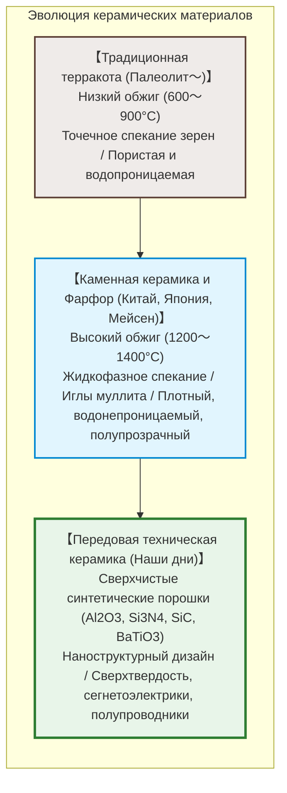
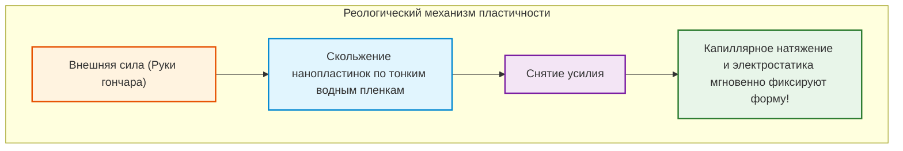
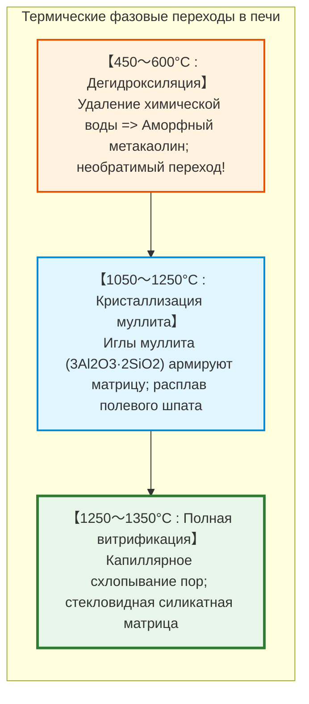
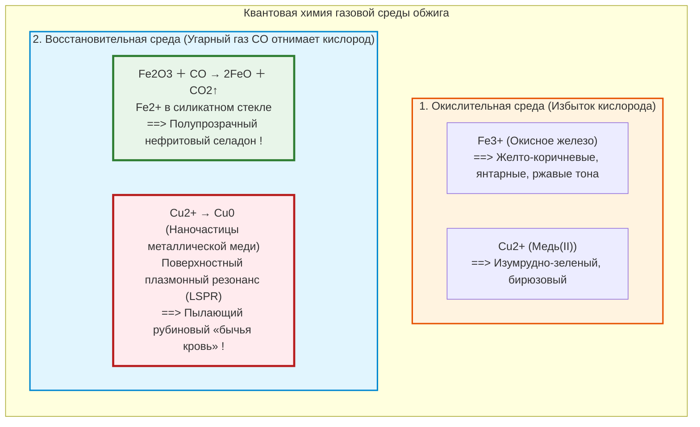

## Введение: Почему мягкая глина в пламени становится камнем

Десятки тысяч лет назад охотники-собиратели верхнего палеолита заметили чудо: пластичная глина, легко деформируемая влажными пальцами, оказавшись в сильном огне, необратимо преображалась в твердый, водостойкий и звонкий сосуд: **керамику**.

Слово восходит к древнегреческому **«keramos» (κέραμος)** — обожженная глина. Сегодня область применения керамики вышла далеко за пределы посуды:
- Свыше 1000 **многослойных керамических конденсаторов (MLCC)** стабилизируют напряжение в каждом смартфоне;
- Плитки из диоксида кремния выдерживают плазму $1500^\circ\text{C}$ при входе космических челноков в атмосферу;
- Биокерамика на основе гидроксиапатита интегрируется с костями человека;
- **Карбид кремния ($\text{SiC}$)** обеспечивает работу инверторов электромобилей.

---

## Глава 1: Наноструктура каолинита и физика пластичности

### 1.1 Слоистая решетка каолинита

Основа благородных глин — **каолинит** ($\text{Al}_2\text{Si}_2\text{O}_5(\text{OH})_4$), филлосиликат со слоями толщиной 0,72 нм:
1. Кремнекислородный тетраэдрический слой ($\text{Si-O}$);
2. Алюмокислородный октаэдрический слой ($\text{Al-O/OH}$).

### 1.2 Механизм пластичности

- **Колоссальная удельная поверхность**: $10 \text{--} 30\,\text{м}^2/\text{г}$;
- **Отрицательные базовые грани и положительные торцы**, создающие структуру «карточного домика»;
- **Нанослои структурированной воды**: Обеспечивают гладкое скольжение пластинок при сдвиге (**текучесть**), а капиллярное разрежение фиксирует частицы при снятии нагрузки (**сохранение формы**).

---

## Глава 2: Фазовые переходы и спекание в печи

1. **Дегидроксиляция ($450 \sim 600^\circ\text{C}$)**: Группы $-\text{OH}$ уходят в виде пара. Каолинит становится **метакаолином**, который больше никогда не размокнет в грязь.
2. **Рост муллита ($> 1100^\circ\text{C}$)**: Игольчатые кристаллы **муллита** ($3\text{Al}_2\text{O}_3 \cdot 2\text{SiO}_2$) переплетаются подобно стальной арматуре.
3. **Жидкофазное спекание**: Полевой шпат плавится, и капиллярные силы сжимают частицы, изгоняя поры.

---

## Глава 3: Гончарная керамика, каменная масса и фарфор

| Категория | Температура | Микроструктура | Водопоглощение | Полупрозрачность | Звук при ударе |
|---|---|---|---|---|---|
| **Гончарная керамика / Терракота** | **$800 \sim 1150^\circ\text{C}$** | Пористое спекание | **$> 10\%$** | Непрозрачна | Глухой звук |
| **Каменная масса** | **$1200 \sim 1280^\circ\text{C}$** | Плотная, водонепроницаемая | **$< 1\%$** | Непрозрачна | Каменный твердый звук |
| **Фарфор** | **$1300 \sim 1400^\circ\text{C}$** | Стекло-муллитовый композит без пор | **$0 \sim 0{,}2\%$** | **Полупрозрачен** | **Чистый металлический звон** |

---

## Глава 4: Химия глазури и атмосфера обжига

- **Селадон**: Небольшое количество железа ($1 \sim 2\%$), восстановленное до $\text{Fe}^{2+}$, дает прозрачный зеленовато-голубой цвет нефрита.
- **Кракелюр**: Разница коэффициентов термического расширения глазури и черепка ($\alpha_\text{глазури} > \alpha_\text{черепка}$) создает декоративную сетку трещин при остывании.

---

## Глава 5: «Белое золото» — Мейсен и Арита

В XVII веке Европа была охвачена страстью к фарфору из Ариты (Имари). Август Сильный заключил алхимика **Иоганна Фридриха Бёттгера** в крепость, где тот в 1709 г. раскрыл формулу: обжиг каолина и полевого шпата при $1300^\circ\text{C}$. Так в 1710 г. родился **Мейсенский фарфор**.

---

## Глава 6: Передовая техническая керамика

- **Титанат бария ($\text{BaTiO}_3$) и MLCC**: Диэлектрическая проницаемость более 5000–10000. Более 1000 субмикронных слоев в компактных чипах.
- **Частично стабилизированный диоксид циркония (PSZ)**: Эффект фазового упрочнения. Напряжение в вершине трещины вызывает мартенситное превращение с 4%-ным расширением объема, которое намертво сжимает трещину.

---

## Заключение: Союз минерала и огня

От первого неолитического горшка до нанокерамических чипов искусственного интеллекта: фундаментальный принцип остается неизменным — термодинамическое упорядочение неорганических связей жаром пламени.
