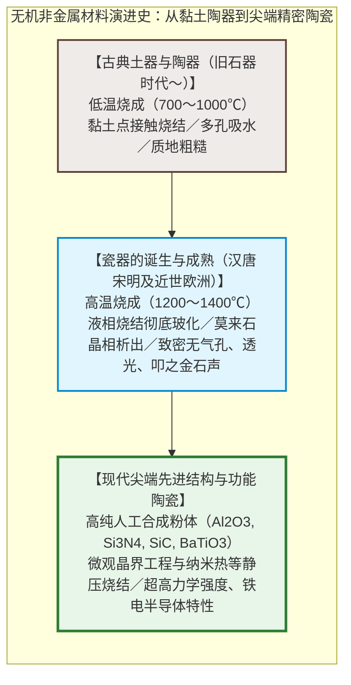
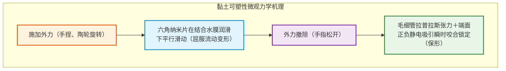
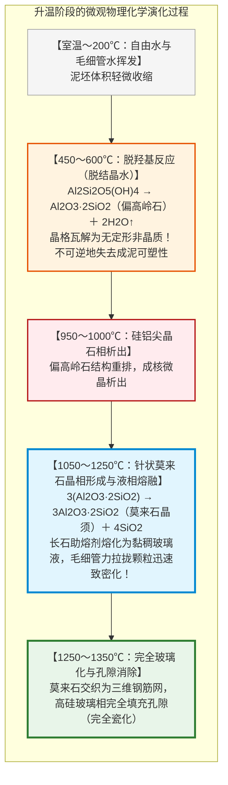
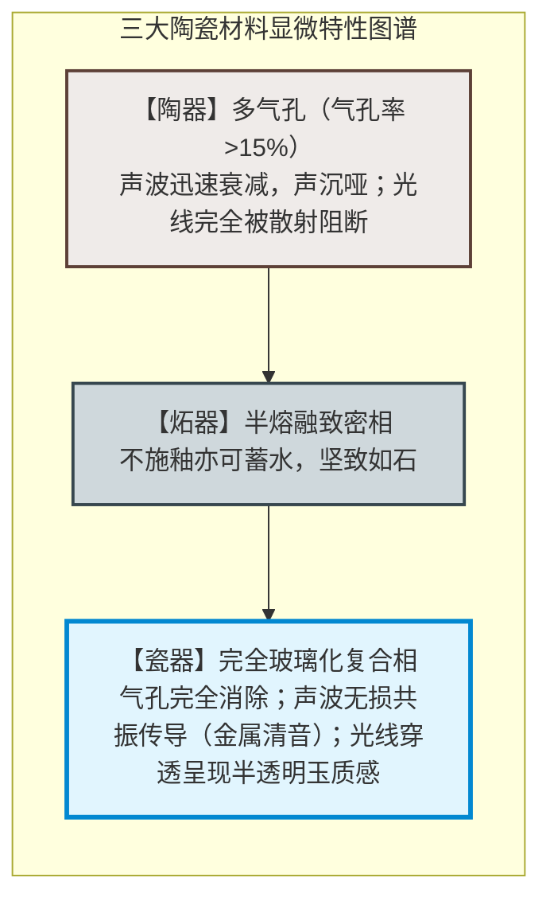
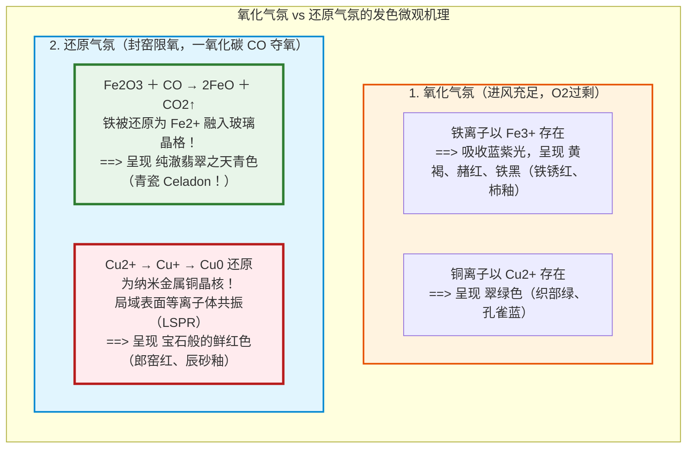
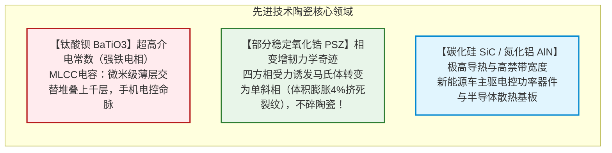

## 引言：柔软的泥土，为何浴火能化作坚硬的器皿？

数万年前的旧石器时代晚期，原始人类在火塘余烬中发现了一个奇迹：在水中可以被随意揉捏、指尖轻压即碎的柔软“黏土”，被投入熊熊烈火中烧灼至一定高温后，不仅没有化为灰烬，反而脱胎换骨，蜕变成一种无论怎样浸泡都再不溶于水、坚硬致密、能蓄积液体的固态器物：**陶瓷（Ceramics）**。

这是人类历史上最早掌握的人工高分子无机材料合成工程。

“陶瓷”在希腊语中源自 **“keramos（κέραμος）”**，意为“烧烤过的泥土”。从中国的仰韶彩陶、商周白陶、汉代越窑青瓷，到宋代景德镇天青青瓷、明清五彩与景泰蓝；从日本古朴的绳文土器、备前烧，到江户时代风靡欧洲的有田伊万里瓷器，烧造之火绵延上万年。

然而在现代材料科学中，“陶瓷”的疆界已远远超越了餐桌上的盘碗：
- 一部5G智能手机内部装载着超过1000只、一辆智能电动汽车上装载着超过10,000只用以稳定电路电压的**MLCC（多层片式陶瓷电容器）**；
- 航天飞机重返大气层时抵御 $1500^\circ\text{C}$ 以上等离子体烈焰的**超轻高纯二氧化硅耐热瓦**；
- 与人体骨骼形成分子级骨整合结合的**生物活性羟基磷灰石陶瓷人工关节**；
- 支撑高压电动汽车碳化硅（$\text{SiC}$）和氮化镓（$\text{GaN}$）功率半导体的**高导热氮化铝（$\text{AlN}$）基板**。

泥土在窑火中究竟经历了怎样的相变？陶与瓷的本质区别何在？窑炉中的氧化焰与还原焰，如何通过量子能级跃迁决定了青瓷的翡翠之色与辰砂的鲜红？本文将从微观晶体结构、烧结热力学、釉药玻璃化学、地缘历史到半导体陶瓷展开终极解析。

---

## 第一章：黏土矿物的层状结构与可塑性物理力学

### 1.1 高岭石（Kaolinite）的 1:1 型层状晶体

黏土并非普通的碎沙砾石，而是地壳深处的花岗岩等长石类矿物，经数亿年热液蚀变与风化形成的**层状硅酸盐（Phyllosilicates）**。

制瓷最核心的高岭土主矿物为**高岭石**，化学式为：

$$\text{Al}_2\text{Si}_2\text{O}_5(\text{OH})_4 \quad (\text{或 } \text{Al}_2\text{O}_3 \cdot 2\text{SiO}_2 \cdot 2\text{H}_2\text{O})$$

其晶体结构由厚度约 0.72 纳米的单层堆叠而成：
1. **硅氧四面体层（$\text{Si-O}$）**：硅离子与4个氧原子配位，底面共角顶排成连续六角网层；
2. **铝氧/氢氧八面体层（$\text{Al-O/OH}$，三水铝石型层）**：铝离子与氧和羟基（$-\text{OH}$）配位。

在透射电镜下，高岭石呈现为微米级尺寸、厚度仅数十纳米的六角扁平纳米薄片，状如扑克牌。

### 1.2 可塑性（Plasticity）机理：为什么加水可以随意捏造并不塌陷？

普通海砂加水后虽能成堆，一碰即垮。黏土之所以具备非凡的可塑性，源于其**巨大的比表面积**与**表面双电层水化膜**：
- **巨大比表面积**：微米级片状粒子赋予每克黏土高达 $10 \sim 30\,\text{m}^2$ 的表面积；
- **表面负电与端面正电**：由于晶格同晶置换，纳米薄片底面常年带**负电荷**，而断裂边缘常带**正电荷**；
- **结构化结合水膜**：加入水后，极性水分子定向吸附于表面形成纳米水膜。外力推挤时，薄片依靠水膜顺畅相对滑动（**易变形**）；外力撤离后，毛细管负压和正负电荷相吸（“卡片屋”絮凝网络）使粒子瞬间咬合定位（**保形性**）。

---

## 第二章：窑炉中的微观相变与烧结物理化学

将干燥后的泥坯放入窑炉加热至 $1000 \sim 1350^\circ\text{C}$，是一场剧烈的无机固相合成与烧结过程：

1. **脱羟基化（$450 \sim 600^\circ\text{C}$）**：晶格内部的 $-\text{OH}$ 逃逸脱水生成**偏高岭石（Metakaolin）**，彻底打破黏土结构，再也无法还原为泥浆。
2. **莫来石（Mullite）针状微晶生长**：超过 $1100^\circ\text{C}$ 时，耐高温的高强度**莫来石晶相（$3\text{Al}_2\text{O}_3 \cdot 2\text{SiO}_2$）**析出并生长为微观针状微晶，像钢筋网一样相互咬合。
3. **液相烧结（Liquid-Phase Sintering）**：胎土中的长石在 $1150^\circ\text{C}$ 熔化为极黏稠的高硅玻璃液，在毛细负压下将所有颗粒强力拉近，排出气孔。冷却后，瓷胎成为**“交织针状莫来石微晶（钢筋）＋连续致密硅酸盐玻璃（混凝土）”**的微观复合材料。

---

## 第三章：陶器、炻器与瓷器的科学分界

| 分类 | 烧成温度 | 原料特性 | 显微结构 | 吸水率 | 透光性 | 敲击声音 |
|---|---|---|---|---|---|---|
| **陶器（Earthenware/Pottery）** | **$800 \sim 1150^\circ\text{C}$** | 含杂质黏土 | 多孔颗粒点接触烧结 | **$> 3 \sim 10\%$** | 不透光 | 沉闷浊音（噗噗声） |
| **炻器（Stoneware）** | **$1200 \sim 1280^\circ\text{C}$** | 耐火黏土/铁长石 | 烧结致密无釉不漏水 | **$< 1\%$** | 不透光 | 硬石声（备前烧、宜兴紫砂） |
| **瓷器（Porcelain）** | **$1300 \sim 1400^\circ\text{C}$** | 高岭土+长石+石英 | 完全玻化莫来石晶体网 | **$< 0.2\%$（完全不吸水）** | **半透光（光线可透过）** | **清脆金属声（如击金石之声）** |

---

## 第四章：釉药玻璃化学与窑炉气氛工学

釉是涂抹在坯体表面的薄层硅酸盐玻璃。而在烧窑过程中，**气氛（Atmosphere）**对釉色具有生杀予夺的控制力：

- **宋代青瓷的翡翠之谜**：釉中仅含 $1 \sim 2\%$ 极微量铁，在缺氧强还原气氛中，一氧化碳将 3 价铁还原为 2 价亚铁离子（$\text{Fe}^{2+}$）。$\text{Fe}^{2+}$ 在硅酸盐玻璃中的配位晶体场吸收红光，投射出“雨过天青云破处”的青翠。
- **开片（贯入）的物理学**：当釉料的线膨胀系数大于胎土（$\alpha_\text{釉} > \alpha_\text{胎}$）时，冷却收缩受阻产生巨大二维拉应力，釉层瞬间产生如冰裂纹般的细密微裂纹，成就宋代哥窑瓷器的裂纹美学。

---

## 第五章：瓷器地缘政治与迈森的诞生

明末清初（1644年）战乱重创景德镇，中国瓷器出口中断。荷兰东印度公司（VOC）遂转向日本九州**有田烧（伊万里瓷器）**。高丽陶工李参平在泉山发现白瓷陶石，日本在数十年间向欧洲狂飙出口数百数千万件白瓷，引爆欧洲宫廷的“瓷器狂热”。

萨克森选帝侯奥古斯特强王软禁炼金术士**伯特格尔（Böttger）**研制白瓷。1709年，伯特格尔终于揭开了瓷器的真正奥秘——高岭土与长石在 $1300^\circ\text{C}$ 以上的熔融，催生了西方首座白瓷官窑**迈森（Meissen）**，终结了东方对欧洲长达千年的白瓷技术垄断。

---

## 第六章：先进精密电子与结构陶瓷的前沿飞跃

20世纪后半叶，陶瓷演化为采用超纯人造无机化合物精密制成的**先进技术陶瓷（Fine Ceramics）**：

- **钛酸钡（$\text{BaTiO}_3$）与 MLCC**：钙钛矿结构的钛离子自发偏心位移带来超大介电常数（$\varepsilon_r > 5000$）。纳米晶体超薄流延堆叠千层，在比米粒还小数十倍的芯片内储存惊人电荷，维系着现代全球数字芯片的命脉。
- **氧化锆“相变增韧”**：向氧化锆（$\text{ZrO}_2$）中掺杂氧化钇保留亚稳四方相。当裂纹扩展时，尖端应力诱发其发生马氏体相变并产生4%体积膨胀，牢牢将裂纹掐死，使陶瓷拥有媲美金属的抗冲击韧性。

---

## 结语：从泥与火的远古契约到纳米晶体控制

将脚下的泥土揉捏成型，投入火中烧结成石。

人类从万年前手捏泥碗开始，便在无意中拉开了重新排布地壳硅铝原子、利用热力学相变改造自然的宏大序幕。从高岭土纳米片的静电可塑性，到液相烧结的莫来石网络，再到如今运转在人工智能服务器核心的微型陶瓷电容，**以热力与化学精密重组无机原子键**的科学，始终是人类文明最坚固、最不可或缺的物理基石。
