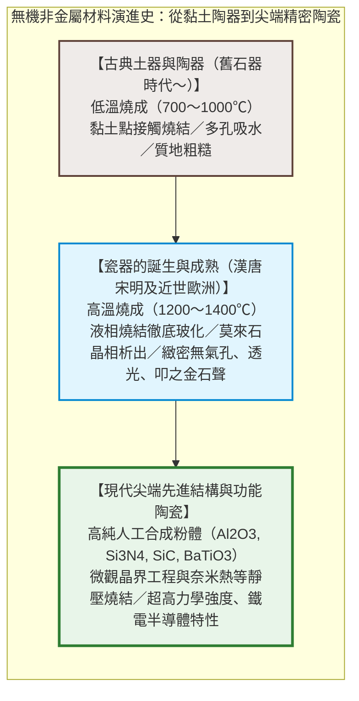
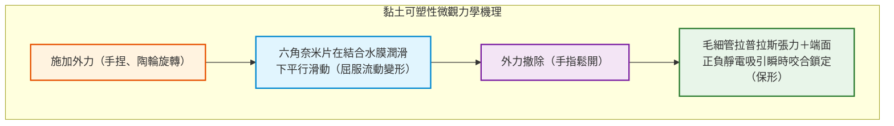
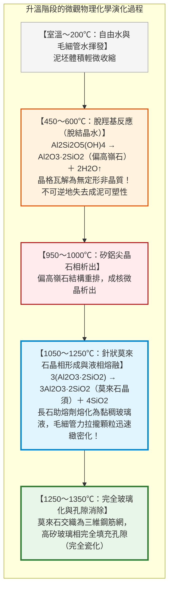
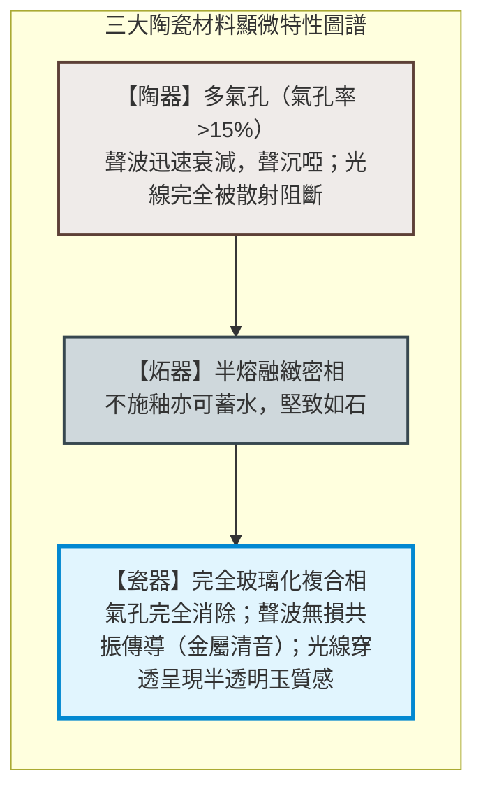
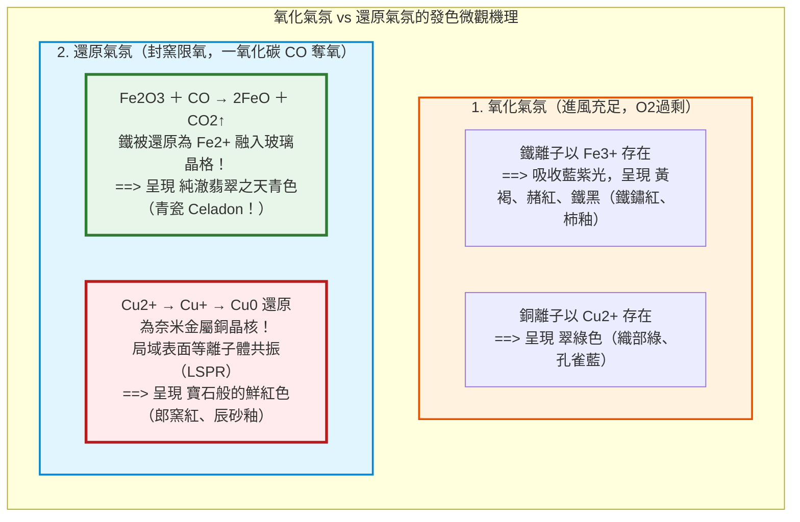
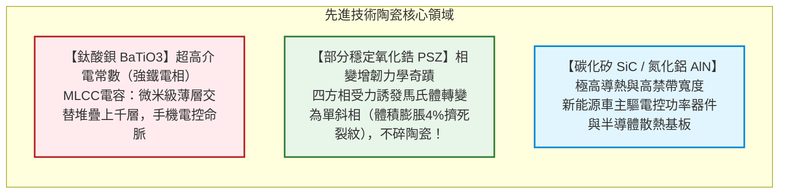

## 引言：柔軟的泥土，為何浴火能化作堅硬的器皿？

數萬年前的舊石器時代晚期，原始人類在火塘餘燼中發現了一個奇蹟：在水中可以被隨意揉捏、指尖輕壓即碎的柔軟「黏土」，被投入熊熊烈火中燒灼至一定高溫後，不僅沒有化為灰燼，反而脫胎換骨，蛻變成一種無論怎樣浸泡都再不溶於水、堅硬緻密、能蓄積液體的固態器物：**陶瓷（Ceramics）**。

這是人類歷史上最早掌握的人工高分子無機材料合成工程。

「陶瓷」在希臘語中源自 **「keramos（κέραμος）」**，意為「燒烤過的泥土」。從中國的仰韶彩陶、商周白陶、漢代越窯青瓷，到宋代景德鎮天青青瓷、明清五彩與景泰藍；從日本古樸的繩文土器、備前燒，到江戶時代風靡歐洲的有田伊萬里瓷器，燒造之火綿延上萬年。

然而在現代材料科學中，「陶瓷」的疆界已遠遠超越了餐桌上的盤碗：
- 一部5G智慧型手機內部裝載著超過1000只、一輛智慧電動車上裝載著超過10,000只用以穩定電路電壓的**MLCC（多層陶瓷電容器）**；
- 太空梭重返大氣層時抵禦 $1500^\circ\text{C}$ 以上電漿烈焰的**超輕高純二氧化矽耐熱瓦**；
- 與人體骨骼形成分子級骨整合結合的**生物活性羥基磷灰石陶瓷人工關節**；
- 支撐高壓電動車碳化矽（$\text{SiC}$）和氮化鎵（$\text{GaN}$）功率半導體的**高導熱氮化鋁（$\text{AlN}$）基板**。

泥土在窯火中究竟經歷了怎樣的相變？陶與瓷的本質區別何在？窯爐中的氧化焰與還原焰，如何通過量子能級躍遷決定了青瓷的翡翠之色與辰砂的鮮紅？本文將從微觀晶體結構、燒結熱力學、釉藥玻璃化學、地緣歷史到半導體陶瓷展開終極解析。

---

## 第一章：黏土礦物的層狀結構與可塑性物理力學

### 1.1 高嶺石（Kaolinite）的 1:1 型層狀晶體

黏土並非普通的碎沙礫石，而是地殼深處的花崗岩等長石類礦物，經數億年熱液蝕變與風化形成的**層狀矽酸鹽（Phyllosilicates）**。

制瓷最核心的高嶺土主礦物為**高嶺石**，化學式為：

$$\text{Al}_2\text{Si}_2\text{O}_5(\text{OH})_4 \quad (\text{或 } \text{Al}_2\text{O}_3 \cdot 2\text{SiO}_2 \cdot 2\text{H}_2\text{O})$$

其晶體結構由厚度約 0.72 奈米的單層堆疊而成：
1. **矽氧四面體層（$\text{Si-O}$）**：矽離子與4個氧原子配位，底面共角頂排成連續六角網層；
2. **鋁氧/氫氧八面體層（$\text{Al-O/OH}$，三水鋁石型層）**：鋁離子與氧和羥基（$-\text{OH}$）配位。

在穿透式電鏡下，高嶺石呈現為微米級尺寸、厚度僅數十奈米的六角扁平奈米薄片，狀如撲克牌。

### 1.2 可塑性（Plasticity）機理：為什麼加水可以隨意捏造並不塌陷？

普通海砂加水後雖能成堆，一碰即垮。黏土之所以具備非凡的可塑性，源於其**巨大的比表面積**與**表面雙電層水化膜**：
- **巨大比表面積**：微米級片狀粒子賦予每克黏土高達 $10 \sim 30\,\text{m}^2$ 的表面積；
- **表面負電與端面正電**：由於晶格同晶置換，奈米薄片底面常年帶**負電荷**，而斷裂邊緣常帶**正電荷**；
- **結構化結合水膜**：加入水後，極性水分子定向吸附於表面形成奈米水膜。外力推擠時，薄片依靠水膜順暢相對滑動（**易變形**）；外力撤離後，毛細管負壓和正負電荷相吸（“卡片屋”絮凝網路）使粒子瞬間咬合定位（**保形性**）。

---

## 第二章：窯爐中的微觀相變與燒結物理化學

將乾燥後的泥坯放入窯爐加熱至 $1000 \sim 1350^\circ\text{C}$，是一場劇烈的無機固相合成與燒結過程：

1. **脫羥基化（$450 \sim 600^\circ\text{C}$）**：晶格內部的 $-\text{OH}$ 逃逸脫水生成**偏高嶺石（Metakaolin）**，徹底打破黏土結構，再也無法還原為泥漿。
2. **莫來石（Mullite）針狀微晶生長**：超過 $1100^\circ\text{C}$ 時，耐高溫的高強度**莫來石晶相（$3\text{Al}_2\text{O}_3 \cdot 2\text{SiO}_2$）**析出並生長為微觀針狀微晶，像鋼筋網一樣相互咬合。
3. **液相燒結（Liquid-Phase Sintering）**：胎土中的長石在 $1150^\circ\text{C}$ 熔化為極黏稠的高矽玻璃液，在毛細負壓下將所有顆粒強力拉近，排出氣孔。冷卻後，瓷胎成為**「交織針狀莫來石微晶（鋼筋）＋連續緻密矽酸鹽玻璃（混凝土）」**的微觀複合材料。

---

## 第三章：陶器、炻器與瓷器的科學分界

| 分類 | 燒成溫度 | 原料特性 | 顯微結構 | 吸水率 | 透光性 | 敲擊聲音 |
|---|---|---|---|---|---|---|
| **陶器（Earthenware/Pottery）** | **$800 \sim 1150^\circ\text{C}$** | 含雜質黏土 | 多孔顆粒點接觸燒結 | **$> 3 \sim 10\%$** | 不透光 | 沉悶濁音（噗噗聲） |
| **炻器（Stoneware）** | **$1200 \sim 1280^\circ\text{C}$** | 耐火黏土/鐵長石 | 燒結緻密無釉不漏水 | **$< 1\%$** | 不透光 | 硬石聲（備前燒、宜興紫砂） |
| **瓷器（Porcelain）** | **$1300 \sim 1400^\circ\text{C}$** | 高嶺土+長石+石英 | 完全玻化莫來石晶體網 | **$< 0.2\%$（完全不吸水）** | **半透光（光線可透過）** | **清脆金屬聲（如擊金石之聲）** |

---

## 第四章：釉藥玻璃化學與窯爐氣氛工學

釉是塗抹在坯體表面的薄層矽酸鹽玻璃。而在燒窯過程中，**氣氛（Atmosphere）**對釉色具有生殺予奪的控制力：

- **宋代青瓷的翡翠之謎**：釉中僅含 $1 \sim 2\%$ 極微量鐵，在缺氧強還原氣氛中，一氧化碳將 3 價鐵還原為 2 價亞鐵離子（$\text{Fe}^{2+}$）。$\text{Fe}^{2+}$ 在矽酸鹽玻璃中的配位晶體場吸收紅光，投射出「雨過天青雲破處」的青翠。
- **開片（貫入）的物理學**：當釉料的線膨脹係數大於胎土（$\alpha_\text{釉} > \alpha_\text{胎}$）時，冷卻收縮受阻產生巨大二維拉應力，釉層瞬間產生如冰裂紋般的細密微裂紋，成就宋代哥窯瓷器的裂紋美學。

---

## 第五章：瓷器地緣政治與邁森的誕生

明末清初（1644年）戰亂重創景德鎮，中國瓷器出口中斷。荷蘭東印度公司（VOC）遂轉向日本九州**有田燒（伊萬里瓷器）**。高麗陶工李參平在泉山發現白瓷陶石，日本在數十年間向歐洲狂飆出口數百數千萬件白瓷，引爆歐洲宮廷的「瓷器狂熱」。

薩克森選帝侯奧古斯特強王軟禁煉金術士**伯特格爾（Böttger）**研製白瓷。1709年，伯特格爾終於揭開了瓷器的真正奧秘——高嶺土與長石在 $1300^\circ\text{C}$ 以上的熔融，催生了西方首座白瓷官窯**邁森（Meissen）**，終結了東方對歐洲長達千年的白瓷技術壟斷。

---

## 第六章：先進精密電子與結構陶瓷的前沿飛躍

20世紀後半葉，陶瓷演化為採用超純人造無機化合物精密製成的**先進技術陶瓷（Fine Ceramics）**：

- **鈦酸鋇（$\text{BaTiO}_3$）與 MLCC**：鈣鈦礦結構的鈦離子自發偏心位移帶來超大介電常數（$\varepsilon_r > 5000$）。奈米晶體超薄流延堆疊千層，在比米粒還小數十倍的晶片內儲存驚人電荷，維繫著現代全球數位晶片的命脈。
- **氧化鋯「相變增韌」**：向氧化鋯（$\text{ZrO}_2$）中摻雜氧化釔保留亞穩四方相。當裂紋擴展時，尖端應力誘發其發生馬氏體相變並產生4%體積膨脹，牢牢將裂紋掐死，使陶瓷擁有媲美金屬的抗衝擊韌性。

---

## 結語：從泥與火的遠古契約到奈米晶體控制

將腳下的泥土揉捏成型，投入火中燒結成石。

人類從萬年前手捏泥碗開始，便在無意中拉開了重新排布地殼矽鋁原子、利用熱力學相變改造自然的宏大序幕。從高嶺土奈米片的靜電可塑性，到液相燒結的莫來石網路，再到如今運轉在人工智慧伺服器核心的微型陶瓷電容，**以熱力與化學精密重組無機原子鍵**的科學，始終是人類文明最堅固、最不可或缺的物理基石。
