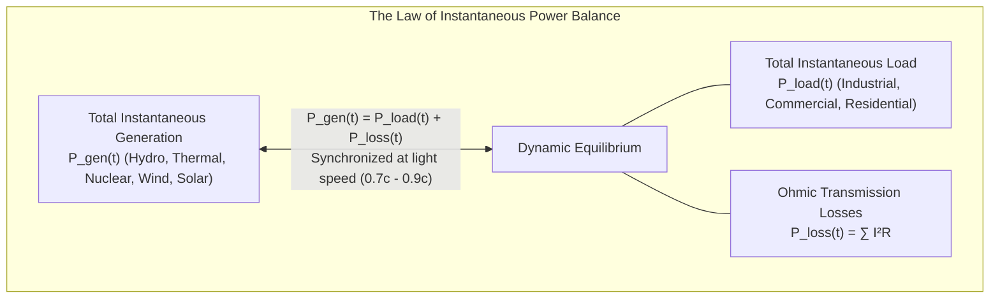
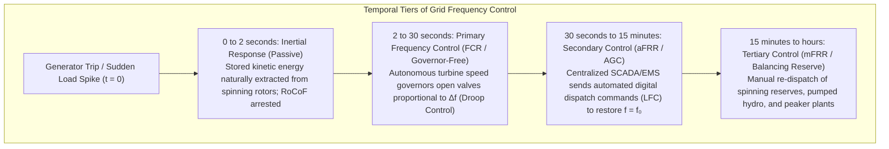
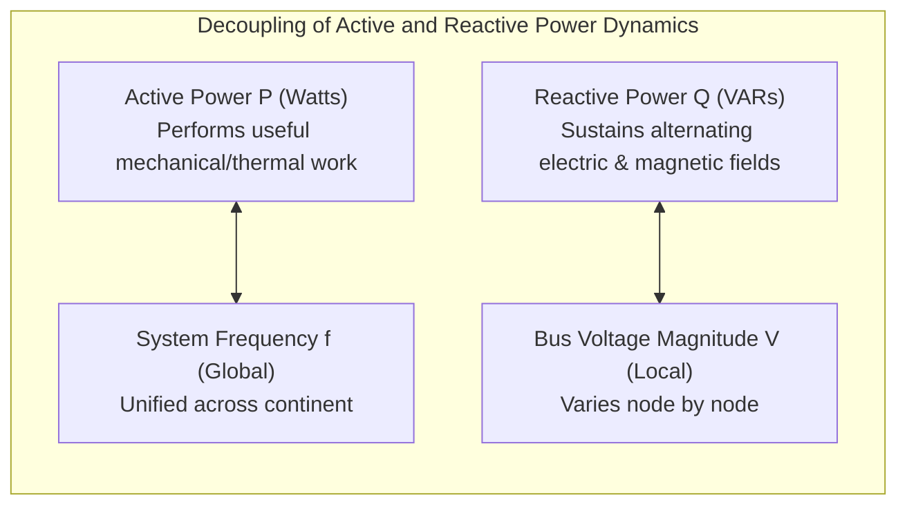
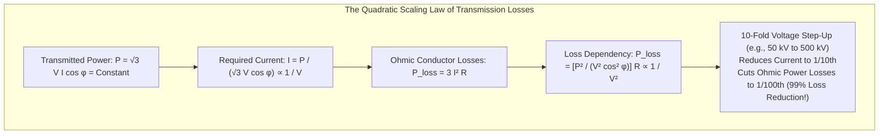
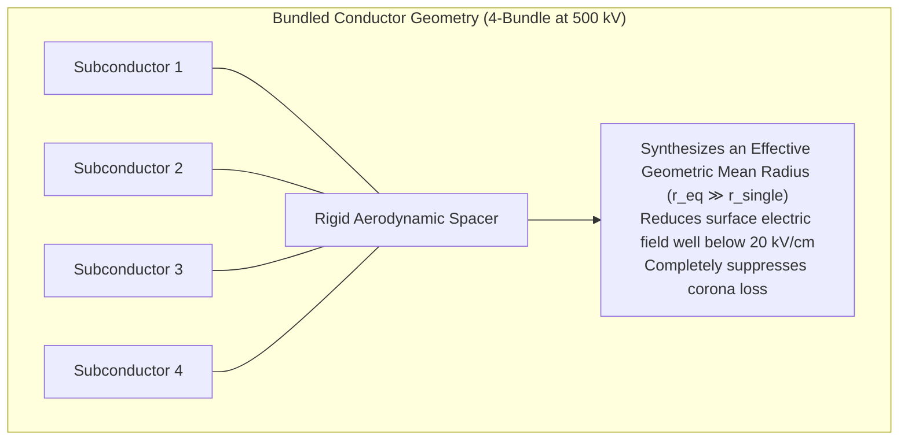
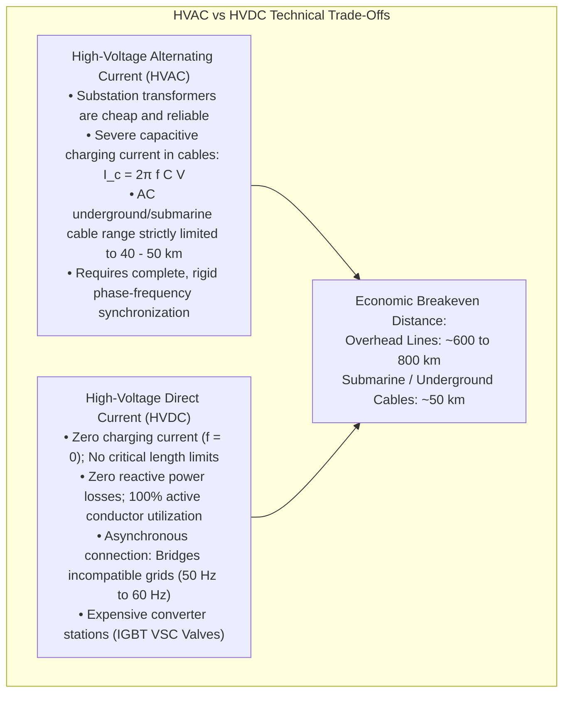
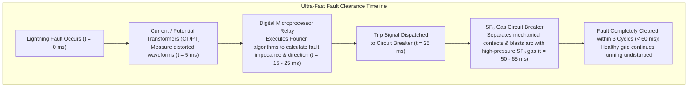
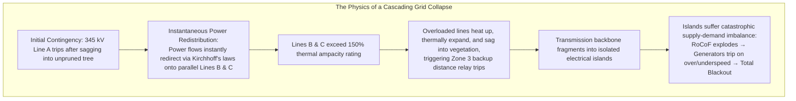
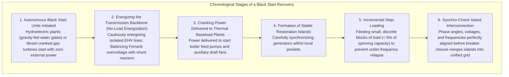
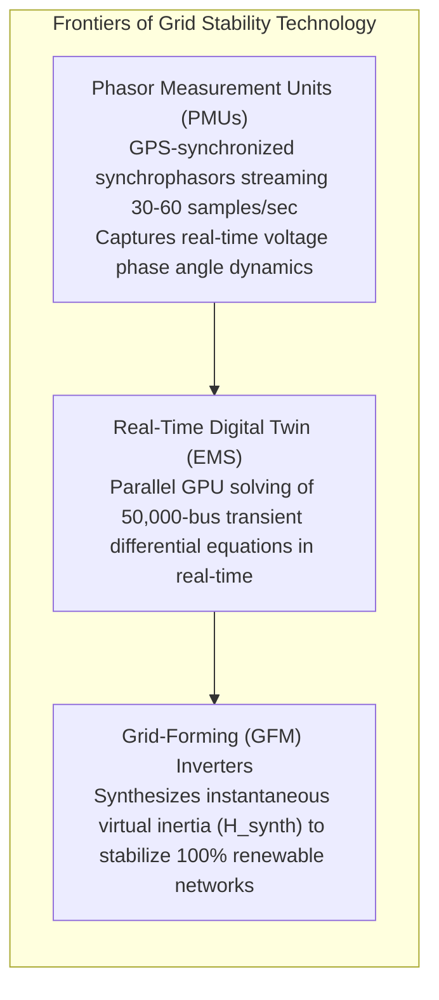

Flip a switch on the wall, and photons flood the room instantaneously. Plug in a laptop, and electrons surge into the lithium battery without hesitation. In modern society, the uninterrupted availability of electrical energy—delivered at an exact, unwavering voltage and alternating current frequency—is taken for granted as an ambient feature of the universe, as effortless as drawing breath.

Yet beneath this tranquil surface lies what is arguably <strong>humanity's single largest, most complex, and most delicate interconnected machine</strong>: the continental electrical power grid.

Spanning millions of square kilometers, interconnecting thousands of gigawatt-scale power stations, hundreds of thousands of kilometers of high-voltage transmission lines, and hundreds of millions of consumers, the power grid functions as a <strong>single, continuously coupled, synchronized electromagnetic organism operating at light speed</strong>.

Most astonishingly, the power grid operates under a severe, non-negotiable physical constraint: <strong>electricity cannot be stored in the transmission network in meaningful quantities</strong>. When you turn on an electric kettle, the kinetic momentum of a 500-ton spinning turbine-generator located hundreds of kilometers away slows down by a fraction of a microsecond, prompting computer-controlled steam valves to open further to restore equilibrium.

This comprehensive treatise explores the profound electrodynamics, control systems, and network physics that keep civilization energized: from the mathematical derivation of the swing equation and rotational grid inertia, to the decoupling of active power and reactive power, the inverse-square physics of 500 kV extra-high voltage (EHV) transmission, the 100-year resolution of the War of the Currents through High-Voltage Direct Current (HVDC), the millisecond physics of protective relaying, the cascading failure dynamics of continental blackouts, and the surgical engineering of black start restoration.

---

## 1. The Largest Real-Time Machine in History: The Principle of Exact Equilibrium

Unlike water networks with holding reservoirs or natural gas pipelines with compressed line-pack capacity, an alternating current (AC) power grid possesses virtually zero storage buffer within its electromagnetic conductors.



Electromagnetic energy propagates along high-voltage transmission conductors at a substantial fraction of the speed of light:

$$v_{prop} = \frac{1}{\sqrt{\mu \epsilon}} \approx 0.7c \text{ to } 0.9c \approx 200,000 - 270,000\,\mathrm{km/s}$$

Because electrons do not queue up inside the wire, every watt of electrical power consumed by a lightbulb, factory motor, or computer server must be <strong>simultaneously generated by a mechanical turbine or solar panel at that exact microsecond</strong>:

$$P_{gen}(t) = P_{load}(t) + P_{loss}(t)$$

If generation exceeds consumption by even $0.1\%$, the surplus energy forces the rotational speed of every synchronized generator rotor across the continent to accelerate, driving grid frequency upward. If consumption exceeds generation, the deficit is forcibly drawn from the kinetic energy of those rotors, slowing them down and dragging grid frequency downward.

---

## 2. The Physics of System Frequency: Rotational Inertia and the Swing Equation

The fundamental heartbeat of an AC power grid is its <strong>System Frequency</strong> ($f_0$), standardized globally at either <strong>$50.00\,\mathrm{Hz}$</strong> (Europe, Asia, Australia, parts of South America, Eastern Japan) or <strong>$60.00\,\mathrm{Hz}$</strong> (North America, Western Japan, parts of South America).

```mermaid
flowchart TD
    subgraph FrequencyBalanceChain ["Dynamic Feedback of Grid Frequency"]
        Imbalance["Power Imbalance: ΔP = P_m - P_e"]
        Imbalance -->|P_m > P_e (Surplus Generation)| Accel["Rotors Accelerate (dω/dt > 0) → Frequency Rises (f > f₀)"]
        Imbalance -->|P_m < P_e (Deficit / Load Surge)| Decel["Rotors Decelerate (dω/dt < 0) → Frequency Drops (f < f₀)"]
        
        Accel --> Limits["Strict Operating Band (±0.2 Hz)"]
        Decel --> Limits
        Limits --> Risk["Risks if Uncontrolled:<br/>1. Steam turbine blade harmonic resonance fracture<br/>2. Transformer core saturation & overheating<br/>3. UFLS cascade tripping & total blackout"]
    end
```

### 2.1 The Swing Equation Derivation

In a conventional power system, power is produced by massive synchronous generators driven by steam turbines (nuclear, coal, gas) or hydro turbines. The rotor of each generator consists of a multi-ton electromagnet rotating inside a stationary three-phase armature winding (stator).

Applying Newton's second law for rotational mechanics to a generator rotor:

$$J \frac{d\omega_m}{dt} = T_m - T_e$$

where:
- $J$ is the rotor mass moment of inertia ($\mathrm{kg\cdot m^2}$).
- $\omega_m$ is the mechanical angular velocity ($\mathrm{rad/s}$).
- $T_m$ is the mechanical shaft torque provided by the prime mover (steam or water flow).
- $T_e$ is the electromagnetic counter-torque (braking torque) exerted on the rotor by the grid's electrical load.

Multiplying both sides by the mechanical speed $\omega_m$ converts torque into power:

$$J \omega_m \frac{d\omega_m}{dt} = P_m - P_e$$

where $P_m$ is mechanical input power and $P_e$ is electrical power delivered to the network.

To generalize this across power systems of varying capacities, electrical engineers define the <strong>Inertia Constant ($H$)</strong>, representing the stored kinetic energy of the rotor at synchronous speed divided by the generator's rated electrical capacity ($S_{base}$ in $\mathrm{MVA}$):

$$H = \frac{E_k}{S_{base}} = \frac{\frac{1}{2} J \omega_{sm}^2}{S_{base}} \quad [\text{seconds}]$$

Typically, $H$ ranges from <strong>$2.0 \text{ to } 6.0\,\mathrm{seconds}$</strong>. A value of $H = 4\,\mathrm{s}$ means that the kinetic energy stored in the spinning rotor could supply the generator's full rated output for exactly 4 seconds with zero fuel input.

Expressing the rotor position in terms of electrical power angle $\delta$ relative to a synchronously rotating reference frame yields the canonical <strong>Swing Equation</strong>:

$$\frac{2H}{\omega_s} \frac{d^2\delta}{dt^2} = P_m - P_e - D \frac{d\delta}{dt}$$

where $\omega_s = 2\pi f_0$ is synchronous electrical angular frequency and $D$ is the aerodynamic/damping coefficient.

The Swing Equation reveals that <strong>the acceleration of the power grid's frequency is strictly proportional to the instantaneous mismatch between mechanical power input ($P_m$) and electrical power demand ($P_e$)</strong>.

### 2.2 Rotational Grid Inertia: The Invisible Shock Absorber

When a major 1,000 MW nuclear or coal generator abruptly trips offline due to an internal fault, an instantaneous 1,000 MW generation deficit strikes the grid.

Why does the power grid not collapse immediately within milliseconds?

Because of <strong>System Inertia ($H_{sys}$)</strong>. The combined rotating mass of hundreds of multi-ton steel turbine-rotors acts as a massive kinetic flywheel. The instant the power deficit appears, the rotors physically resist deceleration, automatically discharging their stored kinetic energy ($E = \frac{1}{2} J \omega^2$) directly into the grid as electrical power.

The initial rate of frequency decline is governed by the <strong>Rate of Change of Frequency (RoCoF)</strong>:

$$\operatorname{RoCoF} = \left. \frac{df}{dt} \right|_{t=0^+} = -\frac{f_0 \cdot \Delta P}{2 H_{sys} S_{sys}}$$

In a high-inertia grid, the massive value of $H_{sys}$ dampens the RoCoF to fractions of a hertz per second, buying critical seconds for automated control mechanisms to intervene.

### 2.3 The Three-Tiered Frequency Control Hierarchy

To manage frequency deviations, modern transmission system operators deploy a three-tiered hierarchical control architecture across distinct temporal regimes:



1. <strong>Inertial Response ($0 \text{ to } 2\,\mathrm{seconds}$)</strong>: Purely passive, physics-driven extraction of kinetic energy from rotating masses, slowing the rate of frequency decline.
2. <strong>Primary Control (Governor Droop Control, $2 \text{ to } 30\,\mathrm{seconds}$)</strong>: Centrifugal speed governors or digital governors detect the drop in local shaft speed. Without requiring central communication, thousands of turbines automatically open their steam or water control valves according to their <strong>droop characteristic</strong> ($R \approx 3 - 5\%$), arresting the frequency drop at a stable, slightly depressed quasi-steady state.
3. <strong>Secondary Control (Automatic Generation Control / AGC, $30\,\mathrm{seconds} \text{ to } 15\,\mathrm{minutes}$)</strong>: Centralized Energy Management System (EMS) computers continuously calculate the <strong>Area Control Error (ACE)</strong>:
   $$\operatorname{ACE} = \Delta P_{tie} + 10 B \Delta f$$
   where $\Delta P_{tie}$ is inter-utility tie-line power deviation and $B$ is frequency bias factor. AGC sends automated setpoint signals to designated fast-ramping units, restoring the frequency exactly to $50.00\,\mathrm{Hz}$ or $60.00\,\mathrm{Hz}$.
4. <strong>Tertiary Control ($15\,\mathrm{minutes} \text{ onward}$)</strong>: Economic dispatch of reserves to relieve secondary reserves for future contingencies.

### 2.4 The Modern Challenge: Low-Inertia Grids

Inverter-based resources (IBRs)—such as solar photovoltaics and modern wind turbines—connect to the grid via solid-state power electronic inverters rather than direct electromechanical synchronous coupling. Solar panels have zero moving parts, while wind turbine rotors are decoupled from grid frequency by back-to-back AC-DC-AC frequency converters.

As coal and nuclear plants retire in favor of renewables, <strong>total system inertia ($H_{sys}$) drops precipitously</strong>. In a low-inertia grid, any sudden generation trip causes RoCoF to skyrocket ($> 1 - 2\,\mathrm{Hz/s}$). Frequency can plunge into dangerous under-frequency trip zones before mechanical turbine governors can even begin to open, threatening catastrophic, rapid grid collapse. 

To prevent this, grid operators now mandate <strong>Grid-Forming Inverters (GFM)</strong> that synthetically emulate the swing equation, injecting "virtual inertia" from battery storage systems within milliseconds.

---

## 3. Voltage Dynamics and Reactive Power: The Geometry of AC Power Flow

While frequency is a global variable that is uniform across an entire synchronous interconnect, <strong>Voltage ($V$) is a localized variable</strong> that varies dramatically from bus to bus. Voltage control is governed by the electrodynamics of <strong>Reactive Power ($Q$)</strong>.



### 3.1 AC Power Flow and the P-Q Decoupling Principle

Consider a high-voltage transmission line with series impedance $Z = R + jX$ connecting sending bus $V_1 \angle \delta$ and receiving bus $V_2 \angle 0$.

In high-voltage transmission grids, line inductive reactance dominates series resistance by an order of magnitude ($X / R \gg 10$). Approximating $R \approx 0$, the complex power flow equations simplify to:

$$P \approx \frac{V_1 V_2}{X} \sin \delta$$

$$Q \approx \frac{V_1^2 - V_1 V_2 \cos \delta}{X} \approx \frac{V_1 (V_1 - V_2)}{X}$$

This yields the fundamental governing principle of power system operation:
1. <strong>Active Power ($P$) is strongly coupled to Voltage Phase Angle ($\delta$)</strong>: Turning a turbine rotor advances its electrical phase angle $\delta$, driving real active power down the line.
2. <strong>Reactive Power ($Q$) is strongly coupled to Voltage Magnitude ($V$)</strong>: Reactive power flows from regions of higher voltage magnitude to regions of lower voltage magnitude.

### 3.2 The Ferranti Effect and Voltage Collapse

Transmission conductors exhibit distributed series inductance $L$ and distributed shunt capacitance to ground $C$.
- <strong>Lightly Loaded Lines (The Ferranti Effect)</strong>:
  During nocturnal low-load periods, the active current is low, but the line's shunt capacitance draws a continuous, leading capacitive charging current:
  $$I_c = \omega C V = 2\pi f C V$$
  This capacitive current flowing through the line's series inductive reactance creates a voltage rise along the line, causing the receiving-end voltage $V_2$ to exceed the sending-end voltage $V_1$:
  $$V_2 \approx \frac{V_1}{\cos(\beta l)} > V_1$$
  To prevent overvoltage insulation breakdown of substation transformers, operators switch in <strong>Shunt Reactors</strong> (massive inductive coils) to absorb surplus reactive power and drag voltage back down.
- <strong>Heavily Loaded Lines (Voltage Collapse)</strong>:
  Industrial induction motors consume massive amounts of inductive reactive power. As electrical load $P$ increases, the line's internal reactive drop $I^2 X$ consumes immense reactive power, depressing receiving-end voltage $V$.
  
  Plotted on a <strong>P-V Curve (Nose Curve)</strong>, there exists an absolute physical ceiling known as the <strong>Nose Point (Saddle-Node Bifurcation Point)</strong>. Beyond this point, the transmission line can transmit no further power. Attempting to draw more current causes voltage to collapse exponentially toward zero within seconds, inducing regional blackout.

To prevent voltage collapse, substations utilize <strong>Static VAR Compensators (SVC)</strong> and <strong>STATCOMs (Static Synchronous Compensators)</strong>—solid-state inverter systems capable of synthesizing capacitive or inductive reactive power within fractions of a cycle.

---

## 4. The Physics of Extra-High Voltage (EHV) Transmission

Why do long-distance power lines operate at staggering potentials of $275\,\mathrm{kV}, 500\,\mathrm{kV}$, or even $1,100\,\mathrm{kV}$?



### 4.1 The Inverse-Square Loss Reduction Law

When current $I$ traverses a conductor of resistance $R$, electrical energy is irreversibly converted into waste heat via Joule dissipation:

$$P_{loss} = 3 I^2 R$$

For a three-phase system delivering total active power $P$ at line-to-line voltage $V$ and power factor $\cos \phi$:

$$I = \frac{P}{\sqrt{3} V \cos \phi}$$

Substituting this current into the loss formula yields the foundational equation of power transmission:

$$P_{loss} = 3 \left( \frac{P}{\sqrt{3} V \cos \phi} \right)^2 R = \frac{P^2 R}{V^2 \cos^2 \phi}$$

<strong>Conductor power loss is inversely proportional to the square of the transmission voltage ($P_{loss} \propto 1/V^2$).</strong>

Stepping up the transmission voltage by a factor of 10 reduces the line current by a factor of 10, cutting thermal power dissipation to <strong>one-hundredth ($1\%$)</strong> of its former value. This quadratic scaling makes gigawatt-scale transmission across continental distances economically and thermodynamically viable.

### 4.2 Corona Discharge and Bundled Conductors

However, raising transmission voltage to hundreds of thousands of volts creates an opposing physical challenge: <strong>Corona Discharge</strong>.

The electrostatic potential gradient at the surface of a circular cylindrical wire of radius $r$ carrying charge $\lambda$ is:

$$E_{surface} = \frac{\lambda}{2\pi \epsilon_0 r} \approx \frac{V}{r \ln(D/r)}$$

When the local surface electric field exceeds the dielectric breakdown strength of atmospheric air (<strong>$E_{breakdown} \approx 30\,\mathrm{kV/cm}$ in dry air, falling to $20\,\mathrm{kV/cm}$ in rain or fog</strong>), the surrounding air molecules are ionized into a conductive plasma sheath. This corona discharge manifests as an audible hissing hum, pale violet glow, ozone emissions, radio frequency interference, and massive parasitic power loss.

Because surface field scales inversely with wire radius ($E \propto 1/r$), one could theoretically suppress corona by using a wire of enormous diameter. However, solid aluminum cables of large diameter are prohibitively heavy and suffer from the <strong>Skin Effect</strong>—at $50/60\,\mathrm{Hz}$, alternating current is confined to an outer skin depth of $\delta \approx 12\,\mathrm{mm}$, leaving the solid metal core electrically wasted.

The elegant engineering solution is <strong>Bundled Conductors</strong>:



By arranging 2, 4, 6, or 8 smaller subconductors in a symmetrical polygon separated by non-conductive mechanical spacers ($40 - 50\,\mathrm{cm}$ apart), the bundle behaves electromagnetically as an imaginary single conductor with an enormous <strong>Equivalent Geometric Mean Radius ($r_{eq}$)</strong>:

$$r_{eq} = \sqrt[N]{N \cdot r \cdot A^{N-1}}$$

This configuration drastically suppresses the peak surface electric field below the corona inception threshold while maximizing the surface area available to defeat the skin effect.

---

## 5. HVAC vs. HVDC: The Modern Resolution to the War of the Currents

The historic 1890s rivalry between Thomas Edison (championing low-voltage Direct Current) and Nikola Tesla/George Westinghouse (championing Alternating Current) was settled in favor of AC because transformers made stepping voltage up and down trivial. 

In the 21st century, modern semiconductor power electronics have triggered a spectacular resurgence of <strong>High-Voltage Direct Current (HVDC)</strong>.



### 5.1 The Critical Cable Distance of AC Transmission

In subterranean and submarine cables, the close proximity of the energized conductor to the grounded seawater or earth sheath creates a massive shunt capacitance per kilometer—roughly 20 to 30 times higher than an overhead line.

Under continuous AC voltage, this capacitance draws an enormous charging current:

$$I_c = 2\pi f C_{cable} V_{line}$$

Because this reactive current flows continuously along the entire cable length, it heats the conductor. Beyond a <strong>Critical Transmission Distance</strong> of approximately <strong>$40 \text{ to } 50\,\mathrm{km}$</strong>, the charging current completely saturates the thermal ampacity of the cable. The cable reaches its thermal limit purely charging and discharging its own capacitance—<strong>it cannot transmit a single watt of useful active power to the other side</strong>.

### 5.2 The HVDC Solution

In DC transmission, the frequency is zero ($f = 0$). After the initial millisecond charging transient upon energization:
- Shunt capacitive current vanishes completely ($I_c = 0$).
- Series inductive reactance vanishes ($X = 0$).
- Dielectric losses drop to near zero.
- Current density is distributed uniformly across the entire conductor cross-section (zero skin effect).

Modern <strong>Voltage Source Converter (VSC-HVDC)</strong> stations utilize arrays of thousands of high-power Insulated Gate Bipolar Transistors (IGBTs) switching at kilohertz frequencies to synthesize clean DC from AC and vice versa. HVDC enables multi-gigawatt submarine transmission across hundreds of kilometers (such as the 720 km North Sea Link between Norway and the UK).

### 5.3 Asynchronous Interconnections: Japan's 50 Hz / 60 Hz Great Divide

HVDC serves another critical physical role: <strong>Asynchronous Grid Coupling</strong>.

Japan's power system is historically split down the middle: Eastern Japan (Tokyo, Tohoku, Hokkaido) operates at $50\,\mathrm{Hz}$ (inherited from German AEG generators in 1895), while Western Japan (Kansai, Chubu, Kyushu) operates at $60\,\mathrm{Hz}$ (inherited from American GE generators in 1896).

Connecting two electrical networks of different frequencies with an ordinary AC transmission line is physically impossible—it would constitute a dead short circuit, resulting in explosive generator destruction.

To bridge this divide, Japan operates three major <strong>Frequency Converter (FC) Stations</strong> (Shin-Shinano, Sakuma, and Higashi-Shimizu). These facilities rectify $50\,\mathrm{Hz}$ AC into DC, transmit it across a distance of zero meters across a shared DC bus, and immediately invert the DC into $60\,\mathrm{Hz}$ AC (or vice versa), allowing controlled inter-regional energy sharing across an otherwise impenetrable frequency barrier.

---

## 6. Protection Systems: Isolating Faults in Milliseconds

High-voltage transmission lines are exposed to extreme environmental trauma: lightning strikes, gale-force tree contact, icing, and mechanical damage. A short circuit (phase-to-ground or phase-to-phase fault) creates an explosive fault current of tens of thousands of amperes ($> 40\,\mathrm{kA}$). 

If left unchecked for even a quarter of a second, this massive fault current would boil transformer oil, vaporize conductors, destabilize generator rotors, and trigger catastrophic system-wide blackout.

The guardians of the grid are <strong>Protective Relays</strong> and <strong>Gas Circuit Breakers (GCB)</strong>.



### 6.1 Distance Relays (Impedance Relaying)

The backbone of transmission protection is the <strong>Distance Relay (Mho Relay)</strong>. 
A distance relay continuously samples local voltage $V$ and line current $I$, computing the apparent complex impedance:

$$Z_{apparent} = \frac{V_{local}}{I_{local}}$$

Under normal operating conditions, voltage is high and current is moderate, so $Z_{apparent}$ is large and sits outside the relay's trip zone. 

When a short circuit occurs, voltage collapses and fault current surges, causing $Z_{apparent}$ to plummet. Because transmission line impedance per kilometer is a fixed physical property ($Z_{line} \approx 0.3\,\Omega/\mathrm{km}$), <strong>the measured impedance $Z_{apparent}$ is directly proportional to the physical distance to the fault</strong>:

$$d_{fault} = \frac{|Z_{apparent}|}{|z_{per\_km}|}$$

If the computed distance falls within Zone 1 (typically the first $80 - 85\%$ of the line length), the relay issues an instantaneous trip command to the circuit breaker in under <strong>$20\,\mathrm{milliseconds}$</strong>.

### 6.2 The Physics of Arc Extinction: $\mathrm{SF_6}$ Gas Circuit Breakers

Clearing a 40,000-ampere fault at 500,000 volts is a staggering feat of plasma physics. When the mechanical contacts of a circuit breaker part, the extreme electric field ionizes the gap, establishing a blinding, ultra-hot electrical plasma arc with core temperatures exceeding <strong>$15,000 \text{ to } 20,000\,\mathrm{K}$</strong> (hotter than the surface of the Sun).

To extinguish this inferno, high-voltage circuit breakers are sealed with <strong>Sulfur Hexafluoride ($\mathrm{SF_6}$)</strong> gas under high pressure:
- $\mathrm{SF_6}$ is an extraordinary dielectric medium with an electronegative molecular structure.
- As the contacts separate, a mechanical puffer cylinder blasts high-velocity $\mathrm{SF_6}$ gas directly through the arc core.
- The $\mathrm{SF_6}$ molecules eagerly capture free electrons, transforming fast mobile electrons into heavy, sluggish negative ions ($\mathrm{SF_6^-}, \mathrm{SF_5^-}$), destroying the plasma's electrical conductivity.
- At the natural alternating current zero-crossing (which occurs every $10\,\mathrm{ms}$ in a $50\,\mathrm{Hz}$ system), the arc is extinguished, and the gap recovers its dielectric insulation strength in microseconds, cleanly severing the circuit in <strong>less than $0.06\,\mathrm{seconds}$</strong>.

---

## 7. The Anatomy of a Blackout: Cascading Failures and Self-Organized Criticality

Major blackouts rarely result from a single catastrophic event. Rather, they are emergent phenomena governed by the physics of <strong>Cascading Failures in Complex Networks</strong>.

The power grid is designed to respect the <strong>$N-1$ Reliability Criterion</strong>: the network must be capable of operating safely within thermal and stability limits following the sudden loss of any single major element ($N-1$). However, when multiple low-probability contingencies align ($N-2, N-k$), self-reinforcing cascading collapse can occur.



### The 2018 Hokkaido Island Blackout: A Real-World Case Study

On September 6, 2018, at 03:07 JST, an Mw 6.6 earthquake struck the Iburi region of Hokkaido, triggering Japan's first-ever island-wide total blackout, cutting power to 2.95 million homes.

The failure progression illustrates the brutal physics of grid stability:
1. <strong>Initial Condition</strong>: Nocturnal low-load period. Total Hokkaido demand was $3,100\,\mathrm{MW}$. To minimize generation costs, $1,650\,\mathrm{MW}$ (more than half of the entire island's demand) was generated by a single massive, high-efficiency coal-fired power station: the <strong>Tomato-Atsuma Thermal Power Station</strong> (Units 1, 2, and 4).
2. <strong>The Seismic Trigger</strong>: The earthquake inflicted severe physical damage on the boiler tubes and coal handling systems at Tomato-Atsuma, causing an immediate, catastrophic trip of all three units ($1,650\,\mathrm{MW}$ lost in seconds).
3. <strong>RoCoF Freefall</strong>: With supply instantly cut in half, the island's frequency plummeted from $50.0\,\mathrm{Hz}$ to <strong>$46.0\,\mathrm{Hz}$ within seconds</strong> as electrical loads drained the rotational kinetic energy of the remaining hydro and thermal turbines.
4. <strong>Under-Frequency Load Shedding (UFLS)</strong>: Automated protective relays executed emergency load shedding, cutting power to $1,400\,\mathrm{MW}$ of consumer feeders across Hokkaido to stabilize the frequency at $48.5\,\mathrm{Hz}$.
5. <strong>Secondary Cascades</strong>: However, earthquake-induced short circuits on local transmission lines and hydraulic surges at hydro plants tripped remaining generation.
6. <strong>Total System Collapse</strong>: Exactly 17 minutes after the initial tremor, the last synchronous generator tripped offline to protect itself from mechanical resonance destruction. Hokkaido was plunged into absolute darkness.

---

## 8. Black Start Restoration: Rebuilding the Grid from Absolute Darkness

Recovering from a complete blackout is one of the most perilous, highly choreographed procedures in electrical engineering: <strong>The Black Start</strong>.

A common paradox of electrical engineering is that <strong>it takes immense amounts of electricity to start a power plant</strong>. A standard 1,000 MW thermal power plant requires between $30\,\mathrm{MW}$ and $70\,\mathrm{MW}$ of auxiliary electrical power just to drive high-pressure boiler feed pumps, forced-draft ventilation fans, fuel pulverizers, and lubricating systems before its main steam turbine can spin.

When the entire grid is dead, where does the initial spark come from?



1. <strong>Step 1: The Black Start Seed</strong>:
   Restoration begins with <strong>Black Start Units</strong>—facilities equipped with self-starting capability independent of external grid power. Hydroelectric stations are ideal: opening water intake gates via gravity or backup DC station batteries requires minimal energy. Water rushes through the penstocks, spins the water turbine, and establishes an active voltage source within minutes.
2. <strong>Step 2: Conquering the Ferranti Overvoltage</strong>:
   The black start plant must energize an unpowered transmission line to reach the nearest thermal plant. Because the line carries no load, its high shunt capacitance creates severe Ferranti voltage rise. If uncontrolled, line voltage can surge to $130 - 150\%$ of rating, destroying substation transformers. Operators must pre-engage shunt reactors and operate the hydro generator under-excited (absorbing reactive power) to pin the voltage down.
3. <strong>Step 3: Managing Inrush Currents</strong>:
   When an unenergized 500 MVA power transformer is suddenly connected to the line, its iron core undergoes violent magnetic saturation. The transformer draws a ferocious <strong>Magnetizing Inrush Current</strong> reaching 6 to 10 times its rated current, rich in second harmonics. The black start generator must be robust enough to ride through this inductive shock without tripping its overcurrent relays.
4. <strong>Step 4: Surgical Load Restoration</strong>:
   Once thermal plants are online and synchronized, loads are restored in small, carefully calculated increments (typically blocks of $10 - 50\,\mathrm{MW}$). If an operator switches on too much load at once, the sudden electrical demand ($P_e \gg P_m$) will drag frequency downward past the UFLS threshold, triggering a secondary blackout.
5. <strong>Step 5: Synchro-Check Synchronization</strong>:
   Finally, multiple independently restored islands are brought together. Operators adjust generator governors to bring voltage magnitude ($\Delta V < 2\%$), frequency ($\Delta f < 0.05\,\mathrm{Hz}$), and phase angle ($\Delta \delta < 5^\circ$) into razor-thin alignment. At the exact instant of phase coincidence, a <strong>Synchro-Check Relay</strong> snaps the tie-line breaker shut, seamlessly re-welding the continent back into a single synchronized machine.

---

## 9. Next-Generation Grid Physics: Synchrophasors and Digital Twins

As power grids transition into decentralized architectures dominated by distributed energy resources (DERs), electric vehicles, and battery storage, grid monitoring is evolving from sluggish SCADA telemetry into high-speed dynamic physics sensing.



- <strong>Phasor Measurement Units (PMU / Synchrophasors)</strong>:
  Traditional supervisory control (SCADA) systems refreshed data only once every 2 to 4 seconds. Modern PMUs utilize atomic GPS clock synchronization to sample AC voltage and current waveforms at <strong>30 to 60 times per second</strong>. By measuring the absolute geometric phase angle $\delta$ across continent-spanning nodes, PMUs allow operators to directly visualize inter-area oscillations and dynamic power waves propagating across the grid like oceanic tsunamis.
- <strong>Grid-Forming Inverters (GFM)</strong>:
  Rather than passively following the grid's voltage and frequency (Grid-Following / GFL), next-generation GFM inverters act as stiff, independent voltage sources. By digitally implementing virtual synchronous machine algorithms within their DSPs, they immediately discharge millisecond bursts of energy from utility-scale batteries to replicate physical rotational inertia, paving the way for a $100\%$ renewable grid that remains stable without fossil-fuel spinning mass.

---

## 10. Conclusion: The Masterwork of Invisible Infrastructure

The modern electrical power grid is far more than an industrial utility network; it is a masterpiece of applied physics and global synchronization.

- <strong>Instantaneous Equilibrium</strong>: Maintaining an exact, unbroken balance between production and consumption at the speed of light with virtually zero storage buffer.
- <strong>Electromechanical Coupling</strong>: Uniting thousands of gigawatt turbines into a single synchronized rotating flywheel whose inertia shields civilization from catastrophic disruptions.
- <strong>The Elegance of Extra-High Voltage</strong>: Harnessing the inverse-square law ($P_{loss} \propto 1/V^2$) and bundled conductor geometry to deliver gigawatts across thousands of kilometers with less than $5\%$ loss.
- <strong>Millisecond Autonomy</strong>: Deploying impedance distance relays and gas circuit breakers that extinguish 20,000 K plasma arcs in under three cycles.
- <strong>Restoration Resilience</strong>: Possessing the surgical capability to rebuild a continent-spanning synchronous machine from absolute stillness using a single droplet of water in a mountain reservoir.

The next time you press a light switch and watch darkness vanish without a flicker, remember that you are tapping into the harmonious, synchronized rhythm of the largest machine ever built—a monument to human ingenuity operating in flawless, continuous equilibrium.
