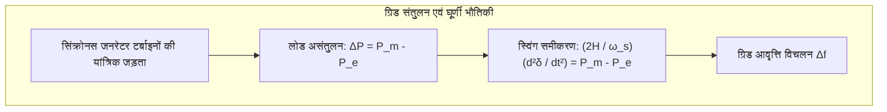

दीवार पर लगे स्विच को दबाते ही कमरा रोशनी से भर जाता है। आधुनिक सभ्यता में प्लग सॉकेट से निरंतर वोल्टेज और सटीक आवृत्ति पर बिजली का मिलना हवा और पानी की तरह स्वाभाविक मान लिया जाता है।

लेकिन भौतिकी और सिस्टम इंजीनियरिंग के दृष्टिकोण से, यह दैनिक चमत्कार <strong>मानव इतिहास में निर्मित सबसे बड़ी वास्तविक समय की समकालिक मशीन: इंटरकनेक्टेड एसी पावर ग्रिड</strong> पर निर्भर करता है।

पावर ग्रिड की सबसे कठोर भौतिक बाधा यह है कि <strong>ट्रांसमिशन तारों में बिजली को जमा करके रखने की कोई अंतर्निहित भंडारण क्षमता नहीं होती</strong>। विद्युत चुम्बकीय तरंगें प्रकाश की गति के करीब (लगभग 2,00,000 से 2,70,000 किमी/सेकंड) तारों में दौड़ती हैं। इसका सीधा अर्थ है कि उत्पादित बिजली की हर एक इकाई उसी मिलीसेकंड में उपभोग होनी चाहिए जिस क्षण वह बनती है।

---

### 1. वास्तविक समय ऊर्जा संतुलन का भौतिक नियम

प्रत्येक माइक्रोसेकंड में कुल उत्पादन $P_{gen}(t)$ को उपभोक्ताओं की कुल मांग $P_{load}(t)$ और ट्रांसमिशन लाइनों में होने वाले जूल तापीय नुकसान $P_{loss}(t)$ के बिल्कुल बराबर होना पड़ता है:

$$P_{gen}(t) = P_{load}(t) + P_{loss}(t)$$

यदि अचानक लाखों लोग एयर कंडीशनर चालू कर दें और उत्पादन न बढ़े, तो अतिरिक्त आवश्यक ऊर्जा पूरे ग्रिड में घूम रहे विशाल टरबाइन रोटार की घूर्णी गतिज ऊर्जा से तुरंत खींच ली जाती है। इससे रोटार धीमे हो जाते हैं और ग्रिड की आवृत्ति (50.00 Hz) घटने लगती है। इसके विपरीत, अधिक उत्पादन होने पर रोटार तेजी से घूमने लगते हैं और आवृत्ति बढ़ जाती है।

---

### 2. आवृत्ति की भौतिकी: रोटेशनल इनर्शिया और स्विंग समीकरण (Swing Equation)

ग्रिड से जुड़े प्रत्येक सिंक्रोनस जनरेटर का गतिशील व्यवहार प्रसिद्ध <strong>स्विंग समीकरण (Swing Equation)</strong> द्वारा नियंत्रित होता है:

$$\frac{2H}{\omega_s} \frac{d^2\delta}{dt^2} = P_m - P_e - D \Delta \omega$$

यहाँ प्रयुक्त प्रमुख पैरामीटर:
- $H$: जनरेटर का जड़त्व स्थिरांक (Inertia Constant, सामान्यतः 3 से 6 सेकंड), जो रोटर में संचित गतिज ऊर्जा को व्यक्त करता है।
- $\delta$: स्टेटर के चुंबकीय क्षेत्र के सापेक्ष रोटर का विद्युत भार कोण।
- $P_m$: टरबाइन द्वारा दिया गया यांत्रिक इनपुट पावर।
- $P_e$: ग्रिड में आपूर्ति की गई विद्युत चुम्बकीय शक्ति।
- $D$: डैम्पिंग गुणांक।

जब कोई बड़ा पावर प्लांट अचानक ट्रिप हो जाता है, तो आवृत्ति में गिरावट की प्रारंभिक दर (<strong>RoCoF</strong> - <em>Rate of Change of Frequency</em>) प्रणाली की कुल जड़ता पर निर्भर करती है:

$$\left. \frac{df}{dt} \right|_{t=0^+} = - \frac{f_0 \cdot \Delta P_{loss}}{2 \sum H_i \cdot S_{n,i}}$$

घूमते हुए भारी टर्बाइनों की यांत्रिक जड़ता आवृत्ति को अचानक पाताल में गिरने से रोकती है और स्वचालित नियंत्रण प्रणालियों को संभलने का जीवनरक्षक समय प्रदान करती है।

---

### 3. आवृत्ति नियंत्रण का बहु-स्तरीय ढांचा

ग्रिड की आवृत्ति को 50.00 हर्ट्ज़ पर बनाए रखने के लिए समय के आधार पर चार स्तरों का सुरक्षा तंत्र काम करता है:

| नियंत्रण स्तर | समय सीमा | भौतिक / परिचालन तंत्र | प्राथमिक उद्देश्य |
| :--- | :--- | :--- | :--- |
| <strong>जड़त्वीय प्रतिक्रिया</strong> | 0 से 2 सेकंड | रोटर द्रव्यमान से प्राकृतिक गतिज ऊर्जा का निकास | आवृत्ति गिरावट की दर (RoCoF) को सीमित करना |
| <strong>प्राथमिक नियंत्रण</strong> | 2 से 30 सेकंड | टरबाइन गवर्नर और ड्रूप नियंत्रण | गिरावट को रोककर न्यूनतम स्तर (Nadir) पर स्थिर करना |
| <strong>द्वितीयक नियंत्रण (AGC)</strong> | 30 सेकंड से 15 मिनट | स्वचालित उत्पादन नियंत्रण (Automatic Generation Control) | आवृत्ति को सटीक 50.00 Hz पर वापस लाना |
| <strong>तृतीयक नियंत्रण</strong> | 15 मिनट से कई घंटे | आर्थिक री-डिस्पैच और रिज़र्व रीलोडिंग | प्राथमिक और द्वितीयक सुरक्षा भंडारों को फिर से भरना |

---

### 4. उच्च वोल्टेज संचरण: एसी बनाम एचवीडीसी (HVDC)

सैकड़ों किलोमीटर दूर बिजली ले जाने पर ऊर्जा की बर्बादी रोकने के लिए वोल्टेज को लाखों वोल्ट (400 kV, 765 kV) तक बढ़ाया जाता है। जूल के तापन नियम के अनुसार:

$$P_{loss} = I^2 R = \left( \frac{P}{\sqrt{3} V \cos\phi} \right)^2 R$$

वोल्टेज को 10 गुना बढ़ाने से करंट 10 गुना कम हो जाता है, जिससे तारों में प्रतिरोध के कारण होने वाला ताप नुकसान 100 गुना ($100 \times$) घट जाता है।

लेकिन अत्यधिक लंबी दूरी या समुद्र के नीचे बिछाई जाने वाली केबलों में एसी लाइनों का कैपेसिटिव प्रभाव भारी नुकसान पैदा करता है। ऐसे मामलों में <strong>हाई वोल्टेज डायरेक्ट करंट (HVDC)</strong> तकनीक का उपयोग किया जाता है। आईजीबीटी ट्रांजिस्टर पर आधारित वोल्टेज सोर्स कन्वर्टर्स (VSC) बिना किसी लाइन रिएक्टेंस के भारी मात्रा में बिजली पहुंचाते हैं और दो अलग-अलग ग्रिडों को बिना किसी कंपन के जोड़ते हैं।

---

### 5. कैस्केडिंग ब्लैकआउट का विज्ञान और ब्लैक स्टार्ट (Black Start)

एक बड़ा ब्लैकआउट कभी किसी एक विफलता से नहीं होता, बल्कि यह घटनाओं की एक अशांत गैर-रेखीय श्रृंखला होती है:
1. अत्यधिक भार के कारण तार गर्म होकर झूलता है और पेड़ की शाखा को छूता है, जिससे सुरक्षा रिले लाइन को बंद कर देती है।
2. किरचॉफ के नियमों के अनुसार बिजली तुरंत समानांतर लाइनों पर स्थानांतरित हो जाती है।
3. समानांतर लाइनें अधिक भार सहन न कर पाने के कारण एक-एक करके ट्रिप होने लगती हैं।
4. ग्रिड में वोल्टेज और रोटर कोण का तालमेल टूट जाता है और पूरी प्रणाली ढह जाती है।

ब्लैकआउट के बाद शून्य से बिजली बहाल करने की प्रक्रिया को <strong>ब्लैक स्टार्ट (Black Start)</strong> कहा जाता है। इसमें जलविद्युत संयंत्र जैसे स्व-प्रारंभिक जनरेटर पहले खुद चालू होते हैं, फिर धीरे-धीरे ट्रांसमिशन लाइनों को चार्ज करते हुए स्थानीय विद्युत द्वीप बनाते हैं और अंततः पूरे देश के ग्रिड को दोबारा एक समकालिक इकाई में जोड़ते हैं।
