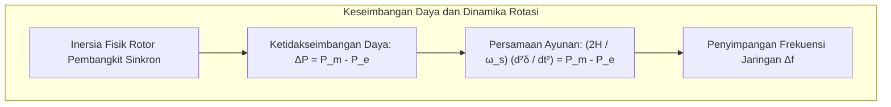

Menyalakan sakelar lampu atau mencolokkan pengisi daya ponsel di dinding adalah kebiasaan harian yang tampak sederhana. Di balik stopkontak tersebut, terdapat <strong>mesin sinkron real-time terbesar yang pernah dibangun peradaban manusia: jaringan transmisi tenaga listrik terinterkoneksi</strong>.

Jaringan listrik memiliki batasan fisik yang sangat ketat: <strong>jaringan kawat transmisi tidak memiliki kapasitas penyimpanan energi internal</strong>. Gelombang elektromagnetik merambat di sepanjang kawat konduktor mendekati kecepatan cahaya (sekitar 200.000 hingga 270.000 km/detik). Akibatnya, setiap watt daya listrik harus dibangkitkan pada milidetik yang persis sama saat ia dikonsumsi oleh konsumen.

---

### 1. Hukum Keseimbangan Daya Seketika

Pada setiap mikrodetik $t$, total daya yang dihasilkan oleh pembangkit listrik $P_{gen}(t)$ harus benar-benar sama persis dengan penjumlahan daya beban konsumsi $P_{load}(t)$ dan rugi-rugi transmisi termal Joule $P_{loss}(t)$:

$$P_{gen}(t) = P_{load}(t) + P_{loss}(t)$$

Jika konsumsi beban tiba-tiba melonjak melampaui kapasitas pembangkitan, kekurangan energi tersebut akan ditarik secara paksa dari energi kinetik putaran rotor turbin sinkron. Rotor akan melambat, dan frekuensi jaringan (50.00 Hz) akan anjlok. Sebaliknya, kelebihan pasokan energi mekanik akan mempercepat putaran rotor, menaikkan frekuensi listrik.

---

### 2. Fisika Frekuensi Jaringan: Inersia dan Persamaan Ayunan (Swing Equation)

Dinamika mekanik-listrik dari setiap generator sinkron dikendalikan oleh <strong>Persamaan Ayunan (Swing Equation)</strong>:

$$\frac{2H}{\omega_s} \frac{d^2\delta}{dt^2} = P_m - P_e - D \Delta \omega$$

Keterangan parameter:
- $H$: Konstanta inersia sistem (berkisar antara 3 hingga 6 detik), mencerminkan rasio energi kinetik tersimpan terhadap daya pengenal generator.
- $\delta$: Sudut beban rotor relatif terhadap gelombang medan magnet stator.
- $P_m$: Daya mekanik masukan dari turbin uap, gas, atau air.
- $P_e$: Daya elektromagnetik keluaran ke jaringan transmisi.
- $D$: Koefisien peredaman dinamik.

Ketika terjadi trip mendadak pada pembangkit skala gigawatt, laju penurunan frekuensi awal (<strong>RoCoF</strong> - <em>Rate of Change of Frequency</em>) berbanding terbalik dengan total inersia putar sistem:

$$\left. \frac{df}{dt} \right|_{t=0^+} = - \frac{f_0 \cdot \Delta P_{trip}}{2 \sum H_i \cdot S_{n,i}}$$

Keberadaan turbin raksasa berputar memberikan inersia fisik krusial yang menahan laju penurunan frekuensi selama detik-detik pertama sebelum sistem kendali otomatis sempat bereaksi.

---

### 3. Hierarki Pengendalian Frekuensi Bertingkat

Sistem tenaga listrik mengandalkan empat lapisan pertahanan otomatis berjenjang:

| Tingkatan Kontrol | Rentang Waktu | Mekanisme Operasi | Fungsi Utama |
| :--- | :--- | :--- | :--- |
| <strong>Respon Inersia</strong> | 0 - 2 detik | Pelepasan energi kinetik alami massa rotor | Menahan laju perubahan frekuensi (RoCoF) |
| <strong>Kontrol Primer</strong> | 2 - 30 detik | Governor turbin melalui kurva droop kecepatan | Menahan penurunan dan menstabilkan frekuensi di titik nadir |
| <strong>Kontrol Sekunder (AGC)</strong>| 30 detik - 15 menit | *Automatic Generation Control* terpusat | Mengembalikan frekuensi ke nominal 50.00 Hz persis |
| <strong>Kontrol Tersier</strong> | 15 menit - beberapa jam | Penjadwalan ulang pembangkitan cadangan panas | Memulihkan cadangan daya putar primer dan sekunder |

---

### 4. Transmisi Tegangan Ekstra Tinggi: AC vs HVDC

Untuk mentransmisikan daya ribuan megawatt melintasi pulau atau ratusan kilometer, tegangan harus dinaikkan hingga ratusan kilovolt (150 kV, 275 kV, 500 kV). Berdasarkan hukum Joule:

$$P_{loss} = I^2 R = \left( \frac{P}{\sqrt{3} V \cos\phi} \right)^2 R$$

Menaikkan voltase sebesar 10 kali lipat akan menurunkan arus sebesar 10 kali lipat, yang secara dramatis memangkas rugi panas tembaga kawat hingga seratus kali lipat ($100 \times$).

Namun, pada saluran kabel transmisi laut atau jarak antar-pulau yang sangat jauh, saluran AC terhambat oleh reaktansi kapasitif yang besar. Teknologi <strong>Arus Searah Tegangan Tinggi (HVDC)</strong> dengan konverter berbasis IGBT (VSC-HVDC) menjadi solusi mutlak, memampukan transfer daya tanpa batasan reaktansi saluran serta mengisolasi gangguan osilasi antar pulau.

---

### 5. Fenomena Pemadaman Beruntun (Blackout Cascading) dan Black Start

Pemadaman listrik massal (*blackout*) hampir selalu bermula dari kegagalan beruntun tak linier:
1. Satu saluran transmisi mengalami kelebihan beban panas dan menyentuh vegetasi pohon, memicu trip relai proteksi impedansi.
2. Arus listrik terdistribusi ulang secara instan ke saluran transmisi tetangga melalui Hukum Arus Kirchhoff.
3. Saluran tetangga mengalami lonjakan arus melebihi ambang batas termal, memicu pemutusan relai secara berantai.
4. Terjadi kehilangan sinkronisme sudut rotor, ketidakstabilan tegangan, hingga sistem terfragmentasi.

Pemulihan total jaringan memanfaatkan skenario <strong>Black Start</strong>: pembangkit berkapasitas start mandiri (seperti PLTA dengan turbin hidro) mengalirkan daya mula untuk menyalakan pembangkit uap besar secara bertahap, membangun pulau-pulau tegangan kecil, sebelum disinkronkan kembali menjadi satu kesatuan jaringan utuh.
