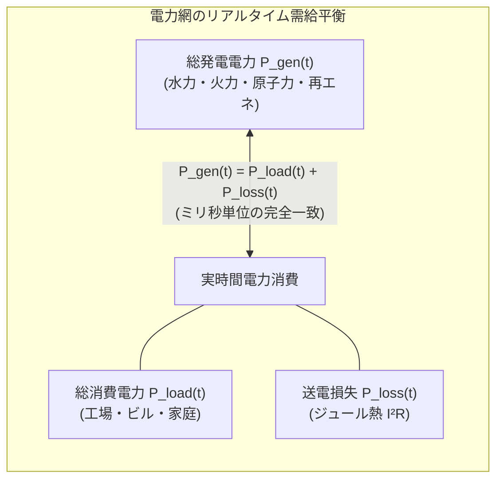
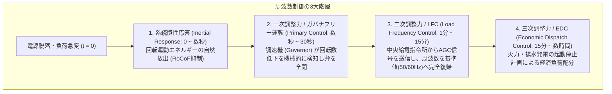
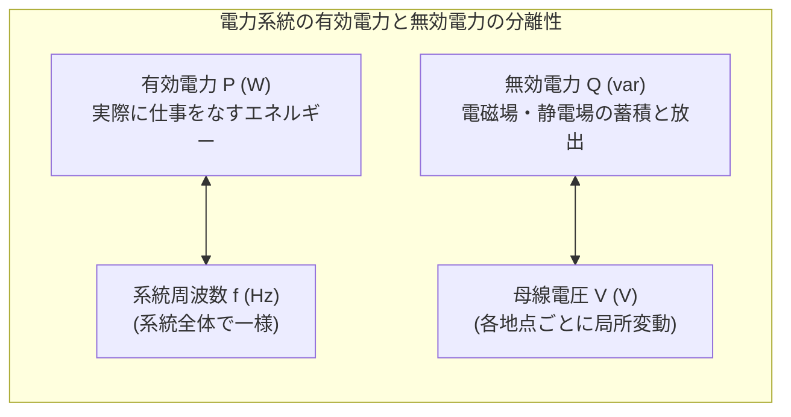
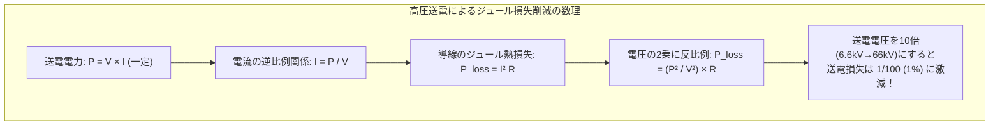
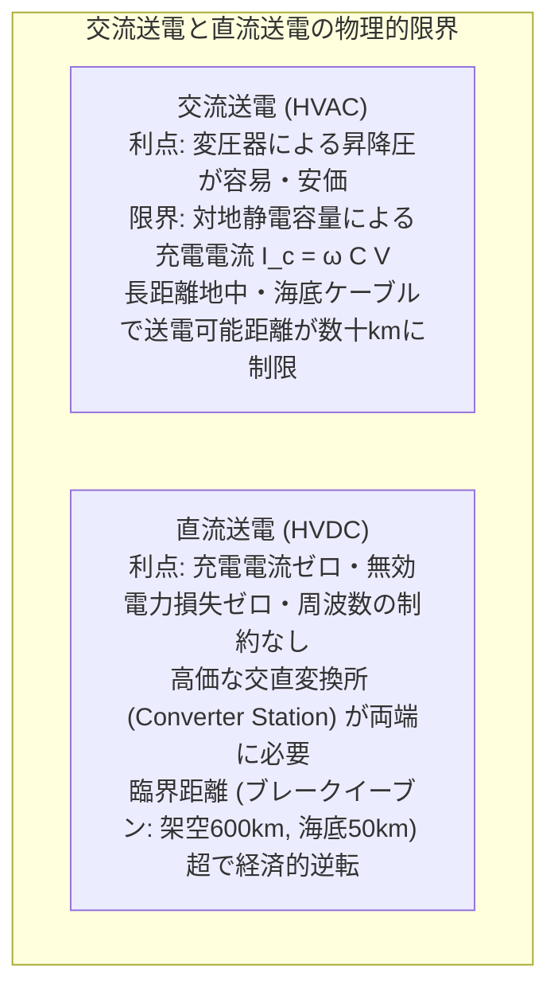
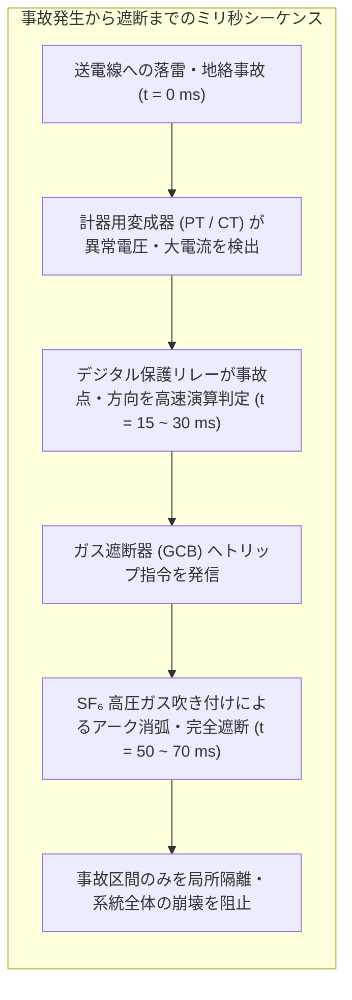
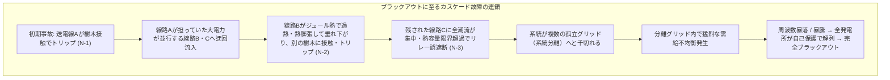
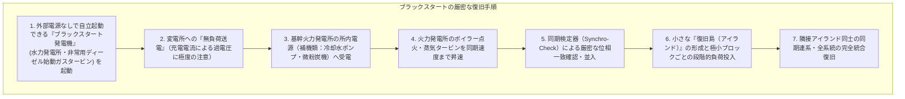
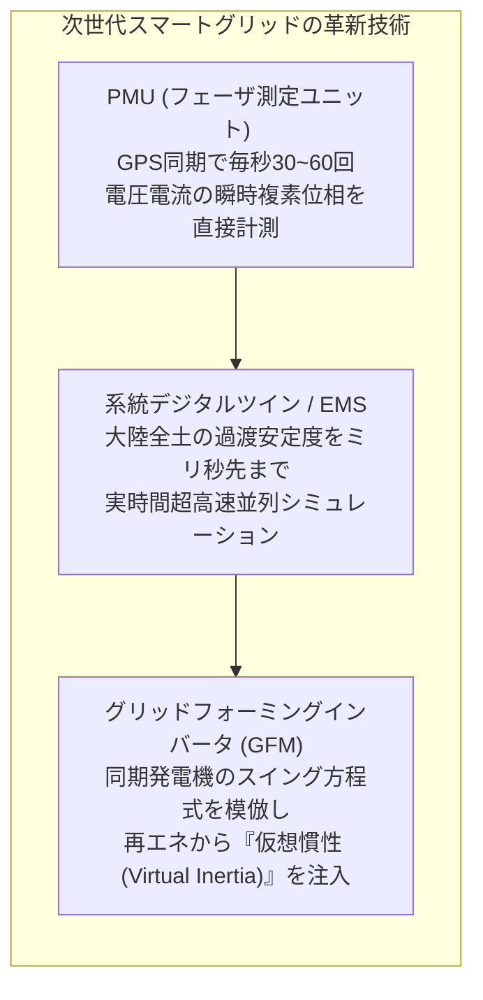

部屋の壁にあるスイッチを入れると、部屋全体が瞬時に明るくなる。スマートフォンを充電器につなぐと、即座に充電が始まる。現代社会において、コンセントの向こう側から電気が「常に、途切れることなく、安定した電圧と周波数で届き続ける」ことは、空気や水と同じように当たり前の前提とされています。

しかし、物理学的・工学的な実態に目を向けると、この日常は奇跡のような動的平衡（Dynamic Equilibrium）の上に成り立っています。

大陸全土に張り巡らされた電力網（Power Grid）は、<strong>「人類がこれまでに建設した最も巨大で、かつ全域が光速で連動する単一の巨大機械」</strong>です。何千基もの巨大発電機、数十万キロメートルに及ぶ超高圧送電線、無数の変電所、そして数千万の消費者が一つの巨大な交流回路として同期（シンクロ）しています。

さらに驚くべきことに、電力網は<strong>「電気をそのままの形で大規模に貯蔵するクッションを持たない」</strong>という過酷な物理的制約を抱えています。あなたが電気ケトルのスイッチを入れたその瞬間、数千キロメートル離れた発電所のタービンがその負荷を瞬時に感知し、毎秒ミリグラム単位で燃料噴射量を増やして回転数を保っているのです。

本稿では、「なぜ電力需給が崩れると周波数が狂うのか」「スイング方程式と系統慣性の数理」「500kVという超高電圧で送電する理由」「交流送電と直流送電（HVDC）の物理限界」「大規模停電（ブラックアウト）が連鎖するカスケード故障の力学」「外部電源ゼロから系統を再起動するブラックスタートの手順」に至るまで、巨大電力網の全貌を徹底的に解き明かします。

---

## 1. 人類史上最大のリアルタイム機械：同時同量の原則

電力システムの最も根本的な物理法則は、<strong>「同時同量の原則（Real-Time Balance of Supply and Demand）」</strong>です。



### 1.1 電気は「導線の中に貯められない」

水道網であれば巨大な配水池やダムに水を蓄えておくことで、蛇口の開閉による水圧変動を吸収できます。ガス網であればパイプライン自体に圧縮ガスを蓄圧（ラインパック）できます。

しかし、電力網を流れる電磁波の伝播速度は真空中光速の約 $70\%\sim 90\%$（導線中でおよそ秒速20万〜27万キロメートル）に達します。導線そのものには電磁場としての微小なエネルギーしか蓄えられず、電気エネルギーは<strong>「発電された瞬間に光速で送電され、同じ瞬間に消費され尽くす」</strong>という性質を持ちます。

ある瞬間の総発電電力 $P_{gen}(t)$、総需要電力 $P_{load}(t)$、送電線損失 $P_{loss}(t)$ の間には、物理的に次の等式が常に厳密に成り立っていなければなりません。

$$P_{gen}(t) = P_{load}(t) + P_{loss}(t)$$

もし需要が発電をわずかでも上回れば、不足したエネルギーは系統内の巨大回転機の運動エネルギーから強制的に削り取られ、系統全体の回転速度（周波数）が低下します。逆に発電が需要を上回れば、余剰エネルギーが回転機を加速させ、周波数が跳ね上がります。

---

## 2. 周波数の物理学：巨大回転機の慣性とスイング方程式

電力網の健全性を監視する最も重要な心電図が<strong>系統周波数（System Frequency）</strong>です。日本では東日本が $50.00\,\mathrm{Hz}$、西日本が $60.00\,\mathrm{Hz}$、北米や欧州でも厳密に $60\,\mathrm{Hz}$ や $50\,\mathrm{Hz}$ に維持されています。

なぜ周波数はこれほど厳密に保たれなければならないのでしょうか。

```mermaid
flowchart TD
    subgraph FrequencyDynamics ["需給バランスと系統周波数の物理連鎖"]
        SupplyDemand["需要 P_load と 発電 P_gen の不均衡"]
        SupplyDemand -->|P_load > P_gen (需要超過)| Decel["巨大同期発電機の回転子が減速 (dω/dt < 0)"]
        SupplyDemand -->|P_load < P_gen (供給超過)| Accel["巨大同期発電機の回転子が加速 (dω/dt > 0)"]
        Decel --> FreqDrop["系統周波数 f が低下 (例: 50.0Hz → 49.5Hz)"]
        Accel --> FreqRise["系統周波数 f が上昇 (例: 50.0Hz → 50.5Hz)"]
        FreqDrop --> Risk["タービン翼の共振破壊・変圧器偏磁・UFLS遮断"]
        FreqRise --> Risk
    end
```

### 2.1 スイング方程式（Swing Equation）の数理

電力網に接続されたすべての同期発電機（火力、原子力、水力発電所の巨大タービン）の回転子は、磁気的に互いにガッチリと結合し、同じ電気角速度 $\omega$ で一糸乱れず同期回転しています。

単一の同期発電機ローターの運動方程式は、力学の回転運動方程式から導かれる<strong>スイング方程式（Swing Equation）</strong>によって記述されます。

$$J \frac{d\omega_m}{dt} = T_m - T_e$$

ここで $J$ は回転子の慣性モーメント（$\mathrm{kg\cdot m^2}$）、$\omega_m$ は機械的角速度（$\mathrm{rad/s}$）、$T_m$ は蒸気や水流がタービンブレードを押す機械的入力トルク、$T_e$ は電力網へ電力を送り出す際に生じる電磁気的負荷トルク（発電ブレーキトルク）です。

両辺に回転速度 $\omega_m$ を乗じて電力の次元に変換すると:

$$J \omega_m \frac{d\omega_m}{dt} \approx M \frac{d\Delta \omega}{dt} = P_m - P_e$$

ここで $P_m = T_m \omega_m$ は機械的入力電力、$P_e = T_e \omega_m$ は電気的出力電力、$M$ は角運動量（慣性定数）です。

電気角の位相差 $\delta$ を用いて表すと、標準的なスイング方程式が得られます。

$$\frac{2H}{\omega_s} \frac{d^2\delta}{dt^2} = P_m - P_e - D \Delta \omega$$

ここで:
- $H$（慣性定数 / Inertia Constant, 単位: 秒）: 発電機が定格回転数で蓄えている回転運動エネルギー $E_k = \frac{1}{2} J \omega_s^2$ を、発電機の定格容量 $S_{base}$ で割った値。通常 $3\sim 6\,\mathrm{秒}$。
- $\omega_s$: 同期電気角速度（$2\pi \times 50$ または $2\pi \times 60\,\mathrm{rad/s}$）。
- $D$: 制動係数（Damping Factor）。

この方程式が雄弁に物語っているのは、<strong>「電気的負荷 $P_e$ が機械的入力 $P_m$ を上回った瞬間、回転子の角速度偏差 $\Delta \omega$（すなわち周波数 $f$）は、蓄えられた運動エネルギーを吐き出しながら直ちに負の加速度で減速する」</strong>という物理的必然性です。

### 2.2 系統慣性（System Inertia）という見えない巨大防波堤

何百万台もの重さ数十トンの回転子が全力で同期回転しているとき、電力網全体には莫大な回転運動エネルギー（<strong>系統慣性 / System Inertia</strong>）が蓄えられています。

突然、大型火力発電所（100万kW）が落雷で脱落したとします。この瞬間、電力網全体で瞬時に100万kWの供給不足が生じます。
しかし、周波数は一瞬でゼロに落ちるわけではありません。系統内のすべての巨大回転子が、自らの回転運動エネルギーを自動的・受動的に電力へと変換して放出し、周波数の低下速度（RoCoF: Rate of Change of Frequency）を物理的にブレーキのように押し留めます。

この慣性のクッションがある数秒の間に、自動制御システムが介入して需給を回復させるのです。

### 2.3 3段階の需給周波数制御階層

周波数変動を抑制するために、電力システムは時定数の異なる3重のフィードバックループを構築しています。



1. <strong>一次調整力（ガバナフリー運転 / Governor-Free Operation）</strong>:
   各発電機の回転軸に取り付けられたガバナ（調速機）が、回転数の低下を即座に感知し、蒸気加減弁や水門を自律的に数秒で開いて出力を増大させます。
2. <strong>二次調整力（LFC: 負荷周波数制御 / Load Frequency Control）</strong>:
   中央給電指令所のコンピュータが系統周波数と地域間連系線潮流の偏差（ACE: Area Control Error）をリアルタイム演算し、応答性の高い火力発電所や水力発電所へ数秒〜数分周期で出力増減指令（AGC信号）を送り、低下した周波数を基準値（50.00Hz / 60.00Hz）へと引き戻します。
3. <strong>三次調整力（経済負荷配分制御 / EDC）</strong>:
   15分〜数時間単位で、電力需要予測に基づいて最も発電コストの安い発電機の出力を配分し、余力を確保します。

### 2.4 インバータ電源急増による「低慣性化」の危機

現在、太陽光発電（PV）や風力発電などの再生可能エネルギーが急速に普及しています。
しかし、太陽光パネルは回転部を持たず、インバータ（半導体スイッチング素子）を通じて電気を系統へ流し込みます。従来の風力発電機もインバータを介しているため、機械的慣性が系統と電気的に切り離されています。

系統内の火力発電所が次々と休止・廃止され、インバータ電源の割合が高まると、<strong>系統全体の物理的慣性 $H_{sys}$ が激減（低慣性化 / Low Inertia Grid）</strong>します。
慣性が低下した系統では、わずかな電源脱落でも周波数低下速度（RoCoF）が猛烈に加速し、ガバナ制御が作動する前に後述する保護リレーが作動して大規模停電に至るリスクが世界的な課題となっています。

---

## 3. 電圧と無効電力（Reactive Power）の制御力学

電力網を安定に維持するためには、周波数（$f$）だけでなく<strong>電圧（$V$）</strong>も各地点で公称電圧の $\pm 5\%\sim \pm 10\%$ 以内に厳密に収めなければなりません。

周波数が系統全体で均一な「大域的（Global）指標」であるのに対し、<strong>電圧は場所ごとに異なる「局所的（Local）指標」</strong>であり、その背後には<strong>無効電力（Reactive Power $Q$）</strong>の物理が存在します。



### 3.1 潮流方程式（Power Flow Equations）

交流送電線（インピーダンス $Z = R + jX$、送電端電圧 $V_1 \angle \theta_1$、受電端電圧 $V_2 \angle \theta_2$、位相差 $\delta = \theta_1 - \theta_2$）を介して送られる電力は、以下の潮流方程式で記述されます。

高圧送電線では抵抗分に比べてリアクタンス分が圧倒的に大きい（$X \gg R$）ため、$R \approx 0$ と近似すると:

$$P \approx \frac{V_1 V_2}{X} \sin \delta$$

$$Q \approx \frac{V_1^2 - V_1 V_2 \cos \delta}{X} \approx \frac{V_1 (V_1 - V_2)}{X}$$

この式は送電工学における最も重要な結論を導きます。
1. <strong>有効電力 $P$ は、両端の電圧位相差 $\delta$（相差角）によって決まる</strong>: 発電機の出力を上げると回転子の位相が進み、有効電力が送電されます。
2. <strong>無効電力 $Q$ は、両端の電圧の「大きさの差（$V_1 - V_2$）」によって決まる</strong>: 電圧の高い地点から低い地点へと無効電力が流れます。

### 3.2 フェランチ効果と電圧崩壊（Voltage Collapse）

送電線は、導線間の静電容量（キャパシタンス $C$）と自己インダクタンス（$L$）を持つ分布定数回路です。
- <strong>軽負荷時（深夜など）</strong>: 送電線を流れる電流が小さいとき、送電線の対地静電容量による進相電流（充電電流）が支配的となり、受電端の電圧が送電端よりも異常に跳ね上がる<strong>フェランチ効果（Ferranti Effect）</strong>が生じます。機器の絶縁破壊を防ぐため、変電所に<strong>分路リアクトル（Shunt Reactor）</strong>を投入して遅れ無効電力を消費させ、電圧を押し下げます。
- <strong>重負荷時（真夏の昼間など）</strong>: 工場やエアコンの誘導電動機（モーター）が大量の遅れ無効電力を消費すると、送電線のリアクタンス $X$ による電圧降下が極大化します。
  受電端の電力特性を示す<strong>P-V曲線（ノーズカーブ / Nose Curve）</strong>において、負荷の増大に伴い動作点が「臨界点（ノーズ点 / 鼻点）」に達すると、それ以上電力を送れなくなり、電圧が雪崩を打ってゼロへと急降下する<strong>電圧崩壊（Voltage Collapse）</strong>が発生します。

これを防ぐため、変電所には<strong>電力用コンデンサ</strong>や、半導体素子でミリ秒単位で無効電力を双方向に注入・吸収する<strong>静止型無効電力補償装置（SVC / STATCOM）</strong>が配備されています。

---

## 4. 変圧と高圧送電の物理：なぜ50万ボルトなのか？

発電所で生まれた電気は、なぜ数万〜数十万ボルトという超高電圧に昇圧されて送電されるのでしょうか。



### 4.1 ジュール損失と電圧の2乗反比例則

送電線を流れる電流を $I$、送電線の往復電気抵抗を $R$ とすると、導線の発熱（オーム損）によって大気中に捨てられる電力損失（ジュール熱損失 $P_{loss}$）はジュールの法則より次式となります。

$$P_{loss} = I^2 R$$

一方、送電される三相交流電力 $P$ は、線間電圧 $V$、線電流 $I$、力率 $\cos \phi$ を用いて次のように表されます。

$$P = \sqrt{3} V I \cos \phi \implies I = \frac{P}{\sqrt{3} V \cos \phi}$$

この電流 $I$ を損失の式に代入すると、送電工学の最も偉大な結論が得られます。

$$P_{loss} = \left( \frac{P}{\sqrt{3} V \cos \phi} \right)^2 R = \frac{P^2 R}{3 V^2 \cos^2 \phi}$$

送電損失 $P_{loss}$ は、<strong>送電電圧 $V$ の2乗に反比例</strong>します。
例えば、電圧を $6.6\,\mathrm{kV}$ から $66\,\mathrm{kV}$ へと10倍に昇圧すると、同じ電力を送るために必要な電流は $1/10$ に減少し、送電損失はなんと <strong>$1/100$（$1\%$）</strong> に激減します。

このため、長距離を大量に送電する幹線送電線では、$275\,\mathrm{kV}$ や $500\,\mathrm{kV}$、世界最高峰では中国やロシアの $1000\,\mathrm{kV}$（超々高圧 UHV）という途方もない超高電圧が用いられているのです。

### 4.2 コロナ放電の抑制と多導体方式

しかし、電圧を極端に高めると、電線表面の電界強度が空気の絶縁破壊強度（約 $30\,\mathrm{kV/cm}$）を超え、空気が局所電離して青紫色の光とジージーという異音を放つ<strong>コロナ放電（Corona Discharge）</strong>が発生します。コロナ放電は莫大な電力損失、電線腐食、ラジオ電波障害を引き起こします。

電線表面の電界強度 $E$ は、導線の外径半径 $r$ に反比例します（$E \propto 1/r$）。
そこで $500\,\mathrm{kV}$ などの超高圧送電線では、1相あたり太い電線を1本だけ張るのではなく、スペーサーで数十センチの間隔を保ちながら2本、4本、あるいは8本の電線を円筒状に束ねて配置する<strong>多導体方式（Bundle Conductors）</strong>を採用しています。幾何学的な等価半径を数倍から十倍以上に拡大することで表面電界を劇的に緩和し、コロナ放電をほぼ完全に封じ込めています。

---

## 5. 交流送電（HVAC）vs 直流送電（HVDC）：100年越しの電流戦争の決着

19世紀末、トマス・エジソン（直流派）とニコラ・テスラ／ジョージ・ウェスティングハウス（交流派）の間で繰り広げられた「電流戦争（War of the Currents）」は、変圧器による昇圧の容易さから交流の完全勝利に終わりました。しかし21世紀の現代、パワーエレクトロニクスの進化によって<strong>高圧直流送電（HVDC: High Voltage Direct Current）</strong>が劇的な復活を遂げています。



### 5.1 交流送電の物理的限界：ケーブル充電電流

海底ケーブルや都市部の大容量地中送電線では、導体と大地（海水や接地遮蔽層）が絶縁体を挟んで近接しているため、架空送電線の数倍から数十倍という巨大な対地静電容量 $C$ を持ちます。

交流電圧 $V(t) = V_0 \sin(\omega t)$ を印加すると、電力を全く消費していなくても、常に<strong>充電電流（Charging Current）</strong> $I_c$ が流れ続けます。

$$I_c = \omega C V = 2\pi f C V$$

ケーブルが長くなると、この充電電流だけで導線の通電容量（熱的許容電流）を100%使い果たしてしまい、<strong>有効電力を1Wも送れなくなる「臨界送電距離」</strong>に達します。高圧交流海底ケーブルでは、この限界距離はわずか <strong>$40\sim 50\,\mathrm{km}$</strong> 程度です。

### 5.2 直流送電（HVDC）の圧倒的優位性

直流送電では、周波数 $f = 0$（$\omega = 0$）であるため、充電電流 $I_c = 0$、無効電力損失もゼロとなります。送電線断面の全体に均一に電流が流れるため表皮効果もなく、導体の利用効率が最大化されます。
- 海底送電線（数百km）
- 大陸横断長距離大容量送電（$1000\,\mathrm{km}$ 以上）
- 洋上風力発電所から本土への送電

現代のHVDCは、高耐圧半導体素子（IGBT）を用いた自励式交直変換器（VSC: Voltage Source Converter）により、有効電力と無効電力をミリ秒単位で自在に独立制御できるため、系統全体の動的安定度を飛躍的に向上させます。

### 5.3 周波数変換所（FC）：日本を東西に引き裂く50Hz/60Hzの壁

日本は世界でも極めて特異な、<strong>同一国内で商用周波数が $50\,\mathrm{Hz}$（東日本）と $60\,\mathrm{Hz}$（西日本）に真っ二つに分断された国</strong>です。
明治期に東京電燈がドイツ・AEG製（50Hz）を導入し、大阪電灯がアメリカ・GE製（60Hz）を導入した歴史的経緯に由来します。

50Hzと60Hzの交流は直接電線をつないでも絶対に同期できず、短絡大爆発を起こします。そのため、静岡県と長野県にある3箇所（新信濃、佐久間、東清水）などの<strong>周波数変換所（FC: Frequency Converter）</strong>において、50Hzの交流を一旦直流に変換し、改めて60Hzの交流へと再合成することで東西の電力融通を行っています。

---

## 6. 系統保護とリレー工学：事故の超高速局所隔離

落雷、台風による樹木接触、クレーン車の接触など、送電線では年間何千件もの地絡（ショート）事故が発生します。もし事故電流を放置すれば、高圧アーク火災で送電線が溶断し、周辺の発電機が次々と脱調停止して国中がブラックアウトします。

事故をミリ秒単位で検知し、健全な系統から瞬時に切り離す頭脳が<strong>保護リレー（Protection Relays）</strong>です。



1. <strong>距離リレー（Distance Relay / インピーダンスリレー）</strong>:
   事故地点までの電気的インピーダンス $Z = V/I$ を測定します。送電線の単位長さあたりインピーダンスは既知であるため、測定された $Z$ の大きさから「自変電所から何キロメートル先で事故が起きたか」を瞬時に特定し、自区間内の事故であれば数サイクル（$0.03\sim 0.05\,\mathrm{秒}$）で遮断器を開放します。
2. <strong>電流差動リレー（Current Differential Relay）</strong>:
   送電線の両端（変電所Aと変電所B）を専用光ファイバーで結び、流入する電流ベクトル $\mathbf{I}_A$ と流出する電流ベクトル $\mathbf{I}_B$ のキルヒホッフ総和を比較します。
   正常時は $\mathbf{I}_A + \mathbf{I}_B = \mathbf{0}$ ですが、区間内で地絡事故が起きると $\mathbf{I}_A + \mathbf{I}_B = \mathbf{I}_{fault} \ne \mathbf{0}$ となります。光速のデータ通信により、極めて高感度かつ誤動作なしに事故を隔離します。
3. <strong>ガス遮断器（GCB: Gas Circuit Breaker）</strong>:
   数十万ボルト・数万アンペアの超高エネルギー短絡電流を開放する際、接点間には数千度の導電性プラズマ（アーク放電）が発生します。優れた消弧能力と絶縁耐力を持つ<strong>六フッ化硫黄（$\mathrm{SF_6}$）ガス</strong>を高圧で吹き付けることで、電流零点を捉えてわずか <strong>$0.05$ 秒（3サイクル以内）</strong> で巨大電流を粉砕・完全消弧します。

---

## 7. ブラックアウト（大停電）の連鎖科学：カスケード故障の力学

大規模ブラックアウトは、突発的な単一の故障で起きることは稀です。多くの場合、<strong>1つの小さなトリップが次の過負荷を引き起こし、それがドミノ倒しのように全域へ波及する「カスケード故障（Cascading Failure）」</strong>によって引き起こされます。

電力工学には<strong>「N-1基準」</strong>という大原則があります。系統内の主要設備（送電線、変圧器、発電機）のうち「どれか1基が突然脱落しても、残りの設備で健全に給電を継続できる」ように設計されています。しかし、想定外の事象が重なる「N-2」や「N-k」の多重事故が発生したとき、破滅的な連鎖が始まります。



### 2018年 北海道胆振東部地震における日本初の全系ブラックアウト

2018年9月6日未明、北海道全域の約295万戸が完全停電したブラックアウトは、カスケード故障の典型例として世界中の電力工学者に衝撃を与えました。
1. <strong>背景</strong>: 深夜の軽負荷時間帯、北海道全域の総需要は約310万kW。そのうち半分以上（約165万kW）を、コストの安い単一の大型石炭火力「苫東厚真発電所（1, 2, 4号機）」が集中的に発電していた。
2. <strong>発災</strong>: 震度7の直下型地震により、苫東厚真発電所のボイラー配管が破断・火災を起こし、3基合計165万kWが一瞬で全数脱落。
3. <strong>周波数暴落</strong>: 需要310万kWに対し、供給が一瞬で半減。スイング方程式に従い、系統周波数は定格の $50.0\,\mathrm{Hz}$ からわずか数秒で <strong>$46\,\mathrm{Hz}$ 付近まで垂直落下</strong>。
4. <strong>UFLS（周波数低下負荷遮断リレー）の作動</strong>: 系統崩壊を防ぐため、自動リレーが道内の約半分（140万kW分）の配電線を緊急強制切断。
5. <strong>水力発電の過負荷トリップ</strong>: 周波数は一時 $48\,\mathrm{Hz}$ まで持ち直したものの、揺れで停止した送電線の地絡や、水力発電所への過剰負荷により残存発電所が次々と自己保護のため系統から自動解列。
6. <strong>全系停止</strong>: 最初の地震発生からわずか17分後、北海道電力の全発電所が停止し、北海道全土が完全な暗黒（ブラックアウト）に包まれました。

---

## 8. ブラックスタート（系統復旧）：暗黒からの再起動工学

ブラックアウトした電力網を復旧させることは、平時の運用よりも遥かに高度な物理的・制御的難事業です。外部からの電気が一切来ていない「ゼロ」の状態から、どのようにして電力網を蘇らせるのでしょうか。この極限手順を<strong>ブラックスタート（Black Start）</strong>と呼びます。



1. <strong>ブラックスタート発電機の自立起動</strong>:
   一般的な火力・原子力発電所は、数万kWにおよぶ巨大な冷却水ポンプ、微粉炭機、通風機などの所内補機が動いていなければ起動できません。そのため、外部電力が不要な<strong>「水力発電所（水圧鉄管のバルブを手動開放して起動）」</strong>や、専用の非常用ディーゼル発電機を持つガスタービンが最初の種火（ブラックスタート電源）となります。
2. <strong>フェランチ効果と励磁突入電流の制御</strong>:
   水力発電所から停止している送電線へ送電（課電）する際、負荷が繋がっていない「無負荷送電」となるため、対地静電容量により受電端の電圧が跳ね上がります（フェランチ効果）。また、巨大変圧器を通電する瞬間には、鉄心の磁気飽和により定格電流の数倍におよぶ猛烈な<strong>励磁突入電流（Inrush Current）</strong>が流れ、種火の小さな水力発電所が過電流でトリップする危険と常に隣り合わせです。
3. <strong>慎重な段階的負荷投入</strong>:
   復旧した発電所に一度に大きな街の電気を接続すると、負荷の衝撃で周波数が再び暴落して再停電します。中央給電指令所は、数メガワット単位の極めて小さなブロックごとに、発電機の出力余力（ガバナ応答マージン）を計算しながら、外科手術のように慎重に配電線を一つずつ再投入していきます。
4. <strong>アイランドの同期併入</strong>:
   各地で独立して立ち上げられた複数の「復旧島（Island）」同士を結合する際には、<strong>同期検定器（Synchroscope）</strong>を用いて、両者の電圧・周波数・位相角が完全にゼロ誤差で一致した瞬間をミリ秒単位で見計らって遮断器を投入（並入）し、最終的に単一の巨大電力網へと再統合します。

---

## 9. 次世代の系統科学：デジタルツインとグリッドフォーミング

21世紀の電力網は、AI、ビッグデータ、そして最先端のパワーエレクトロニクスによって、劇的なデジタル変革を遂げつつあります。



1. <strong>フェーザ測定ユニット（PMU / Synchrophasor）</strong>:
   従来のSCADAシステムは数秒に1回の計測データしか得られませんでした。GPSの超高精度タイムスタンプと同期したPMUは、毎秒30〜60回の頻度で大陸全土の電圧・電流の「位相角」をリアルタイム直接計測します。これにより、電力網の上を広がる見えない「電力動揺波（Power Oscillations）」の伝播が津波のように可視化できるようになりました。
2. <strong>グリッドフォーミング（GFM: Grid-Forming）インバータ</strong>:
   従来の再エネインバータ（Grid-Following）は、既存の系統電圧と周波数に受動的に従うだけでした。次世代のGFMインバータは、自らが電圧源として動作し、制御アルゴリズムの内部でスイング方程式を仮想演算することで、<strong>蓄電池から系統へ「仮想慣性（Virtual Inertia）」を供給</strong>します。これにより、回転機を持たない100%再生可能エネルギー系統であっても、従来の火力発電所と同等以上の周波数安定性を維持することが可能になりつつあります。

---

## 10. まとめ：目に見えない巨大な秩序

コンセントの穴の奥に広がる世界は、静止した空間ではありません。
そこでは、プランク定数とマクスウェル方程式に支配された無数の光子と電子が、秒速25万キロメートルで大陸を駆け巡り、数千台の巨大タービンが1秒間に50回または60回、完全な調和をもって回転し続けています。

- <strong>同時同量の宿命</strong>: 貯蔵クッションのない世界で、ミリ秒単位で需要と供給を釣り合わせる。
- <strong>スイング方程式</strong>: 巨大回転機の慣性モーメントが、突発的な事故から社会を守る第一の防波堤となる。
- <strong>2乗反比例の変圧工学</strong>: 500kVという超高電圧によってジュール損失を極限まで削ぎ落とす。
- <strong>保護リレーと遮断器の決断</strong>: 事故を0.05秒で切り離し、カスケード崩壊を阻止する。
- <strong>ブラックスタートの執念</strong>: 暗黒の静寂から、水力の一滴を種火として文明の光を蘇らせる。

電力網とは、熱力学、電磁気学、流体力学、制御理論のすべてが極限のスケールで融合した、人類工学の最高傑作なのです。
