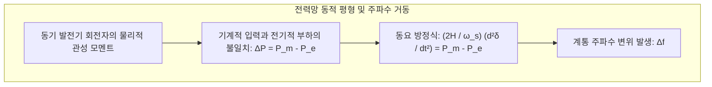

벽에 달린 스위치를 누르면 방 안이 즉시 밝아지고, 스마트폰 충전기를 꽂으면 전류가 막힘없이 흘러 들어옵니다. 현대 사회에서 콘센트 너머로 언제나 일정한 전압과 주파수의 전기가 흐르는 것은 공기나 물처럼 당연하게 여겨집니다.

그러나 물리학과 시스템 공학의 관점에서 보면, 이 일상적인 편리함은 <strong>인류 역사상 가장 거대하고 광속으로 상호작용하는 단일 실시간 기계인 ‘상호연결 교류 전력망(Synchronous AC Power Grid)’</strong> 덕분에 가능한 기적입니다.

전력망에는 매우 엄격한 물리적 한계가 존재합니다. 바로 <strong>송전 선로 자체에는 전기를 대규모로 저장할 수 있는 물리적 완충 능력이 전혀 없다</strong>는 점입니다. 전자기파는 전선 속을 빛의 속도의 70~90%(초속 약 20만~27만 km)로 이동합니다. 즉, 발전소에서 만들어진 전기는 소비자가 사용하는 바로 그 마이크로초에 생산되어야만 합니다.

---

### 1. 실시간 동시동량(同時同量)의 물리 법칙

전력 시스템의 대원칙은 <strong>‘발전과 소비의 실시간 동적 일치(동시동량)’</strong>입니다.

어느 순간 $t$에 있어서도 전체 발전량 $P_{gen}(t)$은 수용가의 총 소비 전력 $P_{load}(t)$과 송전 선로의 줄열 손실 $P_{loss}(t)$의 합과 정확히 일치해야 합니다:

$$P_{gen}(t) = P_{load}(t) + P_{loss}(t)$$

수억 명의 소비자가 동시에 가전제품을 켜서 소비가 발전을 초과하면, 부족한 에너지는 계통에 연결된 모든 거대 동기 발전기 회전자의 회전 운동 에너지에서 강제로 추출됩니다. 그 결과 회전자가 감속하며 전력망 주파수(60.00 Hz)가 떨어집니다. 반대로 발전이 과잉되면 회전자가 가속되어 주파수가 상승합니다.

---

### 2. 주파수의 물리 법칙: 관성력과 스윙 방정식(Swing Equation)

계통 주파수(60.00 Hz 또는 50.00 Hz)는 전력망 전체의 심장 박동수와 같습니다. 동기 발전기의 회전자 거동은 유명한 <strong>스윙 방정식(Swing Equation, 동요 방정식)</strong>에 의해 지배됩니다:

$$\frac{2H}{\omega_s} \frac{d^2\delta}{dt^2} = P_m - P_e - D \Delta \omega$$

매개변수 설명:
- $H$: 발전기의 관성 상수(Inertia Constant, 통상 3~6초). 정격 속도에서 회전자에 저장된 운동 에너지가 정격 용량으로 방출될 수 있는 지속 시간을 의미합니다.
- $\delta$: 고정자 회전 자계에 대한 회전자 자극의 전기적 부하각.
- $P_m$: 터빈이 제공하는 기계적 입력 파워.
- $P_e$: 전력망으로 출력되는 전자기적 유효 전력.
- $D$: 댐핑 계수.

대형 원자력이나 화력 발전소가 불시에 탈락할 때, 초기 주파수 하강률(<strong>RoCoF</strong> - <em>Rate of Change of Frequency</em>)은 계통의 총 회전 관성에 의해 결정됩니다:

$$\left. \frac{df}{dt} \right|_{t=0^+} = - \frac{f_0 \cdot \Delta P_{loss}}{2 \sum H_i \cdot S_{n,i}}$$

회전 터빈의 막대한 물리적 관성은 주파수가 순간적으로 바닥으로 추락하는 것을 막아주는 완충 스프링 역할을 하며, 자동 제어계가 가동될 수 있는 결정적인 시간을 벌어줍니다.

---

### 3. 다단계 계통 주파수 제어 구조

전력망은 주파수를 60.00 Hz로 유지하기 위해 엄격한 다계층 자동 제어 체계를 갖추고 있습니다:

| 제어 계층 | 응답 시간 | 제어 및 물리 메커니즘 | 주요 역할 |
| :--- | :--- | :--- | :--- |
| <strong>관성 응답</strong> | 0 ~ 2초 | 회전자 회전 운동 에너지 자연 방출 | 급격한 주파수 변화율(RoCoF) 억제 |
| <strong>1차 제어 (조속기)</strong> | 2 ~ 30초 | 터빈 조속기의 드룹 특성(Droop 4~5%) | 주파수 하락 저지 및 최저점(Nadir) 형성 |
| <strong>2차 제어 (AGC)</strong> | 30초 ~ 15분 | 중앙 자동 발전 제어 컴퓨터 알고리즘 | 오차 상쇄 및 주파수를 정확한 60.00 Hz로 복귀 |
| <strong>3차 제어</strong> | 15분 ~ 수 시간 | 계통 운영자의 예비력 재배치 및 기동 | 1차, 2차 예비력 용량을 복원하여 지속성 확보 |

---

### 4. 초고압 송전과 직류 송전(HVDC)의 물리학

수 기가와트의 대용량 전력을 수백~수천 킬로미터 떨어진 대도시로 보내려면 전압을 수십만 볼트(345 kV, 765 kV)로 승압하는 것이 필수적입니다. 줄의 법칙에 따르면:

$$P_{loss} = I^2 R = \left( \frac{P}{\sqrt{3} V \cos\phi} \right)^2 R$$

전압을 10배 높이면 전류는 10분의 1로 줄어들고, 전선의 저항으로 인한 줄열 손실은 무려 100분의 1(1%)로 급감합니다.

그러나 해저 케이블이나 장거리 지중선에서는 교류의 정전용량(충전전류)으로 인해 전송 한계가 발생합니다. 이때 IGBT 소자 기반의 <strong>초고압 직류 송전(HVDC)</strong> 기술을 사용하면 충전전류와 유도성 리액턴스 손실 없이 대규모 전력을 안정적으로 수송할 수 있으며, 서로 다른 주파수나 비동기 전력망 간의 연계도 가능해집니다.

---

### 5. 연쇄 대정전(캐스케이딩 블랙아웃)과 블랙 스타트(Black Start)

대규모 블랙아웃은 결코 단 하나의 고장에서 시작되지 않습니다.
1. 송전선 하나가 과열로 처져 수목에 접촉하면서 단락 사고가 발생하고 차단기가 동작합니다.
2. 키르히호프의 법칙에 따라 전력 조류가 인근 병렬 송전선으로 급격히 우회 집중됩니다.
3. 주변 선로들이 열적 한계를 초과하여 연쇄적으로 트립(Trip)됩니다.
4. 발전기의 위상각 안정도가 붕괴하고 전압 강하가 일어나며 전력망이 산산조각 납니다.

완전히 멈춘 전력망을 되살리는 과정을 <strong>블랙 스타트(Black Start, 자체 기동)</strong>라고 부릅니다. 외부 전원이 전무한 상태에서 자체 디젤 발전기를 갖춘 수력 발전소 등이 최초의 ‘불씨’ 전력을 공급하여 송전선을 서서히 가압하고, 원자력 및 화력 발전소의 보조 기기를 켠 뒤, 단계별로 전력 섬들을 동기화하여 거대한 전력망 전체를 복원해 냅니다.

---

### 6. 신재생에너지 시대의 도전: 저관성 전력망과 가상 동기 발전기(VSG)

풍력과 태양광 등 인버터 기반의 신재생에너지가 급격히 보급되면서, 현대 전력망은 물리적 동기 관성이 결여되는 전례 없는 기술적 과제에 직면해 있습니다.

태양광 모듈과 풍력 발전기는 회전 터빈과 계통이 물리적으로 직접 결합되지 않고 <strong>전력전자 인버터(Inverter)</strong>를 통해 연결됩니다. 이로 인해 대규모 신재생 전원이 유입될수록 계통 전체의 물리적 관성 상수($H_{sys}$)가 급격히 떨어지며, 작은 외란에도 주파수 변동폭(RoCoF)이 치솟아 대규모 정전으로 이어질 위험이 커집니다.

이를 해결하기 위해 <strong>그리드 포밍(Grid-Forming, GFM)</strong> 인버터와 <strong>가상 동기 발전기(Virtual Synchronous Generator, VSG)</strong> 제어 기법이 개발되었습니다:
- <strong>인버터 소프트웨어의 스윙 방정식 모사</strong>: 인버터 내부 DSP에서 실시간으로 스윙 방정식을 연산하여, 물리적 회전자 없이도 회전 관성과 감쇠력을 전력망에 인공적으로 주입합니다;
- <strong>고속 배터리 에너지 저장장치(BESS) 연계</strong>: 주파수 강하 시 밀리초 단위로 초고속 유효 전력을 방출하여 계통의 초기 주파수 하락을 저지합니다;
- <strong>독립 전압원 형성</strong>: 계통 전압 위상을 추종하는 기존 PLL 방식에서 벗어나, 인버터 자체가 스스로 3상 교류 전압과 주파수를 안정적으로 생성하여 전력망의 복원력을 획기적으로 강화합니다.
