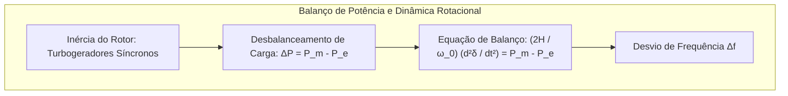

Acender um interruptor e ter luz instantânea é um dos maiores confortos da civilização moderna. Contudo, do ponto de vista físico e termodinâmico, esse ato corriqueiro apoia-se na <strong>maior máquina síncrona em tempo real construída pela humanidade: a rede elétrica interligada de corrente alternada</strong>.

Ao contrário de outros sistemas de infraestrutura (como redes de água ou gás que contam com grandes reservatórios pressurizados), <strong>a rede elétrica não possui capacidade de armazenamento intrínseco em sua malha de transmissão</strong>. A energia elétrica viaja a velocidades próximas à da luz (cerca de 200.000 a 270.000 km/s nos condutores) e precisa ser consumida exatamente no mesmo instante em que é produzida.

---

### 1. A Lei do Balanço Dinâmico Simultâneo

A cada microssegundo, a potência gerada $P_{gen}(t)$ deve igualar a soma da potência consumida $P_{load}(t)$ e das perdas por efeito Joule na transmissão $P_{loss}(t)$:

$$P_{gen}(t) = P_{load}(t) + P_{loss}(t)$$

Se o consumo excede a geração, o déficit de energia é imediatamente extraído da energia cinética rotacional de todos os rotores das turbinas síncronas conectadas ao sistema, provocando a desaceleração das máquinas e a queda da frequência de operação (50 Hz ou 60 Hz). Se a geração for superior à demanda, os rotores aceleram, elevando a frequência.

---

### 2. A Física da Frequência: Inércia Rotacional e Equação de Oscilação (Swing Equation)

O comportamento dinâmico de cada gerador síncrono é governado pela célebre <strong>Equação de Oscilação (Swing Equation)</strong>:

$$\frac{2H}{\omega_s} \frac{d^2\delta}{dt^2} = P_m - P_e - D \Delta \omega$$

Onde:
- $H$ é a constante de inércia do gerador (normalmente entre 3 e 6 segundos), representando a energia cinética normalizada armazenada na massa girante.
- $\delta$ é o ângulo de carga do rotor elétrico.
- $P_m$ é a potência mecânica aplicada pela turbina (hidráulica, térmica ou nuclear).
- $P_e$ é a potência elétrica eletromagnética extraída pela rede.
- $D$ é o fator de amortecimento de amortecedores de enrolamento.

Quando ocorre a perda intempestiva de uma grande usina geradora, a taxa inicial de variação da frequência (<strong>RoCoF</strong> - <em>Rate of Change of Frequency</em>) depende criticamente da inércia total equivalente do sistema:

$$\left. \frac{df}{dt} \right|_{t=0^+} = - \frac{f_0 \cdot \Delta P_{perda}}{2 \sum H_i \cdot S_{n,i}}$$

Uma inércia física elevada atenua a descida abrupta da frequência, concedendo segundos vitais para a atuação dos sistemas de controle primário (reguladores de velocidade das turbinas) e evitando o desarme catastrófico em cascata.

---

### 3. A Hierarquia de Controle da Frequência

A restauração da estabilidade da rede ocorre em múltiplas escalas de tempo:

| Nível de Controle | Faixa Temporal | Mecanismo Físico / Tecnológico | Função Principal |
| :--- | :--- | :--- | :--- |
| <strong>Resposta Inercial</strong> | 0 a 2 segundos | Liberação natural de energia cinética rotacional | Limitar a taxa de variação da frequência (RoCoF) |
| <strong>Controle Primário</strong> | 2 a 30 segundos | Reguladores de turbinas (Governor Droop) | Interromper a queda e estabilizar a frequência no nadir |
| <strong>Controle Secundário (AGC)</strong> | 30 s a 15 minutos | Despacho automático de geração centralizado | Restaurar a frequência ao valor nominal (50/60 Hz) e zerar desvios |
| <strong>Controle Terciário</strong> | 15 minutos a horas | Redespacho econômico e reservas operacionais girantes | Recompor as reservas energéticas primárias e secundárias |

---

### 4. Transmissão em Alta Tensão: CA versus CC (HVDC)

Para transmitir dezenas de gigawatts por milhares de quilômetros (como na Usina de Itaipu ou Belo Monte), elevar a tensão é uma exigência termodinâmica decorrente da Lei de Joule:

$$P_{loss} = I^2 R = \left( \frac{P}{V \sqrt{3} \cos\phi} \right)^2 R$$

Ao decuplicar a tensão de operação, a corrente elétrica cai por um fator de dez, reduzindo as perdas dissipativas térmicas em cem vezes ($100 \times$).

No entanto, linhas de Corrente Alternada (CA) muito longas sofrem perdas por reatância indutiva e capacitância distribuída (efeito Ferranti). Nesses cenários transcontinentais ou submarinos, a tecnologia de <strong>Alta Tensão em Corrente Contínua (HVDC)</strong> com conversores VSC (<em>Voltage Source Converters</em>) baseados em transistores IGBT torna-se insubstituível, eliminando a reatância da linha e permitindo interligar assincronamente redes elétricas distintas sem propagação de oscilações de fase.

---

### 5. A Anatomia dos Apagões em Cascata e a Restauração (Black Start)

Um grande apagão (<strong>blackout</strong>) raramente decorre de uma única falha isolada, mas sim de uma falha em cascata desencadeada por eventos não lineares:
1. Uma linha de alta tensão desarma devido a contato térmico por flecha de condutores com vegetação ou curto-circuito atmosférico.
2. A potência excedente redistribui-se instantaneamente para linhas paralelas pelas Leis de Kirchhoff.
3. As linhas adjacentes sofrem sobrecarga térmica e desarme por relés de impedância de zona de distância.
4. Perda massiva de sincronismo angular, instabilidade de tensão e colapso geral da rede.

A recuperação total exige o procedimento de <strong>Black Start</strong>: usinas hidrelétricas ou térmicas com geradores a diesel autônomos restauram pequenas ilhas elétricas, alimentando progressivamente as subestações e sincronizando as fases até a total reconstituição do sistema integrado.
