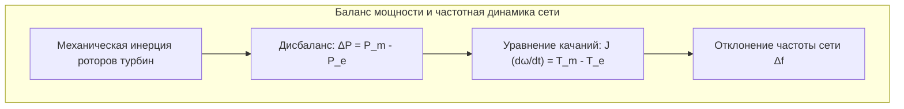

Когда мы щелкаем выключателем, загорается свет. В современном мире постоянное наличие напряжения и стабильной частоты в розетке воспринимается как само собой разумеющееся явление, подобно воздуху.

Однако с точки зрения фундаментальной физики и системной инженерии это чудо обеспечивается <strong>самой гигантской непрерывно функционирующей синхронной машиной в истории человечества — Единой энергетической системой</strong>.

Главная физическая особенность континентальной энергосети заключается в том, что <strong>в линиях электропередачи невозможно накапливать электроэнергию впрок</strong>. Электромагнитная волна распространяется со скоростью, близкой к скорости света (от 200 000 до 270 000 км/с). Энергия должна производиться ровно в то же мгновение, когда она потребляется.

---

### 1. Закон мгновенного баланса мощности

В любой микросекундный момент времени $t$ суммарная вырабатываемая генераторами мощность $P_{gen}(t)$ обязана строго равняться сумме потребления нагрузок $P_{load}(t)$ и омических потерь в сетях $P_{loss}(t)$:

$$P_{gen}(t) = P_{load}(t) + P_{loss}(t)$$

Если миллионы потребителей включают энергоемкие приборы, а генерация не увеличена, недостающая энергия мгновенно изымается из кинетической энергии вращения многотонных роторов всех синхронных генераторов. Роторы синхронно замедляются, и частота тока (50.00 Гц) падает. Наоборот, при избытке генерации роторы ускоряются, и частота растет.

---

### 2. Физика частоты: Уравнение качаний (Swing Equation) и инерция

Динамика синхронного генератора в энергосистеме описывается дифференциальным <strong>уравнением качаний (Swing Equation)</strong>:

$$\frac{2H}{\omega_s} \frac{d^2\delta}{dt^2} = P_m - P_e - D \Delta \omega$$

Где:
- $H$ — постоянная инерции агрегата (обычно от 3 до 6 секунд), выражающая запас кинетической энергии вращения, отнесенный к номинальной мощности.
- $\delta$ — угол нагрузки ротора генератора относительно вращающегося магнитного поля статора.
- $P_m$ — механическая мощность, подводимая турбиной.
- $P_e$ — отдаваемая в сеть электромагнитная мощность.
- $D$ — коэффициент демпфирования.

При внезапном аварийном отключении крупного энергоблока начальная скорость изменения частоты (<strong>RoCoF</strong>) определяется суммарной инерцией системы:

$$\left. \frac{df}{dt} \right|_{t=0^+} = - \frac{f_0 \cdot \Delta P_{loss}}{2 \sum H_i \cdot S_{n,i}}$$

Механическая инерция вращающихся турбин служит критическим демпфером, препятствующим катастрофическому обвалу частоты в первые 1–2 секунды после аварии.

---

### 3. Трехуровневая структура регулирования частоты

Для поддержания стабильности 50.00 Гц функционирует строгая иерархия автоматического регулирования:

| Уровень регулирования | Временной масштаб | Технологический механизм | Целевая функция |
| :--- | :--- | :--- | :--- |
| <strong>Инерционный отклик</strong> | 0 — 2 секунды | Высвобождение кинетической энергии роторов | Ограничение крутизны падения частоты (RoCoF) |
| <strong>Первичное регулирование</strong> | 2 — 30 секунд | Регуляторы скорости турбин (статизм 4-5%) | Остановка падения частоты на безопасном уровне |
| <strong>Вторичное регулирование (АРЧМ)</strong> | 30 с — 15 минут | Автоматическое централизованное регулирование частоты и перетоков | Возврат частоты к номиналу 50.00 Гц |
| <strong>Третичное регулирование</strong> | 15 минут — часы | Диспетчерский перерасчет и запуск резервов | Восстановление первичных и вторичных резервов |

---

### 4. Передача сверхвысокого напряжения: Переменный ток и HVDC

Чтобы передавать гигаватты электроэнергии на тысячи километров без фатальных потерь, напряжение поднимают до сотен тысяч вольт (500 кВ, 750 кВ, 1150 кВ). Согласно закону Джоуля — Ленца:

$$P_{loss} = I^2 R = \left( \frac{P}{\sqrt{3} U \cos\phi} \right)^2 R$$

Увеличение напряжения в 10 раз снижает ток в 10 раз, а тепловые омические потери в проводах — в 100 раз.

Однако при экстремальных расстояниях или прокладке подводных кабелей переменный ток сталкивается с емкостными токами утечки и реактивным сопротивлением. Решением служат системы <strong>постоянного тока ультравысокого напряжения (UHVDC)</strong>. Преобразователи напряжения (VSC) на IGBT-транзисторах позволяют связывать несинхронизированные энергозоны и транслировать гигантские потоки мощности с минимальными потерями.

---

### 5. Механика каскадных блэкаутов и Black Start

Каскадный блэкаут начинается с тривиального инцидента: перегрузка одной ЛЭП вызывает ее провисание и замыкание на кроны деревьев. Срабатывает дистанционная релейная защита.
По законам Кирхгофа ток мгновенно перераспределяется по параллельным линиям, вызывая их цепную перегрузку. В энергосистеме возникает асинхронный ход, глубокая просадка напряжения и срабатывание автоматической частотной разгрузки (АЧР).

Для ликвидации системной аварии используется процедура <strong>Black Start (пуск с нуля)</strong>: гидроэлектростанции или газотурбинные агрегаты с локальными дизелями поднимают напряжение без внешнего питания, формируя локальные энергоострова, которые шаг за шагом синхронизируются в единую сеть.
