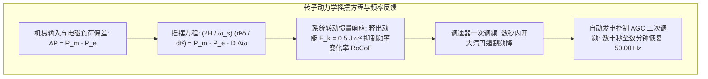

按下墙上的开关，灯光瞬间点亮；插上手机充电器，电能立即涌入电池。在现代文明中，电力在插座背后以恒定不变的电压与频率永不间断地供应，常被视作如空气与水一般的天然存在。

然而在物理学与系统工程视角下，这一日常奇迹依托于<strong>人类有史以来建造的规模最大、全域以光速协同的单一实时机器——互联交流电网</strong>。

电网面临着极其严苛的物理约束：<strong>电网本身几乎完全没有大规模储存电能的物理缓冲</strong>。当数以亿计的用户开启电磁炉或空调时，数千公里外的巨型发电机转子瞬间受到反向制动减速，整个大陆的控制系统必须在毫秒内同步增发同等能量。

---

### 1. 人类最大的实时机械：同时同量法则

电力系统的基石物理法则是<strong>「发用电实时动态平衡（同时同量）」</strong>。

电磁能量在超高压输电线中的传播速度高达光速的 70%~90%（每秒约 20 万至 27 万公里）。电能在导线中无法排队储存，在任何时刻 $t$，系统总发电量 $P_{gen}(t)$、总负荷需求 $P_{load}(t)$ 与线路焦耳热损耗 $P_{loss}(t)$ 必须在微秒级完全相等：

$$P_{gen}(t) = P_{load}(t) + P_{loss}(t)$$

一旦发电小于用电，不足的能量将无情地从所有旋转同步发电机的转子动能中被强行抽走，导致全网旋转变慢（频率下降）；反之，发电盈余将迫使转子加速（频率上升）。

---

### 2. 频率的物理学：转动惯量与摇摆方程（Swing Equation）

系统频率（50.00 Hz 或 60.00 Hz）是整个电网的心跳指标。电网内所有同步发电机的转子动力学均服从<strong>摇摆方程（Swing Equation）</strong>：

$$\frac{2H}{\omega_s} \frac{d^2\delta}{dt^2} = P_m - P_e - D \Delta \omega$$

式中各物理量定义如下：
- $H$：发电机惯性常数（Inertia Constant，通常在 3 到 6 秒之间），定义为额定转速下转子总储能与机组额定容量之比。
- $\delta$：转子内电势与电网母线旋转磁场之间的电角（功角）。
- $P_m$：汽轮机或水轮机输入的机械功率。
- $P_e$：定子绕组输出的电磁有功功率。
- $D$：系统阻尼系数。

当特大主力电厂因故障意外切除时，初始频率变化率（RoCoF）完全由全网同步惯量决定：

$$\left. \frac{df}{dt} \right|_{t=0^+} = - \frac{f_0 \cdot \Delta P_{loss}}{2 \sum H_i \cdot S_{n,i}}$$

正是重达数十吨的高速转子蕴含的巨大机械转动动能，成为电网在突发扰动初期的“物理弹簧”，阻遏了频率断崖式下跌，为自动化控制装置争取到极为宝贵的处置窗口。

---

### 3. 三级频率控制架构

现代电网构建了严密的四级时间尺度防御纵深：

| 控制层级 | 响应时间 | 物理/控制机制 | 核心使命 |
| :--- | :--- | :--- | :--- |
| <strong>惯量响应</strong> | 0 ~ 2 秒 | 同步机转子释放固有转动动能 | 限制频率变化率（RoCoF），防止低频跳闸 |
| <strong>一次调频</strong> | 2 ~ 30 秒 | 汽轮机调速器下垂特性（Droop 4%~5%） | 抑制频率下跌并稳定于最低点（Nadir） |
| <strong>二次调频 (AGC)</strong> | 30 秒 ~ 15 分钟 | 调度中心计算机算法自动增减机组出力 | 消除静态残差，将频率精准拉回 50.00 Hz |
| <strong>三次调频</strong> | 15 分钟 ~ 数小时 | 调度员重新优化机组启停与备用重置 | 释放一次与二次调节容量，维持长期安全裕度 |

---

### 4. 电压与无功功率：P-Q 解耦原理

交流电力系统的另一核心支柱是电压与无功功率的平衡。在传统电网中，有效功率与无功功率展现出高度解耦特性：
- <strong>有功功率与功角耦合（$P-\delta$）</strong>：主导能量长途传送；
- <strong>无功功率与电压幅值耦合（$Q-V$）</strong>：维系变压器与电机磁场建立。

在高压架空线路中，轻载时线路对地电容产生的无功功率大于线路电感消耗，会导致受电端电压异常升高，即著名的<strong>费兰梯效应（Ferranti Effect）</strong>，必须并入并联电抗器进行吸收。若无功严重不足，电网运行点逼近 $P-V$ 曲线的拐点（鼻点），将触发灾难性的<strong>电压崩溃（Voltage Collapse）</strong>。

---

### 5. 输电电压的物理跃迁：超高压、特高压与直流输电（HVDC）

为将成千上万兆瓦的电能跨越数千公里输送，提升电压是不可抗拒的热力学规律。根据焦耳定律：

$$P_{loss} = I^2 R = \left( \frac{P}{\sqrt{3} U \cos\phi} \right)^2 R$$

将输电电压提升 10 倍，线路上流经的电流便降为十分之一，导线焦耳发热损耗惊人地暴跌至原来的百分之一（降低 99%）。

特高压直流输电（$\pm 800\,\mathrm{kV}, \pm 1100\,\mathrm{kV}$）采用晶闸管或基于 IGBT 的柔性直流换流器（VSC），彻底免除了长距离交流电缆的容性充电电流困扰，支持各大区域电网之间的非同步互联，阻断了交流故障的跨区连锁蔓延。

---

### 6. 级联停电的动力学与黑启动（Black Start）

大停电的发生往往源于非线性级联反应：
1. 某条重载输电线路因导线发热弧垂下垂触碰树木短路，距离保护继电器在 20ms 内跳闸切除该线。
2. 潮流依据基尔霍夫定律瞬间向周边并联线路转移，导致相邻线路因严重热过载相继跳闸。
3. 局部电网发用电平衡被撕裂，发电机组功角失步飞车，低频减载装置动作，最终诱发全网崩溃。

大停电后的复原是一项极其精密系统的工程——<strong>黑启动（Black Start）</strong>。调度员首先利用具备自启动能力的水电站或应急柴油机启动火电厂辅机，逐步给高压线路充能，严密监视变压器励磁涌流与过电压，建立互不相连的电气小孤岛，最终在微秒级同相位条件下完成全网合闸，使文明重新焕发生机。

---

### 7. 可再生能源时代的新挑战：低惯量电网与虚拟同步机技术

随着风力发电和光伏发电在现代能源结构中占比的大幅攀升，电力系统迎来了一场前所未有的范式变革。

传统的风电机组和光伏电池板是通过<strong>电力电子逆变器（Inverters）</strong>接入电网的。这种接口在电气上将发电单元的机械旋转与电网频率彻底解耦，导致并网逆变器无法像传统的重型汽轮发电机那样天然提供巨大的转动惯量。当高比例新能源并网时，电网的等效总惯量急剧萎缩，使得系统应对负荷突变的抵御能力显著恶化，频率变化率（RoCoF）飙升，极易触发保护装置的误动作。

为化解这一重大系统安全挑战，现代电气工程界开发了<strong>构网型换流器（Grid-Forming Inverter, GFM）</strong>与<strong>虚拟同步机技术（Virtual Synchronous Generator, VSG）</strong>：
- <strong>算法模拟转子动力学</strong>：在逆变器数字信号处理器（DSP）中通过微积分算法实时求解摇摆方程，使逆变器展现出类似于物理转子的虚拟转动惯量（Virtual Inertia）和虚拟阻尼特性；
- <strong>储能协同毫秒级放电</strong>：结合超高速电池储能系统（BESS）与飞轮储能装置，在电网频率跌落的微秒至毫秒瞬间，直接向电网注入突增功率，人工填补“物理惯性空缺”；
- <strong>主动构建内部电压源</strong>：突破传统跟随电网相位（Grid-Following）的锁相环（PLL）架构，构网型设备直接自主建立并维持三相交流电压波形，从而具备在孤岛电网或极端弱电网环境下稳定运行的独立能力。

这一技术革命确保了即使在未来全绿电渗透率极高的极端场景下，人类赖以生存的巨型电网依然能够维持坚如磐石的动态稳定。
