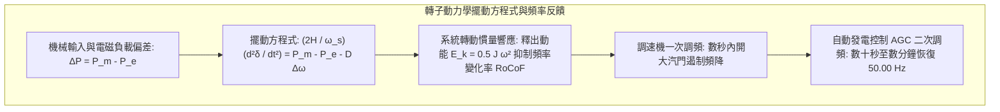

按下牆上的開關，燈光瞬間點亮；插上手機充電器，電能立即湧入電池。在現代文明中，電力在插座背後以恆定不變的電壓與頻率永不停頓地供應，常被視為如空氣與水一般的天然存在。

然而在物理學與系統工程視角下，這一日常奇蹟依托於<strong>人類有史以來建造的規模最大、全域以光速協同的單一即時機器——互聯交流電網</strong>。

電網面臨著極其嚴苛的物理約束：<strong>電網本身幾乎完全沒有大規模儲存電能的物理緩衝</strong>。當數以億計的用戶開啟電磁爐或冷氣時，數千公里外的巨型發電機轉子瞬間受到反向制動減速，整個大陸的控制系統必須在毫秒內同步增發同等能量。

---

### 1. 人類最大的即時機械：同時同量法則

電力系統的基石物理法則為<strong>「發用電即時動態平衡（同時同量）」</strong>。

電磁能量在超高壓輸電線中的傳播速度高達光速的 70%~90%（每秒約 20 萬至 27 萬公里）。電能在導線中無法排隊儲存，在任何時刻 $t$，系統總發電量 $P_{gen}(t)$、總負載需求 $P_{load}(t)$ 與線路焦耳熱損耗 $P_{loss}(t)$ 必須在微秒級完全相等：

$$P_{gen}(t) = P_{load}(t) + P_{loss}(t)$$

一旦發電小於用電，不足的能量將無情地從所有旋轉同步發電機的轉子動能中被強行抽走，導致全網旋轉變慢（頻率下降）；反之，發電盈餘將迫使轉子加速（頻率上升）。

---

### 2. 頻率的物理學：轉動慣量與擺動方程式（Swing Equation）

系統頻率（50.00 Hz 或 60.00 Hz）是整個電網的心跳指標。同步發電機的轉子運動受<strong>擺動方程式（Swing Equation）</strong>支配：

$$\frac{2H}{\omega_s} \frac{d^2\delta}{dt^2} = P_m - P_e - D \Delta \omega$$

式中各物理量定義如下：
- $H$：發電機慣性常數（Inertia Constant，通常在 3 到 6 秒之間），定義為額定轉速下轉子總儲能與機組額定容量之比。
- $\delta$：轉子內電勢與電網母線旋轉磁場之間的電角（功角）。
- $P_m$：汽輪機或水輪機輸入的機械功率。
- $P_e$：定子繞組輸出的電磁有效功率。
- $D$：系統阻尼係數。

當大型機組突然跳脫時，巨大的功率缺口首先由全網成千上萬台重達數十噸的高速旋轉轉子透過<strong>轉動慣量（System Inertia）</strong>自然釋出動能填補，強效阻滯頻率下跌速率（RoCoF）：

$$\left. \frac{df}{dt} \right|_{t=0^+} = - \frac{f_0 \cdot \Delta P_{loss}}{2 \sum H_i \cdot S_{n,i}}$$

這份固有的物理慣性為後續調速機一次調頻與 AGC 二次調頻爭取了關鍵的黃金應變時間。

---

### 3. 三級頻率控制架構

現代電網構建了嚴密的四級時間尺度防禦縱深：

| 控制層級 | 響應時間 | 物理/控制機制 | 核心使命 |
| :--- | :--- | :--- | :--- |
| <strong>慣量響應</strong> | 0 ~ 2 秒 | 同步機轉子釋放固有轉動動能 | 限制頻率變化率（RoCoF），防止低頻跳脫 |
| <strong>一次調頻</strong> | 2 ~ 30 秒 | 汽輪機調速機下垂特性（Droop 4%~5%） | 抑制頻率下跌並穩定於最低點（Nadir） |
| <strong>二次調頻 (AGC)</strong> | 30 秒 ~ 15 分鐘 | 調度中心電腦演算法自動增減機組出力 | 消除靜態殘差，將頻率精準拉回 50.00 Hz |
| <strong>三次調頻</strong> | 15 分鐘 ~ 數小時 | 調度員重新最佳化機組啟停與備轉容量重置 | 釋放一次與二次調節容量，維持長期安全裕度 |

---

### 4. 電壓與無功功率：P-Q 解耦原理

交流電力系統的另一核心支柱是電壓與無功功率的平衡。在傳統電網中，有效功率與無功功率展現出高度解耦特性：
- <strong>有效功率與功角耦合（$P-\delta$）</strong>：主導能量長途傳送；
- <strong>無功功率與電壓幅值耦合（$Q-V$）</strong>：維繫變壓器與馬達磁場建立。

在高壓架空線路中，輕載時線路對地電容產生的無功功率大於線路電感消耗，會導致受電端電壓異常升高，即著名的<strong>費蘭梯效應（Ferranti Effect）</strong>，必須投入並聯電抗器進行吸收。若無功嚴重不足，電網運行點逼近 $P-V$ 曲線的拐點（鼻點），將觸發災難性的<strong>電壓崩潰（Voltage Collapse）</strong>。

---

### 5. 輸電電壓的物理躍遷：超高壓與高壓直流輸電（HVDC）

為將成千上萬兆瓦的電能跨越數千公里輸送，提升電壓是不可抗拒的熱力學規律。根據焦耳定律：

$$P_{loss} = I^2 R = \left( \frac{P}{\sqrt{3} U \cos\phi} \right)^2 R$$

將輸電電壓提升 10 倍，線路上流經的電流便降為十分之一，導線焦耳發熱損耗驚人地暴跌至原來的百分之一（降低 99%）。

海底電纜和長距離地下電纜具有龐大的對地電容。在工頻交流下，持續充電電流會在數十公里內佔滿電纜載流容量。<strong>高壓直流輸電（HVDC）</strong>徹底消除了容性充電電流與感抗壓降，成為長距離跨海輸電與非同步電網互聯的唯一解決方案。

---

### 6. 級聯大停電與黑啟動（Black Start）

大停電的發生往往源於非線性連鎖跳脫反應：
1. 某條重載線路因熱膨脹下垂碰觸樹木短路，保護電驛在 20ms 內跳脫。
2. 潮流依基爾霍夫定律轉移至相鄰線路，引發連鎖熱過載跳脫。
3. 系統發生功角失步與電壓崩潰，低頻卸載動作失敗導致全島瓦解。

大停電後的復原是一項極為嚴密的系統工程——<strong>黑啟動（Black Start）</strong>。調度員利用具備自啟動能力的水力發電或柴油發電機作為種子電源，逐步建立孤島電網，小心抑制變壓器突入電流與線路過電壓，最終將各大孤島同步併聯，使文明重新恢復光明。

---

### 7. 再生能源時代的全新考驗：低轉動慣量電網與虛擬同步機（VSG）

隨著離岸風電與太陽能光電的大規模普及，全球電網正面臨百年未見的結構性轉變。

太陽能板與風力發電機主要透過<strong>電力電子變流器（Inverters）</strong>與交流電網銜接。這種無旋轉質量的電力介面使發電系統無法提供物理性轉動慣量，導致電網的等效系統慣性大幅降低。一旦發生大型發電機組跳脫，頻率變動率（RoCoF）急劇攀升，極易觸發全島性低頻卸載甚至引發大停電。

為因應這項系統級難題，先進工程界廣泛發展<strong>構網型換流器（Grid-Forming Inverter, GFM）</strong>與<strong>虛擬同步機技術（Virtual Synchronous Generator, VSG）</strong>：
- <strong>微處理器模擬轉子運動</strong>：透過演算法在變流器控制器中即時運算擺動方程式，賦予電力電子設備宛如實體重型轉子般的虛擬慣性與阻尼效果；
- <strong>超高速電池儲能響應</strong>：搭配毫秒級快速放電的電池儲能系統（BESS），在頻率驟降的微秒瞬間瞬間注入強大功率，填補慣性空缺；
- <strong>自主構建電壓相位</strong>：擺脫傳統依賴電網鎖相環（PLL）的限制，主動在母線上建立穩定的三相電壓波形，在超高比例綠能與微電網環境中提供堅實的系統穩定度支撐。
