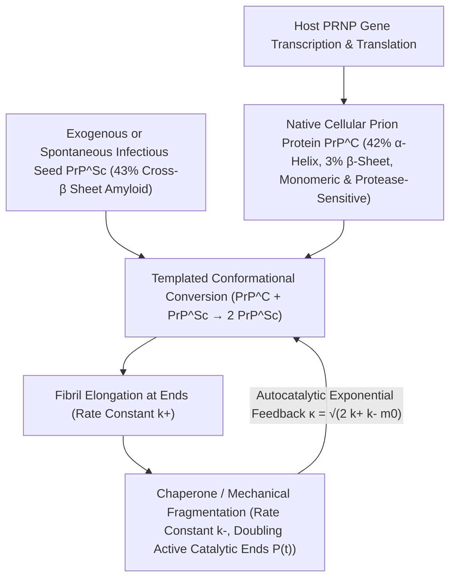

## 1. تحدي العقيدة المركزية: كيف اكتُشف عامل مُعدٍ يخلو تماماً من الأحماض النووية؟

في العصر الذهبي للبيولوجيا الجزيئية، أرست <strong>العقيدة المركزية (Central Dogma)</strong> التي صاغها فرانسيس كريك مبدأً صارماً مفاده أن جميع المعلومات الوراثية وقدرات التضاعف الذاتي البيولوجي تعتمد حتماً على الأحماض النووية (DNA أو RNA). فالبكتيريا والفيروسات وأشباه الفيروسات تفقد قدرتها المعدية بالكامل عند تدمير جينومها بالأشعة فوق البنفسجية قصيرة الموجة ($254\,\text{nm}$) أو الإشعاع المؤين أو إنزيمات النوكلياز. غير أن العامل المسبب لمجموعة <strong>اعتلالات الدماغ الإسفنجية المعدية (TSE)</strong> — مثل مرض الراعوش (Scrapie) في الأغنام، ومرض كورو (Kuru)، ومرض كروتزفيلد-جاكوب (CJD) في البشر، وجنون البقر (BSE) — كسر هذه القاعدة تماماً.

في عام 1967، أثبتت عالمة الأحياء الإشعاعية تيكفا ألبر أن عامل الراعوش يظل معدياً حتى بعد تعريضه لجرعات هائلة من الأشعة فوق البنفسجية والمؤينة الكفيلة بتدمير أي جينوم فيروسي، مما دفع عالم الرياضيات ج. س. غريفيث إلى اقتراح أول نماذج رياضية لتضاعف ذاتي يعتمد على البروتين وحده. وفي عام 1982، نجح ستانلي بروسينر (الحائز على جائزة نوبل عام 1997) في تنقية العامل المعدي وإثبات أنه يتكون حصرياً من بروتين مضيف واحد خالٍ تماماً من أي حمض نووي، وصاغ مصطلح <strong>البريون (Prion — الجسيم البروتيني المعدي)</strong>. والأكثر إدهاشاً أن الجين <em>PRNP</em> المشفر لهذا البروتين موجود طبيعياً في كروموسومات جميع الثدييات السليمة! فبروتين البريون الخلوي الطبيعي ($\text{PrP}^\text{C}$) والشكل المرضي المعدي ($\text{PrP}^{\text{Sc}}$) يمتلكان <strong>نفس التسلسل المكون من 208 أحماض أمينية ونفس الروابط التساهمية بنسبة $100\%$</strong>، ويكمن الفرق الوحيد بينهما في هندسة الطي ثلاثي الأبعاد:

$$
\Delta G_{\text{fold}} = \Delta H_{\text{fold}} - T \Delta S_{\text{conf}} + \Delta G_{\text{solv}}, \qquad k_{\text{conv}} = A \exp\!\left(-\frac{\Delta G^\ddagger_{\text{C}\to\text{Sc}}}{k_B T}\right)
$$

---

## 2. مشهد الطاقة الحرة والتحويل بالقالب: من حلزونات $\alpha$ إلى ألياف الأميلويد المتصالبة $\beta$

وفقاً لفرضية كريستيان أنفينسن الديناميكية الحرارية، ينطوي البروتين الكروي تلقائياً نحو النهاية الصغرى الشاملة لطاقة غيبس الحرة $G$. غير أنه في فضاء التشكيل عالي الأبعاد، غالباً ما يحتوي مشهد الطاقة الحرة على عدة نهايات صغرى محلية تفصل بينها حواجز طاقة تنشيط حركية عالية $\Delta G^\ddagger$. يتكون البروتين الطبيعي $\text{PrP}^\text{C}$ من نحو $42\%$ من حلزونات $\alpha$ و$3\%$ فقط من صفائح $\beta$، وهو أحادي الجزيء وقابل للذوبان في الماء ويتحلل بسهولة بإنزيم البروتيناز K. في المقابل، يحتوي الشكل المرضي $\text{PrP}^{\text{Sc}}$ على $43\%$ من <strong>صفائح $\beta$ المتصالبة الصلبة (Cross-$\beta$ Sheets)</strong> التي تتراص في <strong>لييفات أميلويد (Amyloid Fibrils)</strong> غير قابلة للذوبان ومقاومة للبروتيناز K.

بالنسبة لجزيء $\text{PrP}^\text{C}$ منفرد، فإن عبوره التلقائي لحاجز التنشيط $\Delta G^\ddagger_{\text{C}\to\text{Sc}}$ نادر للغاية (إذ لا يتجاوز معدل الإصابة بمرض كروتزفيلد-جاكوب الفردي حالة واحدة لكل مليون شخص سنوياً). ولكن بمجرد دخول بذرة بلورية (Seed) من $\text{PrP}^{\text{Sc}}$، يعمل طرفها المتصالب $\beta$ المكشوف بمثابة <strong>قالب كيميائي فراغي (Structural Template)</strong> يلتقط جزيء $\text{PrP}^\text{C}$ الطبيعي ويخفض حاجز التنشيط بشدة عبر شبكة كثيفة من الروابط الهيدروجينية ليحوله إلى وحدة $\text{PrP}^{\text{Sc}}$ جديدة. إذن لا يصنع البريون بروتينات من العدم، بل يختطف إمدادات $\text{PrP}^\text{C}$ التي تنتجها خلية المضيف باستمرار (وقد أثبت تشارلز فايسمان عام 1993 أن الفئران المعطلة الجين $Prnp^{0/0}$ محصنة تماماً ضد المرض حتى لو حُقنت بالبريونات مباشرة في الدماغ!).

---

## 3. لماذا يتكاثر البريون أُسّياً بدون جينات؟ حركية التنوي والاستطالة والتشظي الذاتية التحفيز

لو كانت لييفة الأميلويد تكتفي بإضافة المونومرات عند طرفيها فقط (بمعدل استطالة $k_+$)، لكانت الكتلة الكلية للتجمعات $M(t)$ تنمو خطياً وببطء مع الزمن، ولما أحدثت الانفجار الأُسّي المميز للعدوى بعد فترة الحضانة. غير أن <strong>المعادلة الرئيسية للبلمرة المنوّاة</strong> التي صاغها توماس نولز وميشيل فيندروسكولو كشفت أن المحرك الفيزيائي للتضخيم الأُسّي هو <strong>تشظي اللييفات وانكسارها (Fragmentation, $k_-$)</strong>:

$$
\left\{
\begin{aligned}
\frac{dP(t)}{dt} &= k_n m(t)^{n_c} + k_- \big[ M(t) - (2n_c - 1)P(t) \big] \approx k_- M(t) \\
\frac{dM(t)}{dt} &= 2 k_+ m(t) P(t) + n_c k_n m(t)^{n_c} \approx 2 k_+ m_0 P(t)
\end{aligned}
\right.
$$

---

## 4. لغز «السلالات» بلا حمض نووي، حاجز الأنواع، والانتشار «الشبيه بالبريون» في التنكس العصبي

عندما تنكسر لييفة أميلويد طويلة إلى قطعتين بفعل التقلبات الحرارية أو القص الميكانيكي لبروتينات الشابرون (مثل Hsp104) بمعدل $k_-$، فإن <strong>عدد الأطراف النشطة تحفيزياً $P(t)$ يتضاعف فوراً</strong>! ويؤدي الاقتران بين الاستطالة ($k_+$) والتشظي ($k_-$) إلى معادلة تفاضلية من الدرجة الثانية $\ddot{M}(t) = 2 k_+ k_- m_0 M(t)$ تقود <strong>نمواً أُسّياً صارماً $M(t) \sim e^{\kappa t}$</strong> بمعدل فعال $\kappa = \sqrt{2 k_+ k_- m_0}$. وعلى هذا المبدأ بالذات تقوم تقنيات التشخيص فائقة الحساسية <strong>PMCA</strong> و<strong>RT-QuIC</strong> التي تضخم أتوجراماً واحداً ($10^{-18}\,\text{g}$) من بذور البريون في السائل النخاعي مليارات المرات.

كما حسم المجهر الإلكتروني فائق التبريد (Cryo-EM) لغز <strong>سلالات البريون (Prion Strains)</strong>: إذ يمكن لنفس تسلسل الأحماض الأمينية أن يتبلور في عدة <strong>أشكال متعددة التشكيل (Conformational Polymorphs)</strong> تختلف في طوبولوجيا طي صفائح $\beta$، ولا يسمح كل قالب إلا بنمو الشكل الهندسي المطابق له. واليوم ثبت أن بروتينات $\text{A}\beta$ و$\text{Tau}$ في ألزهايمر، و$\alpha$-سينوكلين في باركنسون، وTDP-43 في التصلب الجانبي الضموري تتبع نفس <strong>آلية الانتشار الشبيه بالبريون (Prion-like propagation)</strong>، بينما تُظهر البريونات الوظيفية مثل $[\text{PSI}^+]$ في الخميرة وبروتين الذاكرة المشبكية CPEB كيف طوّعت الطبيعة هذا التحول الطوري الفيزيائي كذاكرة فوق جينية مفيدة.

| بُعد المقارنة | بروتين البريون الخلوي ($\text{PrP}^\text{C}$) | البريون المعدي ($\text{PrP}^{\text{Sc}}$) | الفيروس التقليدي (Virus) |
| :--- | :--- | :--- | :--- |
| <strong>الجينوم (DNA/RNA)</strong> | لا يوجد (يشفره جين المضيف <em>PRNP</em>) | <strong>خالٍ تماماً من DNA وRNA</strong> | يحتوي حتماً على جينوم DNA أو RNA |
| <strong>البنية الثانوية</strong> | $\approx 42\%$ حلزون $\alpha$، $\approx 3\%$ صفيحة $\beta$ | $\approx 30\%$ حلزون $\alpha$، <strong>$\approx 43\%$ صفيحة $\beta$ متصالبة</strong> | قفيصة بروتينية تغلف الحمض النووي |
| <strong>الخواص الكيميائية الحيوية</strong> | مونومر ذواب، حساس للبروتيناز K | أميلويد غير ذواب، <strong>مقاوم للبروتياز والحرارة والأشعة</strong> | يتعطل بالأشعة فوق البنفسجية والبروتياز |
| <strong>آلية التضاعف ونقل المعلومات</strong> | طي تلقائي بعد الترجمة الريبوسومية | <strong>تحويل بالقالب + استطالة/تشظٍ ذاتي التحفيز ($e^{\kappa t}$)</strong> | نسخ الحمض النووي وترجمة القفيصة |

$$
\frac{d^2 M(t)}{dt^2} - 2 k_+ k_- m_0 \, M(t) = 0 \implies M(t) \simeq C \cosh(\kappa t) \sim \exp(\kappa t), \qquad \kappa = \sqrt{2 \, k_+ \, k_- \, m_0}
$$

