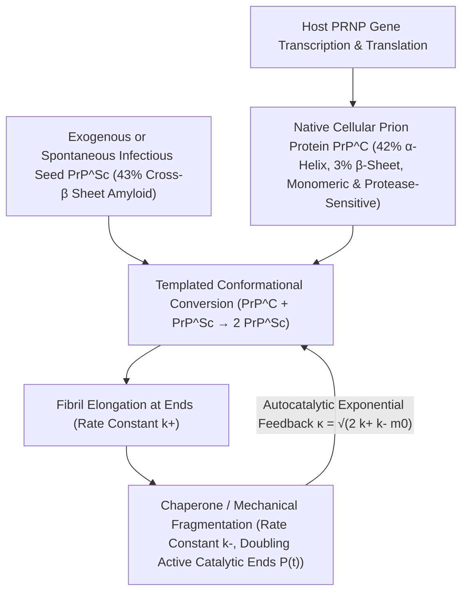

## 1. Häresie gegen das Zentrale Dogma: Wie ein nukleinsäurefreier Erreger entdeckt wurde

In der Blütezeit der Molekularbiologie formulierte Francis Crick das <strong>Zentrale Dogma</strong>, wonach jede biologische Vererbung und Selbstreplikation zwingend Nukleinsäuren (DNA oder RNA) als Informationsträger voraussetzt. Bakterien, Viren und Viroide verlieren ihre Infektiosität vollständig, wenn ihr Genom durch kurzwellige UV-Strahlung ($254\,\text{nm}$), ionisierende Strahlung oder Nukleasen zerstört wird. Doch der Erreger der <strong>transmissiblen spongiformen Enzephalopathien (TSE)</strong> – darunter Scrapie bei Schafen, Kuru in Papua-Neuguinea, die Creutzfeldt-Jakob-Krankheit (CJK) beim Menschen und BSE beim Rind – widersetzte sich diesem Grundgesetz.

1967 zeigte die Strahlenbiologin Tikvah Alper, dass der Scrapie-Erreger selbst extremen UV- und Ionisationsdosen standhält, die jedes virale Genom vernichten; kurz darauf entwarf der Mathematiker J. S. Griffith erste Modelle einer rein proteinbasierten Selbstreplikation. 1982 isolierte Stanley B. Prusiner (Nobelpreis 1997) das infektiöse Agens, wies nach, dass es ausschließlich aus einem einzigen Wirtsprotein ohne jede Nukleinsäure besteht, und prägte den Begriff <strong>Prion (Proteinaceous Infectious Particle)</strong>. Noch verblüffender war die Erkenntnis, dass das zugehörige Gen <em>PRNP</em> ein regulärer Bestandteil des Säugetiergenoms ist: Das harmlose zelluläre Prion-Protein ($\text{PrP}^\text{C}$) und die tödliche infektiöse Isoform ($\text{PrP}^{\text{Sc}}$) besitzen <strong>exakt dieselbe Aminosäuresequenz und identische kovalente Bindungen</strong> – sie unterscheiden sich einzig und allein in ihrer dreidimensionalen räumlichen Faltung:

$$
\Delta G_{\text{fold}} = \Delta H_{\text{fold}} - T \Delta S_{\text{conf}} + \Delta G_{\text{solv}}, \qquad k_{\text{conv}} = A \exp\!\left(-\frac{\Delta G^\ddagger_{\text{C}\to\text{Sc}}}{k_B T}\right)
$$

---

## 2. Thermodynamische Energielandschaft und Matrizen-Konversion: Von der $\alpha$-Helix zum Cross-$\beta$-Amyloid

Nach Christian Anfinsens thermodynamischer Hypothese faltet sich ein globuläres Protein spontan in das globale Minimum seiner freien Enthalpie $G$. Im hochdimensionalen Konformationsraum weist die freie Energielandschaft jedoch oft mehrere tiefe Minima auf, die durch hohe kinetische Aktivierungsbarrieren $\Delta G^\ddagger$ getrennt sind. Das native $\text{PrP}^\text{C}$ besteht zu rund $42\%$ aus $\alpha$-Helices und nur zu $3\%$ aus $\beta$-Faltblättern; es ist monomer, wasserlöslich und wird durch Proteinase K vollständig abgebaut. Im Gegensatz dazu weist $\text{PrP}^{\text{Sc}}$ rund $43\%$ starre <strong>Cross-$\beta$-Faltblätter (Cross-$\beta$ Sheets)</strong> auf, die sich zu unlöslichen, extrem proteaseresistenten <strong>Amyloidfibrillen</strong> stapeln.

Für ein isoliertes $\text{PrP}^\text{C}$-Molekül ist die spontane Überwindung der Barriere $\Delta G^\ddagger_{\text{C}\to\text{Sc}}$ extrem unwahrscheinlich (sporadische CJK tritt nur bei ca. $1$ pro $10^6$ Menschen pro Jahr auf). Trifft jedoch ein vorhandener $\text{PrP}^{\text{Sc}}$-Keim (Seed) auf natives $\text{PrP}^\text{C}$, wirkt seine exponierte Cross-$\beta$-Grenzfläche als <strong>stereochemische Strukturmatrize (Template)</strong>: Durch dichte Wasserstoffbrücken-Netzwerke und hydrophobe Wechselwirkungen senkt der Keim die Aktivierungsbarriere drastisch ab und zwingt das gebundene $\text{PrP}^\text{C}$ in die pathogene $\text{PrP}^{\text{Sc}}$-Konformation. Prionen erzeugen Proteine also nicht *de novo*, sondern kapern den Nachschub an wirtseigenem $\text{PrP}^\text{C}$ (Charles Weissmann bewies 1993, dass <em>Prnp</em>-Knockout-Mäuse $Prnp^{0/0}$ selbst bei direkter intrazerebraler Prioneninjektion vollkommen immun sind!).

---

## 3. Warum wachsen Prionen exponentiell ohne Gene? Die Nukleations-Elongations-Fragmentierungs-Kinetik

Würde eine Amyloidfibrille lediglich an ihren beiden Enden Monomere anlagern (Elongationsrate $k_+$), nähme die Aggregatmasse $M(t)$ nur linear mit der Zeit zu – niemals könnte der für Infektionen typische exponentielle Ausbruch entstehen. Die von Tuomas Knowles und Michele Vendruscolo formulierte <strong>Mastergleichung der nukleierten Polymerisation</strong> zeigt, dass der Schlüssel zur exponentiellen Selbstverstärkung in der <strong>Fibrillenfragmentierung ($k_-$)</strong> liegt:

$$
\left\{
\begin{aligned}
\frac{dP(t)}{dt} &= k_n m(t)^{n_c} + k_- \big[ M(t) - (2n_c - 1)P(t) \big] \approx k_- M(t) \\
\frac{dM(t)}{dt} &= 2 k_+ m(t) P(t) + n_c k_n m(t)^{n_c} \approx 2 k_+ m_0 P(t)
\end{aligned}
\right.
$$

---

## 4. Prionenstämme ohne DNA, Speziesbarrieren und „Prion-like“-Ausbreitung bei Neurodegeneration

Wenn eine lange Fibrille durch thermische Fluktuationen oder molekulare Chaperone (wie Hsp104) mit der Rate $k_-$ entzweibricht, <strong>verdoppelt sich die Anzahl der katalytisch aktiven Fibrillenenden $P(t)$</strong>! Da die Elongation ($k_+$) Masse aufbaut und die Fragmentierung ($k_-$) diese Masse in neue katalytische Enden verwandelt, entsteht die gekoppelte Differentialgleichung $\ddot{M}(t) = 2 k_+ k_- m_0 M(t)$, welche ein <strong>exaktes exponentielles Wachstum $M(t) \sim e^{\kappa t}$</strong> mit der Wachstumsrate $\kappa = \sqrt{2 k_+ k_- m_0}$ antreibt. Auf genau diesem Prinzip beruhen die hochsensitiven Diagnoseverfahren <strong>PMCA</strong> und <strong>RT-QuIC</strong>, die einzelne Attogramm ($10^{-18}\,\text{g}$) an Prionen im Liquor durch zyklischen Ultraschall- bzw. Schüttelbruch milliardenfach amplifizieren.

Auch das Rätsel der <strong>Prionenstämme (Strains)</strong> – wie identische Aminosäuresequenzen unterschiedliche Inkubationszeiten und Läsionsmuster hervorrufen können – wurde durch Cryo-EM-Strukturanalysen gelöst: Dieselbe Polypeptidkette kann in verschiedene <strong>konformationelle Polymorphe</strong> (unterschiedliche $\beta$-Faltblatt-Topologien und Seitenketten-Steric-Zippers) kristallisieren, von denen jeder an seinen Enden ausschließlich die eigene Geometrie epitaktisch fortsetzt. Heute wissen wir, dass auch $\text{A}\beta$ und $\text{Tau}$ bei Alzheimer, $\alpha$-Synuclein bei Parkinson sowie TDP-43 bei ALS exakt derselben <strong>„Prion-like“-Ausbreitung</strong> im Gehirn folgen, während funktionelle Prionen wie $[\text{PSI}^+]$ in Hefen und CPEB in Synapsen als epigenetische Gedächtnisspeicher dienen.

| Vergleichsmerkmal | Natives Prion-Protein ($\text{PrP}^\text{C}$) | Infektiöses Prion ($\text{PrP}^{\text{Sc}}$) | Klassisches Virus (Virus) |
| :--- | :--- | :--- | :--- |
| <strong>Nukleinsäure-Genom</strong> | Keines (codiert durch Wirtsgen <em>PRNP</em>) | <strong>Vollkommen frei von DNA/RNA</strong> | Besitzt zwingend DNA- oder RNA-Genom |
| <strong>Sekundärstruktur</strong> | $\approx 42\%$ $\alpha$-Helix, $\approx 3\%$ $\beta$-Faltblatt | $\approx 30\%$ $\alpha$-Helix, <strong>$\approx 43\%$ Cross-$\beta$-Faltblatt</strong> | Kapsidproteine umhüllen Nukleinsäure |
| <strong>Biochemische Eigenschaften</strong> | Löslich, monomer, Proteinase-K-sensitiv | Unlösliches Amyloid, <strong>resistent gegen Proteasen, Hitze & UV</strong> | Empfindlich gegen UV, Strahlung & Proteasen |
| <strong>Replikationsmechanismus</strong> | Spontane ribosomale Faltung ins Energieminimum | <strong>Matrizen-Konversion + Elongation/Fragmentierung ($e^{\kappa t}$)</strong> | Nukleinsäurereplikation & Kapsidsynthese |

$$
\frac{d^2 M(t)}{dt^2} - 2 k_+ k_- m_0 \, M(t) = 0 \implies M(t) \simeq C \cosh(\kappa t) \sim \exp(\kappa t), \qquad \kappa = \sqrt{2 \, k_+ \, k_- \, m_0}
$$

