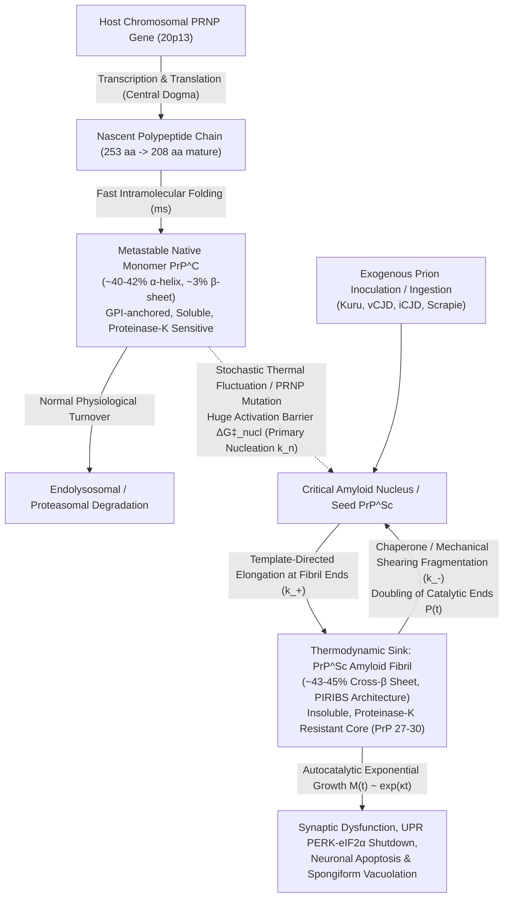
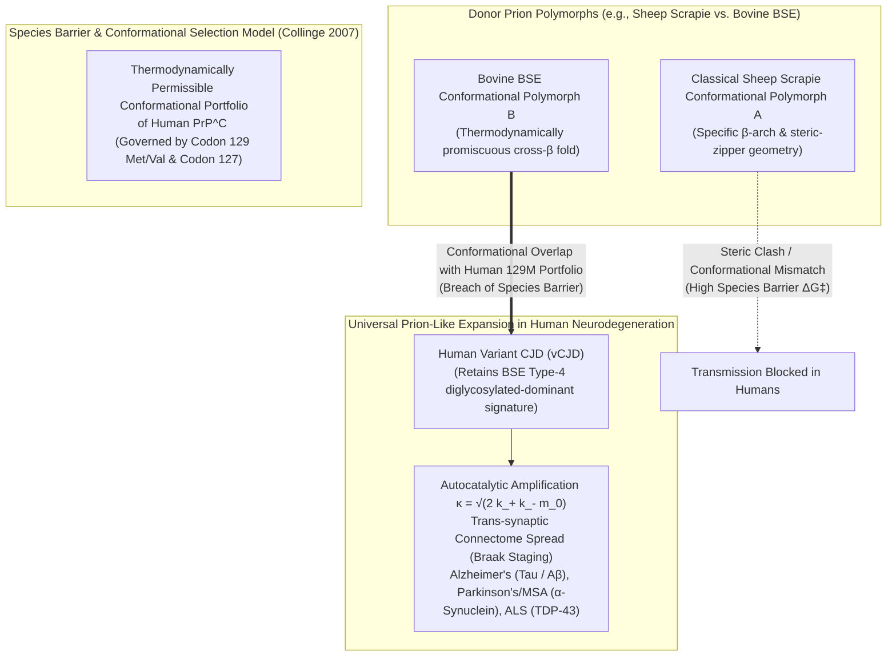

## 1. Introduction: The Ultimate Heresy of Biology — "Infection" Without Genetic Information

Ever since Robert Koch and Louis Pasteur established the Germ Theory of Disease in the late 19th century—and Oswald Avery, Alfred Hershey, Martha Chase, James Watson, and Francis Crick unveiled the chemical identity and double-helical structure of nucleic acids ($\text{DNA}$ and $\text{RNA}$) in the mid-20th century—modern biology rested upon an unassailable axiom: <strong>every self-replicating infectious pathogen capable of transmitting heritable strain characteristics across generations and hosts must possess a nucleic acid genome ($\text{DNA}$ or $\text{RNA}$) as its informational blueprint.</strong>

From cellular organisms such as bacteria, fungi, and protozoa down to subcellular parasites like DNA viruses, RNA retroviruses, bacteriophages, and even naked, capsid-free plant pathogens known as <strong>viroids</strong> (comprising barely 250–400 nucleotides of circular single-stranded $\text{RNA}$), every known biological entity reproduced by copying a one-dimensional digital sequence of nucleotides. Consequently, any physical or chemical treatment that destroys nucleic acids—such as ultraviolet ($\text{UV}$) irradiation at $254\text{ nm}$, ionizing radiation, psoralen photochemical crosslinking, or digestion with nucleases ($\text{DNase}$ and $\text{RNase}$)—must inevitably abolish the pathogen's capacity to multiply.

Yet during the second half of the 20th century, investigators studying a group of fatal, progressive neurodegenerative disorders—sheep <strong>Scrapie</strong>, <strong>Kuru</strong> among the Fore people of Papua New Guinea, human <strong>Creutzfeldt-Jakob Disease (CJD)</strong>, and <strong>Bovine Spongiform Encephalopathy (BSE, or "Mad Cow Disease")</strong>, collectively termed <strong>Transmissible Spongiform Encephalopathies (TSEs)</strong>—confronted an experimental anomaly that threatened the very foundations of molecular biology.

The transmissible agent responsible for these diseases easily passed through bacterial-retaining filters, yet it laughed off procedures that annihilate conventional viruses: prolonged boiling, formalin fixation, standard steam autoclaving at $121^\circ\text{C}$, exhaustive digestion with $\text{DNase}$ and $\text{RNase}$, and massive doses of $\text{UV}_{254\text{ nm}}$ radiation. Conversely, its infectivity was dramatically abolished by reagents that denature or hydrolyze proteins, such as chaotropic salts (concentrated urea or guanidinium thiocyanate), sodium dodecyl sulfate (SDS), phenol extraction, and prolonged digestion with broad-spectrum proteases.

In 1982, amid fierce skepticism and open derision from the virological establishment, neurologist and biochemist <strong>Stanley B. Prusiner</strong> at the University of California, San Francisco (UCSF) published a landmark paper in *Science* proposing that the scrapie agent was devoid of any nucleic acid and consisted solely of an infectious protein. He coined the term <strong>"prion"</strong> (*proteinaceous infectious particle*)—an achievement eventually recognized with the 1997 Nobel Prize in Physiology or Medicine.

However, the <strong>Protein-Only Hypothesis</strong> immediately provoked three profound theoretical crises across physics, chemistry, and genetics:

1. <strong>Reconciling with Crick's Central Dogma:</strong> Francis Crick's Central Dogma of Molecular Biology explicitly forbids the transfer of sequence information from protein to protein ($\text{Protein} \nrightarrow \text{Protein}$) or from protein back to nucleic acid ($\text{Protein} \nrightarrow \text{RNA/DNA}$). How can a gene-free protein molecule appear to multiply by factors of $10^8$ to $10^{10}$ inside an infected brain without synthesizing new polypeptide chains *de novo*?
2. <strong>Defying Anfinsen's Thermodynamic Hypothesis:</strong> Christian Anfinsen's thermodynamic dogma dictates that under physiological conditions, a polypeptide's native three-dimensional fold is uniquely determined by its amino acid sequence as the global minimum of Gibbs free energy. How can two radically different structural isoforms—the benign cellular form ($\text{PrP}^\text{C}$) and the lethal scrapie isoform ($\text{PrP}^{\text{Sc}}$)—share the exact same amino acid sequence, coexist in the same organism, and undergo an irreversible, autocatalytic structural conversion?
3. <strong>The Paradox of Nucleic-Acid-Free "Strains":</strong> Viruses exhibit distinct strains (such as Influenza subtypes or SARS-CoV-2 variants) because mutations alter their nucleotide sequences. How can pure protein prions, composed of the exact same host-encoded amino acid sequence in genetically identical inbred mice, exist as multiple distinct <strong>prion strains</strong> with reproducibly different incubation times, regional brain lesion profiles, and biochemical cleavage signatures that breed true across serial passages?

In this comprehensive treatise, we dissect the physics, mathematics, and molecular biology of prions. Tracing the arc from clinical mysteries and radiobiological target-size experiments to the statistical mechanics of rugged folding funnels, the master differential equations of seeded nucleated polymerization, cryo-electron microscopy (Cryo-EM) atomic structures of cross-$\beta$ amyloids, and the contemporary expansion of the prion paradigm to epigenetic inheritance, synaptic memory maintenance, and Alzheimer's and Parkinson's diseases, we reveal how <strong>three-dimensional conformational templating</strong> operates as biology's second fundamental channel of information transfer.

---

## 2. Historical Arc of TSEs and the Collapse of the Nucleic Acid Dogma

### 2.1 Scrapie, Kuru, and the Threefold Epidemiological Paradox of CJD

The scientific history of prions begins in 18th-century European agriculture (with written British records dating back to 1732) with <strong>Scrapie</strong>, a lethal neurological affliction of sheep and goats. Stricken animals developed intense pruritus, compulsively scraping their fleece against fences and trees until their skin bled, followed by progressive cerebellar ataxia, tremors, wasting, and death. Postmortem neuropathology revealed a striking triad: massive neuronal loss, florid astrocytic gliosis, and extensive intracellular and neuropil vacuolation that left the brain parenchyma perforated like a microscopic kitchen sponge—yet with a <strong>complete absence of inflammatory leukocytic infiltration or antiviral immune responses</strong>.

For two centuries, scrapie was debated as a hereditary defect or nutritional disorder until 1936, when French veterinary investigators Jean Cuillé and Paul-Louis Chelle inoculated healthy sheep intraocularly and intracerebrally with spinal cord homogenates from scrapie-affected sheep. After an astonishingly protracted incubation period of <strong>18 to 24 months</strong>, the recipient sheep developed classic scrapie, proving its transmissibility.

Two decades later, this obscure veterinary curiosity collided with human medicine in the remote Eastern Highlands of Papua New Guinea. Among the Fore linguistic group, a devastating neurological epidemic called <strong>Kuru</strong> (from the Fore word *kuria*, meaning "to tremble with fear or cold") was claiming up to 1–2% of the population annually. Documented systematically beginning in 1957 by American pediatrician and virologist <strong>Daniel Carleton Gajdusek</strong> and Australian medical officer Vincent Zigas, Kuru presented with progressive cerebellar ataxia, shivering tremors, dysarthria, emotional lability with pathological bursts of pseudobulbar laughter, and universal death within 6 to 12 months of onset. Bafflingly, Kuru overwhelmingly struck adult women and children of both sexes, while largely sparing adult men.

Through meticulous ethnographic fieldwork by anthropologists Robert Glasse and Shirley Lindenbaum alongside Gajdusek's team, the transmission route was traced to <strong>ritualistic mortuary endocannibalism (*transumption*)</strong>. Out of love and respect for deceased kinsfolk, Fore families consumed the bodies of their dead relatives so their spirit and life force would remain within the village. Adult men consumed primarily skeletal muscle, which contained negligible infectious titer, whereas women and young children prepared and consumed the brain and viscera—exposing themselves via mucosal ingestion, conjunctival rubbing, and open skin abrasions to massive titers of the neuropathogen. Once Australian colonial authorities banned endocannibalism in the late 1950s, Kuru transmission ceased abruptly; no child born after the ban ever developed the disease, although incubation periods in previously exposed individuals stretched up to <strong>50 years</strong>.

The crucial conceptual bridge was forged in 1959 when veterinary neuropathologist <strong>William Hadlow</strong> visited a Wellcome Medical Museum exhibition in London displaying photomicrographs of Kuru brains. Hadlow immediately recognized that the spongiform vacuolation and astrocytic gliosis of human Kuru were virtually indistinguishable from sheep scrapie. Prompted by Hadlow's observation, Gajdusek inoculated chimpanzees with brain extracts from Kuru patients—and subsequently from patients with <strong>Creutzfeldt-Jakob Disease (CJD)</strong>, a rare, rapidly progressive human presenile dementia first described by Hans Gerhard Creutzfeldt and Alfons Maria Jakob in the 1920s. After 1.5 to 3 years, the chimpanzees succumbed to spongiform encephalopathy, earning Gajdusek the 1976 Nobel Prize.

Yet this triumph exposed a profound enigma known as the <strong>Threefold Epidemiological Paradox of CJD</strong>. Unlike any known viral, bacterial, or parasitic infection in medical history, human prion diseases manifest across three seemingly irreconcilable etiological categories:

1. <strong>Sporadic CJD (sCJD, $\sim 85\%$ of cases):</strong> Arises spontaneously in individuals between ages 55 and 75 with no identifiable infectious exposure and no family history, striking at a remarkably uniform worldwide incidence of <strong>$1\text{ to }1.5\text{ cases per }10^6\text{ population per year}$</strong>.
2. <strong>Familial / Genetic Prion Diseases (fCJD, Gerstmann-Sträussler-Scheinker syndrome [GSS], and Fatal Familial Insomnia [FFI], $\sim 10\text{--}15\%$ of cases):</strong> Segregate strictly as autosomal dominant Mendelian traits with nearly 100% penetrance within affected pedigrees.
3. <strong>Acquired / Infectious CJD ($<1\text{--}5\%$ of cases):</strong> Transmitted horizontally via contaminated cadaveric human pituitary growth hormone or gonadotropin injections, dura mater grafts, corneal transplants, inadequately sterilized neurosurgical depth electrodes (<strong>iatrogenic CJD [iCJD]</strong>), ritual cannibalism (<strong>Kuru</strong>), or consumption of cattle tissues infected with <strong>Bovine Spongiform Encephalopathy (BSE)</strong>, which sparked the 1986 UK epizootic and crossed into humans in 1996 as <strong>variant CJD (vCJD)</strong>.

How could a single nosological entity be simultaneously a spontaneous stochastic event, a Mendelian genetic disorder, and a horizontally transmissible infectious plague? And even more remarkably, when Gajdusek and Gibbs inoculated primates with brain tissue from *familial* (inherited) CJD patients, the genetic disease proved *infectious* to healthy animals!

### 2.2 Tikvah Alper's Radiobiological Target Theory and J.S. Griffith's Mathematical Models

Throughout the 1960s, the prevailing hypothesis held that scrapie and Kuru were caused by an unconventional "Slow Virus." To determine the physical size of this hypothetical viral genome, British radiobiologist <strong>Tikvah Alper</strong>, working with David Haig, Michael Clarke, and William Cramp at Hammersmith Hospital in London, subjected scrapie brain homogenates to ionizing radiation (high-energy electron beams and $\gamma$-rays) and monochromatic ultraviolet light, publishing landmark papers in *Biochemical and Biophysical Research Communications* (1966) and *Nature* (1967).

According to <strong>Douglas Lea's Classical Target Theory of Radiobiology</strong>, ionizing radiation deposits discrete energy packets (ionizations) randomly in space according to a Poisson distribution. If a single primary ionization event occurs within the sensitive volume $V_{\text{target}}$ of a biological macromolecule or viral genome, that particle is inactivated. The surviving fraction of infectivity $S(D) = I(D)/I_0$ after an absorbed radiation dose $D$ follows a single-hit exponential decay law:

$$S(D) = \frac{I(D)}{I_0} = \exp\left(-V_{\text{target}} \cdot D\right) = \exp\left(-\frac{D}{D_{37}}\right)$$

Here, $D_{37}$ denotes the radiation dose required to reduce infectivity to $e^{-1} \approx 37\%$ of its initial value. Because target volume is directly proportional to molecular weight $M_w$ (via the partial specific volume $\bar{v}$ and Avogadro's number $N_A$), the empirical empirical relationship connects $D_{37}$ directly to the molecular mass of the essential genetic target:

$$M_w \propto V_{\text{target}} = \frac{1}{D_{37}}$$

Alper's experiments yielded two revolutionary physical results:

* <strong>An Impossibly Small Target Mass:</strong> While conventional viruses (such as bacteriophage T2, vaccinia, or herpesvirus) were rapidly inactivated at low radiation doses corresponding to double-stranded $\text{DNA}$ genomes of $10^7\text{ to }10^8\text{ Da}$, and even the smallest known single-stranded viruses (such as bacteriophage $\Phi\text{X174}$ or poliovirus, $M_w \approx 1.7\text{--}2.5 \times 10^6\text{ Da}$) exhibited moderate $D_{37}$ values, the scrapie agent required stupendous doses of ionizing radiation to lose infectivity. Its calculated target molecular weight was merely <strong>$50,000\text{ to }150,000\text{ Da}$ ($50\text{--}150\text{ kDa}$)</strong>—far too small to encode even a minimal viral capsid or polymerase, and squarely within the size range of a single protein or small protein oligomer.
* <strong>An Inverted UV Action Spectrum:</strong> Nucleic acids strongly absorb ultraviolet light at $\lambda = 254\text{--}260\text{ nm}$ due to conjugated purine and pyrimidine rings, whereas proteins absorb maximally around $\lambda = 280\text{ nm}$ (aromatic tryptophan and tyrosine side chains) and below $230\text{--}240\text{ nm}$ (peptide backbone bonds). Alper (1967) and subsequently Raymond Latarjet et al. (1970) demonstrated that scrapie infectivity was extraordinarily resistant to $254\text{ nm}$ UV light, and that its monochromatic UV inactivation action spectrum peaked sharply at $237\text{ nm}$ and $280\text{ nm}$—the unmistakable optical signature of a pure protein target rather than a nucleic acid!

Alper boldly concluded in *Nature* (1967) that the scrapie agent replicates without nucleic acid. Just four months later, in the September 1967 issue of *Nature*, British mathematician and theoretical biophysicist <strong>John Stanley Griffith</strong> published a brilliant theoretical paper titled *"Self-replication and scrapie."* Griffith demonstrated rigorously that there is no thermodynamic reason why a protein encoded by a host gene cannot appear to self-replicate autonomously, formulating three distinct mechanisms:

1. <strong>Epigenetic Transcriptional Derepression:</strong> The infectious protein binds to a genetic repressor governing its own silent host gene, switching on transcription of more of the same protein (analogous to Jacob and Monod's *lac* operon switch).
2. <strong>Thermodynamic Autocatalytic Oligomerization (Condensation):</strong> The host constitutively synthesizes a monomeric protein include state $A$, which can undergo a conformational transition into state $A'$. Monomeric $A'$ is thermodynamically unstable alone, but oligomers $(A')_n$ ($n \ge 2$) are highly stable. Introduction of a pre-formed dimer or oligomer seed $(A')_n$ catalyzes the condensation and structural conversion of endogenous $A$ subunits onto the oligomer, followed by dissociative splitting into new catalytic seeds!
3. <strong>Autoimmune Positive Feedback:</strong> An abnormal tissue breakdown product stimulates lymphoid or glial cells to produce more of the same proteinaceous factor.

Griffith's second mechanism was a breathtakingly prescient mathematical anticipation of the modern seeded nucleated polymerization theory of prions.

### 2.3 Prusiner's Isolation of $\text{PrP } 27\text{--}30$ and Reconciling the Central Dogma

Converting Alper and Griffith's biophysical deductions into molecular reality required a decade of arduous biochemical purification by <strong>Stanley B. Prusiner</strong>. By developing a faster bioassay in Syrian golden hamsters (reducing incubation time from 300+ days in mice to $\sim 60\text{--}70\text{ days}$) and subjecting infected brain homogenates to detergent extraction (sarkosyl), differential ultracentrifugation, and limited proteolysis with <strong>Proteinase K (PK)</strong>, Prusiner's team isolated a hydrophobic, protease-resistant sialoglycoprotein of apparent molecular mass $27\text{--}30\text{ kDa}$—designated <strong>$\text{PrP } 27\text{--}30$</strong>—whose concentration tracked strictly across several orders of magnitude with infectious titer.

In 1982, Prusiner introduced the term <strong>prion</strong>. Two years later (1984–1985), in collaboration with Leroy Hood (who determined the N-terminal amino acid sequence of purified $\text{PrP } 27\text{--}30$ via gas-phase microsequencing) and Charles Weissmann and Bruno Oesch (who cloned the corresponding cDNA), a stunning revelation emerged:

The gene encoding $\text{PrP } 27\text{--}30$—designated <strong>*PRNP*</strong> (located on the short arm of human chromosome 20 at locus $\text{20p13}$, and on mouse chromosome 2)—was <strong>not</strong> a foreign viral gene. It was a normal, single-copy chromosomal housekeeping gene conserved across all mammals and birds! Furthermore, northern blot hybridization showed that both healthy, uninfected brains and terminal scrapie-infected brains expressed the exact same levels of $\text{PrP}\text{ mRNA}$, translating into a 253-amino-acid polypeptide of <strong>100% identical primary sequence</strong>.

This discovery immediately resolved the apparent contradiction with <strong>Francis Crick's Central Dogma of Molecular Biology</strong> (1958, 1970). Crick's Central Dogma specifically governs the flow of <strong>sequence information</strong> (the linear order of nucleic acid bases and amino acid residues):

$$\text{DNA} \xrightarrow{\text{Transcription}} \text{RNA} \xrightarrow{\text{Translation}} \text{Protein} \quad (\text{and } \text{Protein} \nrightarrow \text{Protein}_{\text{sequence}}, \; \text{Protein} \nrightarrow \text{RNA/DNA})$$

Prions do <strong>not</strong> violate the Central Dogma because $\text{PrP}^{\text{Sc}}$ never synthesizes a polypeptide chain from free amino acids, nor does it reverse-translate its sequence into $\text{RNA}$ or $\text{DNA}$. Every single molecule of prion protein in an infected brain is transcribed from the host's chromosomal *PRNP* gene into $\text{mRNA}$ and translated on host endoplasmic reticulum-bound ribosomes strictly via the canonical $\text{DNA} \rightarrow \text{RNA} \rightarrow \text{Protein}$ pathway, folding initially into the benign cellular isoform <strong>$\text{PrP}^\text{C}$</strong>. What the infectious prion particle <strong>$\text{PrP}^{\text{Sc}}$</strong> transmits is not primary sequence information, but <strong>post-translational three-dimensional conformational information</strong>:

$$\text{PrP}^{\text{Sc}} + \text{PrP}^\text{C} \xrightarrow{\text{Template-Assisted Refolding}} 2\,\text{PrP}^{\text{Sc}}$$

---

## 3. Statistical Thermodynamics of Protein Folding and the Free-Energy Landscape

### 3.1 Beyond Anfinsen's Dogma: Rugged Folding Funnels vs. the Amyloid Global Minimum

To understand how a single polypeptide chain can adopt two radically different, stable three-dimensional architectures, we must examine the statistical mechanics of protein folding.

In the early 1960s, <strong>Christian Anfinsen</strong> demonstrated through the reversible chemical denaturation and renaturation of ribonuclease A (RNase A) that the native three-dimensional conformation of a globular protein corresponds to the unique global minimum of Gibbs free energy $G$ under physiological temperature, pH, and ionic strength (1972 Nobel Prize in Chemistry). Shortly thereafter, <strong>Cyrus Levinthal</strong> formulated <strong>Levinthal's Paradox</strong>: if a polypeptide of $N = 200$ amino acids can sample just 3 rotameric states per backbone dihedral angle pair $(\phi_i, \psi_i)$, the configuration space contains $3^{200} \approx 10^{95}$ conformations. Sampling them sequentially at picosecond bond-vibration rates ($10^{-12}\text{ s}$) would require $10^{83}\text{ seconds}$—more than $10^{65}$ times the age of the universe—yet real proteins fold reliably within milliseconds to seconds.

Statistical physicists <strong>Peter Wolynes</strong>, <strong>José Onuchic</strong>, and <strong>Ken Dill</strong> resolved Levinthal's paradox in the late 1980s and 1990s by replacing the flat golf-course search with a multidimensional <strong>funnel-shaped free-energy landscape</strong> $G(\mathbf{q})$. Parameterizing the protein's conformational state by reaction coordinates $\mathbf{q}$ (such as the fraction of native contacts $Q \in [0, 1]$ and radius of gyration $R_g$), the free-energy surface reflects the competition between internal enthalpy $H(\mathbf{q})$ (intramolecular hydrogen bonds, van der Waals packing, hydrophobic core burial, and electrostatic salt bridges) and polypeptide conformational entropy $S_{\text{conf}}(\mathbf{q})$:

$$G(\mathbf{q}) = H(\mathbf{q}) - T S_{\text{conf}}(\mathbf{q})$$

In the unfolded ensemble ($Q \approx 0$), $S_{\text{conf}}$ is maximal and $H$ is high; as native contacts progressively form down the sloped walls of the folding funnel ($Q \to 1$), the steep enthalpic stabilization $\Delta H < 0$ overwhelms the entropic penalty $-T\Delta S_{\text{conf}} > 0$, guiding the chain rapidly into the native basin ($\text{PrP}^\text{C}$).

Crucially, however, Anfinsen's thermodynamic hypothesis implicitly applies only to an <strong>isolated monomeric protein at infinite dilution ($c \to 0$)</strong>. When we expand the thermodynamic phase space to a <strong>multimolecular system at finite physiological concentration ($c > c_{\text{crit}}$)</strong>—where multiple polypeptide chains can interact intermolecularly—the global geometry of the free-energy landscape changes dramatically.

As demonstrated by <strong>Christopher Dobson</strong>, <strong>Michele Vendruscolo</strong>, and colleagues at the University of Cambridge, for almost all polypeptide sequences above a critical concentration, the monomeric native state ($\text{PrP}^\text{C}$) is <strong>not</strong> the true global minimum of Gibbs free energy! Rather, the <strong>intermolecular cross-$\beta$ amyloid fibril state ($\text{PrP}^{\text{Sc}}$)</strong> lies at a significantly deeper global free-energy minimum ($\Delta G_{\text{amyloid}} \ll \Delta G_{\text{native}}$), driven by an extensive, continuous network of intermolecular main-chain hydrogen bonds running parallel to the fibril axis and water-excluding hydrophobic "steric zippers" between stacked $\beta$-sheets.

Why, then, does the proteome of living organisms not spontaneously collapse into solid amyloid aggregates within seconds? Because the monomeric native basin ($\text{PrP}^\text{C}$) is separated from the multimolecular amyloid basin ($\text{PrP}^{\text{Sc}}$) by a colossal <strong>kinetic activation free-energy barrier ($\Delta G^\ddagger_{\text{nucl}} \gg k_B T$)</strong> associated with primary nucleation (unfolding the native helices and simultaneously aligning $n_c$ monomers in an entropically unfavorable critical nucleus).

Living proteins are therefore <strong>kinetically trapped in a metastable native state</strong>. An infectious prion $\text{PrP}^{\text{Sc}}$ acts as a heterogeneous structural catalyst: by presenting a pre-formed, rigid cross-$\beta$ template at its fibril ends, it provides an alternative reaction pathway with a drastically lowered activation barrier ($\Delta G^\ddagger_{\text{elong}} \ll \Delta G^\ddagger_{\text{nucl}}$), unlocking the thermodynamic trap and pulling metastable $\text{PrP}^\text{C}$ monomers down into the deep thermodynamic sink of the amyloid state.

### 3.2 Atomic and Biochemical Architecture: $\text{PrP}^\text{C}$ vs. $\text{PrP}^{\text{Sc}}$

High-resolution nuclear magnetic resonance (NMR) spectroscopy pioneered by <strong>Kurt Wüthrich</strong> (2002 Nobel Laureate) and recent cryo-electron microscopy (Cryo-EM) reconstructions have elucidated the exact structural transformation between $\text{PrP}^\text{C}$ and $\text{PrP}^{\text{Sc}}$.

In humans, the *PRNP* gene encodes a 253-residue precursor. During translocation into the endoplasmic reticulum, an N-terminal signal peptide (residues 1–22) and a C-terminal hydrophobic peptide (residues 231–253) are cleaved off, yielding the mature <strong>208-residue polypeptide ($\text{residues } 23\text{--}230$)</strong>. Post-translational modifications identical in both $\text{PrP}^\text{C}$ and $\text{PrP}^{\text{Sc}}$ include:
- A C-terminal <strong>glycosylphosphatidylinositol (GPI) anchor</strong> attached at $\text{Ser230}$, tethering the protein to cholesterol- and sphingolipid-rich outer membrane lipid rafts.
- A single intramolecular <strong>disulfide bond</strong> bridging $\text{Cys179}$ and $\text{Cys214}$ (connecting helices H2 and H3).
- Two <strong>N-linked complex glycosylation sites</strong> at $\text{Asn181}$ and $\text{Asn197}$, which can be variably occupied to produce unglycosylated, monoglycosylated, and diglycosylated glycoforms.

Despite sharing this identical covalent chemistry, their three-dimensional folds are diametrically opposed:

* <strong>Normal Cellular Isoform ($\text{PrP}^\text{C}$):</strong>
  Circular dichroism (CD) and NMR spectroscopy reveal a bipartite architecture:
  1. An <strong>intrinsically disordered, flexible N-terminal tail</strong> ($\text{residues } 23\text{--}124$) containing four or five histidine-rich octapeptide repeats ($\text{PHGGGWGQ}$) that coordinate divalent copper ($\text{Cu}^{2+}$) and zinc ($\text{Zn}^{2+}$) ions, alongside a positively charged polybasic region and a central hydrophobic core ($\text{residues } 111\text{--}134$). Physiologically, $\text{PrP}^\text{C}$ regulates peripheral nerve myelin maintenance (via the G-protein-coupled receptor Adgrg6/Gpr126), modulates synaptic NMDA receptor currents, and protects against oxidative stress.
  2. A <strong>well-ordered globular C-terminal domain</strong> ($\text{residues } 125\text{--}230$) composed of <strong>three $\alpha$-helices</strong> ($\text{H1}: 144\text{--}154$, $\text{H2}: 173\text{--}194$, $\text{H3}: 200\text{--}228$) and <strong>two very short antiparallel $\beta$-strands</strong> ($\text{S1}: 128\text{--}131$, $\text{S2}: 161\text{--}164$). Overall secondary structure is <strong>$\sim 40\text{--}42\%$ $\alpha$-helix and only $\sim 3\%$ $\beta$-sheet</strong>. $\text{PrP}^\text{C}$ is monomeric, soluble in non-ionic detergents, and completely degraded within minutes by Proteinase K.
* <strong>Pathogenic Scrapie Isoform ($\text{PrP}^{\text{Sc}}$):</strong>
  Fourier-transform infrared (FTIR) spectroscopy shows that conversion into $\text{PrP}^{\text{Sc}}$ entails a catastrophic loss of $\alpha$-helical structure and a massive gain of $\beta$-sheet content (<strong>$\sim 43\text{--}45\%$ $\beta$-sheet and $< 20\text{--}30\%$ $\alpha$-helix</strong>). Between 2021 and 2022, landmark near-atomic Cryo-EM reconstructions ($2.7\text{--}3.2\text{ \AA}$ resolution) of brain-derived infectious prion fibrils by <strong>Allison Kraus and Byron Caughey</strong> (hamster 263K strain) and <strong>SW Manka, Wenjuan Zhang, and John Collinge</strong> (mouse RML and ME7 strains) resolved a decades-long debate between the $\beta$-solenoid model and the PIRIBS model.
  Infectious mammalian $\text{PrP}^{\text{Sc}}$ fibrils adopt a <strong>Parallel In-Register Intermolecular $\beta$-Sheet (PIRIBS)</strong> architecture:
  - The entire C-terminal region ($\text{residues } \sim 90\text{--}230$) completely refolds into a flat, serpentine planar rung of multiple $\beta$-strands connected by tight turns and loops.
  - Individual monomer rungs stack vertically along the fibril axis at a canonical cross-$\beta$ spacing of <strong>$4.7\text{--}4.8\text{ \AA}$</strong>, such that identical amino acid residues from successive polypeptide chains align directly on top of one another ("in-register"), stabilized by continuous vertical ladders of backbone amide hydrogen bonds and $\pi\text{--}\pi$ or amide ladders (e.g., $\text{Gln}/\text{Asn}$ stacks).
  - Adjacent $\beta$-strands within and across protofilaments pack tightly at <strong>$\sim 10\text{ \AA}$</strong> separation via interdigitating hydrophobic side chains—forming <strong>steric zippers</strong> (as termed by David Eisenberg) that exclude bulk water and render the core ($\text{residues } \sim 90\text{--}230$, corresponding to $\text{PrP } 27\text{--}30$) extraordinarily resistant to Proteinase K digestion and thermal denaturation.

The table below synthesizes the structural, biochemical, and genetic contrasts across $\text{PrP}^\text{C}$, $\text{PrP}^{\text{Sc}}$, classical viruses, and viroids:

| Biophysical / Biological Feature | Normal Cellular Prion ($\text{PrP}^\text{C}$) | Pathogenic Scrapie Prion ($\text{PrP}^{\text{Sc}}$) | Classical Viruses | Viroids |
| :--- | :--- | :--- | :--- | :--- |
| <strong>Nucleic Acid Genome ($\text{DNA}/\text{RNA}$)</strong> | None (Encoded by host *PRNP* gene) | <strong>None</strong> (Encoded by host *PRNP* gene) | Present ($\text{DNA}$ or $\text{RNA}$, $3\text{ kb to }1.2\text{ Mb}$) | Present (Naked circular ssRNA, $246\text{--}401\text{ nt}$) |
| <strong>Polypeptide Primary Sequence</strong> | Host 208-aa mature chain ($\text{23--230}$) | <strong>100% Identical primary sequence & PTMs</strong> to $\text{PrP}^\text{C}$ | Virus-encoded capsid & polymerase proteins | <strong>None</strong> (Does not encode any protein) |
| <strong>Secondary Structure Content</strong> | <strong>$\sim 40\text{--}42\%$ $\alpha$-helix</strong>, $\sim 3\%$ $\beta$-sheet | $<20\%$ $\alpha$-helix, <strong>$\sim 43\text{--}45\%$ $\beta$-sheet</strong> | Variable (capsid fold dependent) | N/A (Highly base-paired rod-like RNA) |
| <strong>Quaternary Architecture</strong> | Monomeric; flexible tail + globular C-domain | Multimeric amyloid fibril (<strong>PIRIBS cross-$\beta$ rungs</strong>, $4.8\text{ \AA}$ rise) | Icosahedral or helical nucleocapsid ($20\text{--}300\text{ nm}$) | Monomeric/oliomeric circular RNA |
| <strong>Detergent Solubility</strong> | Soluble in non-ionic detergents | <strong>Insoluble</strong>; forms high-molecular-weight aggregates | Disruptable (enveloped) or stable (non-enveloped) | Water-soluble |
| <strong>Proteinase K (PK) Sensitivity</strong> | <strong>Completely sensitive</strong> (rapidly digested) | <strong>Highly resistant</strong>; leaves $\text{PrP } 27\text{--}30$ core ($\text{aa } 90\text{--}230$) | Capsid digested; infectivity lost or reduced | Completely resistant to proteases; sensitive to RNase |
| <strong>Resistance to $\text{UV}_{254\text{ nm}}$ & Nucleases</strong> | N/A (Non-infectious) | <strong>Extreme resistance</strong> ($D_{37}$ corresponds to protein target) | Highly sensitive (pyrimidine dimers / strand breaks) | Highly sensitive to $\text{UV}_{254\text{ nm}}$ and RNases |
| <strong>Mechanism of Amplification</strong> | Ribosomal translation from host $\text{mRNA}$ | <strong>Template-directed conformational conversion + fibril fragmentation</strong> | Polymerase-driven templated nucleotide synthesis | Host RNA Pol II rolling-circle RNA replication |
| <strong>Basis of Heritable "Strains"</strong> | Single native fold | <strong>Distinct 3D amyloid polymorphs</strong> (fold topology & glycoform ratio) | Nucleotide sequence mutations / reassortment | RNA sequence mutations |
| <strong>Host Immune & Inflammatory Response</strong> | Self-antigen (Immunologically tolerated) | <strong>Zero antibody/T-cell response or leukocytic inflammation</strong> | Robust innate (IFN) and adaptive (B/T-cell) immunity | Triggers plant RNA silencing (siRNA / RNAi) |

---

## 4. Mathematical Kinetics of Template Conversion and Seeded Nucleated Polymerization

### 4.1 Heterodimer Refolding vs. Nucleated Polymerization

How does a non-living, non-genetic protein aggregate generate an exponential growth curve ($M(t) \sim e^{\kappa t}$) that quantitatively mimics the replication of bacteria or viruses?

Historically, two kinetic paradigms competed to explain prion conversion:
1. <strong>The Template-Directed Refolding (Heterodimer) Model</strong> (proposed by Griffith and refined by Prusiner and Fred Cohen): Postulated that monomeric $\text{PrP}^{\text{Sc}}$ binds monomeric $\text{PrP}^\text{C}$ to form a heterodimer complex $[\text{PrP}^\text{C} \cdot \text{PrP}^{\text{Sc}}]$, catalyzes its conformational transition into a homodimer $[\text{PrP}^{\text{Sc}} \cdot \text{PrP}^{\text{Sc}}]$ by lowering $\Delta G^\ddagger$, and dissociates into two monomeric $\text{PrP}^{\text{Sc}}$ molecules. However, biophysical fractionation proved that isolated monomeric $\text{PrP}^{\text{Sc}}$ does not exist as a stable infectious entity; small oligomers ($n < 14\text{--}20\text{ subunits}$, as shown by Silveira and Caughey in 2005, peaking in specific infectivity around $14\text{--}28\text{ PrP}$ molecules) and fibrils are required for stability.
2. <strong>The Seeded Nucleated Polymerization with Fragmentation Model</strong>: Pioneered by <strong>Joseph Jarrett and Peter Lansbury</strong> (1993), formalized mathematically for in vivo prion dynamics by <strong>Joanna Masel, Vincent Jansen, and Martin Nowak</strong> (1999), and generalized into an exact analytical master equation framework by <strong>Tuomas Knowles, Michele Vendruscolo, Christopher Dobson, and colleagues</strong> (*Science*, 2009).

### 4.2 The Master Equation of Filamentous Amyloid Growth and Fragmentation

Let $m(t)$ denote the molar concentration of soluble, normal monomer ($\text{PrP}^\text{C}$) at time $t$, and let $f(t, j)$ denote the molar concentration of filamentous $\text{PrP}^{\text{Sc}}$ polymers composed of exactly $j$ monomer units, where $j \ge n_c$ ($n_c \ge 2$ being the size of the critical thermodynamic nucleus).

The infinite hierarchy of polymer concentrations $\{f(t, j)\}_{j=n_c}^{\infty}$ is governed by three fundamental microscopic rate processes:
1. <strong>Primary Nucleation ($k_n$):</strong> The spontaneous, homogeneous reaction of $n_c$ soluble monomers to form a minimal stable amyloid seed of length $n_c$, occurring at rate $k_n m(t)^{n_c}$.
2. <strong>Fibril-End Elongation ($k_+$):</strong> The addition and structural templating of soluble monomers $\text{PrP}^\text{C}$ onto either of the two active ends of an existing fibril of length $j$, converting it into a fibril of length $j+1$ with second-order rate constant $k_+$. Because each fibril possesses two reactive ends, the flux from length $j$ to $j+1$ is $2 k_+ m(t) f(t, j)$.
3. <strong>Fibril Fragmentation / Breakage ($k_-$):</strong> The scission of an internal intermolecular bond within a fibril of length $j$ (which possesses $j-1$ internal bonds) with first-order rate constant $k_-$ per bond, splitting one polymer of length $j$ into two daughter polymers of lengths $i$ and $j-i$. In vivo, fragmentation is driven by ATP-dependent disaggregase chaperones (such as <strong>Hsp104</strong> in yeast or the metazoan <strong>Hsp70–DNAJB1–Hsp110</strong> triad), endolysosomal mechanical shearing, or ultrasonic cavitation in vitro.

Writing the full kinetic master equation for each polymer length $j \ge n_c$:

$$\frac{\partial f(t, j)}{\partial t} = 2 k_+ m(t) \big[ f(t, j-1) - f(t, j) \big] - k_- (j-1) f(t, j) + 2 k_- \sum_{i=j+1}^{\infty} f(t, i) + k_n m(t)^{n_c} \delta_{j, n_c}$$

Rather than solving an infinite system of partial difference-differential equations, we introduce the two macroscopic <strong>principal moments</strong> of the polymer length distribution:

* <strong>The Zeroth Moment — Polymer Number Concentration $P(t)$</strong> (total molar concentration of fibrils, proportional to the concentration of catalytic fibril ends):
  $$P(t) = \sum_{j=n_c}^{\infty} f(t, j)$$
* <strong>The First Moment — Polymer Mass Concentration $M(t)$</strong> (total molar concentration of $\text{PrP}$ monomer subunits incorporated into $\text{PrP}^{\text{Sc}}$ fibrils):
  $$M(t) = \sum_{j=n_c}^{\infty} j \cdot f(t, j)$$

Summing the master equation over all $j \ge n_c$ (assuming negligible depolymerization $k_{\text{off}} \approx 0$ and noting that for long fibrils $\sum_{j=n_c}^{\infty} (j - 2n_c + 1) f(t, j) \approx M(t)$), the infinite hierarchy collapses into a closed pair of coupled differential equations for $P(t)$ and $M(t)$:

$$\frac{dP(t)}{dt} = k_n m(t)^{n_c} + k_- M(t)$$

$$\frac{dM(t)}{dt} = 2 k_+ m(t) P(t) + n_c k_n m(t)^{n_c}$$

### 4.3 Analytical Solution and the Origin of Exponential Amplification $\kappa = \sqrt{2 k_+ k_- m_0}$

In a living mammalian brain (prior to terminal neuronal loss) or during the early-to-mid phase of an in vitro amplification assay, cellular biosynthesis and proteolytic clearance buffer the normal monomer concentration at a steady-state baseline $m(t) \approx m_0$. Because primary nucleation is an exceedingly slow barrier-crossing event ($n_c k_n m_0^{n_c} \ll 2 k_+ m_0 P(t)$ once seeds exist), we can differentiate the mass equation with respect to time $t$ and substitute $\frac{dP}{dt}$:

$$\frac{d^2 M(t)}{dt^2} = 2 k_+ m_0 \frac{dP(t)}{dt} = 2 k_+ m_0 \Big( k_n m_0^{n_c} + k_- M(t) \Big) = \big(2 k_+ k_- m_0\big) M(t) + 2 k_+ k_n m_0^{n_c + 1}$$

This is a second-order linear inhomogeneous differential equation governed by a single fundamental eigenvalue—the <strong>effective autocatalytic amplification rate constant $\kappa$</strong>:

$$\kappa \equiv \sqrt{2 k_+ k_- m_0}$$

Given initial conditions at $t = 0$ of initial seed number concentration $P(0) = P_0$ and initial seed mass concentration $M(0) = M_0$, the exact analytical solution is:

$$M(t) = M_0 \cosh(\kappa t) + \left(\frac{2 k_+ m_0 P_0}{\kappa}\right) \sinh(\kappa t) + \frac{2 k_+ k_n m_0^{n_c + 1}}{\kappa^2} \Big[ \cosh(\kappa t) - 1 \Big]$$

For $\kappa t \gg 1$, since $\cosh(\kappa t) \approx \sinh(\kappa t) \approx \frac{1}{2}\exp(\kappa t)$, the accumulation of pathogenic prion mass grows <strong>strictly exponentially in time</strong>:

$$M(t) \simeq \frac{1}{2}\left( M_0 + \frac{2 k_+ m_0 P_0}{\kappa} + \frac{2 k_+ k_n m_0^{n_c + 1}}{\kappa^2} \right) \exp(\kappa t) \propto \exp\left(\sqrt{2 k_+ k_- m_0}\, t\right)$$

If we further include monomer depletion in a closed system ($m(t) = m_{\text{tot}} - M(t)$), Knowles et al. (2009) showed that the full reaction time course follows a universal sigmoidal curve:

$$M(t) = m_{\text{tot}} \left[ 1 - \exp\left( -C_+ e^{\kappa t} + C_- e^{-\kappa t} - \frac{k_n m_{\text{tot}}^{n_c - 1}}{k_-} \right) \right]$$

This mathematical structure $\kappa = \sqrt{2 k_+ k_- m_0}$ yields four foundational physical insights into prion biology:

1. <strong>Why Elongation ($k_+$) Alone Cannot Create an Infectious Pathogen:</strong>
   Suppose fibrils could elongate ($k_+ > 0$) but never fragment ($k_- = 0$). Then with a fixed number of exogenous seeds $P(t) = P_0$, polymer mass would grow only <strong>linearly</strong> with time: $M(t) = M_0 + 2 k_+ m_0 P_0 t$ (or quadratically, $M(t) \propto t^2$, under homogeneous nucleation). Linear growth from a femtogram inoculum could never consume a brain within an animal's lifespan. It is the <strong>multiplicative coupling of elongation ($k_+$) and fragmentation ($k_-$)</strong> that creates a closed autocatalytic loop: elongation increases fibril mass $M(t)$, which increases the total number of breakable bonds; fragmentation ($k_-$) cleaves those bonds to generate new reactive fibril ends $P(t)$; and those new ends recruit more monomers via $k_+$. Thus, mechanical/chaperone fragmentation transforms one-dimensional polymer chemistry into <strong>exponential branching replication ($\exp(\kappa t)$)</strong> mathematically isomorphic to binary fission!
2. <strong>Quantitative Resolution of the Threefold CJD Paradox:</strong>
   - In <strong>Sporadic CJD</strong>, $P_0 = M_0 = 0$. The disease must wait for a rare stochastic primary nucleation event ($k_n m_0^{n_c}$). Because $\Delta G^\ddagger_{\text{nucl}}$ is enormous, the mean waiting time $\tau_{\text{nucl}} \sim (k_n m_0^{n_c} V)^{-1}$ exceeds centuries for almost all humans, occurring by chance in only $\sim 1\text{ per }10^6\text{ people per year}$. Once a single stable nucleus forms, however, secondary fragmentation ($k_- M$) takes over and drives rapid exponential expansion ($\kappa$), causing death within months of clinical onset.
   - In <strong>Familial CJD / GSS / FFI</strong>, germline point mutations in *PRNP* (such as $\text{P102L}$, $\text{D178N}$, $\text{E200K}$, or octapeptide repeat insertions) destabilize the native $\text{PrP}^\text{C}$ fold or lower the nucleation barrier $\Delta G^\ddagger_{\text{nucl}}$, increasing $k_n$ by orders of magnitude so that spontaneous nucleation occurs deterministically by middle age.
   - In <strong>Acquired / Infectious CJD</strong>, pre-formed seeds ($P_0, M_0 > 0$) are introduced directly, completely bypassing the slow primary nucleation barrier $k_n$. The incubation time $t_{\text{lag}}$ required to reach a lethal threshold mass $M_{\text{th}}$ scales inversely with $\kappa$ and logarithmically with initial dose $P_0$:
     $$t_{\text{lag}} \approx \frac{1}{\kappa} \ln\left(\frac{M_{\text{th}} \kappa}{k_+ m_0 P_0}\right)$$
     This exact logarithmic inverse dose-incubation relationship ($\text{Incubation Time} \propto -\log_{10}[\text{Inoculum Titer}]$) is the classic empirical hallmark used by Prusiner to bioassay prion titers in laboratory rodents!
3. <strong>Absolute Dependence on Host Monomer Concentration $m_0$:</strong>
   Because $\kappa = \sqrt{2 k_+ k_- m_0}$, if the host does not express endogenous $\text{PrP}^\text{C}$ ($m_0 = 0$), then $\kappa = 0$ identically: no replication can occur. And if $m_0$ is halved ($0.5 m_0$), $\kappa$ decreases by $\sqrt{2} \approx 1.414$, predictably lengthening the incubation time by $\sim 40\text{--}70\%$.

---

## 5. Definitive Experimental Proofs and the Enigma of Prion Strains & Species Barriers

### 5.1 The $Prnp^{0/0}$ Knockout Mouse Experiments (Büeler, Aguzzi & Weissmann, 1993)

Throughout the late 1980s, skeptics argued that $\text{PrP } 27\text{--}30$ might merely be a host protein that co-purified with a tiny, hidden "virino" nucleic acid. The definitive experimental refutation of the viral hypothesis was achieved by <strong>Charles Weissmann</strong>, <strong>Hansruedi Büeler</strong>, and <strong>Adriano Aguzzi</strong> at the University of Zurich in 1992–1993.

Using homologous recombination in embryonic stem cells, Weissmann's team generated <strong>$\text{Prnp}^{0/0}$ knockout mice</strong> completely lacking the *Prnp* gene ($m_0 = 0$):
1. <strong>Normal Development:</strong> Contrary to expectations that losing a conserved brain protein would be embryonically lethal, $Prnp^{0/0}$ mice developed normally and showed no gross anatomical or behavioral defects (apart from subtle late-onset peripheral demyelination).
2. <strong>Absolute Resistance to Prion Infection (Büeler et al., *Cell* 1993):</strong> When wild-type ($Prnp^{+/+}$) mice were inoculated intracerebrally with mouse-adapted RML scrapie prions, 100% developed fatal neurological symptoms and died within $\sim 150\text{--}160\text{ days}$, with brain prion titers rising above $10^8\text{ LD}_{50}\text{ units/g}$. In stark contrast, <strong>$Prnp^{0/0}$ knockout mice inoculated with the exact same lethal dose remained completely healthy for over 2 years (their entire natural lifespan), showed zero spongiform pathology, and exhibited zero propagation of infectious titer</strong> once the initial inoculum cleared!
3. <strong>Gene-Dosage Effect in Heterozygotes ($Prnp^{+/-}$):</strong> Heterozygous $Prnp^{+/-}$ mice, which express half the normal level of $\text{PrP}^\text{C}$ ($m_0' = 0.5\, m_0$), exhibited a dramatic prolongation of incubation period to $\sim 290\text{ days}$—matching the mathematical prediction $\kappa \propto \sqrt{m_0}$.
4. <strong>Neural Grafting into $Prnp^{0/0}$ Brains (Brandner et al., *Nature* 1996):</strong> Aguzzi and Weissmann next implanted neuroectodermal tissue grafts overexpressing wild-type $\text{PrP}^\text{C}$ ($Prnp^{+/+}$) into the brains of $Prnp^{0/0}$ host mice and inoculated them with prions. Within months, the $Prnp^{+/+}$ graft developed severe spongiform degeneration, gliosis, and massive $\text{PrP}^{\text{Sc}}$ accumulation. Yet even though large streams of protease-resistant $\text{PrP}^{\text{Sc}}$ diffused out of the graft and infiltrated the surrounding $Prnp^{0/0}$ host brain parenchyma, <strong>the adjacent $Prnp^{0/0}$ host neurons remained 100% healthy and undamaged for up to 16 months!</strong>

This landmark grafting experiment proved two fundamental tenets: first, prion replication is impossible without host $\text{PrP}^\text{C}$ substrate; second, extracellular $\text{PrP}^{\text{Sc}}$ amyloid deposits are <strong>not</strong> intrinsically neurotoxic to bystander neurons unless those neurons express GPI-anchored $\text{PrP}^\text{C}$ on their own plasma membranes to transduce the toxic conversion signal.

### 5.2 Cell-Free Amplification (PMCA, RT-QuIC) and Synthetic Recombinant Prions

If prion propagation is purely governed by the physical chemistry of elongation ($k_+$) and fragmentation ($k_-$), can it be reproduced endlessly in a test tube?

In 2001, <strong>Claudio Soto</strong> and colleagues invented <strong>Protein Misfolding Cyclic Amplification (PMCA)</strong>—the conceptual equivalent of the Polymerase Chain Reaction (PCR) for protein conformations. PMCA alternates between two automated phases:
- <strong>Incubation Phase ($k_+$):</strong> Trace amounts of $\text{PrP}^{\text{Sc}}$ seed are incubated with an excess of normal $\text{PrP}^\text{C}$ substrate, allowing fibril ends to recruit and convert monomers.
- <strong>Sonication Phase ($k_-$):</strong> A brief pulse of high-frequency ultrasound mechanically shears the elongated fibrils into numerous smaller fragments, exponentially multiplying the number of reactive ends $P(t)$.

By performing serial rounds of PMCA with sequential dilutions exceeding $10^{-20}$—such that not a single molecule from the original infected brain homogenate remained—Soto's group demonstrated that the newly converted in vitro $\text{PrP}^{\text{Sc}}$ retained full infectivity and strain properties when inoculated into wild-type hamsters (Castilla et al., *Cell* 2005). Subsequently, <strong>Ryuichiro Atarashi</strong> and <strong>Byron Caughey</strong> developed <strong>Real-Time Quaking-Induced Conversion (RT-QuIC)</strong>, replacing variable sonication with controlled orbital shaking in multiwell plates containing recombinant $\text{PrP}^{\text{C}}$ and the amyloid-binding dye Thioflavin T (ThT). RT-QuIC detects sub-femtogram ($10^{-15}\text{ to }10^{-18}\text{ g}$) quantities of prion seeds in human cerebrospinal fluid (CSF) or olfactory mucosa brushings with $>95\%$ sensitivity and $\sim 100\%$ specificity, revolutionizing clinical premortem diagnosis of sCJD.

Finally, following pioneering work with synthetic amyloid fibrils in transgenic mice by Giuseppe Legname and Stanley Prusiner (2004), <strong>Fei Wang, Xinhe Wang, Chong-Gang Yuan, and Jiyan Ma</strong> (*Science*, 2010) achieved the ultimate fulfillment of Koch's postulates: starting with <strong>bacterially expressed recombinant mouse $\text{PrP}$ purified from *Escherichia coli</strong>* (completely devoid of any mammalian nucleic acid or protein), they performed PMCA in the presence of a synthetic anionic phospholipid (POPG) and RNA cofactors, generating *de novo* recombinant prions that caused classic, high-titer fatal transmissible spongiform encephalopathy in wild-type mice within $\sim 130\text{ days}$.

### 5.3 The Structural Code of Prion Strains, Species Barriers, and Human Codon 129 Evolution

How can nucleic-acid-free prions encode distinct, heritable <strong>strains</strong>?

In classic experiments by <strong>Richard Bessen and Richard Marsh</strong> (1992–1994), two distinct mink-derived prion strains passaged in genetically identical Syrian hamsters—<strong>Hyper (HY)</strong> (causing hyperactivity, ataxia, and a short $\sim 65\text{-day}$ incubation period) and <strong>Drowsy (DY)</strong> (causing progressive lethargy and a long $\sim 165\text{-day}$ incubation period)—were digested with Proteinase K. Western blotting revealed that although both HY and DY $\text{PrP}^{\text{Sc}}$ were composed of the exact same hamster $\text{PrP}$ amino acid sequence, <strong>PK cleaved HY at a more N-terminal site yielding a $21\text{ kDa}$ unglycosylated core, whereas PK cleaved DY further C-terminally yielding a $19\text{ kDa}$ unglycosylated core</strong>.

In 1996, <strong>Charles Telling, Piero Parchi, Pierluigi Gambetti, and Stanley Prusiner</strong> (*Science*), alongside <strong>John Collinge</strong> (*Nature*), extended this proof to humans: transferring human sporadic CJD Type 1 ($21\text{ kDa}$ PK core) vs. Type 2 / Fatal Familial Insomnia ($19\text{ kDa}$ PK core) or bovine BSE/vCJD into transgenic mice transmitted the exact donor-specific $21\text{ kDa}$ or $19\text{ kDa}$ cleavage signature and glycoform ratio (diglycosylated vs. monoglycosylated vs. unglycosylated band proportions) to the newly formed mouse $\text{PrP}^{\text{Sc}}$!

Near-atomic Cryo-EM structures (Kraus et al. 2021; Manka, Collinge et al. 2022) have now visualized this <strong>Conformational Enciphering Mechanism</strong> directly:
- Different prion strains are <strong>distinct three-dimensional cross-$\beta$ amyloid polymorphs</strong> of the same polypeptide chain.
- For example, while both mouse RML and ME7 strains fold residues $\sim 94\text{--}225$ into a PIRIBS single-protofilament or paired-protofilament architecture featuring an N-terminal arch, a central lysyl/hydrophobic cluster, and a disulfide-linked C-terminal arch, the exact angles of the $\beta$-arches, the internal packing of side chains within the steric zippers, and the orientation of the Asn-linked glycan trees differ markedly between RML and ME7.
- Because incoming $\text{PrP}^\text{C}$ monomers must hydrogen-bond directly onto the exposed top/bottom rung of the seed fibril, they are sterically forced to adopt the exact 2D planar rung geometry of that specific strain polymorph!

This structural code also explains the <strong>Species Barrier</strong> via John Collinge and Anthony Clarke's <strong>Conformational Selection Model</strong> (*Science*, 2007). Each mammal's specific $\text{PrP}$ amino acid sequence thermodynamically permits only a restricted subset (portfolio) of possible 3D amyloid conformations. If the preferred 3D conformation of a donor prion strain falls outside the thermodynamically permissible conformational portfolio of the recipient host's $\text{PrP}$ sequence, transmission is either blocked completely (as with classical sheep scrapie in humans) or requires a prolonged adaptation phase ("strain mutation") wherein a minor conformational subpopulation from the donor quasispecies cloud is selected. Conversely, the bovine BSE strain happened to possess a 3D fold that overlapped directly with the permissible conformational portfolio of human $\text{PrP}$—specifically human $\text{PrP}$ carrying <strong>Methionine at polymorphic codon 129 ($\text{129M}$)</strong>—allowing BSE to cross into humans as variant CJD (vCJD).

Indeed, the human *PRNP* <strong>codon 129 polymorphism ($\text{ATG}[\text{Met}] / \text{GTG}[\text{Val}]$)</strong> provides a textbook demonstration of PIRIBS steric-zipper biophysics and human evolutionary selection:
- Whereas $\sim 40\%$ of Europeans (and $>90\%$ of East Asians) are $\text{M/M}$ homozygotes, $\sim 50\%$ of Europeans are $\text{M/V}$ heterozygotes and $\sim 10\%$ are $\text{V/V}$ homozygotes.
- Remarkably, <strong>virtually every clinically confirmed case of human vCJD worldwide (over 230 cases, with only a single late-onset exception in 2016) has occurred in a codon 129 $\text{M/M}$ homozygote!</strong> Moreover, $\text{M/V}$ heterozygotes enjoy profound protection against sporadic CJD, iatrogenic CJD, and Kuru.
- Why does heterozygosity protect so powerfully? Because in-register parallel $\beta$-sheet stacking requires identical side chains ($\text{Met129}$ on $\text{Met129}$, or $\text{Val129}$ on $\text{Val129}$) to pack seamlessly at $4.8\text{ \AA}$ vertical intervals. In an $\text{M/V}$ heterozygote, the simultaneous presence of both $\text{PrP}^\text{C}\text{-129M}$ and $\text{PrP}^\text{C}\text{-129V}$ monomers causes hetero-allelic steric frustration at the growing fibril tip, poisoning elongation ($k_+ \to 0$) via dominant-negative inhibition.
- Even more astonishingly, when <strong>Simon Mead, John Collinge, and Michael Alpers</strong> (*NEJM*, 2009; *Nature*, 2015) sequenced the *PRNP* gene of elderly Fore women in Papua New Guinea who had participated in multiple Kuru mortuary feasts in their youth yet survived unscathed, they discovered not only intense balancing selection for $\text{M129V}$ heterozygosity, but also a newly evolved missense polymorphism exclusively found in the Kuru region: <strong>$\text{G127V}$ (Glycine-to-Valine at codon 127)</strong>. Transgenic mice expressing human $\text{PrP-127V}$ proved <strong>100% completely resistant to all human prion strains</strong>—rivaling the protection of a complete *Prnp* knockout!

---

## 6. From Pathology to Universal Biology: Functional Prions and "Prion-Like" Neurodegeneration

### 6.1 Epigenetic Bet-Hedging in Yeast and Synaptic Memory Consolidation (CPEB / Orb2)

For decades, prions were viewed exclusively as molecular monsters—catastrophic failures of protein homeostasis. That view shattered in 1994 when <strong>Reed B. Wickner</strong> at the US National Institutes of Health demonstrated that two enigmatic non-Mendelian cytoplasmic genetic elements in budding yeast (*Saccharomyces cerevisiae*), designated <strong>$[\text{URE3}]$</strong> and <strong>$[\text{PSI}^+]$</strong>, were in fact heritable prion forms of the normal yeast cellular proteins <strong>Ure2p</strong> (a nitrogen catabolite regulator) and <strong>Sup35p</strong> (the translation termination release factor eRF3).

Through a series of seminal investigations, the late <strong>Susan Lindquist</strong> (Whitehead Institute / MIT) revealed that <strong>$[\text{PSI}^+]$ operates as an epigenetic evolutionary capacitor</strong>. In the soluble non-prion state ($[\text{psi}^-]$), Sup35p terminates mRNA translation efficiently at stop codons. When yeast cells encounter severe environmental stress, a small fraction converts Sup35p into self-templating $[\text{PSI}^+]$ amyloid filaments, which are severed by the hexameric AAA+ ATPase chaperone <strong>Hsp104</strong> (maintaining high fragmentation rate $k_-$) so that amyloid seeds are faithfully partitioned into daughter cells during mitosis. Sequestration of Sup35p into $[\text{PSI}^+]$ aggregates causes a controlled level of ribosomal stop-codon readthrough, abruptly expressing previously silent 3'-untranslated regions (cryptic genetic variation) and generating instant phenotypic diversity that allows yeast populations to survive novel antifungal, thermal, or osmotic stresses—without altering a single base pair of genomic $\text{DNA}$!

In filamentous fungi such as *Podospora anserina*, the <strong>HET-s prion</strong> functions as a precision innate self/non-self recognition switch (heterokaryon incompatibility), folding into a highly regular 2-rung $\beta$-solenoid structure (solved via solid-state NMR by Beat Meier and Roland Riek) with zero sequence degeneracy.

Perhaps the most breathtaking functional prion discovery emerged in neuroscience from Nobel Laureate <strong>Eric Kandel</strong> and <strong>Kausik Siwicki</strong> (2003–2012), who sought to solve a central paradox of memory: <strong>How can a long-term memory trace endure at a specific dendritic spine for decades when every individual protein molecule in the synapse has a half-life of only hours to a few days?</strong>

Studying serotonin-induced long-term facilitation in the sea slug *Aplysia californica*, as well as <strong>Orb2</strong> in *Drosophila* and <strong>CPEB3</strong> in mice, Kandel and Siwicki discovered that <strong>Cytoplasmic Polyadenylation Element-Binding Protein (CPEB)</strong>—a local regulator of synaptic mRNA translation—possesses an N-terminal glutamine-rich prion-like domain. When a specific synapse is stimulated during learning, local serotonin signaling converts monomeric CPEB into a <strong>self-perpetuating prion-like oligomeric assembly</strong> exclusively within that activated dendritic spine. Unlike pathological prions that kill cells, the aggregated prion state of CPEB/Orb2 is the <strong>active functional form</strong>: it binds local dormant mRNAs, elongates their poly(A) tails, and drives local synthesis of actin and AMPA receptors to maintain synaptic strengthening (long-term potentiation). As older CPEB molecules degrade, newly synthesized monomeric CPEB diffusing through the dendrite is captured and templated ($k_+$) by the resident CPEB oligomer at the active spine. Thus, the self-templating physics of prion conversion provides the <strong>physical molecular engram that allows transient proteins to store permanent memories!</strong>

### 6.2 The Prion Paradigm Across Major Human Neurodegenerative Diseases

Simultaneously, the mechanistic framework of seeded nucleated polymerization ($\kappa = \sqrt{2 k_+ k_- m_0}$), trans-synaptic anatomical spread, and conformational strain polymorphism has unified the study of virtually all major age-related human neurodegenerative disorders under the <strong>"Prion-Like Propagation" (or "Prionoid") Paradigm</strong> (Prusiner, *Science* 2012; Jucker & Walker, *Nature* 2013):

1. <strong>Alzheimer's Disease (AD) and Primary Tauopathies:</strong>
   Characterized by extracellular plaques of <strong>Amyloid-$\beta$ ($\text{A}\beta_{40/42}$)</strong> and intracellular neurofibrillary tangles of hyperphosphorylated <strong>Tau</strong>. Neuropathologist <strong>Heiko Braak</strong> famously demonstrated in 1991 that Tau pathology progresses across the human brain in six highly stereotyped anatomical stages (<strong>Braak Staging</strong>), starting in the transentorhinal/locus coeruleus regions and spreading along synaptically connected neural pathways into the hippocampus and neocortex. Experimental intracerebral inoculation of $\text{A}\beta$ or Tau seeds into transgenic mice accelerates pathology across connected brain regions, and contaminated human cadaveric pituitary growth hormone batches that transmitted iatrogenic CJD were recently shown by John Collinge's group (2015–2024) to have simultaneously transmitted iatrogenic cerebral $\text{A}\beta$ pathology and early-onset Alzheimer's disease! Furthermore, groundbreaking Cryo-EM studies by <strong>Michel Goedert and Sjors Scheres</strong> at the MRC Laboratory of Molecular Biology (2017–2022) proved that Tau filaments from <strong>Alzheimer's disease (C-shaped paired helical and straight filaments)</strong>, <strong>Pick's disease (J-shaped 3R-tau fold)</strong>, <strong>Corticobasal Degeneration (CBD, 4-layered 4R-tau fold)</strong>, <strong>Progressive Supranuclear Palsy (PSP, 3-layered fold)</strong>, and <strong>Chronic Traumatic Encephalopathy (CTE)</strong> each adopt a <strong>unique, disease-specific cross-$\beta$ conformational strain fold</strong>—providing definitive atomic proof that human tauopathies are distinct conformational strains of Tau!
2. <strong>Parkinson's Disease (PD), Dementia with Lewy Bodies (DLB), and Multiple System Atrophy (MSA):</strong>
   Driven by the misfolding and cell-to-cell propagation of the presynaptic protein <strong>$\alpha$-Synuclein</strong>. Striking clinical proof emerged in 2008 (Li et al.; Kordower et al.) when postmortem examination of Parkinson's patients who had received fetal nigral dopaminergic neuron transplants 11 to 16 years earlier revealed that <strong>host $\alpha$-synuclein Lewy bodies had invaded and templated pathology inside the young, genetically unrelated grafted fetal neurons</strong>! Moreover, Prusiner's group demonstrated that $\alpha$-synuclein fibrils from Multiple System Atrophy (MSA) behave as aggressive, high-titer transmissible prions in mice and cultured cells, with Cryo-EM confirming distinct MSA vs. PD $\alpha$-synuclein strain folds.
3. <strong>Amyotrophic Lateral Sclerosis (ALS) and Frontotemporal Lobar Degeneration (FTLD):</strong>
   Driven by prion-like seeded aggregation and corticospinal propagation of <strong>TDP-43</strong>, <strong>SOD1</strong>, and <strong>FUS</strong>, explaining the contiguous anatomical spread of motor neuron degeneration from focal onset sites along spinal and cortical motor networks.

---

## 7. Contemporary Research Frontiers and Fundamental Limitations

Despite these triumphs, three formidable scientific challenges remain at the frontier of prion biology.

### 7.1 Uncoupling Infectivity from Neurotoxicity: The $\text{PrP}^\text{L}$ Hypothesis and UPR Shutdown

A major limitation of classical prion models is that <strong>total protease-resistant $\text{PrP}^{\text{Sc}}$ fibril burden ($M(t)$) and infectious titer frequently do not correlate with the timing or severity of neuronal death</strong>. In subclinical infections or specific transgenic models (such as mice expressing anchorless $\text{PrP}$ lacking the GPI anchor, studied by Bruce Chesebro), massive extracellular amyloid plaques of $\text{PrP}^{\text{Sc}}$ and high infectious titers accumulate with minimal clinical neurotoxicity for long periods.

To resolve this paradox, <strong>John Collinge</strong> proposed the <strong>Two-Phase Kinetics and Lethal Intermediate ($\text{PrP}^\text{L}$) Model</strong> (*Nature*, 2011):
- <strong>Phase 1 (Exponential Infectivity Replication):</strong> Infectivity replicates exponentially ($\kappa = \sqrt{2 k_+ k_- m_0}$) until reaching a plateau, dynamically uncoupled from clinical onset.
- <strong>Phase 2 (Catalytic Production of Toxic $\text{PrP}^\text{L}$):</strong> Once $\text{PrP}^{\text{Sc}}$ seeds saturate a threshold, they catalyze a secondary pathway converting cell-surface $\text{PrP}^\text{C}$ into a transient, protease-sensitive, non-infectious toxic oligomeric species termed <strong>$\text{PrP}^\text{L}$ (Lethal $\text{PrP}$)</strong> at a rate directly proportional to host $\text{PrP}^\text{C}$ concentration $m_0$.

Downstream of $\text{PrP}^\text{L}$ formation, <strong>Giovanna Mallucci</strong> and colleagues (*Nature*, 2012) discovered that accumulation of misfolded $\text{PrP}$ chronically hyperactivates the <strong>Unfolded Protein Response (UPR)</strong> via the <strong>PERK / phosphorylated eIF2$\alpha$ ($\text{p-eIF2}\alpha$)</strong> pathway. Sustained phosphorylation of eIF2$\alpha$ shuts down global ribosomal translation of essential synaptic proteins, causing dendritic spine collapse, synaptic starvation, and neuronal death—which Mallucci's team remarkably rescued in mice by pharmacologically inhibiting PERK or restoring eIF2$\alpha$ activity (e.g., with trazodone or ISRIB) even without clearing $\text{PrP}^{\text{Sc}}$ aggregates!

### 7.2 The Cofactor Mystery in High-Titer Conversion

A second unresolved limitation is the <strong>obligate role of non-protein cofactors</strong> in maintaining strain fidelity and high specific infectivity. When purified recombinant $\text{PrP}$ is polymerized into amyloid fibrils in pure buffer without cofactors, the resulting fibrils typically display a specific infectivity orders of magnitude lower than brain-derived $\text{PrP}^{\text{Sc}}$. <strong>Surachai Supattapone</strong> and colleagues demonstrated that endogenous polyanions (such as single-stranded cellular RNA) or specific phospholipids (such as phosphatidylethanolamine, PE) are required as <strong>stoichiometric structural cofactors</strong> during PMCA to maintain the high-titer infectious conformation—and stripping away the lipid cofactor in vitro forces the prion to refold irreversibly into a low-infectivity conformation! Exactly how lipid headgroups and polyanionic backbones neutralize electrostatic repulsion among positively charged lysine clusters within the PIRIBS core remains a major target of solid-state NMR and Cryo-EM investigation.

### 7.3 Drug-Resistant Prion Quasispecies and the Pivot to Substrate Reduction (ASOs)

Finally, the kinetic master equation $\kappa = \sqrt{2 k_+ k_- m_0}$ exposes why decades of small-molecule drug discovery targeting $\text{PrP}^{\text{Sc}}$ fibrils failed in human clinical trials:
1. <strong>The Fragmentation Trap:</strong> Any compound that destabilizes mature fibrils without completely dissociating them into monomers risks increasing the brittle fragmentation rate $k_-$, paradoxically <strong>increasing the concentration of active ends $P(t)$ and accelerating $\kappa$</strong>.
2. <strong>Darwinian Selection of Drug-Resistant Conformational Quasispecies:</strong> In 2013, <strong>David Berry, Kurt Giles, and Stanley Prusiner</strong> (*PNAS*) demonstrated that treating scrapie-infected mice with potent antiprion 2-aminothiazoles (such as IND24) extended survival initially, but ultimately selected for <strong>drug-resistant prion strains</strong> that replicated relentlessly in the presence of the drug! Without a single nucleotide mutation, a prion population behaves as a <strong>conformational quasispecies cloud</strong>: inhibiting the dominant fold A allows a pre-existing minor conformational variant B (which fails to bind the drug) to capture the monomer pool $m_0$ and take over the brain.

To defeat conformational evolution entirely, modern therapeutics has pivoted from targeting the variable product ($\text{PrP}^{\text{Sc}}$) to eliminating the universal substrate: <strong>lowering endogenous $\text{PrP}^\text{C}$ monomer concentration $m_0$</strong>. Spearheaded by husband-and-wife scientist team <strong>Eric Vallabh Minikel and Sonia Vallabh</strong> at the Broad Institute (who left their careers in engineering and law to pursue a cure after learning Sonia inherited the fatal *PRNP* $\text{D178N}$ mutation), <strong>Antisense Oligonucleotides (ASOs, such as ION717)</strong> and <strong>epigenetic base/silencing editors (CHARM, 2024)</strong> degrade or silence *PRNP* $\text{mRNA}$ across the brain. As proven mathematically by $\kappa = \sqrt{2 k_+ k_- m_0}$ and biologically by Weissmann's $Prnp^{0/0}$ knockout mice, depleting $m_0$ simultaneously collapses autocatalytic amplification $\kappa \to 0$ and halts $\text{PrP}^\text{L}$ neurotoxic signaling—across <strong>every prion strain and every etiology, with zero possibility of conformational drug resistance</strong>.

---

## 8. Conclusion: Three-Dimensional Conformation as Biology's Second Code

The fifty-year quest to understand how a gene-free protein appears to multiply has transformed our fundamental definition of biological information. While the linear nucleotide sequence of $\text{DNA}$ and $\text{RNA}$ indisputably encodes the primary covalent sequence of every polypeptide in the biosphere, the folding of that polypeptide across a rugged, multimolecular free-energy landscape opens a second, orthogonal informational dimension: <strong>the self-templating three-dimensional conformational code</strong>.

Driven by the universal physical chemistry of seeded nucleated polymerization ($k_+$) coupled to mechanical or chaperone-mediated filament fragmentation ($k_-$), a cross-$\beta$ structural template achieves true exponential autocatalysis ($\kappa = \sqrt{2 k_+ k_- m_0}$), encodes heritable strain polymorphs via steric-zipper geometry, and adapts across evolutionary species barriers. What began as the study of an obscure sheep malady and a tragic epidemic in the highlands of New Guinea has revealed a universal physical law operating at both extremes of life: as the dark engine of Alzheimer's, Parkinson's, ALS, and prion neurodegeneration, and as the luminous molecular architecture by which cells hedge evolutionary bets and human synapses preserve memories across a lifetime.
