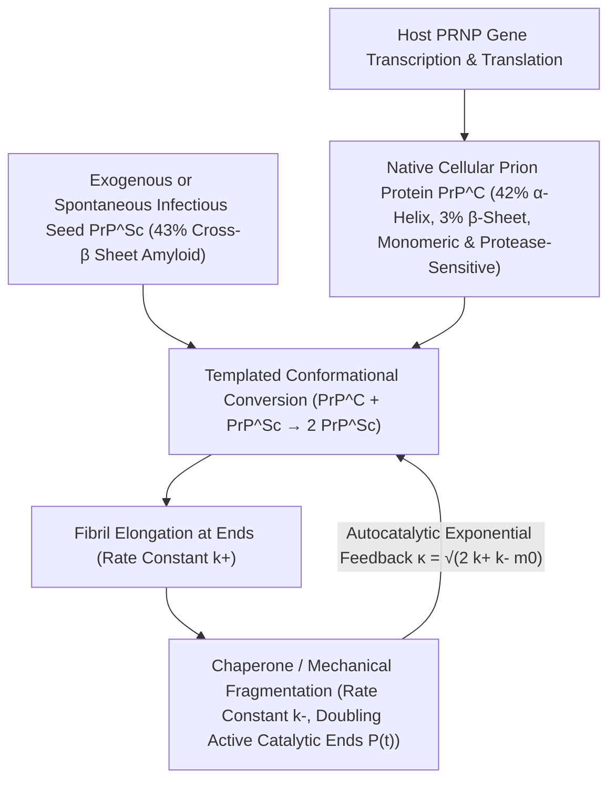

## 1. Una herejía frente al Dogma Central: el descubrimiento de un agente infeccioso sin ácidos nucleicos

En la edad de oro de la biología molecular, el <strong>Dogma Central</strong> formulado por Francis Crick estableció como principio inquebrantable que toda información hereditaria y toda capacidad de autorreplicación biológica requieren necesariamente ácidos nucleicos (ADN o ARN). Bacterias, virus y viroides pierden por completo su infectividad cuando su genoma es destruido por radiación ultravioleta de onda corta ($254\,\text{nm}$), radiación ionizante o nucleasas. Sin embargo, el agente causante de las <strong>encefalopatías espongiformes transmisibles (EET)</strong> —como el *scrapie* ovino, el kuru en Papúa Nueva Guinea, la enfermedad de Creutzfeldt-Jakob (ECJ) y la encefalopatía espongiforme bovina (EEB)— desafiaba estas leyes.

En 1967, la radiobióloga Tikvah Alper demostró que el agente del *scrapie* resistía dosis extremas de radiación UV e ionizante capaces de destruir cualquier genoma viral, lo que llevó al matemático J. S. Griffith a proponer los primeros modelos teóricos de autorreplicación puramente proteica. En 1982, Stanley B. Prusiner (Premio Nobel 1997) aisló el agente infeccioso, demostró que consistía exclusivamente en una única proteína sin ácido nucleico detectable y acuñó el término <strong>prión (Proteinaceous Infectious Particle)</strong>. Más asombroso aún fue descubrir que el gen <em>PRNP</em> que codifica esta proteína forma parte natural del cromosoma de todos los mamíferos sanos: la proteína priónica celular normal ($\text{PrP}^\text{C}$) y la isoforma patógena infecciosa ($\text{PrP}^{\text{Sc}}$) poseen <strong>exactamente la misma secuencia de 208 aminoácidos y los mismos enlaces covalentes</strong>; su única diferencia reside en su plegamiento tridimensional:

$$
\Delta G_{\text{fold}} = \Delta H_{\text{fold}} - T \Delta S_{\text{conf}} + \Delta G_{\text{solv}}, \qquad k_{\text{conv}} = A \exp\!\left(-\frac{\Delta G^\ddagger_{\text{C}\to\text{Sc}}}{k_B T}\right)
$$

---

## 2. Paisaje de energía libre y conversión por molde: de la hélice $\alpha$ a la fibrilla amiloide cross-$\beta$

Según la hipótesis termodinámica de Christian Anfinsen, una proteína globular se pliega espontáneamente hacia el mínimo global de su energía libre de Gibbs $G$. No obstante, en el espacio conformacional de alta dimensión, el paisaje energético presenta múltiples mínimos locales separados por altas barreras cinéticas de activación $\Delta G^\ddagger$. La forma nativa $\text{PrP}^\text{C}$ contiene alrededor de un $42\%$ de hélices $\alpha$ y solo un $3\%$ de láminas $\beta$; es monomérica, soluble en agua y fácilmente degradada por la proteinasa K. Por el contrario, la isoforma $\text{PrP}^{\text{Sc}}$ posee un $43\%$ de <strong>láminas $\beta$ cruzadas rígidas (Cross-$\beta$ Sheets)</strong> que se ensamblan en <strong>fibrillas amiloides</strong> insolubles y resistentes a las proteasas.

Para una molécula aislada de $\text{PrP}^\text{C}$, cruzar espontáneamente la barrera $\Delta G^\ddagger_{\text{C}\to\text{Sc}}$ es sumamente improbable (la ECJ esporádica ocurre en apenas $1$ de cada millón de personas al año). Pero cuando ingresa una semilla cristalina (Seed) de $\text{PrP}^{\text{Sc}}$, su extremo cross-$\beta$ expuesto actúa como un <strong>molde estereoquímico (Structural Template)</strong> que captura al monómero $\text{PrP}^\text{C}$ normal, reduce drásticamente la barrera de activación mediante puentes de hidrógeno e interacciones hidrofóbicas, y lo convierte en una nueva subunidad $\text{PrP}^{\text{Sc}}$. Así, el prión no sintetiza proteínas de la nada, sino que secuestra la $\text{PrP}^\text{C}$ producida continuamente por la célula huésped (como demostró Charles Weissmann en 1993, los ratones *knockout* $Prnp^{0/0}$ sin el gen <em>Prnp</em> son totalmente inmunes a la inoculación de priones).

---

## 3. ¿Por qué crece exponencialmente sin genes? Cinética autocatalítica de nucleación-elongación-fragmentación

Si una fibrilla amiloide solo añadiera monómeros en sus dos extremos (tasa de elongación $k_+$), la masa total de agregados $M(t)$ crecería solo linealmente con el tiempo, sin producir jamás el estallido exponencial típico de una infección. La <strong>ecuación maestra de polimerización nucleada</strong> formulada por Tuomas Knowles y Michele Vendruscolo demuestra que el motor físico de la amplificación exponencial es la <strong>fragmentación de las fibrillas ($k_-$)</strong>:

$$
\left\{
\begin{aligned}
\frac{dP(t)}{dt} &= k_n m(t)^{n_c} + k_- \big[ M(t) - (2n_c - 1)P(t) \big] \approx k_- M(t) \\
\frac{dM(t)}{dt} &= 2 k_+ m(t) P(t) + n_c k_n m(t)^{n_c} \approx 2 k_+ m_0 P(t)
\end{aligned}
\right.
$$

---

## 4. El enigma de las «cepas» sin ADN, la barrera de especie y la propagación «prion-like»

Cuando una fibrilla larga se parte en dos por fluctuaciones térmicas o por la acción mecánica de chaperonas moleculares (como Hsp104) a una tasa $k_-$, <strong>el número de extremos catalíticamente activos $P(t)$ se duplica instantáneamente</strong>. El acoplamiento entre elongación ($k_+$) y fragmentación ($k_-$) genera la ecuación diferencial de segundo orden $\ddot{M}(t) = 2 k_+ k_- m_0 M(t)$, impulsando un <strong>crecimiento exponencial exacto $M(t) \sim e^{\kappa t}$</strong> con tasa efectiva $\kappa = \sqrt{2 k_+ k_- m_0}$. Este mismo principio sustenta las técnicas diagnósticas <strong>PMCA</strong> y <strong>RT-QuIC</strong>, capaces de amplificar mil millones de veces un solo attogramo ($10^{-18}\,\text{g}$) de priones en el líquido cefalorraquídeo.

La criomicroscopía electrónica (Cryo-EM) también resolvió el misterio de las <strong>cepas de priones (Prion Strains)</strong>: una misma secuencia de aminoácidos puede cristalizar en distintos <strong>polimorfos conformacionales</strong> (diferentes topologías de apilamiento $\beta$ y cremalleras estéricas), cada uno de los cuales solo permite el crecimiento epitaxial de su propia geometría. Hoy sabemos que las proteínas $\text{A}\beta$ y $\text{Tau}$ en el Alzheimer, la $\alpha$-sinucleína en el Parkinson y TDP-43 en la ELA siguen exactamente esta misma <strong>propagación de tipo priónico («prion-like»)</strong>, mientras que priones funcionales como $[\text{PSI}^+]$ en levaduras y CPEB en las sinapsis neuronales demuestran cómo la naturaleza ha aprovechado esta transición de fase física como memoria epigenética.

| Dimensión comparativa | Proteína priónica nativa ($\text{PrP}^\text{C}$) | Prión infeccioso ($\text{PrP}^{\text{Sc}}$) | Virus clásico (Virus) |
| :--- | :--- | :--- | :--- |
| <strong>Genoma (ADN/ARN)</strong> | Ninguno (codificada por el gen huésped <em>PRNP</em>) | <strong>Totalmente libre de ADN/ARN</strong> | Posee obligatoriamente genoma de ADN o ARN |
| <strong>Estructura secundaria</strong> | $\approx 42\%$ hélice $\alpha$, $\approx 3\%$ lámina $\beta$ | $\approx 30\%$ hélice $\alpha$, <strong>$\approx 43\%$ lámina cross-$\beta$</strong> | Cápside proteica que envuelve al ácido nucleico |
| <strong>Propiedades bioquímicas</strong> | Monómero soluble, sensible a proteinasa K | Amiloide insoluble, <strong>resistente a proteasas, calor y UV</strong> | Inactivado por UV, radiación y proteasas |
| <strong>Mecanismo de multiplicación</strong> | Plegamiento espontáneo postraduccional | <strong>Conversión por molde + elongación/fragmentación ($e^{\kappa t}$)</strong> | Replicación de ácido nucleico y traducción |

$$
\frac{d^2 M(t)}{dt^2} - 2 k_+ k_- m_0 \, M(t) = 0 \implies M(t) \simeq C \cosh(\kappa t) \sim \exp(\kappa t), \qquad \kappa = \sqrt{2 \, k_+ \, k_- \, m_0}
$$

