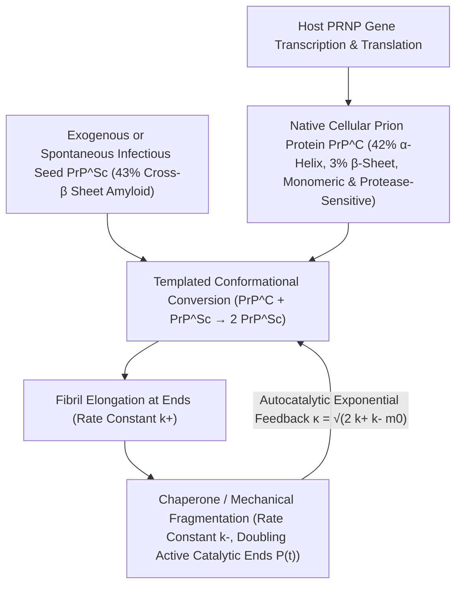

## 1. Une hérésie face au Dogme Central : la découverte d'un agent infectieux sans acide nucléique

À l'âge d'or de la biologie moléculaire, le <strong>Dogme Central</strong> formulé par Francis Crick érigeait en principe absolu que toute information héréditaire et toute capacité d'autoréplication biologique reposent nécessairement sur un acide nucléique (ADN ou ARN). Bactéries, virus et viroïdes perdent toute infectiosité lorsque leur génome est détruit par des rayons ultraviolets courts ($254\,\text{nm}$), des radiations ionisantes ou des nucléases. Pourtant, l'agent responsable des <strong>encéphalopathies spongiformes transmissibles (EST)</strong> — tremblante du mouton (*scrapie*), kuru en Papouasie-Nouvelle-Guinée, maladie de Creutzfeldt-Jakob (MCJ) et encéphalopathie spongiforme bovine (ESB) — défiait toutes ces lois.

En 1967, la radiobiologiste Tikvah Alper démontra que l'agent de la tremblante résistait à des doses extrêmes de rayonnement UV et ionisant capables d'anéantir tout génome viral, incitant le mathématicien J. S. Griffith à proposer les premiers modèles théoriques d'autoréplication purement protéique. En 1982, Stanley B. Prusiner (prix Nobel 1997) purifia l'agent infectieux, prouva qu'il était constitué d'une unique protéine dépourvue d'acide nucléique et forgea le terme de <strong>prion (Proteinaceous Infectious Particle)</strong>. Plus stupéfiant encore : le gène <em>PRNP</em> codant cette protéine est naturellement présent dans le génome de tous les mammifères sains ! La protéine prion cellulaire normale ($\text{PrP}^\text{C}$) et l'isoforme pathogène infectieuse ($\text{PrP}^{\text{Sc}}$) partagent <strong>exactement la même séquence de 208 acides aminés et les mêmes liaisons covalentes</strong> ; seule diffère leur géométrie de repliement tridimensionnel :

$$
\Delta G_{\text{fold}} = \Delta H_{\text{fold}} - T \Delta S_{\text{conf}} + \Delta G_{\text{solv}}, \qquad k_{\text{conv}} = A \exp\!\left(-\frac{\Delta G^\ddagger_{\text{C}\to\text{Sc}}}{k_B T}\right)
$$

---

## 2. Paysage d'énergie libre et conversion par matrice : de l'hélice $\alpha$ à la fibrille amyloïde cross-$\beta$

Selon l'hypothèse thermodynamique de Christian Anfinsen, une protéine globulaire se replie spontanément vers le minimum global de son enthalpie libre de Gibbs $G$. Toutefois, dans l'espace conformationnel de haute dimension, le paysage énergétique comporte souvent plusieurs minimums séparés par de hautes barrières cinétiques d'activation $\Delta G^\ddagger$. La forme native $\text{PrP}^\text{C}$ contient environ $42\%$ d'hélices $\alpha$ et seulement $3\%$ de feuillets $\beta$ ; elle est monomérique, hydrosoluble et aisément digérée par la protéinase K. À l'inverse, l'isoforme $\text{PrP}^{\text{Sc}}$ renferme $43\%$ de <strong>feuillets $\beta$ croisés rigides (Cross-$\beta$ Sheets)</strong> s'empilant en <strong>fibrilles amyloïdes</strong> insolubles et hautement résistantes aux protéases.

Pour une molécule $\text{PrP}^\text{C}$ isolée, le franchissement spontané de la barrière $\Delta G^\ddagger_{\text{C}\to\text{Sc}}$ est extrêmement rare (la MCJ sporadique ne touche qu'environ une personne sur un million par an). Mais dès qu'un germe cristallin (Seed) de $\text{PrP}^{\text{Sc}}$ est présent, son extrémité cross-$\beta$ agit comme une <strong>matrice stéréochimique (Template)</strong> qui capture le monomère $\text{PrP}^\text{C}$ normal, abaisse drastiquement la barrière d'activation via un réseau dense de liaisons hydrogène et le convertit en une nouvelle sous-unité $\text{PrP}^{\text{Sc}}$. Le prion ne synthétise donc aucune protéine *ex nihilo* : il détourne la $\text{PrP}^\text{C}$ continuellement produite par la cellule hôte (comme l'a prouvé Charles Weissmann en 1993, les souris knock-out $Prnp^{0/0}$ dépourvues du gène <em>Prnp</em> sont totalement réfractaires à l'infection !).

---

## 3. Pourquoi une amplification exponentielle sans gènes ? Cinétique de nucléation-élongation-fragmentation

Si une fibrille amyloïde se contentait d'incorporer des monomères à ses deux extrémités (constante de vitesse d'élongation $k_+$), la masse totale d'agrégats $M(t)$ ne croîtrait que linéairement avec le temps, sans jamais produire l'explosion exponentielle caractéristique d'une infection. L'<strong>équation maîtresse de polymérisation nucléée</strong> établie par Tuomas Knowles et Michele Vendruscolo révèle que le moteur physique de l'amplification exponentielle est la <strong>fragmentation des fibrilles ($k_-$)</strong> :

$$
\left\{
\begin{aligned}
\frac{dP(t)}{dt} &= k_n m(t)^{n_c} + k_- \big[ M(t) - (2n_c - 1)P(t) \big] \approx k_- M(t) \\
\frac{dM(t)}{dt} &= 2 k_+ m(t) P(t) + n_c k_n m(t)^{n_c} \approx 2 k_+ m_0 P(t)
\end{aligned}
\right.
$$

---

## 4. L'énigme des « souches » sans ADN, la barrière d'espèce et la propagation « prion-like »

Lorsqu'une longue fibrille se brise en deux sous l'effet de l'agitation thermique ou du cisaillement exercé par des protéines chaperonnes (telles que Hsp104) au taux $k_-$, <strong>le nombre d'extrémités catalytiquement actives $P(t)$ double instantanément</strong> ! Le couplage entre l'élongation ($k_+$) et la fragmentation ($k_-$) engendre l'équation différentielle du second ordre $\ddot{M}(t) = 2 k_+ k_- m_0 M(t)$, gouvernant une <strong>croissance exponentielle stricte $M(t) \sim e^{\kappa t}$</strong> de taux effectif $\kappa = \sqrt{2 k_+ k_- m_0}$. C'est ce mécanisme qu'exploitent les techniques diagnostiques <strong>PMCA</strong> et <strong>RT-QuIC</strong> pour amplifier d'un facteur un milliard quelques attogrammes ($10^{-18}\,\text{g}$) de prions dans le liquide céphalorachidien.

La cryomicroscopie électronique (Cryo-EM) a également résolu le mystère des <strong>souches de prions (Prion Strains)</strong> : une même séquence d'acides aminés peut adopter différents <strong>polymorphes conformationnels</strong> (différentes topologies d'empilement $\beta$ et fermetures éclair stériques), chaque polymorphe ne permettant la croissance épitaxiale que de sa propre géométrie. Aujourd'hui, il est établi que les protéines $\text{A}\beta$ et $\text{Tau}$ (maladie d'Alzheimer), l'$\alpha$-synucléine (maladie de Parkinson) et TDP-43 (SLA) obéissent à cette même <strong>propagation de type prion (« prion-like »)</strong>, tandis que les prions fonctionnels tels que $[\text{PSI}^+]$ chez la levure et CPEB dans les synapses illustrent comment l'évolution a domestiqué cette transition de phase physique en mémoire épigénétique.

| Critère de comparaison | Protéine prion native ($\text{PrP}^\text{C}$) | Prion infectieux ($\text{PrP}^{\text{Sc}}$) | Virus classique (Virus) |
| :--- | :--- | :--- | :--- |
| <strong>Génome (ADN/ARN)</strong> | Aucun (codée par le gène hôte <em>PRNP</em>) | <strong>Totalement dépourvu d'ADN/ARN</strong> | Possède obligatoirement un génome ADN ou ARN |
| <strong>Structure secondaire</strong> | $\approx 42\%$ hélice $\alpha$, $\approx 3\%$ feuillet $\beta$ | $\approx 30\%$ hélice $\alpha$, <strong>$\approx 43\%$ feuillet cross-$\beta$</strong> | Capside protéique entourant l'acide nucléique |
| <strong>Propriétés physico-chimiques</strong> | Monomère soluble, sensible à la protéinase K | Amyloïde insoluble, <strong>résistant aux protéases, chaleur & UV</strong> | Inactivé par UV, radiations et protéases |
| <strong>Mécanisme de multiplication</strong> | Repliement spontané post-traductionnel | <strong>Conversion par matrice + élongation/fragmentation ($e^{\kappa t}$)</strong> | Réplication de l'acide nucléique et traduction |

$$
\frac{d^2 M(t)}{dt^2} - 2 k_+ k_- m_0 \, M(t) = 0 \implies M(t) \simeq C \cosh(\kappa t) \sim \exp(\kappa t), \qquad \kappa = \sqrt{2 \, k_+ \, k_- \, m_0}
$$

