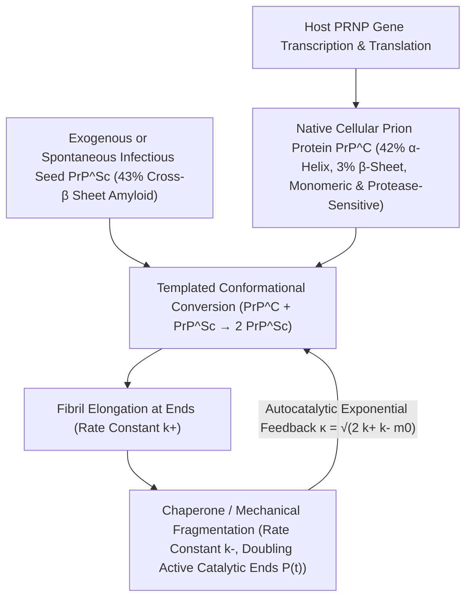

## 1. सेंट्रल डॉग्मा को चुनौती: बिना न्यूक्लिक अम्ल वाले संक्रामक कारक की खोज कैसे हुई?

आणविक जीवविज्ञान के स्वर्ण युग में फ्रांसिस क्रिक (Francis Crick) द्वारा प्रतिपादित <strong>सेंट्रल डॉग्मा (Central Dogma)</strong> ने यह अटल नियम स्थापित किया था कि समस्त जैविक आनुवंशिक सूचना और स्व-प्रतिकृति (self-replication) के लिए न्यूक्लिक अम्ल (DNA या RNA) अनिवार्य है। जीवाणु, विषाणु (virus) और वायरोइड्स जब न्यूक्लिक अम्ल को नष्ट करने वाले लघु-तरंग पराबैंगनी विकिरण ($254\,\text{nm}$), आयनकारी विकिरण या न्यूक्लिएज़ एंजाइम के संपर्क में आते हैं, तो उनकी संक्रामकता समाप्त हो जाती है। किंतु भेड़ों के स्क्रैपी (Scrapie), पापुआ न्यू गिनी के कुरु (Kuru), मानव क्रอยत्ज़फेल्ट-जैकब रोग (CJD) और मैड काउ रोग (BSE) जैसे <strong>संक्रामक स्पॉन्जीफॉर्म एन्सेफैलोपैथी (TSE)</strong> के कारक ने इस नियम को ध्वस्त कर दिया।

1967 में विकिरण जीवविज्ञानी टिकवा एल्पर (Tikvah Alper) ने दिखाया कि किसी भी विषाणु जीनोम को नष्ट करने में सक्षम अत्यधिक पराबैंगनी और आयनकारी विकिरण के बावजूद स्क्रैपी कारक संक्रामक बना रहता है; इसके तुरंत बाद गणितज्ञ जे. एस. ग्रिफ़िथ (J. S. Griffith) ने केवल प्रोटीन द्वारा स्व-प्रतिकृति का सैद्धांतिक मॉडल प्रस्तुत किया। 1982 में स्टैनली प्रुसिनर (Stanley B. Prusiner, 1997 नोबेल पुरस्कार) ने इस संक्रामक कारक को शुद्ध किया, सिद्ध किया कि इसमें कोई न्यूक्लिक अम्ल नहीं है और इसे <strong>प्रियोन (Prion — Proteinaceous Infectious Particle)</strong> नाम दिया। सबसे आश्चर्यजनक तथ्य यह था कि इस प्रोटीन को कोड करने वाला जीन <em>PRNP</em> प्रत्येक स्वस्थ स्तनधारी के गुणसूत्र में पहले से मौजूद होता है! सामान्य कोशिकीय प्रियोन प्रोटीन ($\text{PrP}^\text{C}$) और रोगजनक संक्रामक प्रियोन ($\text{PrP}^{\text{Sc}}$) का <strong>208 अमीनो अम्लों का अनुक्रम और सहसंयोजक बंध $100\%$ समान होते हैं</strong>; दोनों में एकमात्र अंतर उनकी त्रि-आयामी फोल्डिंग ज्यामिति (3D conformation) का है:

$$
\Delta G_{\text{fold}} = \Delta H_{\text{fold}} - T \Delta S_{\text{conf}} + \Delta G_{\text{solv}}, \qquad k_{\text{conv}} = A \exp\!\left(-\frac{\Delta G^\ddagger_{\text{C}\to\text{Sc}}}{k_B T}\right)
$$

---

## 2. मुक्त ऊर्जा परिदृश्य और टेम्पलेट रूपांतरण: $\alpha$-हेलिक्स से क्रॉस-$\beta$ एमिलॉइड तक

क्रिश्चियन एनफिनसेन की ऊष्मागतिक परिकल्पना के अनुसार, एक सामान्य प्रोटीन स्वतः ही न्यूनतम गिब्स मुक्त ऊर्जा $G$ वाली अपनी मूल संरचना में मुड़ जाता है। किंतु उच्च-आयामी विन्यास समष्टि (conformational space) में मुक्त ऊर्जा परिदृश्य में अक्सर उच्च गतिज सक्रियण ऊर्जा अवरोध $\Delta G^\ddagger$ द्वारा पृथक कई स्थानीय न्यूनतम (local minima) होते हैं। सामान्य $\text{PrP}^\text{C}$ में लगभग $42\%$ $\alpha$-हेलिक्स और केवल $3\%$ $\beta$-शीट होती है; यह जल में घुलनशील मोनोमर है और प्रोटीनेज़ K (Proteinase K) द्वारा आसानी से पच जाता है। इसके विपरीत, संक्रामक $\text{PrP}^{\text{Sc}}$ में $43\%$ कठोर <strong>क्रॉस-$\beta$ शीट (Cross-$\beta$ Sheets)</strong> होती हैं जो अघुलनशील और प्रोटीनेज़-प्रतिरोधी <strong>एमिलॉइड फाइब्रिल (Amyloid Fibrils)</strong> बनाती हैं।

एक अकेले $\text{PrP}^\text{C}$ अणु के लिए स्वतः $\Delta G^\ddagger_{\text{C}\to\text{Sc}}$ अवरोध को पार करना अत्यंत दुर्लभ है (छिटपुट CJD प्रतिवर्ष दस लाख में केवल $1$ व्यक्ति को होता है)। परंतु जैसे ही $\text{PrP}^{\text{Sc}}$ का एक सूक्ष्म क्रिस्टलीय बीज (Seed) प्रवेश करता है, उसका खुला हुआ क्रॉस-$\beta$ सिरा एक <strong>त्रिविम-रासायनिक साँचे (Structural Template)</strong> की तरह कार्य करता है जो सामान्य $\text{PrP}^\text{C}$ मोनोमर को पकड़कर हाइड्रोजन बंधों के माध्यम से सक्रियण अवरोध को घटा देता है और उसे नए $\text{PrP}^{\text{Sc}}$ में बदल देता है। अर्थात् प्रियोन शून्य से प्रोटीन नहीं बनाता, बल्कि मेज़बान कोशिका द्वारा निरंतर बनाए जा रहे सामान्य $\text{PrP}^\text{C}$ का अपहरण करता है (चार्ल्स वाइसमैन ने 1993 में सिद्ध किया कि <em>Prnp</em> जीन-रहित नॉकआउट चूहे $Prnp^{0/0}$ मस्तिष्क में सीधे प्रियोन इंजेक्शन के बाद भी कभी बीमार नहीं पड़ते!)।

---

## 3. बिना जीन के घातांकीय वृद्धि कैसे होती है? न्यूक्लिएशन-एलॉन्गेशन-फ्रैगमेंटेशन बलगतिकी

यदि एमिलॉइड फाइब्रिल केवल अपने दोनों सिरों पर मोनोमर जोड़कर लंबा होता (दीर्घीकरण दर स्थिरांक $k_+$), तो कुल द्रव्यमान $M(t)$ समय के साथ केवल रैखिक रूप से बढ़ता और कभी भी विषाणु संक्रमण जैसा विस्फोटक घातांकीय (exponential) उभार नहीं दिखा पाता। तुओमास नोल्स और मिशेल वेंड्रुस्कोलो के <strong>न्यूक्लिएटेड बहुलकीकरण मास्टर समीकरण</strong> ने सिद्ध किया कि प्रियोन के घातांकीय प्रवर्धन का असली भौतिक इंजन <strong>फाइब्रिल विखंडन (Fragmentation, $k_-$)</strong> है:

$$
\left\{
\begin{aligned}
\frac{dP(t)}{dt} &= k_n m(t)^{n_c} + k_- \big[ M(t) - (2n_c - 1)P(t) \big] \approx k_- M(t) \\
\frac{dM(t)}{dt} &= 2 k_+ m(t) P(t) + n_c k_n m(t)^{n_c} \approx 2 k_+ m_0 P(t)
\end{aligned}
\right.
$$

---

## 4. बिना DNA के 'स्ट्रेन' का रहस्य, प्रजाति अवरोध और न्यूरोडीजेनेरेशन में 'प्रियोन-सदृश' प्रसार

जब एक लंबा फाइब्रिल ऊष्मीय उतार-चढ़ाव या आणविक चैपरोन (जैसे Hsp104) के यांत्रिक अपरूपण से दर $k_-$ पर दो टुकड़ों में टूटता है, तो <strong>उत्प्रेरक रूप से सक्रिय सिरों की संख्या $P(t)$ तुरंत दोगुनी हो जाती है</strong>! दीर्घीकरण ($k_+$) और विखंडन ($k_-$) का यह युग्मन द्वितीय कोटि का अवकल समीकरण $\ddot{M}(t) = 2 k_+ k_- m_0 M(t)$ बनाता है, जो प्रभावी वृद्धि दर $\kappa = \sqrt{2 k_+ k_- m_0}$ के साथ <strong>सटीक घातांकीय वृद्धि $M(t) \sim e^{\kappa t}$</strong> उत्पन्न करता है। इसी सिद्धांत पर आधारित <strong>PMCA</strong> और <strong>RT-QuIC</strong> नैदानिक तकनीकें मस्तिष्क-मेरु द्रव में उपस्थित एक एटोग्राम ($10^{-18}\,\text{g}$) प्रियोन बीज को अरबों गुना प्रवर्धित कर देती हैं।

क्रायो-इलेक्ट्रॉन माइक्रोस्कोपी (Cryo-EM) ने <strong>प्रियोन स्ट्रेन (Prion Strains)</strong> की पहेली को भी सुलझा दिया है: एक ही अमीनो अम्ल अनुक्रम विभिन्न <strong>संरचनात्मक बहुरूपों (Conformational Polymorphs)</strong> में क्रिस्टलीकृत हो सकता है, और प्रत्येक साँचा अपने सिरों पर केवल अपनी ही ज्यामिति की एपिटैक्सियल वृद्धि की अनुमति देता है। आज यह स्थापित हो चुका है कि अल्ज़ाइमर रोग में $\text{A}\beta$ व $\text{Tau}$, पार्किंसंस में $\alpha$-सिन्यूक्लिन और ALS में TDP-43 प्रोटीन भी मस्तिष्क में इसी <strong>प्रियोन-सदृश (Prion-like) तंत्र</strong> से फैलते हैं, जबकि यीस्ट में $[\text{PSI}^+]$ और न्यूरॉन सिनैप्स में CPEB प्रोटीन दिखाते हैं कि प्रकृति ने इस भौतिक प्रावस्था संक्रमण को उपयोगी एपिजेनेटिक स्मृति के रूप में कैसे अपनाया है।

| तुलनात्मक आयाम | सामान्य कोशिकीय प्रियोन ($\text{PrP}^\text{C}$) | संक्रामक प्रियोन ($\text{PrP}^{\text{Sc}}$) | पारंपरिक विषाणु (Virus) |
| :--- | :--- | :--- | :--- |
| <strong>न्यूक्लिक अम्ल जीनोम</strong> | कोई नहीं (मेज़बान <em>PRNP</em> जीन द्वारा कोडित) | <strong>DNA/RNA से पूर्णतः मुक्त</strong> | अनिवार्य रूप से DNA या RNA जीनोम युक्त |
| <strong>द्वितीयक संरचना</strong> | $\approx 42\%$ $\alpha$-हेलिक्स, $\approx 3\%$ $\beta$-शीट | $\approx 30\%$ $\alpha$-हेलिक्स, <strong>$\approx 43\%$ क्रॉस-$\beta$ शीट</strong> | न्यूक्लिक अम्ल को घेरे हुए प्रोटीन कैप्सिड |
| <strong>जैव-रासायनिक गुण</strong> | घुलनशील मोनोमर, प्रोटीनेज़ K के प्रति संवेदनशील | अघुलनशील एमिलॉइड, <strong>प्रोटीनेज़, ताप व UV प्रतिरोधी</strong> | UV, विकिरण और प्रोटीनेज़ द्वारा निष्क्रिय |
| <strong>गुणन एवं सूचना तंत्र</strong> | राइबोसोम अनुवाद के बाद स्वतः फोल्डिंग | <strong>टेम्पलेट रूपांतरण + दीर्घीकरण/विखंडन स्व-उत्प्रेरण ($e^{\kappa t}$)</strong> | न्यूक्लिक अम्ल प्रतिकृति एवं कैप्सिड संश्लेषण |

$$
\frac{d^2 M(t)}{dt^2} - 2 k_+ k_- m_0 \, M(t) = 0 \implies M(t) \simeq C \cosh(\kappa t) \sim \exp(\kappa t), \qquad \kappa = \sqrt{2 \, k_+ \, k_- \, m_0}
$$

