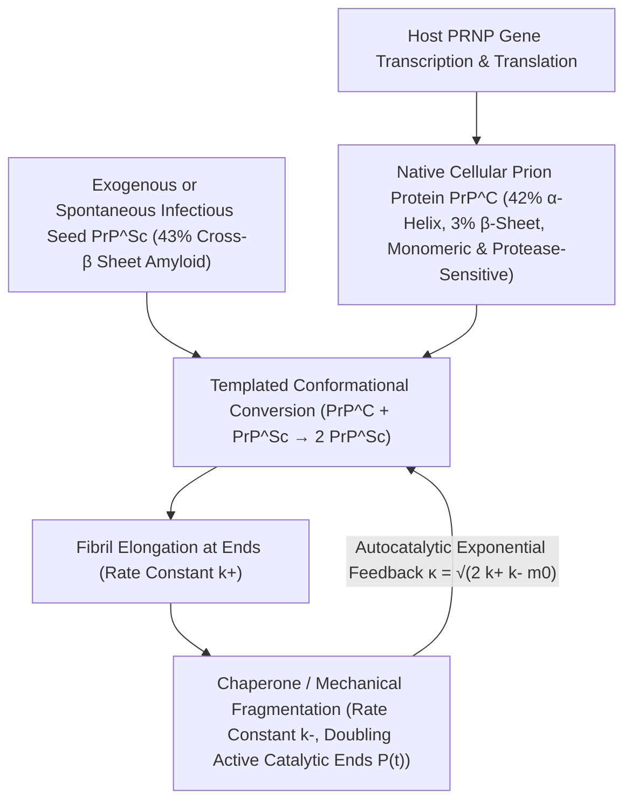

## 1. Menantang Dogma Sentral: Penemuan Agen Infeksius Tanpa Asam Nukleat

Padaยุค keemasan biologi molekuler, <strong>Dogma Sentral</strong> yang dirumuskan oleh Francis Crick menetapkan prinsip mutlak bahwa seluruh informasi genetik dan kemampuan replikasi diri biologis wajib bergantung pada asam nukleat (DNA atau RNA). Bakteri, virus, dan viroid kehilangan seluruh daya infeksinya ketika genomnya dihancurkan oleh sinar ultraviolet gelombang pendek ($254\,\text{nm}$), radiasi pengion, atau enzim nuklease. Namun, agen penyebab <strong>ensefalopati spongiformis ทransmisibel (TSE)</strong> — seperti penyakit *scrapie* pada domba, kuru di Papua Nugini, penyakit Creutzfeldt-Jakob (CJD) pada manusia, dan penyakit sapi gila (BSE) — mematahkan hukum tersebut.

Pada tahun 1967, ahli radiobiologi Tikvah Alper membuktikan bahwa agen *scrapie* tetap infeksius meskipun disinari dosis UV dan radiasi pengion ekstrem yang mampu menghancurkan genom virus apa pun, mendorong matematikawan J. S. Griffith mengajukan model teoretis replikasi diri murni berbasis protein. Pada tahun 1982, Stanley B. Prusiner (Pemenang Nobel 1997) berhasil memurnikan agen infeksius tersebut, membuktikan bahwa ia tersusun sepenuhnya dari satu jenis protein inang tanpa asam nukleat sedikit pun, dan menciptakan istilah <strong>prion (Proteinaceous Infectious Particle)</strong>. Yang lebih mengejutkan, gen <em>PRNP</em> yang menyandi protein ini secara alami sudah ada di kromosom setiap mamalia sehat! Protein prion seluler normal ($\text{PrP}^\text{C}$) dan isoform patogenik infeksius ($\text{PrP}^{\text{Sc}}$) memiliki <strong>urutan 208 asam amino dan ikatan kovalen yang $100\%$ identik</strong>; satu-satunya perbedaan terletak pada geometri pelipatan tiga dimensinya:

$$
\Delta G_{\text{fold}} = \Delta H_{\text{fold}} - T \Delta S_{\text{conf}} + \Delta G_{\text{solv}}, \qquad k_{\text{conv}} = A \exp\!\left(-\frac{\Delta G^\ddagger_{\text{C}\to\text{Sc}}}{k_B T}\right)
$$

---

## 2. Lanskap Energi Bebas dan Konversi Cetakan: Dari Heliks-$\alpha$ ke Fibril Amiloid Cross-$\beta$

Menurut hipotesis termodinamika Christian Anfinsen, protein globular secara spontan melipat menuju minimum global energi bebas Gibbs $G$. Namun, dalam ruang konformasi berdimensi tinggi, lanskap energi bebas sering kali memiliki beberapa minimum lokal yang dipisahkan oleh penghalang energi aktivasi kinetik $\Delta G^\ddagger$ yang tinggi. Bentuk asli $\text{PrP}^\text{C}$ mengandung sekitar $42\%$ heliks-$\alpha$ dan hanya $3\%$ lembaran-$\beta$; ia bersifat monomerik, larut dalam air, dan mudah dihancurkan oleh enzim proteinase K. Sebaliknya, isoform $\text{PrP}^{\text{Sc}}$ mengandung $43\%$ <strong>lembaran cross-$\beta$ kaku (Cross-$\beta$ Sheets)</strong> yang menumpuk menjadi <strong>fibril amiloid</strong> tak larut air dan tahan terhadap proteinase K.

Bagi satu molekul $\text{PrP}^\text{C}$ terisolasi, melintasi penghalang $\Delta G^\ddagger_{\text{C}\to\text{Sc}}$ secara spontan sangatlah langka (CJD sporadis hanya terjadi pada sekitar $1$ dari sejuta orang per tahun). Akan tetapi, begitu benih kristal (Seed) $\text{PrP}^{\text{Sc}}$ masuk, ujung cross-$\beta$ terbukanya bekerja sebagai <strong>cetakan stereokimia (Structural Template)</strong> yang menangkap monomer $\text{PrP}^\text{C}$ normal, menurunkan penghalang aktivasi secara drastis melalui jaringan ikatan hidrogen, dan mengubahnya menjadi subunit $\text{PrP}^{\text{Sc}}$ baru. Dengan demikian, prion tidak menyintesis protein dari ketiadaan, melainkan membajak pasokan $\text{PrP}^\text{C}$ normal yang terus-menerus diproduksi oleh sel inang (sebagaimana dibuktikan Charles Weissmann pada 1993, mencit *knockout* $Prnp^{0/0}$ tanpa gen <em>Prnp</em> sama sekali kebal terhadap suntikan prion!).

---

## 3. Mengapa Bisa Tumbuh Eksponensial Tanpa Gen? Kinetika Nukleasi-Elongasi-Fragmentasi

Andaikan fibril amiloid hanya menambahkan monomer di kedua ujungnya (laju elongasi $k_+$), massa total agregat $M(t)$ hanya akan bertambah secara linear terhadap waktu dan tidak mungkin memicu ledakan eksponensial seperti infeksi virus. <strong>Persamaan induk polimerisasi ternukleasi</strong> yang dirumuskan oleh Tuomas Knowles dan Michele Vendruscolo membuktikan bahwa mesin fisik di balik amplifikasi eksponensial prion adalah <strong>fragmentasi fibril ($k_-$)</strong>:

$$
\left\{
\begin{aligned}
\frac{dP(t)}{dt} &= k_n m(t)^{n_c} + k_- \big[ M(t) - (2n_c - 1)P(t) \big] \approx k_- M(t) \\
\frac{dM(t)}{dt} &= 2 k_+ m(t) P(t) + n_c k_n m(t)^{n_c} \approx 2 k_+ m_0 P(t)
\end{aligned}
\right.
$$

---

## 4. Teka-teki «Galur» Tanpa DNA, Penghalang Spesies, dan Propagasi «Prion-like» pada Neurodegenerasi

Ketika sebuah fibril panjang patah menjadi dua akibat fluktuasi termal atau gaya geser protein *chaperone* (seperti Hsp104) dengan laju $k_-$, <strong>jumlah ujung fibril yang aktif secara katalitik $P(t)$ langsung berlipat ganda</strong>! Kopel antara elongasi ($k_+$) dan fragmentasi ($k_-$) menghasilkan persamaan diferensial orde dua $\ddot{M}(t) = 2 k_+ k_- m_0 M(t)$, yang memicu <strong>pertumbuhan eksponensial murni $M(t) \sim e^{\kappa t}$</strong> dengan laju efektif $\kappa = \sqrt{2 k_+ k_- m_0}$. Prinsip inilah yang mendasari teknologi diagnostik ultra-sensitif <strong>PMCA</strong> dan <strong>RT-QuIC</strong>, yang mampu melipatgandakan satu attogram ($10^{-18}\,\text{g}$) benih prion dalam cairan serebrospinal hingga miliaran kali lipat.

Mikroskopi cryo-EM juga memecahkan misteri <strong>galur prion (Prion Strains)</strong>: urutan asam amino yang persis sama dapat mengkristal menjadi berbagai <strong>polimorf konformasi</strong> (topologi lipatan-$\beta$ dan ritsleting sterik rantai samping yang berbeda), di mana setiap cetakan hanya mengizinkan pertumbuhan epitaksial bagi geometri yang cocok dengannya. Kini diketahui bahwa protein $\text{A}\beta$ dan $\text{Tau}$ pada Alzheimer, $\alpha$-sinuklein pada Parkinson, serta TDP-43 pada ALS menyebar di otak melalui <strong>mekanisme mirip-prion («prion-like»)</strong> yang sama, sementara prion fungsional seperti $[\text{PSI}^+]$ pada ragi dan protein memori sinaptik CPEB menunjukkan bagaimana evolusi memanfaatkan transisi fase fisik ini sebagai memori epigenetik.

| Dimensi Perbandingan | Protein Prion Seluler ($\text{PrP}^\text{C}$) | Prion Infeksius ($\text{PrP}^{\text{Sc}}$) | Virus Klasik (Virus) |
| :--- | :--- | :--- | :--- |
| <strong>Genom (DNA/RNA)</strong> | Tidak ada (disandi gen inang <em>PRNP</em>) | <strong>Sama sekali tanpa DNA/RNA</strong> | Wajib memiliki genom DNA atau RNA |
| <strong>Struktur Sekunder</strong> | $\approx 42\%$ heliks-$\alpha$, $\approx 3\%$ lembaran-$\beta$ | $\approx 30\%$ heliks-$\alpha$, <strong>$\approx 43\%$ lembaran cross-$\beta$</strong> | Kapsid protein membungkus asam nukleat |
| <strong>Sifat Biokimia</strong> | Monomer larut air, peka proteinase K | Amiloid tak larut, <strong>tahan protease, panas & UV</strong> | Diinaktivasi oleh UV, radiasi & protease |
| <strong>Mekanisme Multiplikasi</strong> | Pelipatan spontan pasca-translasi | <strong>Konversi cetakan + elongasi/fragmentasi ($e^{\kappa t}$)</strong> | Replikasi asam nukleat & translasi kapsid |

$$
\frac{d^2 M(t)}{dt^2} - 2 k_+ k_- m_0 \, M(t) = 0 \implies M(t) \simeq C \cosh(\kappa t) \sim \exp(\kappa t), \qquad \kappa = \sqrt{2 \, k_+ \, k_- \, m_0}
$$

