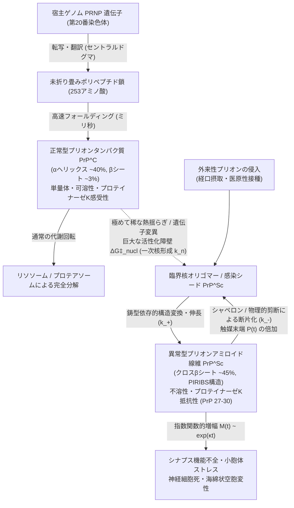
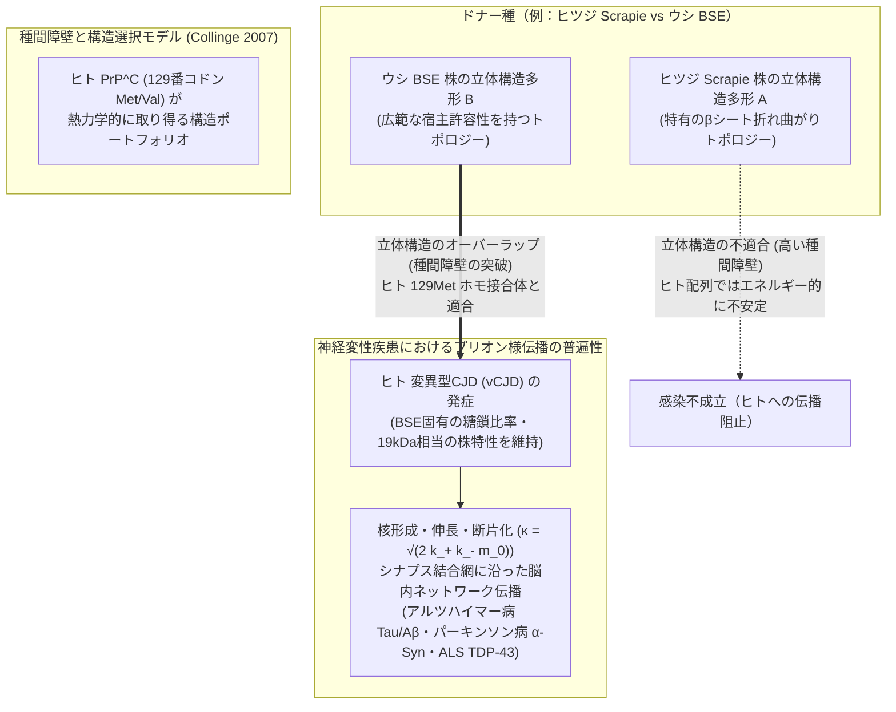

## 1. 序論：遺伝情報なき「感染」という生物学最大の異端

19世紀後半にロベルト・コッホとルイ・パスツールが感染症の病原体説（Germ Theory）を確立し、20世紀半ばにオズワルド・エイヴリー、アルフレッド・ハーシー、マーサ・チェイス、そしてジェームズ・ワトソンとフランシス・クリックが遺伝物質の正体として核酸（$\text{DNA}$および$\text{RNA}$）の構造を解き明かして以来、近代生物学には一つの絶対的な不文律が君臨していた。それは、<strong>「自己複製し、世代や個体を超えて固有の形質（株）を伝播させるすべての感染性病原体は、その設計図として必ず核酸（DNAまたはRNA）を保持していなければならない」</strong>という原則である。

細菌や真菌、寄生虫といった細胞性生物はもちろんのこと、細胞を持たない最小の寄生体であるウイルスやバクテリオファージ、さらにはタンパク質外壳すら持たない植物病原体「ウイロイド（Viroid）」に至るまで、既知のあらゆる感染因子は例外なくヌクレオチド配列という1次元のデジタル記号列を鋳型（テンプレート）として自己のコピーを再生産していた。もしある病原体を紫外線や電離放射線、あるいは核酸分解酵素（ヌクレアーゼ）で徹底的に処理し、その内部に含まれる$\text{DNA}$や$\text{RNA}$を完全に破壊すれば、その病原体は複製能力を永久に失うはずであった。

ところが20世紀後半、羊の<strong>スクレイピー（Scrapie）</strong>、パプアニューギニアの先住民に流行した<strong>クールー病（Kuru）</strong>、人間の<strong>クロイツフェルト・ヤコブ病（CJD）</strong>、そして1980年代以降の英国を震撼させた<strong>牛海綿状脳症（BSE：いわゆる狂牛病）</strong>という一連の致死性神経変性疾患——総称して<strong>伝達性海綿状脳症（Transmissible Spongiform Encephalopathies: TSEs）</strong>——の病原体を追跡していた科学者たちは、この生物学の根本原則を根底から覆す巨大なパラドックスに直面することになる。

その病原体は、細菌を捕捉する微細フィルターを容易に通過するほど微小でありながら、ウイルスを確実に死滅させるはずのホルマリン固定、煮沸、オートクレーブ（高圧蒸気滅菌）、高濃度のヌクレアーゼ処理、さらには核酸を選択的に破壊する$254\text{ nm}$の紫外線照射やソラレン（psoralen）光架橋処理に対して、驚くべき抵抗性を示した。それにもかかわらず、タンパク質を変性させるカオトロピック試薬（高濃度の尿素やグアニジン塩酸塩）や界面活性剤（SDS）、フェノール処理に対しては脆くも感染性を失ったのである。

1982年、カリフォルニア大学サンフランシスコ校（UCSF）の神経学者<strong>スタンリー・プルシナー（Stanley B. Prusiner）</strong>は、科学界からの激しい懐疑と嘲笑の嵐の中、この未知の病原体が核酸を一切含まない純粋なタンパク質のみから構成されていると提唱し、それを<strong>「プリオン（Prion: Proteinaceous Infectious Particle＝タンパク質性感染粒子）」</strong>と命名した（1997年ノーベル生理学・医学賞受賞）。

しかし、この「タンパク質単独仮説（Protein-Only Hypothesis）」は、直ちに分子生物学の根幹に関わる3つの深刻な問いを突きつけた。

1. <strong>セントラルドグマとの整合性：</strong> フランシス・クリックが提唱した分子生物学のセントラルドグマは、配列情報が「タンパク質からタンパク質へ」直接伝達されて新たなペプチド鎖が合成されることを明確に禁じている。遺伝子（核酸）を持たないタンパク質が、なぜ宿主の脳内で何百万倍、何億倍にも「自己増殖」しているかのように振る舞うのか？
2. <strong>熱力学の第一原理との矛盾：</strong> クリスチャン・アンフィンセン（Christian Anfinsen）の熱力学仮説によれば、タンパク質の立体構造はそのアミノ酸配列によって一意に決まる自由エネルギー最小状態であるはずだ。なぜ全く同じアミノ酸配列を持つ正常タンパク質と異常プリオンタンパク質が、同一の生体環境下で安定に共存し、かつ一方向的な構造変換を起こすのか？
3. <strong>核酸なき「株（Strains）」の遺伝現象：</strong> インフルエンザやコロナウイルスに変異株が存在するのは、$\text{RNA}$配列に突然変異が生じるからである。では、全く同一のアミノ酸配列を持ち、核酸を一切含まないプリオンに、なぜ潜伏期間や脳内の病変分布、生化学的性質が明確に異なる複数の「プリオン株（Prion Strains）」が存在し、継代接種してもその性質が忠実に「遺伝」するのか？

本稿では、この生物学史上最大のミステリーであったプリオン現象を、感染症学の発見史から説き起こし、タンパク質フォールディングの統計熱力学、核形成依存性重合（Seeded Nucleated Polymerization）の非線形微分方程式モデル、クライオ電子顕微鏡（Cryo-EM）が暴いたクロス$\beta$アミロイドの原子構造、そして酵母のエピジェネティクスや長期記憶の維持、さらにはアルツハイマー病・パーキンソン病・ALSへと拡張された現代の「プリオン様構造伝播（Prion-like Propagation）」の統一理論に至るまで、物理学と数理生物学の視点から徹底的に解き明かす。

---

## 2. 伝達性海綿状脳症（TSE）の発見史と「核酸仮説」の崩壊

### 2.1 スクレイピー、クールー病、そしてCJDの交錯

プリオン研究の源流は、18世紀のヨーロッパ（1732年の英国の記録など）の羊飼いたちの間で恐れられていた羊および山羊の神経疾患<strong>スクレイピー（Scrapie）</strong>に遡る。発症した羊は激しい掻痒感に襲われたかのように柵や木に自らの体を執拗に擦りつけ（scrape）、羊毛が抜け落ちた後、小脳性の運動失調（よろめき歩行）と振戦を呈して数週間から数ヶ月で例外なく死に至る。死後の脳を顕微鏡で観察すると、神経細胞が脱落し、脳組織全体がスポンジ（海綿）のように無数の微小な空胞（vacuole）で穴だらけになる特異な病理像が認められた。

長らく遺伝病か中毒症と考えられていたスクレイピーが「感染症」であることを決定づけたのは、1936年のフランスの獣医学者ジャン・キュイエ（Jean Cuillé）とポール・シェル（Paul-Louis Chelle）による実験であった。彼らはスクレイピーに罹患した羊の脊髄組織懸濁液を健常な羊の眼内や脳内に接種し、<strong>1年半から2年という途方もなく長い潜伏期間</strong>の後に、健常な羊が全く同じスクレイピーを発症することを証明したのである。さらに異様なことに、これほど脳組織が破壊されているにもかかわらず、通常のウイルス性脳炎や細菌性髄膜炎で必ず見られるはずの<strong>炎症反応（リンパ球や好中球の浸潤、インターフェロン産生、特異的抗体の上昇）が完全に欠如</strong>していた。

この獣医学上の奇病が人類医学と劇的に結びついた舞台は、パプアニューギニア東部高地の険しい山岳地帯に暮らすフォア族（Fore people）の居住域であった。1950年代、フォア族の間で「震えること」を意味する<strong>クールー（Kuru）</strong>と呼ばれる謎の致死性疾患が猛威を振るっていた。患者は歩行障害と激しい震えから始まり、感情の制御を失って不適切な爆発的笑い（そのため「笑い死に病」とも呼ばれた）を示し、構音障害と嚥下障害を経て1年以内に100%死亡した。奇妙なことに、患者の大半は成人女性と男女の子供に集中しており、成人男性にはほとんど発症しなかった。

1957年から現地に入った米国の医師<strong>ダニエル・カールトン・ガイジュセック（Daniel Carleton Gajdusek）</strong>とヴィンセント・ジガス（Vincent Zigas）、そして人類学者ロバート・グラッセ（Robert Glasse）とシャーリー・リンデンバウム（Shirley Lindenbaum）らの綿密なフィールド調査により、その驚くべき感染経路が判明した。フォア族には、亡くなった親族への深い敬意と哀悼の儀式として、遺体を解体して食す<strong>族内食人習慣（Endocannibalism / Transumption）</strong>が存在していたのである。その際、成人男性は主に筋肉部位を食したのに対し、女性と子供は故人の「脳や内臓」を分配されて調理・摂取していた。儀式中に素手で脳組織に触れ、粘膜や皮膚の小さな傷口、あるいは経口経路から病原体が取り込まれていたのである（1950年代後半にオーストラリア統治政府がこの儀式を禁止すると、それ以降に生まれた世代からクールーの発症は劇的に消失した）。

決定的な転換点は1959年に訪れた。スクレイピーを専門とする獣医病理学者ウィリアム・ハドロー（William Hadlow）が、ロンドンの医学博物館で開催されていた展示会でクールー患者の脳病理写真を目にし、羊のスクレイピーにおける海綿状変性・アストロサイトのグリオーシス・神経細胞内空胞化と<strong>双子のように瓜二つである</strong>ことに気づいたのである。ハドローからの書簡を受けたガイジュセックは、クールー患者および人間に極めて稀に発生する原因不明の認知症<strong>クロイツフェルト・ヤコブ病（CJD）</strong>の脳組織をチンパンジーに接種し、数年の潜伏期間を経て見事に病気を再現することに成功した（ガイジュセックは「スローウイルス感染症」の概念により1976年にノーベル賞を受賞）。

しかし、ここでCJDという疾患が持つ、従来の医学常識では到底説明できない<strong>「三重の疫学的パラドックス」</strong>が浮かび上がった。CJDは全く同一の病理像を示しながら、以下の3つの完全に異なる様式で発生する。

1. <strong>孤発性（Sporadic CJD: sCJD）：</strong> 全CJDの約85%を占める。感染源との接触歴も家族歴も一切なく、世界中のどの人口集団でも<strong>年間100万人に約1〜1.5人</strong>という極めて一定の確率で、中高年期に突発的（ランダム）に自然発症する。
2. <strong>遺伝性・家族性（Familial / Genetic CJD, GSS, FFI）：</strong> 約10〜15%を占める。メンデルの優性遺伝（顕性遺伝）法則に厳密に従って家系内で遺伝する（ゲルストマン・ストロイスラー・シャインカー症候群や致死性家族性不眠症を含む）。
3. <strong>獲得性・感染性（Acquired / Infectious CJD）：</strong> 1〜5%未満。死体由来の硬膜移植や下垂体成長ホルモン製剤、汚染された脳外科手術器具による<strong>医原性CJD（iCJD）</strong>、フォア族の<strong>クールー</strong>、そして1996年以降に英国を中心に発生した、BSE感染牛の摂取による<strong>変異型CJD（vCJD）</strong>。

「偶然の自然発生（孤発性）」「メンデル遺伝病（家族性）」「外来の感染症（獲得性）」という、本来であれば互いに排他的であるはずの3つの病因カテゴリーが、なぜ単一の疾患の中で同時に成立し得るのか？「スローウイルス（遅発性ウイルス）」という仮説では、なぜ何の感染機会もない老人の脳内でウイルスが年間100万分の1の確率で「無から自然発生」するのかを全く説明できなかった。

### 2.2 ティクヴァ・アルパーの放射線標的理論とグリフィスの数理モデル

「スローウイルス」の正体であるはずの核酸を単離しようとした世界中のウイルス学者たちの試みは、ことごとく失敗に終わった。その決定的な物理学的死刑宣告を下したのが、英国ハマースミス病院の放射線生物学者<strong>ティクヴァ・アルパー（Tikvah Alper）</strong>らが1966年から1967年にかけて『Nature』誌に発表した一連の放射線不活化実験であった。

ダグラス・リー（Douglas Lea）が確立した<strong>古典的放射線標的理論（Target Theory）</strong>によれば、生体高分子やウイルス粒子に電離放射線（電子線や$\gamma$線）を照射したとき、1回の電離イベント（ヒット）が標的分子の活性領域（体積$V_{\text{target}}$、分子量$M_w$）の内部で生じれば、その分子は不活化される。電離イベントの空間的発生がポアソン分布に従うとすると、放射線量$D$（単位体積あたりの電離数または吸収線量）に対する感染価の生存率$S(D) = I(D)/I_0$は、単一ヒット指数関数モデルに従う。

$$S(D) = \frac{I(D)}{I_0} = \exp\left(-V_{\text{target}} \cdot D\right) = \exp\left(-\frac{D}{D_{37}}\right)$$

ここで$D_{37}$は感染価を初期値の$e^{-1} \approx 37\%$に減少させるのに必要な放射線量であり、標的である遺伝物質の分子量$M_w$と厳密な反比例関係にある（標的が大きければわずかな線量で被弾して失活し、標的が極小であれば莫大な線量を浴びせても生き残る）。

$$M_w \propto V_{\text{target}} = \frac{1}{D_{37}}$$

アルパーらがスクレイピー病原体に高エネルギー電子線および紫外線を照射して$D_{37}$を測定した結果、以下の2つの衝撃的な事実が判明した。

* <strong>極小の標的分子量：</strong> スクレイピー病原体を不活化するのに必要な電離放射線量$D_{37}$は異常なほど大きく、そこから逆算された標的の分子量はわずか<strong>約$50\text{〜}150\text{ kDa}$（ダルトン）</strong>に過ぎなかった。これは当時知られていた最小のウイルスやバクテリオファージ（例えば$\Phi\text{X174}$の1本鎖$\text{DNA}$ですら約$1.7 \times 10^6\text{ Da}$）よりも1桁以上小さく、わずか数十〜百数十アミノ酸からなる単一のタンパク質分子のサイズに相当していた。
* <strong>紫外線作用スペクトル（Action Spectrum）の逆転：</strong> 核酸（プリン・ピリミジン塩基）の最大吸収波長である$254\text{ nm}$の紫外線を莫大な線量照射してもスクレイピーはほとんど失活しなかった。さらに1970年のラタール（Raymond Latarjet）とアルパーらの共同研究により、波長ごとの不活化効率（作用スペクトル）を測定したところ、核酸の吸収ピーク（$254\text{〜}260\text{ nm}$）ではなく、芳香族アミノ酸（トリプトファンやチロシン）に由来する<strong>タンパク質の吸収ピーク（$280\text{ nm}$付近）および$237\text{ nm}$付近で不活化効率が最大化</strong>することが実証された。

アルパーは1967年の論文において、「スクレイピー病原体は複製のために核酸を必要としない」という大胆な結論を下した。これを受けて同年の『Nature』誌上で、英国の数学者・理論生物物理学者<strong>ジョン・スタンリー・グリフィス（J. S. Griffith）</strong>は、『Self-replication and scrapie（自己複製とスクレイピー）』と題する歴史的論文を発表し、宿主自身がコードするタンパク質が核酸の助けを借りずに見かけ上の自己複製を行う3つの熱力学的・生化学的メカニズムを数学的に定式化した。特にその第2のモデル——<strong>「通常は単量体として存在する宿主タンパク質が、別種の立体構造を持つ多量体（オリゴマー）を核（シード）として凝集・構造変換することで、自己触媒的に異常多量体を増やしていく」</strong>という熱力学的モデル——は、その後のプリオン生物学の発展を30年先取りする驚異的な洞察であった。

### 2.3 プルシナーによる「プリオン」の単離とセントラルドグマの再解釈

アルパーとグリフィスの理論的枠組みを、厳密な生化学的精製によって現実の分子へと昇華させたのがスタンリー・プルシナーであった。プルシナーは、マウスからスクレイピーの潜伏期間が短いシリアンハムスターへと実験系を切り替え、超遠心分離、界面活性剤抽出、そしてタンパク質分解酵素<strong>プロテイナーゼK（Proteinase K: PK）</strong>による消化を組み合わせることで、感染価（Titer）と完全に挙動を共にする分子量$27\text{〜}30\text{ kDa}$の単一のプロテアーゼ抵抗性コアタンパク質——<strong>$\text{PrP } 27\text{--}30$（Prion Protein 27–30）</strong>——を精製することに成功した。

1982年、プルシナーは『Science』誌に発表した記念碑的論文において<strong>「プリオン（Prion）」</strong>という言葉を定義した。さらに1984年から1985年にかけて、プルシナーとチャールズ・ワイスマン（Charles Weissmann）、リー・フッド（Leroy Hood）らの共同研究により、精製された$\text{PrP } 27\text{--}30$のN末端アミノ酸配列が決定され、それに対応する遺伝子がクローニングされた。その瞬間、科学界はさらなる衝撃に見舞われた。

$\text{PrP } 27\text{--}30$をコードする遺伝子<strong>*PRNP*（ヒトでは第20番染色体短腕20p13に存在）</strong>は、外来のウイルス遺伝子ではなく、<strong>感染していない健常なハムスターやマウス、ヒト、さらにはあらゆる哺乳類のゲノムに最初から存在する正常な宿主遺伝子</strong>だったのである。しかも、感染した脳でも健常な脳でも、*PRNP*遺伝子から転写される$\text{mRNA}$の量も塩基配列も、翻訳される全長253アミノ酸（マウスでは254アミノ酸）の1次配列も、<strong>1アミノ酸たりとも違いがなかった</strong>。

ここで、冒頭の第1の問い——<strong>「フランシス・クリックのセントラルドグマに反しないのか？」</strong>——に対する明確な回答が得られる。

1958年および1970年にクリックが定式化したセントラルドグマの本質は、<strong>「配列情報（Sequence Information：核酸の塩基配列またはタンパク質のアミノ酸配列という1次元の並び順）は、一度タンパク質へと翻訳されたら、そこから再び核酸や別のタンパク質の1次配列へと逆流・伝達されることはない（$\text{Protein} \nrightarrow \text{RNA/DNA}$, $\text{Protein} \nrightarrow \text{Protein}_{\text{sequence}}$）」</strong>という点にある。

プリオンは、無からアミノ酸を繋ぎ合わせて自らのペプチド鎖を合成しているのではない。ペプチド鎖の合成（1次配列の生成）そのものは、あくまで宿主細胞の核内にある*PRNP*遺伝子（$\text{DNA}$）から$\text{mRNA}$への転写、そしてリボソームにおける翻訳という、<strong>古典的なセントラルドグマ（$\text{DNA} \rightarrow \text{RNA} \rightarrow \text{Protein}$）に100%忠実に従って行われている</strong>。プリオンが行っているのは「配列情報の複製」ではなく、宿主が絶えず生産している正常型プリオンタンパク質（<strong>$\text{PrP}^\text{C}$</strong>: Cellular Prion Protein）に接触し、その3次元的な折り畳み構造（コンフォメーション）を、感染型の異常構造（<strong>$\text{PrP}^{\text{Sc}}$</strong>: Scrapie Prion Protein）へと塗り替える<strong>「構造情報（Conformational Information）の鋳型伝達」</strong>なのである。

---

## 3. タンパク質フォールディングの熱力学と自由エネルギー地形

### 3.1 アンフィンセンのドグマとファネル型エネルギー地形の破綻

では、なぜ全く同じアミノ酸配列を持つポリペプチド鎖が、$\text{PrP}^\text{C}$と$\text{PrP}^{\text{Sc}}$という似ても似つかぬ2つの立体構造を取り得るのか。これを理解するには、タンパク質フォールディング（折り畳み）の統計熱力学に立ち返る必要がある。

1960年代初頭、クリスチャン・アンフィンセンはリボヌクレアーゼA（RNase A）の変性・再生実験を通じて、「生理的条件下において、タンパク質の天然立体構造（Native State）は、そのアミノ酸配列のみによって一意に決定されるギブズ自由エネルギー$G$の大域的最小状態（Global Minimum）である」という<strong>熱力学仮説（アンフィンセンのドグマ）</strong>を確立した（1972年ノーベル化学賞）。また、サイラス・レヴィンタール（Cyrus Levinthal）が指摘した「ランダムな構造探索では宇宙の年齢以上の時間がかかる」という<strong>レヴィンタールのパラドックス</strong>は、ピーター・ウォリネス（Peter Wolynes）、ホセ・オヌチック（José Onuchic）、ケン・ディル（Ken Dill）らが提唱した<strong>「ファネル（漏斗）型自由エネルギー地形（Folding Funnel Landscape）」</strong>によって解決された。

反応座標ベクトルを$\mathbf{q}$（例えば天然接触の割合$Q$や慣性半径$R_g$、二面角$(\phi, \psi)$の集合）とすると、系のギブズ自由エネルギー地形$G(\mathbf{q})$はエンタルピー$H(\mathbf{q})$と配置エントロピー$S_{\text{conf}}(\mathbf{q})$の競合として記述される。

$$G(\mathbf{q}) = H(\mathbf{q}) - T S_{\text{conf}}(\mathbf{q})$$

変性状態（Unfolded State）では配置エントロピー$S_{\text{conf}}$が極大であるが、疎水性コアのパッキングや分子内水素結合の形成に伴ってエンタルピー$H(\mathbf{q})$が急激に低下するため、エネルギー地形は天然状態（$\text{Native}$）の谷底へと向かう急峻な漏斗（ファネル）を形成する。

しかし、アンフィンセンの実験には一つの暗黙の前提が隠されていた。それは<strong>「極めて希薄な単量体溶液（無限希釈極限 $c \to 0$）における分子内フォールディング」</strong>しか考慮していなかったという点である。

細胞内の現実のタンパク質濃度（または局所的な脂質ラフト上の高密度環境）において、複数個のポリペプチド鎖が相互作用できる<strong>多分子系（Multimolecular System）の自由エネルギー地形</strong>を描くと、恐るべき事実が浮かび上がる。クリストファー・ドブソン（Christopher Dobson）やミケーレ・ヴェンドルスコロ（Michele Vendruscolo）らが明らかにしたように、単量体としては天然構造$\text{PrP}^\text{C}$が局所的な自由エネルギー最小値（準安定状態：Metastable State）にあるものの、多数の分子が主鎖間で水素結合を共有して凝集した<strong>「クロス$\beta$シート型アミロイド線維状態（$\text{PrP}^{\text{Sc}}$）」こそが、実は天然構造よりもはるかに深い真の大域的自由エネルギー最小状態（Thermodynamic Global Minimum: $\Delta G_{\text{amyloid}} < \Delta G_{\text{native}}$）に位置している</strong>のである。

なぜ私たち人間の体内のタンパク質は、今この瞬間にすべて熱力学的に最も安定なアミロイド状態へと雪崩を打って崩壊しないのか？それは、単量体の天然状態$\text{PrP}^\text{C}$の谷と、多量体のアミロイド状態$\text{PrP}^{\text{Sc}}$の深い谷との間に、熱揺らぎ（$k_B T$）では容易に越えることのできない<strong>巨大な活性化自由エネルギー障壁（$\Delta G^\ddagger_{\text{nucl}} \gg k_B T$）</strong>が聳え立っているからである。すなわち、正常な生命活動とは、熱力学的な最安定状態（アミロイドという死の谷）から、高いエネルギー障壁によって<strong>「速度論的にトラップ（Kinetically Trapped）」されて守られている準安定状態</strong>の上に成り立っているに過ぎない。プリオンの感染とは、外部から侵入した$\text{PrP}^{\text{Sc}}$という「構造の種（シード）」がこの巨大な活性化障壁$\Delta G^\ddagger_{\text{nucl}}$をバイパスし、準安定状態にあった$\text{PrP}^\text{C}$を真の熱力学的底であるアミロイドの谷へと次々に引きずり込む触媒反応なのである。

### 3.2 $\text{PrP}^\text{C}$と$\text{PrP}^{\text{Sc}}$の分子構造・生化学的対比

クルト・ヴュートリッヒ（Kurt Wüthrich：2002年ノーベル化学賞）らによる核磁気共鳴（NMR）構造解析と、近年のクライオ電子顕微鏡（Cryo-EM）による高分解能解析によって、$\text{PrP}^\text{C}$と$\text{PrP}^{\text{Sc}}$の劇的な構造差が原子レベルで解明されている。

ヒトの*PRNP*遺伝子から翻訳された253アミノ酸の前駆体タンパク質は、小胞体（ER）へと輸送される過程でN末端のシグナルペプチド（1〜22残基）とC末端の疎水性ペプチド（231〜253残基）が切断され、<strong>23番から230番までの208アミノ酸残基</strong>からなる成熟体となる。そのC末端（Ser230）には細胞膜外葉の脂質ラフトに繋ぎ止められるための<strong>GPI（グリコシルホスファチジルイノシトール）アンカー</strong>が付加され、Cys179とCys214の間には1つの分子内ジスルフィド結合（$\text{-S-S-}$）が形成され、さらにAsn181とAsn197の2箇所にN結合型糖鎖（無糖鎖型、1本鎖型、2本鎖型の3種のグリコフォームを生じる）が付加される。

* <strong>正常型 $\text{PrP}^\text{C}$ の構造：</strong>
  N末端側半分（23〜124残基）は特定の固定された2次構造を持たない柔軟な<strong>天然変性領域（Intrinsically Disordered Region: IDR）</strong>であり、そこに含まれるオクタペプチド反復配列（$\text{PHGGGWGQ}$の繰り返し）が銅イオン（$\text{Cu}^{2+}$）や亜鉛イオン（$\text{Zn}^{2+}$）と配位結合し、シナプスにおける酸化ストレス防御やミエリン鞘の維持、NMDA受容体の制御に関わっている。一方、C末端側半分（125〜230残基）はコンパクトな球状ドメインを形成しており、<strong>3本の明確な$\alpha$ヘリックス（H1, H2, H3：全体の約40〜42%）と、ごく短い2本の逆平行$\beta$ストランド（S1, S2：全体の約3%）</strong>から構成されている。$\text{PrP}^\text{C}$は非イオン性界面活性剤に完全に可溶な単量体であり、プロテイナーゼK（PK）を作用させると数分以内に跡形もなく完全分解される。
* <strong>異常型 $\text{PrP}^{\text{Sc}}$ の構造：</strong>
  1次配列もジスルフィド結合もGPIアンカーも糖鎖修飾も$\text{PrP}^\text{C}$と全く同一であるにもかかわらず、C末端側の約90番から230番までの領域が、元の3本の$\alpha$ヘリックスを完全に解きほぐし、<strong>全体の約43〜45%以上を占める長大な$\beta$シート構造</strong>へと劇的なトポロジー変換（Refolding）を遂げている。2021年から2022年にかけてアリソン・クラウス（Allison Kraus）、バイロン・コーギー（Byron Caughey）、サイモン・マンカ（SW Manka）、ジョン・コリンジ（John Collinge）らの研究グループがCryo-EMを用いて決定した感染性$\text{PrP}^{\text{Sc}}$線維の原子構造（分解能$2.7\text{〜}3.2\text{ \AA}$）によれば、$\text{PrP}^{\text{Sc}}$は各単量体が平面的なラング（段）となって線維軸に沿って正確に同じ残基同士を重ね合わせる<strong>「平行インレジスター分子間$\beta$シート構造（Parallel In-Register Intermolecular $\beta$-Sheet: PIRIBS）」</strong>を形成している。線維軸方向に沿った$\beta$ストランド間の距離は極めて規則正しい$4.7\text{〜}4.8\text{ \AA}$であり、隣接する$\beta$シート面同士は疎水性側鎖が歯車のように噛み合う<strong>「ステリック・ジッパー（Steric Zipper：間隔約$10\text{ \AA}$）」</strong>を形成して水分子を完全に排除している。この強固な分子間パッキングのため、$\text{PrP}^{\text{Sc}}$は界面活性剤に不溶であり、プロテイナーゼKで処理してもN末端の柔軟な領域（23〜89残基付近）が切り落とされるだけで、残りの90〜230残基のコア領域（<strong>$\text{PrP } 27\text{--}30$</strong>）は酵素の活性部位が入り込めず、驚異的な分解抵抗性を示すのである。

以下の表に、$\text{PrP}^\text{C}$、$\text{PrP}^{\text{Sc}}$、そして古典的なウイルスおよびウイロイドの物理化学的・生物学的特性を対比する。

| 比較項目 | 正常型プリオン ($\text{PrP}^\text{C}$) | 異常型プリオン ($\text{PrP}^{\text{Sc}}$) | 古典的ウイルス (Viruses) | ウイロイド (Viroids) |
| :--- | :--- | :--- | :--- | :--- |
| <strong>核酸（DNA / RNA）の有無</strong> | なし（宿主遺伝子*PRNP*がコード） | <strong>なし</strong>（宿主遺伝子*PRNP*がコード） | あり（DNAまたはRNAゲノム） | あり（環状1本鎖RNAのみ、約250〜400塩基） |
| <strong>タンパク質成分</strong> | 単一ポリペプチド（ヒト208残基） | $\text{PrP}^\text{C}$と<strong>1次配列・翻訳後修飾が完全同一</strong> | ウイルス固有のカプシド・酵素群 | <strong>なし</strong>（タンパク質を一切コードしない） |
| <strong>2次構造の組成（CD / FTIR）</strong> | <strong>$\alpha$ヘリックス 約40〜42%</strong>、$\beta$シート 約3% | $\alpha$ヘリックス 約20%以下、<strong>$\beta$シート 約43〜45%</strong> | カプシドタンパク質に依存 | 該当なし（高次塩基対合したRNA構造） |
| <strong>高次構造・会合状態</strong> | 単量体（Monomer）、球状C末端ドメイン | 多量体・アミロイド線維（<strong>PIRIBSクロス$\beta$構造</strong>） | 正二十面体またはらせん状ヌクレオカプシド | 棒状に近い高次構造を持つ裸の環状RNA |
| <strong>界面活性剤への溶解性</strong> | 可溶性（Non-ionic detergentsに溶解） | <strong>不溶性</strong>（凝集体として沈殿） | エンベロープの有無により異なる | 水溶性 |
| <strong>プロテイナーゼK（PK）耐性</strong> | <strong>完全感受性</strong>（速やかに完全分解） | <strong>高抵抗性</strong>（コア領域 $\text{PrP } 27\text{--}30$ が残存） | カプシド分解により感染性喪失または低下 | 完全に耐性（RNaseには高感受性） |
| <strong>$\text{UV}_{254\text{ nm}}$・ヌクレアーゼ耐性</strong> | 該当なし（非感染性） | <strong>極めて高い抵抗性</strong>（不活化されない） | 高感受性（核酸損傷により容易に失活） | RNaseおよびUVに高感受性 |
| <strong>複製・増殖の物理的機構</strong> | リボソームでの新規翻訳合成のみ | <strong>既存の$\text{PrP}^\text{C}$の鋳型依存的構造変換と断片化</strong> | 宿主または自身のポリメラーゼによる核酸複製 | 宿主RNAポリメラーゼIIによるローリングサークル複製 |
| <strong>宿主免疫応答・インターフェロン</strong> | 自己抗原として免疫寛容 | <strong>自己タンパク質と同一配列のため抗体・炎症反応なし</strong> | 強い自然免疫・獲得免疫応答（抗体・T細胞）を誘導 | 植物のRNAサイレンシング（RNAi）を誘導 |

---

## 4. 鋳型変換と核形成依存性重合の数理モデル

### 4.1 ヘテロ二量体モデルから核形成依存性重合モデルへ

遺伝子を持たない$\text{PrP}^{\text{Sc}}$が、なぜ細菌やウイルスと全く同じような<strong>「長い潜伏期間（Lag Phase）の後に爆発的な指数関数的増殖（Exponential Growth Phase）を示す」</strong>のか。この速度論的メカニズムを巡っては、歴史的に2つの主要な物理化学モデルが提唱され、最終的に現代の統合マスター方程式へと収束した。

第1のモデルは、プルシナーらが初期に想定した<strong>「鋳型依存的リフォールディング（ヘテロ二量体モデル：Template-Directed Refolding / Heterodimer Model）」</strong>である。このモデルでは、単量体の$\text{PrP}^{\text{Sc}}$が単量体の$\text{PrP}^\text{C}$と結合してヘテロ二量体複合体 $[\text{PrP}^\text{C} \cdot \text{PrP}^{\text{Sc}}]$ を形成し、$\text{PrP}^{\text{Sc}}$が酵素（触媒）のように働いて活性化エネルギー障壁$\Delta G^\ddagger$を引き下げ、$[\text{PrP}^{\text{Sc}} \cdot \text{PrP}^{\text{Sc}}]$ へと変換した後に解離して再びサイクルを回すと考える。しかし、その後の熱力学的解析により、単離された「単量体の$\text{PrP}^{\text{Sc}}$」は実際には極めて不安定であり、感染性の最小単位は複数個の分子が会合したオリゴマーであることが判明した。

そこで主流となった第2のモデルが、ピーター・ランスベリー（Peter T. Lansbury Jr.）とジョセフ・ジャレット（Joseph T. Jarrett）が1993年に結晶成長理論を応用して提唱し、その後マーティン・ノワク（Martin A. Nowak）やトーマス・ノウルズ（Tuomas P. J. Knowles）、ミケーレ・ヴェンドルスコロ、クリストファー・ドブソンらが2009年の『Science』誌論文などで厳密な解析解を導出した<strong>「核形成依存性重合および断片化モデル（Seeded Nucleated Polymerization with Fragmentation）」</strong>である。

### 4.2 フィラメント成長と断片化のマスター方程式

いま、単位体積あたりの正常型単量体（$\text{PrP}^\text{C}$）のモル濃度を $m(t)$ とし、重合度 $j$（$j$個の単量体が連なったアミロイド線維、ただし最小安定核サイズを $n_c \ge 2$ とする）の異常型ポリマー（$\text{PrP}^{\text{Sc}}$）の数濃度を $f(t, j)$ と定義しよう。

この重合分布 $f(t, j)$ から、マクロな観測量に対応する2つの重要な統計モーメント（Moments）を定義する。

1. <strong>ポリマー数濃度（Polymer Number Concentration） $P(t)$：</strong>
   系内に存在するアミロイド線維の「本数」の総濃度。各線維の両端が新たな単量体を取り込む活性部位（鋳型末端）として働くため、$P(t)$ は<strong>「触媒として機能するシード（種）の濃度」</strong>を表す。
   $$P(t) = \sum_{j=n_c}^{\infty} f(t, j)$$

2. <strong>ポリマー質量濃度（Polymer Mass Concentration） $M(t)$：</strong>
   アミロイド線維（$\text{PrP}^{\text{Sc}}$）の中に組み込まれた単量体ユニットの総モル濃度。ウエスタンブロットやチオフラビンT（ThT）蛍光強度で測定される<strong>「異常型プリオンタンパク質の総量」</strong>に対応する。
   $$M(t) = \sum_{j=n_c}^{\infty} j \cdot f(t, j)$$

この系では、以下の3つの素過程（Elementary Processes）が同時進行する。

* <strong>一次核形成（Primary Nucleation, 速度定数 $k_n$）：</strong>
  $n_c$ 個の正常単量体 $\text{PrP}^\text{C}$ が熱揺らぎによって自発的に会合・構造変換し、最小の安定アミロイド核（サイズ $n_c$）を形成する過程。その発生速度は $k_n m(t)^{n_c}$ で与えられる。活性化障壁 $\Delta G^\ddagger_{\text{nucl}}$ が極めて高いため、$k_n$ は極小の値（事実上ゼロに近い）をとる。
* <strong>線維末端での伸長（Elongation, 速度定数 $k_+$）：</strong>
  既存の線維（数濃度 $P(t)$）の両末端（2箇所）に正常単量体 $\text{PrP}^\text{C}$ が結合し、末端のクロス$\beta$構造を鋳型として瞬時に $\text{PrP}^{\text{Sc}}$ へと構造変換されて線維が長さ $j \to j+1$ へと伸びる過程。この過程では、線維の本数 $P(t)$ は変化せず、ポリマー質量 $M(t)$ のみが $2 k_+ m(t) P(t)$ の速度で増加する。
* <strong>線維の断片化・開裂（Fragmentation / Breakage, 速度定数 $k_-$）：</strong>
  長さ $j$ の線維には $j-1 \approx j$ 個の単量体間結合が存在する。分子シャペロン（酵母のHsp104など）の引き抜き作用、エンドソーム・リソソーム内の物理的ストレス、あるいは超音波処理などの機械的剪断力によって、各結合が単位時間あたり速度定数 $k_-$ でランダムに切断されるとすると、1本の長い線維が2本の短い線維へと分裂する。このとき、ポリマー質量 $M(t)$ は変化しないが、<strong>活性末端を持つ線維の本数 $P(t)$ が単位時間あたり $k_- \sum_{j} (j-1) f(t,j) \approx k_- M(t)$ の速度で増加する</strong>。

以上の3つの素過程を統合し、すべての $j \ge n_c$ について和をとると、無限次元のマスター方程式は驚くほど美しい2本の連立常微分方程式（モーメント方程式）へと厳密に縮約される。

$$\frac{dP(t)}{dt} = k_n m(t)^{n_c} + k_- M(t)$$

$$\frac{dM(t)}{dt} = 2 k_+ m(t) P(t) + n_c k_n m(t)^{n_c}$$

### 4.3 指数関数的自己触媒増幅 $\kappa = \sqrt{2 k_+ k_- m_0}$ の導出と物理的本質

この連立微分方程式こそが、「なぜ遺伝子を持たないタンパク質が生物のように増殖するのか」という謎に対する数学的解答である。

生体内の脳組織では、宿主の神経細胞が*PRNP*遺伝子から絶えず一定の速度で $\text{PrP}^\text{C}$ を新規合成し、古くなった $\text{PrP}^\text{C}$ を分解するホメオスタシスが働いているため、発症初期から中期にかけては正常単量体濃度はほぼ一定の定常値 $m(t) \approx m_0$ に保たれていると近似できる。また、一次核形成の寄与 $n_c k_n m_0^{n_c}$ は伸長項 $2 k_+ m_0 P(t)$ に比べて無視できるほど小さい。このとき、第2式を時間 $t$ で微分し、第1式を代入すると、ポリマー質量 $M(t)$ に関する2階線形微分方程式が得られる。

$$\frac{d^2 M(t)}{dt^2} \approx 2 k_+ m_0 \frac{dP(t)}{dt} = 2 k_+ m_0 \left( k_n m_0^{n_c} + k_- M(t) \right) = \left(2 k_+ k_- m_0\right) M(t) + 2 k_+ k_n m_0^{n_c + 1}$$

ここで、系のダイナミクスを支配する最も重要な特性パラメータとして、<strong>実効的自己触媒増殖速度（Effective Autocatalytic Amplification Rate） $\kappa$</strong> を次のように定義する。

$$\kappa \equiv \sqrt{2 k_+ k_- m_0}$$

初期条件として、時刻 $t=0$ における初期シード数濃度を $P(0) = P_0$、初期シード質量濃度を $M(0) = M_0$ と置くと、この微分方程式の厳密な解析解は双曲線関数を用いて次のように表される。

$$M(t) = M_0 \cosh(\kappa t) + \left(\frac{2 k_+ m_0 P_0}{\kappa}\right) \sinh(\kappa t) + \frac{2 k_+ k_n m_0^{n_c + 1}}{\kappa^2} \left[\cosh(\kappa t) - 1\right]$$

$\cosh(\kappa t) \approx \sinh(\kappa t) \approx \frac{1}{2} e^{\kappa t}$ （$\kappa t \gg 1$）であるから、時間経過とともに異常型プリオンの総量 $M(t)$ は、<strong>マルサスの人口論や細菌の分裂増殖と全く同じ指数関数則に従って爆発的に増幅する</strong>。

$$M(t) \sim A \exp(\kappa t) = A \exp\left(\sqrt{2 k_+ k_- m_0} \, t\right)$$

この数式 $\kappa = \sqrt{2 k_+ k_- m_0}$ は、プリオン生物学における極めて深い3つの物理的洞察を私たちに教えてくれる。

1. <strong>なぜ「伸長（$k_+$）」だけでは感染性病原体になれないのか？</strong>
   もし線維が伸びるだけで一切折れない（断片化速度 $k_- = 0$）と仮定してみよう。その場合、$\frac{dP}{dt} = k_n m_0^{n_c} = \text{const.}$ となり、線維の質量は $M(t) \propto t^2$（初期シードのみなら $M(t) \propto t$ という単なる1次関数・線形増加）でしか増えない。線形増加では、微量の病原体が宿主の寿命のうちに脳全体を埋め尽くすことは不可能である。<strong>「線維が伸長して質量 $M$ を増やし（$k_+$）、その伸びた線維がポキポキと折れて（$k_-$）新たな触媒末端 $P$ を倍加させ、倍加した末端がさらに単量体を喰って伸長する」という $k_+$ と $k_-$ の積（幾何平均 $\sqrt{2 k_+ k_- m_0}$）のポジティブ・フィードバックこそが、核酸の複製（1本が2本、2本が4本になる分岐過程）と数学的に完全同型の指数関数的増殖を生み出している正体</strong>なのである。
2. <strong>なぜ孤発性CJDは60年以上も発症せず、感染性CJDは速やかに発症するのか？</strong>
   上式の第3項（一次核形成項）の係数は $k_n m_0^{n_c} / \kappa^2$ である。外部からシードが侵入しない場合（$M_0 = P_0 = 0$）、最初の1個の臨界核が熱揺らぎで偶然形成されるまでの待ち時間（Stochastic Nucleation Time）は $k_n^{-1}$ に比例し、通常の人間の一生（約80年）よりもはるかに長い。約100万人に1人の割合で、たまたまこの確率的トンネル効果のくじを引いてしまった個体だけが孤発性CJDを発症する。一方、家族性CJDでは*PRNP*遺伝子の点変異（例：$\text{E200K}$, $\text{D178N}$, $\text{P102L}$）によって $\text{PrP}^\text{C}$ の熱力学的安定性が低下し、活性化障壁 $\Delta G^\ddagger_{\text{nucl}}$ が下がって $k_n$ が数百万倍に跳ね上がるため、中年期にほぼ100%発症する。そして獲得性（感染性）CJDでは、最初から $P_0 > 0$ の完成されたシードが外部から注入されるため、最も遅い $k_n$ の律速段階を完全にスキップし、潜伏期間 $t_{\text{lag}} \approx \kappa^{-1} \ln(M_{\text{th}} / M_0)$ で確実に発症に至るのである。
3. <strong>宿主の $\text{PrP}^\text{C}$ 発現量 $m_0$ への依存性：</strong>
   増殖速度 $\kappa$ は宿主が供給する正常単量体濃度 $m_0$ の平方根 $\sqrt{m_0}$ に比例する。もし宿主が $\text{PrP}^\text{C}$ を全く作らなければ（$m_0 = 0$）、どれほど大量の感染性プリオン $M_0$ を脳内に注入しても $\kappa = 0$ となり、プリオンは1ミリグラムたりとも増殖できない。この数理的予言を完璧に実証したのが、次に述べるノックアウトマウス実験である。

---

## 5. 決定的な実験的証明と「プリオン株」「種間障壁」の謎

### 5.1 *Prnp* ノックアウトマウス実験（1993年）による「ウイルス仮説」の完全論破

1980年代後半になってもなお、多くの伝統的ウイルス学者は「プルシナーが精製した$\text{PrP } 27\text{--}30$は、真の未知ウイルスの周囲に付着した宿主側の夾雑物、あるいはウイルスの受容体に過ぎないのではないか」と疑い続けていた。この論争に最終的な終止符を打ったのが、チューリッヒ大学の<strong>チャールズ・ワイスマン（Charles Weissmann）</strong>、ハンスールリ・ビューラー（Hansruedi Büeler）、アドリアーノ・アグッツィ（Adriano Aguzzi）らが1992年から1993年にかけて『Nature』および『Cell』誌に発表した<strong>*Prnp*遺伝子ノックアウトマウス（$Prnp^{0/0}$マウス）</strong>の実験であった。

もしプリオンの正体が独自の核酸ゲノムを持つ「スローウイルス」であるならば、宿主マウスの内在性*Prnp*遺伝子を破壊しても、ウイルスは自前の遺伝子を使って増殖できるはずである（むしろ宿主の防御因子が欠損すれば感染しやすくなる可能性すらある）。逆に、もし「タンパク質単独仮説」と数理モデル $\kappa = \sqrt{2 k_+ k_- m_0}$ が正しければ、基質である正常型 $\text{PrP}^\text{C}$ の供給をゼロ（$m_0 = 0$）にしたマウスでは、増殖速度 $\kappa = 0$ となり、プリオンは絶対に増殖できないはずである。

実験結果は劇的であった。

* <strong>完全な感染抵抗性：</strong> *Prnp*遺伝子をホモ接合体で欠損させた $Prnp^{0/0}$ マウスは、驚くべきことに発生上の重篤な異常を示さず健康に成長した。そして、野生型マウス（$Prnp^{+/+}$）であれば100%が約150日で死亡する致死量のマウススクレイピープリオンを脳内に直接接種されたにもかかわらず、<strong>$Prnp^{0/0}$ マウスは2年以上にわたって1匹たりとも発症せず、脳内の病理変化も一切認められず、さらに脳内のプリオン感染価（Titer）の増加も完全にゼロ</strong>であった。
* <strong>ヘテロ接合体（$Prnp^{+/-}$）における潜伏期間の延長：</strong> *Prnp*遺伝子を片アレルだけ持つヘテロ接合体マウスでは、脳内の正常 $\text{PrP}^\text{C}$ 発現量 $m_0$ が野生型のちょうど半分（$0.5 m_0$）になる。数理モデル $\kappa = \sqrt{2 k_+ k_- m_0}$ が予言する通り、増殖速度 $\kappa$ が低下した結果、野生型で約150日だった潜伏期間が約250〜300日へと大幅に延長された。
* <strong>神経移植実験（Brandner et al., 1996）：</strong> さらにアグッツィとワイスマンらは、$Prnp^{0/0}$ マウスの脳室内に、正常な $\text{PrP}^\text{C}$ を過剰発現する野生型（$Prnp^{+/+}$）の神経組織片（グラフト）を移植し、そこへプリオンを接種した。すると、移植されたグラフトの内部では猛烈な勢いで $\text{PrP}^{\text{Sc}}$ が蓄積し、激しい海綿状変性と神経細胞死が起きたにもかかわらず、グラフトから溢れ出した大量の $\text{PrP}^{\text{Sc}}$ アミロイドに周囲を取り囲まれていた宿主側（$Prnp^{0/0}$）の神経細胞は、<strong>16ヶ月経過しても全く無傷で健全なまま生き続けた</strong>のである。

この移植実験は、単に「プリオンの増殖には宿主の $\text{PrP}^\text{C}$ が必須である」ことを証明しただけでなく、<strong>「細胞外に蓄積した $\text{PrP}^{\text{Sc}}$ の塊そのものが外から神経細胞を圧迫・破壊しているのではなく、神経細胞自身の膜表面にある $\text{PrP}^\text{C}$ が絶えず $\text{PrP}^{\text{Sc}}$ へと構造変換されるプロセスそのもの（あるいはその過程で生じる中間体オリゴマーと膜シグナル異常）が神経毒性の引き金である」</strong>という極めて重要な病理メカニズムを明らかにした。

### 5.2 試験管内増幅法（PMCA・RT-QuIC）と合成プリオンによるコッホの原則の達成

「もしプリオンの増殖が、本当に $\kappa = \sqrt{2 k_+ k_- m_0}$ で記述される伸長（$k_+$）と断片化（$k_-$）の物理化学反応に過ぎないのなら、生きた細胞や核酸が一切存在しない試験管（in vitro）のなかでも、プリオンを無限に増幅できるはずではないか？」

この挑戦を実現したのが、2001年にクラウディオ・ソト（Claudio Soto）らが開発した<strong>PMCA法（Protein Misfolding Cyclic Amplification：タンパク質ミスフォールディング環状増幅法）</strong>であった。PMCAは、遺伝子工学におけるPCR（ポリメラーゼ連鎖反応）の概念を、そのままタンパク質の構造増幅へと翻訳した画期的な技術である。

1. <strong>伸長フェーズ（Incubation / $k_+$）：</strong> 大量の正常型 $\text{PrP}^\text{C}$ を含む基質溶液に、極微量の $\text{PrP}^{\text{Sc}}$ シードを加え、$37^\circ\text{C}$ で一定時間インキュベートする。シードの両末端に $\text{PrP}^\text{C}$ が結合し、アミロイド線維が伸長する。
2. <strong>断片化フェーズ（Sonication / $k_-$）：</strong> そこに強力な<strong>超音波パルス（Sonication）</strong>を数秒間照射する。物理的なキャビテーション剪断力によって伸長した線維がズタズタに切断され、触媒末端（シード数 $P$）が一気に数倍〜数十倍へと倍加する。

この「インキュベーション（$k_+$）」と「超音波破砕（$k_-$）」のサイクルを数十回〜数百回繰り返すことで、当初の検体を何十億倍にも希釈して元の脳由来分子（もし仮にウイルス核酸が混入していたとしてもその分子）が統計的に1分子も残っていない状態にした後でも、新しく作られた $\text{PrP}^{\text{Sc}}$ を健常動物に接種すると確実にプリオン病を発症させることが証明された（Castilla et al., 2005）。さらに、超音波の代わりにプレートシェイカーによる激しい振盪（Quaking）とアミロイド特異的蛍光色素チオフラビンT（ThT）を組み合わせた<strong>RT-QuIC法（Real-Time Quaking-Induced Conversion：アタラシ・新竜一郎およびバイロン・コーギーらが開発）</strong>は、患者の脳脊髄液（CSF）や鼻腔粘膜スワブに含まれるフェムトグラム（$10^{-15}\text{ g}$）レベルの極微量プリオンを感度・特異度ほぼ100%で検出することを可能にし、今日におけるヒトCJDの生前確定診断のゴールドスタンダードとなっている。

そして2004年のジュゼッペ・レグナーメ（Giuseppe Legname）とプルシナーによる先駆的実験に続き、2010年にはフェイ・ワン（Fei Wang）とジヤン・マ（Jiyan Ma）らが『Science』誌において、<strong>大腸菌（*E. coli*）で発現・精製した遺伝子組換えマウス $\text{PrP}$（哺乳類由来の核酸やタンパク質を一切含まない純粋な合成ポリペプチド）に、合成リン脂質（POPG）と補助因子としてのRNAを加えてPMCAを行うことで、野生型マウスに典型的スクレイピーを発症させる高力価の「完全合成プリオン（Synthetic Prion）」をゼロから創出することに成功</strong>した。ここに至り、タンパク質単独仮説はコッホの4原則を分子レベルで完全に満たしたのである。

### 5.3 「プリオン株（Strains）」と「種間障壁」の立体構造暗号

ウイルス仮説の最後の砦であった謎——<strong>「なぜ遺伝子（核酸配列）を持たないプリオンに、多様な『株（Strains）』が存在するのか？」</strong>——もまた、構造生物学によって見事に解き明かされた。

遺伝的に完全に均一な近交系マウスに異なる由来のプリオン（例えばRML株、ME7株、22L株など）を接種すると、宿主の*Prnp*遺伝子配列は全く同一であるにもかかわらず、株ごとに「潜伏期間が130日か180日か」「脳の海綿状変性が大脳皮質に起きるか、小脳や視床に集中するか」「プロテイナーゼKで切断した後の無糖鎖コアバンドの分子量が$21\text{ kDa}$（1型）になるか$19\text{ kDa}$（2型）になるか」「2本糖鎖型・1本糖鎖型・無糖鎖型のどのグリコフォームを好んで取り込むか」といった固有のプロファイルが厳密に維持され、何代継代してもその形質が保存される。

リチャード・ベッセン（Richard Bessen）とリチャード・マーシュ（Richard Marsh）がシリアンハムスターの<strong>HY株（Hyper：過活動性、潜伏期短、PK切断後$21\text{ kDa}$）</strong>と<strong>DY株（Drowsy：傾眠性、潜伏期長、PK切断後$19\text{ kDa}$）</strong>を用いて発見し、その後ジョン・コリンジ（John Collinge）やチャールズ・テリング（Charles Telling）らが確立した<strong>「立体構造暗号仮説（Conformational Enciphering Hypothesis）」</strong>によれば、<strong>プリオン株の正体とは、全く同一のアミノ酸配列からなるポリペプチド鎖が形成する「互いに異なる3次元アミロイド多形（Conformational Polymorphs）」に他ならない</strong>。

氷（$\text{H}_2\text{O}$の結晶）に六方晶や立方晶など複数の結晶多形（Polymorphs）が存在し、どの結晶核を過冷却水に投げ込むかによって成長する氷全体の結晶構造が決まるのと同様に、$\text{PrP}^{\text{Sc}}$ のPIRIBSクロス$\beta$シートにも、どのアミノ酸残基の位置で$\beta$ストランドが折れ曲がるか（$\beta$-arch / turn topology）、どの疎水性側鎖同士がステリック・ジッパーを噛み合わせるか、線維全体のらせんねじれピッチ（helical pitch）がどうなるかによって、複数の熱力学的に安定な局所最小構造（サブタイプ）が存在する。

Cryo-EM構造解析は、実際に異なるプリオン株（例えばマウスのRML株とME7株、あるいはハムスターの263K株）が、同じ1次配列でありながら<strong>全く異なる二次元の断面折りたたみトポロジー（フォールド）</strong>を持っていることを視覚的に証明した。ある株Aの断面フォールドを持つ線維末端には、立体障害なくピタリと重なり合える同じ株Aのフォールドへと単量体が誘導されるため、DNAの塩基対（A-T, G-C）による複製に匹敵する高い立体化学的忠実度（Stereochemical Fidelity）で「3次元構造の遺伝」が起きるのである。

この概念は、異種動物への感染の難しさを規定する<strong>「種間障壁（Species Barrier）」</strong>と、ジョン・コリンジらが2007年に提唱した<strong>「構造選択モデル（Conformational Selection Model）」</strong>をも明快に説明する。

羊のスクレイピーは何百年も前から存在していたにもかかわらず、羊毛業者や羊肉を食べた人間にCJDが多発したという疫学的証拠は存在しない。それに対し、1980年代に英国で発生したウシのBSE（狂牛病）は、種間障壁を乗り越えてネコや動物園の大型ネコ科動物、そして牛肉を摂取した人間に感染し、<strong>変異型CJD（vCJD）</strong>を引き起こした。しかもvCJD患者の脳から回収されたプリオンは、孤発性CJDとは全く異なり、ウシBSEと完全に同一の糖鎖付加パターン（2本糖鎖型が圧倒的に優位）と株特性（分子フィンガープリント）を保持していた。

なぜヒツジは人間へ移らず、ウシBSEは人間へ移ったのか？種が異なると、*PRNP*遺伝子のアミノ酸配列に数個〜十数個の違いが生じる。従来は「アミノ酸配列が似ているほど種間障壁が低い」と単純に考えられていたが、実際には<strong>「ドナーのプリオン株が持つ特定の3次元アミロイド構造（コンフォメーション）を、レシピエント（宿主）のアミノ酸配列が立体障害なく熱力学的に許容できるか（構造ポートフォリオの重なりがあるか）」</strong>によって種間障壁の高さが決定される。ウシBSEという特定の株は、たまたまウシの配列だけでなくヒトの$\text{PrP}$配列（特に129番コドンがメチオニンである配列）も無理なく同じPIRIBS立体構造へと折り畳めるという、極めて不運な「構造的互換性（Promiscuity）」を持っていたのである。

さらに、ヒトの*PRNP*遺伝子における<strong>コドン129番の遺伝子多型（メチオニン $\text{Met}$ またはバリン $\text{Val}$）</strong>は、進化医学における最も劇的な自然選択の実例を提供している。一般集団には $\text{M/M}$ ホモ接合体、$\text{V/V}$ ホモ接合体、そして $\text{M/V}$ ヘテロ接合体が存在する（日本人では約92%が $\text{M/M}$、欧米人では約40%が $\text{M/M}$、約50%が $\text{M/V}$）。驚くべきことに、これまでに確認された<strong>臨床的vCJD患者のほぼ全員（1例を除くすべて）が $\text{M/M}$ ホモ接合体</strong>であり、孤発性CJDやクールー病においても $\text{M/V}$ ヘテロ接合体は発症リスクが劇的に低く、発症しても潜伏期間が著しく長い。

その物理的理由は、PIRIBS構造の幾何学にある。アミロイド線維が伸長（$k_+$）する際、同じアミノ酸配列の単量体（$\text{129M}$同士、または$\text{129V}$同士）であれば、129番目の側鎖が上下の段で隙間なくインレジスターに積み重なることができる。しかし、$\text{M/V}$ ヘテロ接合体の細胞内では、$\text{129M}$ と $\text{129V}$ という2種類の単量体が1:1で混在しているため、線維末端に異なる側鎖を持つ単量体が結合すると立体的なミスマッチ（フラストレーション）が生じ、それ以上の線維伸長速度 $k_+$ に強力なブレーキ（ドミナント・ネガティブ阻害）がかかるのである。実際、サイモン・ミード（Simon Mead）とジョン・コリンジらが2009年に『New England Journal of Medicine』誌に報告した研究では、クールー病の流行を生き延びたパプアニューギニア・フォア族の高齢女性たちのゲノムにおいて、$\text{M/V}$ ヘテロ接合体が強く選択されていただけでなく、129番のすぐ隣にある<strong>127番コドンの新規変異（$\text{G127V}$）</strong>という、プリオンの立体構造変換を完全にブロックする強力な抵抗性遺伝子多型が、わずか数世代の自然選択によって急速に進化・拡散していたことが証明されている。

---

## 6. 病理から普遍的生物学へ：機能性プリオンと神経変性疾患の「プリオン様伝播」

### 6.1 悪魔から天使へ：酵母のエピジェネティクスと「記憶」を刻む機能性プリオン

長らくプリオンは、哺乳類の脳を破壊する「ミスフォールディングの悲劇的エラー」としてのみ捉えられてきた。しかし1994年、米国国立衛生研究所（NIH）の<strong>リード・ウィックナー（Reed B. Wickner）</strong>が、出芽酵母（*Saccharomyces cerevisiae*）において古くから知られていた謎の非メンデル性（細胞質性）遺伝因子 <strong>$[\text{URE3}]$</strong> と <strong>$[\text{PSI}^+]$</strong> の正体が、それぞれ酵母自身のタンパク質である <strong>Ure2p</strong> と <strong>Sup35p</strong> のプリオン化したアミロイド状態であることを看破したことで、プリオン観は180度転換した。

とりわけ、故<strong>スーザン・リンドキスト（Susan Lindquist）</strong>らが徹底的に解明した <strong>Sup35p / $[\text{PSI}^+]$ システム</strong>は、進化生物学に衝撃を与えた。Sup35pは通常、リボソームが終止コドン（Stop Codon）に到達した際に翻訳を終了させる「翻訳終結因子（eRF3）」として機能している。通常の可溶性状態（$[\text{psi}^-]$）では、翻訳は終止コドンで厳密にストップする。しかし、酵母が強い環境ストレスに晒されると、一部の個体でSup35pがプリオン化して不溶性の $[\text{PSI}^+]$ アミロイド凝集体を形成し、細胞分裂を通じて娘細胞へと安定に受け継がれる（このとき、酵母の分子シャペロンである<strong>Hsp104</strong>が線維を適切な長さに切断し、まさに数理モデルの断片化速度 $k_-$ を能動的に制御して娘細胞への分配を保証している）。

Sup35pが $[\text{PSI}^+]$ 凝集体に取り込まれると、可溶性の翻訳終結因子が減少するため、リボソームが終止コドンを一定の確率で読み飛ばす（Stop-codon Readthrough）ようになる。すると、普段は翻訳されずに眠っていたゲノム3'非翻訳領域の「隠れた遺伝的変異（Cryptic Genetic Variation）」が一斉にタンパク質として発現し、酵母の表現型が劇的に変化して、抗真菌薬や高温・高塩濃度ストレスに対する新たな耐性を獲得する個体が現れるのである。そして環境が元に戻れば、Hsp104の活性変化等によってDNA配列を1塩基も書き換えることなく元の $[\text{psi}^-]$ 状態へと復帰できる。つまり酵母は、プリオンの構造変換を<strong>「DNAを変異させずに表現型のスイッチを切り替える、タンパク質ベースのエピジェネティックな進化の賭けヘッジ（Bet-hedging）装置」</strong>として巧みに利用していたのである。

さらに驚くべき発見が、神経科学の核心である<strong>「長期記憶（Long-Term Memory）の物理的実体」</strong>の研究から生まれた。2000年にノーベル生理学・医学賞を受賞した<strong>エリック・カンデル（Eric Kandel）</strong>とカウシク・シウィッキ（Kausik Siwicki）らは、次のような根本的な疑問に取り組んでいた。「人間の記憶は何十年も維持されるのに、シナプスを構成するタンパク質分子の半減期（寿命）はわずか数時間から数日で分解・入れ替わってしまう。なぜ構成分子がすべて入れ替わっても、特定のシナプス（樹状突起スパイン）だけに刻まれた記憶の痕跡（シナプス結合の強化）は消え去らないのか？」

2003年から2012年にかけて、カンデルらはアメフラシ（*Aplysia*）、ショウジョウバエ（*Drosophila* の <strong>Orb2</strong>）、そしてマウスの脳において、シナプス局所で$\text{mRNA}$の翻訳を制御するタンパク質 <strong>CPEB（Cytoplasmic Polyadenylation Element-Binding Protein：細胞質ポリアデニル化エレメント結合タンパク質）</strong>のN末端に、グルタミンに富むプリオン様ドメインが存在することを発見した。

学習によってセロトニンなどの神経伝達物質が特定のシナプスに放出されると、そのシナプス内だけで単量体のCPEBが自己集合し、<strong>プリオン様の自己鋳型オリゴマー（アミロイド様多量体）</strong>へと構造変換する。一度このプリオン様CPEB多量体が形成されると、古く劣化したCPEB分子が分解されても、新しく合成されてやってきた単量体CPEBを次々と自らの多量体へと取り込んで構造変換（$k_+$）し続けるため、そのシナプス局所でのみアクチンや受容体$\text{mRNA}$のポリアデニル化と翻訳活性化が半永久的に維持される。カンデルらがショウジョウバエのOrb2のプリオン化ドメインに変異を入れてアミロイド化を阻害すると、ハエは短期記憶（数時間）は正常に形成できるにもかかわらず、24時間以降の<strong>長期記憶だけを完全に維持できなくなった</strong>のである。

病的な脳破壊因子として発見されたプリオンの「自己鋳型による構造維持機構」は、実は生命が分子のターンオーバー（代謝回転）という熱力学的忘却に抗って、<strong>シナプスに生涯にわたる「記憶」を固定するための最もエレガントな物理的装置（Functional Prion）</strong>として進化の過程で採用されていたのである。

### 6.2 アルツハイマー病・パーキンソン病・ALSへの「プリオン・パラダイム」の拡張

21世紀に入り、プリオンが切り拓いた「核形成依存性重合と細胞間構造伝播」の概念は、TSEという希少疾患の枠を完全に飛び出し、人類が直面するほぼすべての主要な加齢性神経変性疾患を統一的に説明する<strong>「プリオン様伝播（Prion-like Propagation / Prionoid）」パラダイム</strong>へと結実した（Prusiner, 2012; Jucker & Walker, 2013）。

長年、神経病理学者ハイコ・ブラーク（Heiko Braak）は、アルツハイマー病における<strong>タウ（Tau）</strong>の神経原線維変化や、パーキンソン病における<strong>$\alpha$-シヌクレイン（$\alpha$-Synuclein）</strong>のレビー小体病変が、脳内でランダムに発生するのではなく、嗅球や脳幹の特定部位（青斑核や迷走神経背側核、あるいは嗅内野）から始まり、<strong>解剖学的なシナプス結合ネットワーク（コネクトーム）の配線図に沿って、まるで感染症が隣の街へと広がるように極めて規則正しい順序（ブラークのステージ分類：Braak Staging）で脳全体へと拡大していく</strong>ことを報告していた。

今日、以下の疾患群の責任タンパク質はすべて、細胞内でクロス$\beta$アミロイド線維を形成し、エクソソームやトンネリング・ナノチューブ（TNT）、あるいはシナプス間隙でのエンドサイトーシスを介して隣接するニューロンへと受け渡され、移動先の健全なニューロン内の正常単量体を鋳型変換（Seeding）して病変を広げていくことが、動物接種実験および培養細胞実験によって実証されている。

1. <strong>アルツハイマー病（AD）およびタウオパチー：</strong>
   細胞外に沈着する<strong>アミロイド$\beta$（$\text{A}\beta_{40/42}$）</strong>および細胞内に蓄積する微小管結合タンパク質<strong>タウ（Tau）</strong>。特に2017年以降、MRC分子生物学研究所のミシェル・ゲーデルト（Michel Goedert）とショールズ・シェーレス（Sjors Scheres）らがCryo-EMを用いて患者脳由来のタウ線維の原子構造を次々に決定した結果、驚愕の事実が判明した。同じタウタンパク質でありながら、<strong>アルツハイマー病（C字型のペアード・ヘリカル・フィラメント）、ピック病（J字型フォールド）、大脳皮質基底核変性症（CBD：4層フォールド）、進行性核上性麻痺（PSP）、慢性外傷性脳症（CTE）では、タウのクロス$\beta$シートの折り畳み構造（断面トポロジー）が疾患ごとに完全に異なっていた</strong>のである。すなわち、これらの異なる臨床像を持つ認知症群は、まさにタウタンパク質の異なる「プリオン株（Conformational Strains）」そのものであった。
2. <strong>パーキンソン病（PD）、レビー小体型認知症（DLB）、多系統萎縮症（MSA）：</strong>
   シナプス前タンパク質である<strong>$\alpha$-シヌクレイン</strong>の凝集と伝播。特に多系統萎縮症（MSA）の患者脳から抽出された$\alpha$-シヌクレイン線維は、培養細胞やトランスジェニックマウスに接種した際、本来のプリオンに匹敵する極めて強力な伝播性と神経毒性を示すことがプルシナーらのグループによって示されている。また、腸管神経叢（迷走神経末端）で形成された$\alpha$-シヌクレインのシードが迷走神経を逆行性軸索輸送によって駆け上がり、脳幹へと到達するという「腸脳相関（Gut-to-Brain）伝播仮説」も広く検証されている。
3. <strong>筋萎縮性側索硬化症（ALS）および前頭側頭葉変性症（FTLD）：</strong>
   RNA結合タンパク質である<strong>TDP-43</strong>や<strong>FUS</strong>、および抗酸化酵素<strong>SOD1</strong>のミスフォールディングと運動ニューロン網に沿ったプリオン様伝播。これにより、ALSにおいて特定の部位（例えば右手や構音筋）から始まった筋力低下が、解剖学的に隣接する脊髄分節や運動野へと連続的に広がっていく臨床経過が合理的に説明されるようになった。

---

## 7. 現代プリオン研究の限界と未解決のフロンティア

タンパク質単独仮説が確立され、構造伝播の数理と原子構造が解明された現在においても、プリオン生物学にはいまだ解決されていない3つの巨大な壁（研究上の限界）が立ちはだかっている。

### 7.1 「感染価（Infectivity）」と「神経毒性（Neurotoxicity）」の乖離と $\text{PrP}^\text{L}$ 仮説

最も深刻な未解決問題は、<strong>「$\text{PrP}^{\text{Sc}}$ アミロイド線維の蓄積量（または感染価）と、実際の神経細胞死の程度がしばしば一致しない」</strong>というパラドックスである。

特定の動物モデルや無症候性キャリアの状態では、脳内に莫大な量のプロテイナーゼK抵抗性 $\text{PrP}^{\text{Sc}}$ と高い感染力価が蓄積しているにもかかわらず、神経変性や臨床症状がほとんど現れないケースが存在する。逆に、家族性プリオン病の一部や特定の実験系では、PK抵抗性の $\text{PrP}^{\text{Sc}}$ がほとんど検出されないのに激しい海綿状脳変性が進行する。

この乖離を説明するため、ジョン・コリンジらは<strong>「感染性プリオン（$\text{PrP}^{\text{Sc}}$：巨大な安定アミロイド線維）と、真に神経毒性を発揮する致死性中間体（$\text{PrP}^\text{L}$: Lethal PrP、おそらく構造変換の過程で一過性に生じる小さな可溶性オリゴマー）は別物である」</strong>という二段階モデルを提唱している。巨大に成長した成熟アミロイド線維は、むしろ反応性の高い危険なオリゴマーを隔離・封じ込める比較的不活性な「貯蔵庫（Reservoir）」であり、線維末端で $\text{PrP}^\text{C}$ が変換される際に副産物として生じる微小オリゴマーこそが、シナプス膜の孔形成、NMDA受容体・カルシウムチャネルの暴走、そしてジョヴァンナ・マルッチ（Giovanna Mallucci）らが解明した<strong>小胞体ストレス応答（UPR）におけるPERK–eIF2$\alpha$経路の持続的活性化（それによるシナプスタンパク質全般の翻訳停止とシナプス消失）</strong>を引き起こしていると考えられている。しかし、この一過性の毒性オリゴマー $\text{PrP}^\text{L}$ は寿命が極めて短く構造が不均一であるため、Cryo-EMやX線結晶構造解析でその正確な原子構造を捉えることは現在でも極めて困難である。

### 7.2 補助因子（Cofactor）の謎：なぜ純粋なタンパク質だけでは高力価になりにくいのか

第2の限界は、<strong>「生体内の変換反応における必須補助因子（Cofactor）の正体と役割」</strong>である。

大腸菌で作った純粋な組換え $\text{PrP}$ タンパク質だけを試験管内で振盪しても、アミロイド線維自体は容易に形成される。しかし、補助因子を一切含まない状態で形成された組換えアミロイド線維を動物に接種しても、感染価が全くないか、あるいは極めて低い（潜伏期間が異常に長い）ことが多かった。これに対し、スラチャイ・スパッタポーン（Surachai Supattapone）やジヤン・マらの研究により、反応液中に<strong>ポリアニオン分子（宿主由来の短い一本鎖RNAや合成ポリアデニル酸）や特定のリン脂質（ホスファチジルエタノールアミン：PE や POPG）</strong>を共存させると、1分子あたりの感染価が劇的に（数百万倍以上に）跳ね上がることが判明している。

これは「ウイルス核酸が遺伝子として働いている」という意味ではない（実際、塩基配列を持たないホモポリマーや合成脂質だけで代替できる）。しかし、正電荷に富む $\text{PrP}$ の領域が、負電荷を持つポリアニオンや脂質二重膜と静電的・疎水的に相互作用することが、自由エネルギー地形を変調させ、無害なアミロイド多形ではなく<strong>「真に感染性の高い特定のPIRIBS立体構造（高力価株）」を選択的に折り畳ませるための構造的足場（Structural Scaffold / Chaperone）として機能している</strong>ことを強く示唆している。この「タンパク質＋脂質／ポリアニオン複合体」が遷移状態でどのように活性化障壁 $\Delta G^\ddagger$ を引き下げているのか、その量子化学的・分子動力学的な全貌はいまだ解明の途上にある。

### 7.3 治療薬開発のジレンマ：「薬剤耐性プリオン株」の出現と基質削減療法（ASO）への転換

第3の、そして人類にとって最も切実な課題は、<strong>「なぜプリオン病やアルツハイマー病に対する低分子凝集阻害薬の多くが臨床試験で失敗してきたのか」</strong>という治療上の限界である。

先述の数理モデル $\kappa = \sqrt{2 k_+ k_- m_0}$ をもう一度見直してみよう。もしある低分子化合物が、既存のアミロイド線維の安定性を弱めて線維を「崩す」ように作用したとする。もしその薬剤が線維を単量体まで完全に分解できればよいが、中途半端に線維を脆くして折れやすくしてしまった場合、それは<strong>断片化速度 $k_-$ を人為的に増大させる</strong>ことに直結し、かえって活性末端（シード）の数濃度 $P(t)$ と増殖速度 $\kappa$ を爆発的に加速させて症状を悪化させる危険性を孕んでいる。

さらに衝撃的なことに、2013年にプルシナーとデヴィッド・ベリー（David Berry）、カート・ジャイルズ（Kurt Giles）らの研究チームは、プリオンの増殖を強力に抑える低分子化合物（IND24など）を感染マウスに投与し続けると、<strong>核酸を一切持たないはずのプリオンが、あたかも抗生物質に対する耐性菌や抗ウイルス薬に対する耐性ウイルスのように「薬剤耐性株（Drug-Resistant Prion Strain）」へと進化して再増殖し、薬剤を中止すると元の感受性株へと戻る</strong>ことを実証した。

これは「準種（Quasispecies）構造選択モデル」によって説明される。生体内のプリオンは単一の均一な構造ではなく、主たる立体構造の周囲に、熱揺らぎによってわずかに折り畳み方が異なる多数のマイナーな構造変異体（Conformational Quasispecies / Sub-strains）の雲（クラウド）を伴って存在している。特定の立体構造Aの末端に結合して伸長 $k_+$ を阻害する低分子薬を投与すると、構造Aは増殖できなくなるが、薬剤が結合できない別の立体構造B（普段は増殖速度 $\kappa_B < \kappa_A$ で圧倒されていたマイナー構造）が選択的に生き残り、脳内の豊富な単量体 $m_0$ を独占して新たな支配株として台頭するのである。

この「立体構造の多様性と選択による薬剤耐性」という絶望的な壁を打ち破るため、現代の創薬科学は劇的なパラダイムシフトを遂げた。個々のプリオン株の複雑な3次元構造（$k_+$ や $k_-$）を標的にするのではなく、<strong>すべてのプリオン株が増殖および神経毒性の発揮に絶対的に必要とする唯一の共通因子——すなわち宿主自身の正常型単量体 $\text{PrP}^\text{C}$ の濃度 $m_0$ ——を根元から減らす「基質削減療法（Substrate Reduction Therapy）」</strong>である。

特に、自身の妻が致死性家族性不眠症（FFI：*PRNP* D178N変異）の保因者であることを知ったことを機に、統計・ITエンジニアと都市計画家からプリオン研究者へと転身した<strong>エリック・ミニケル（Eric Vallabh Minikel）とソニア・ヴァラブ（Sonia Vallabh）夫妻</strong>らが中心となって推進している<strong>アンチセンス・オリゴヌクレオチド（ASO）療法（ION717など）</strong>や、CRISPRエピジェネティック編集（CHARM）は、*PRNP* $\text{mRNA}$ を特異的に分解・抑制して脳内の $m_0$ を50%以下に引き下げることを目指している。

数理モデル $\kappa = \sqrt{2 k_+ k_- m_0}$ と、先述の $Prnp^{0/0}$ および $Prnp^{+/-}$ ノックアウトマウス実験が完璧に保証している通り、<strong>基質濃度 $m_0$ を減らすアプローチは、プリオンがどのような株（立体構造）であれ、孤発性・家族性・獲得性のいずれであれ、一切の薬剤耐性を許さずに増殖速度 $\kappa$ と神経毒性シグナルを根底から減衰させる</strong>ことができる。

---

## 8. 結論：生命情報における「第2の暗号」としての立体構造

「遺伝子を持たないタンパク質が、なぜ増えるように見えるのか」——この問いから始まったプリオンの探求は、20世紀の分子生物学が打ち立てた「生命の情報＝核酸の1次元配列（デジタル情報）」という単一的な世界観を、より深く豊かな物理学の地平へと押し広げた。

ポリペプチド鎖の1次配列が核酸によって厳密にコードされていることは揺るぎない事実である。しかし、その1次元の文字列が3次元空間のなかで折り畳まれるとき、そこには熱力学的準安定状態（天然構造）と、巨大な活性化障壁の向こう側に広がる複数の大域的安定状態（アミロイド多形）という、豊かな<strong>自由エネルギー地形の多様性</strong>が出現する。そして、ある特定の3次元構造が、同じ1次配列を持つ他の分子の活性化障壁を選択的に引き下げて自らの構造を転写（Templating）し、成長（Elongation: $k_+$）と破断（Fragmentation: $k_-$）のサイクルを回すとき、そこには核酸を一切介さない<strong>「3次元立体構造によるアナログ／トポロジカルな自己複製系（$\kappa = \sqrt{2 k_+ k_- m_0}$）」</strong>が誕生する。

その物理法則は、スクレイピーやクールー病、CJDという悲劇的な感染症を生み出す死のメカニズムであると同時に、酵母が過酷な環境を生き抜くためのエピジェネティックな進化エンジンであり、そして私たち人間がシナプスのなかに数十年の歳月を超える「記憶」を留めておくための生命の叡智でもあった。配列という第1の暗号と、立体構造という第2の暗号——この2つの情報階層の交錯を理解することこそが、神経変性疾患の克服のみならず、「物質がいかにして記憶と自己複製を獲得し、生命となるのか」という根源的命題への最も確かな道標なのである。
