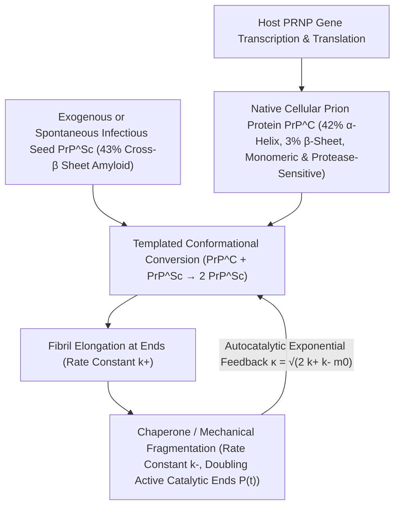

## 1. 분자생물학 중심원리에 대한 도전: 핵산 없는 감염원은 어떻게 발견되었는가?

20세기 분자생물학의 황금기에 프랜시스 크릭(Francis Crick)이 정립한 <strong>중심원리(Central Dogma)</strong>는 모든 생명체의 유전 정보와 자기복제 능력이 반드시 핵산(DNA 또는 RNA)에 의존한다는 절대적 원칙을 세웠습니다. 박테리아, 바이러스, 바이로이드 등 모든 병원체는 핵산을 파괴하는 $254\,\text{nm}$ 자외선, 전리 방사선, 또는 뉴클레아제 처리를 거치면 감염력을 완전히 상실합니다. 그러나 양의 스크래피(Scrapie), 파푸아뉴기니 포레족의 쿠루병(Kuru), 인간의 크로이츠펠트-야콥병(CJD), 광우병(BSE) 등 <strong>전염성 해면상 뇌병증(TSE)</strong>의 원인체는 이러한 상식을 완전히 뒤집었습니다.

1967년 방사선생물학자 티크바 알퍼(Tikvah Alper)는 모든 바이러스 유전체를 파괴할 수 있는 극고선량의 자외선과 방사선을 조사해도 스크래피 병원체의 감염력이 유지된다는 사실을 발견했고, 수학자 그리피스(J.S. Griffith)는 순수 단백질만으로 자기복제가 가능하다는 열역학 모델을 제시했습니다. 1982년 스탠리 프루시너(Stanley B. Prusiner, 1997년 노벨상 수상)는 감염 인자를 분리·정제하여 핵산이 전혀 없는 단일 단백질임을 입증하고 이를 <strong>프리온(Prion, Proteinaceous Infectious Particle)</strong>이라 명명했습니다. 더욱 놀라운 사실은 이 단백질을 암호화하는 <em>PRNP</em> 유전자가 모든 건강한 포유류의 염색체에 원래 존재한다는 점입니다! 정상 세포형 프리온 단백질($\text{PrP}^\text{C}$)과 병원성 프리온 단백질($\text{PrP}^{\text{Sc}}$)은 <strong>208개의 아미노산 서열과 공유결합 구조가 $100\%$ 동일</strong>하며, 오직 3차원 공간에서의 접힘(folding) 구조만 다릅니다:

$$
\Delta G_{\text{fold}} = \Delta H_{\text{fold}} - T \Delta S_{\text{conf}} + \Delta G_{\text{solv}}, \qquad k_{\text{conv}} = A \exp\!\left(-\frac{\Delta G^\ddagger_{\text{C}\to\text{Sc}}}{k_B T}\right)
$$

---

## 2. 단백질 접힘 자유에너지 지형과 주형 구조 변환: $\alpha$-나선에서 교차-$\beta$ 아밀로이드로

안핀센(Christian Anfinsen)의 열역학 가설에 따르면 일반적인 구상 단백질은 생리적 조건에서 깁스 자유에너지 $G$가 가장 낮은 고유 구조로 자발적으로 접힙니다. 그러나 고차원 형태 공간의 자유에너지 지형(Free-Energy Landscape)에는 높은 활성화 에너지 장벽 $\Delta G^\ddagger$으로 분리된 여러 국소 최솟값이 존재합니다. 정상 $\text{PrP}^\text{C}$는 약 $42\%$의 $\alpha$-나선($\alpha$-helix)과 $3\%$의 $\beta$-병풍 구조를 가진 수용성 단량체로 프로테이나제 K(Proteinase K) 효소에 의해 쉽게 분해됩니다. 반면 병원성 $\text{PrP}^{\text{Sc}}$는 약 $43\%$의 강직한 <strong>교차-$\beta$ 병풍(Cross-$\beta$ Sheet)</strong> 구조로 이루어져 있으며, 불용성이자 프로테이나제 K에 저항성을 갖는 <strong>아밀로이드 원섬유(Amyloid Fibrils)</strong>를 형성합니다.

단일 $\text{PrP}^\text{C}$ 분자가 자발적으로 높은 에너지 장벽 $\Delta G^\ddagger_{\text{C}\to\text{Sc}}$를 넘어 $\text{PrP}^{\text{Sc}}$로 변환될 확률은 극히 낮습니다(산발성 CJD 발병률은 연간 100만 명당 1명 수준). 그러나 외부에서 유입되거나 자발적으로 생성된 $\text{PrP}^{\text{Sc}}$ 씨앗(Seed)이 존재하면, 그 노출된 교차-$\beta$ 말단이 <strong>입체화학적 주형(Structural Template)</strong>으로 작용하여 정상 $\text{PrP}^\text{C}$ 단량체를 포획하고 수소결합 네트워크를 통해 활성화 장벽을 획기적으로 낮추어 자신과 동일한 $\text{PrP}^{\text{Sc}}$ 구조로 강제 변환시킵니다. 즉 프리온은 단백질을 무에서 새로 합성하는 것이 아니라 숙주 세포가 계속 만들어내는 정상 $\text{PrP}^\text{C}$를 원료로 납치하는 것입니다(찰스 바이스만의 1993년 실험에서 <em>Prnp</em> 유전자를 제거한 녹아웃 마우스 $Prnp^{0/0}$는 프리온을 뇌에 직접 주입해도 절대 발병하지 않았습니다!).

---

## 3. 유전자 없이 어떻게 지수함수적으로 증식하는가? 핵생성-신장-단편화 자기촉매 동역학

만약 $\text{PrP}^{\text{Sc}}$ 섬유가 양 끝단에서만 단량체를 결합시켜 길어지기만 한다면(신장 속도 상수 $k_+$), 응집체 총질량 $M(t)$는 시간에 따라 선형적으로만 증가할 뿐 바이러스 감염처럼 잠복기 후 폭발적인 지수함수적 증식을 보일 수 없습니다. 투오마스 놀스(Tuomas Knowles)와 미켈레 벤드루스콜로(Michele Vendruscolo)가 정립한 <strong>핵생성-신장-단편화 마스터 방정식(Master Equation of Nucleated Polymerization)</strong>은 프리온의 지수적 증식을 가능케 하는 핵심 물리학이 바로 <strong>섬유 단편화(Fragmentation, $k_-$)</strong>임을 증명했습니다:

$$
\left\{
\begin{aligned}
\frac{dP(t)}{dt} &= k_n m(t)^{n_c} + k_- \big[ M(t) - (2n_c - 1)P(t) \big] \approx k_- M(t) \\
\frac{dM(t)}{dt} &= 2 k_+ m(t) P(t) + n_c k_n m(t)^{n_c} \approx 2 k_+ m_0 P(t)
\end{aligned}
\right.
$$

---

## 4. 핵산 없는 '균주(Strain)'의 비밀, 종간 장벽, 그리고 신경퇴행성 질환의 프리온 유사 전파

긴 아밀로이드 섬유가 열적 요동이나 샤페론 단백질(Hsp104 등)의 기계적 전단력에 의해 속도 $k_-$로 두 조각으로 부러질 때마다, <strong>촉매 활성을 가진 섬유 끝단의 개수 $P(t)$가 두 배로 늘어납니다</strong>! 신장($k_+$)이 섬유 질량을 늘리고 단편화($k_-$)가 그 질량을 새로운 촉매 활성 말단으로 전환하는 피드백 루프는 2계 미분방정식 $\ddot{M}(t) = 2 k_+ k_- m_0 M(t)$를 형성하며, 유효 증식률 $\kappa = \sqrt{2 k_+ k_- m_0}$로 <strong>엄밀한 지수함수적 폭발 증식 $M(t) \sim e^{\kappa t}$</strong>를 일으킵니다! 이 원리를 응용한 <strong>PMCA</strong> 및 <strong>RT-QuIC</strong> 기술은 뇌척수액 내 아토그램($10^{-18}\,\text{g}$) 수준의 극미량 프리온 씨앗을 증폭해 초조기 진단을 가능하게 했습니다.

나아가 극저온 전자현미경(Cryo-EM) 연구는 동일한 아미노산 서열을 가진 프리온이 어떻게 서로 다른 잠복기와 뇌 병변 부위를 갖는 여러 <strong>프리온 균주(Prion Strains)</strong>를 형성하는지 밝혀냈습니다. 동일한 폴리펩타이드 사슬이라도 서로 다른 $\beta$-시트 접힘 각도와 곁사슬 지퍼 계면을 가진 여러 <strong>구조적 다형체(Conformational Polymorphs)</strong>로 결정화될 수 있으며, 각 주형은 자신의 기하학적 단면과 정확히 일치하는 구조만 에피택시(epitaxy) 방식으로 성장시킵니다. 오늘날 알츠하이머병의 $\text{A}\beta$ 및 $\text{Tau}$, 파킨슨병의 $\alpha$-시누클레인($\alpha$-Synuclein), 루게릭병(ALS)의 TDP-43 단백질 역시 동일한 <strong>프리온 유사(Prion-like) 구조 전파 메커니즘</strong>을 따르는 것으로 밝혀졌으며, 효모의 $[\text{PSI}^+]$와 신경 기억 유지 단백질 CPEB는 생명체가 이 물리적 상전이를 유익한 후성유전학적 기억 장치로 활용하고 있음을 보여줍니다.

| 비교 항목 | 정상 세포형 프리온 ($\text{PrP}^\text{C}$) | 병원성 프리온 ($\text{PrP}^{\text{Sc}}$) | 일반 바이러스 (Virus) |
| :--- | :--- | :--- | :--- |
| <strong>핵산 유전체 (DNA/RNA)</strong> | 없음 (숙주 염색체 <em>PRNP</em> 유전자가 암호화) | <strong>핵산 전혀 없음</strong> (순수 단백질 구조체) | 반드시 DNA 또는 RNA 유전체 보유 |
| <strong>2차 구조 비율</strong> | $\approx 42\%$ $\alpha$-나선, $\approx 3\%$ $\beta$-병풍 | $\approx 30\%$ $\alpha$-나선, <strong>$\approx 43\%$ 교차-$\beta$ 병풍</strong> | 캡시드 단백질이 핵산을 포장 |
| <strong>물리화학적·효소적 특성</strong> | 수용성 단량체, 프로테이나제 K에 완전 분해 | 불용성 아밀로이드 섬유, <strong>단백질분해효소·열·자외선 저항성</strong> | 자외선·방사선·단백질분해효소에 불활화 |
| <strong>증식 및 정보 전달 원리</strong> | 리보솜 번역 후 자발적 최소 에너지 접힘 | <strong>주형 유도 구조 변환 + 신장/단편화 자기촉매 ($e^{\kappa t}$)</strong> | 숙주 복제 기구를 이용한 핵산 복제·번역 |

$$
\frac{d^2 M(t)}{dt^2} - 2 k_+ k_- m_0 \, M(t) = 0 \implies M(t) \simeq C \cosh(\kappa t) \sim \exp(\kappa t), \qquad \kappa = \sqrt{2 \, k_+ \, k_- \, m_0}
$$

