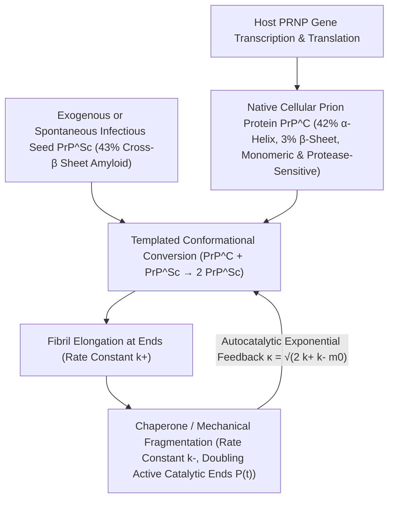

## 1. Uma heresia contra o Dogma Central: a descoberta de um agente infeccioso sem ácidos nucleicos

Na era de ouro da biologia molecular, o <strong>Dogma Central</strong> formulado por Francis Crick estabeleceu como princípio absoluto que toda informação hereditária e toda capacidade de autorreplicação biológica dependem necessariamente de ácidos nucleicos (DNA ou RNA). Bactérias, vírus e viroides perdem totalmente sua infecciosidade quando seu genoma é destruído por radiação ultravioleta de onda curta ($254\,\text{nm}$), radiação ionizante ou nucleases. Contudo, o agente causador das <strong>encefalopatias espongiformes transmissíveis (EET)</strong> — como o *scrapie* ovino, o kuru na Papua-Nova Guiné, a doença de Creutzfeldt-Jakob (DCJ) e a encefalopatia espongiforme bovina (EEB) — desafiava essas leis.

Em 1967, a radiobiologista Tikvah Alper demonstrou que o agente do *scrapie* resistia a doses extremas de radiação UV e ionizante capazes de aniquilar qualquer genoma viral, levando o matemático J. S. Griffith a propor os primeiros modelos teóricos de autorreplicação puramente proteica. Em 1982, Stanley B. Prusiner (Prêmio Nobel 1997) purificou o agente infeccioso, provou que ele consistia exclusivamente em uma única proteína desprovida de ácido nucleico e cunhou o termo <strong>príon (Proteinaceous Infectious Particle)</strong>. Mais surpreendente ainda foi descobrir que o gene <em>PRNP</em> que codifica essa proteína existe naturalmente no cromossomo de todos os mamíferos saudáveis: a proteína priônica celular normal ($\text{PrP}^\text{C}$) e a isoforma patogênica infecciosa ($\text{PrP}^{\text{Sc}}$) possuem <strong>exatamente a mesma sequência de 208 aminoácidos e as mesmas ligações covalentes</strong>; sua única diferença está no dobramento espacial tridimensional:

$$
\Delta G_{\text{fold}} = \Delta H_{\text{fold}} - T \Delta S_{\text{conf}} + \Delta G_{\text{solv}}, \qquad k_{\text{conv}} = A \exp\!\left(-\frac{\Delta G^\ddagger_{\text{C}\to\text{Sc}}}{k_B T}\right)
$$

---

## 2. Paisagem de energia livre e conversão por molde: da hélice $\alpha$ à fibrila amiloide cross-$\beta$

Segundo a hipótese termodinâmica de Christian Anfinsen, uma proteína globular dobra-se espontaneamente em direção ao mínimo global de sua energia livre de Gibbs $G$. Entretanto, no espaço conformacional de alta dimensão, a paisagem de energia livre frequentemente apresenta múltiplos mínimos locais separados por altas barreiras cinéticas de ativação $\Delta G^\ddagger$. A forma nativa $\text{PrP}^\text{C}$ contém cerca de $42\%$ de hélices $\alpha$ e apenas $3\%$ de folhas $\beta$; é monomérica, solúvel em água e facilmente digerida pela proteinase K. Em contrapartida, a isoforma $\text{PrP}^{\text{Sc}}$ apresenta $43\%$ de <strong>folhas $\beta$ cruzadas rígidas (Cross-$\beta$ Sheets)</strong> que se empilham em <strong>fibrilas amiloides</strong> insolúveis e resistentes a proteases.

Para uma molécula isolada de $\text{PrP}^\text{C}$, transpor espontaneamente a barreira $\Delta G^\ddagger_{\text{C}\to\text{Sc}}$ é extremamente improvável (a DCJ esporádica afeta apenas cerca de $1$ em um milhão de pessoas por ano). Mas quando uma semente cristalina (Seed) de $\text{PrP}^{\text{Sc}}$ está presente, sua extremidade cross-$\beta$ exposta atua como um <strong>molde estereoquímico (Structural Template)</strong> que captura o monômero $\text{PrP}^\text{C}$ normal, reduz drasticamente a barreira de ativação por meio de ligações de hidrogênio e interações hidrofóbicas, e o converte em uma nova subunidade $\text{PrP}^{\text{Sc}}$. O príon, portanto, não sintetiza proteínas do nada: ele sequestra a $\text{PrP}^\text{C}$ continuamente produzida pela célula hospedeira (como provou Charles Weissmann em 1993, camundongos *knockout* $Prnp^{0/0}$ sem o gene <em>Prnp</em> são totalmente imunes à inoculação de príons!).

---

## 3. Por que cresce exponencialmente sem genes? Cinética autocatalítica de nucleação-alongamento-fragmentação

Se uma fibrila amiloide apenas adicionasse monômeros em suas duas extremidades (taxa de alongamento $k_+$), a massa total de agregados $M(t)$ cresceria apenas linearmente com o tempo, jamais produzindo a explosão exponencial típica de uma infecção. A <strong>equação mestra da polimerização nucleada</strong> formulada por Tuomas Knowles e Michele Vendruscolo demonstra que o motor físico da amplificação exponencial é a <strong>fragmentação das fibrilas ($k_-$)</strong>:

$$
\left\{
\begin{aligned}
\frac{dP(t)}{dt} &= k_n m(t)^{n_c} + k_- \big[ M(t) - (2n_c - 1)P(t) \big] \approx k_- M(t) \\
\frac{dM(t)}{dt} &= 2 k_+ m(t) P(t) + n_c k_n m(t)^{n_c} \approx 2 k_+ m_0 P(t)
\end{aligned}
\right.
$$

---

## 4. O enigma das «cepas» sem DNA, a barreira de espécie e a propagação «prion-like»

Quando uma fibrila longa se parte em duas por flutuações térmicas ou pelo cisalhamento mecânico de chaperonas moleculares (como Hsp104) a uma taxa $k_-$, <strong>o número de extremidades cataliticamente ativas $P(t)$ dobra instantaneamente</strong>! O acoplamento entre alongamento ($k_+$) e fragmentação ($k_-$) gera a equação diferencial de segunda ordem $\ddot{M}(t) = 2 k_+ k_- m_0 M(t)$, impulsionando um <strong>crescimento exponencial exato $M(t) \sim e^{\kappa t}$</strong> com taxa efetiva $\kappa = \sqrt{2 k_+ k_- m_0}$. Esse mesmo princípio fundamenta as técnicas diagnósticas <strong>PMCA</strong> e <strong>RT-QuIC</strong>, capazes de amplificar um bilhão de vezes um único attograma ($10^{-18}\,\text{g}$) de príons no líquido cefalorraquidiano.

A criomicroscopia eletrônica (Cryo-EM) também elucidou o mistério das <strong>cepas de príons (Prion Strains)</strong>: uma mesma sequência de aminoácidos pode cristalizar em diferentes <strong>polimorfos conformacionais</strong> (diferentes topologias de empilhamento $\beta$ e zíperes estéricos), cada um permitindo apenas o crescimento epitaxial de sua própria geometria. Hoje sabemos que as proteínas $\text{A}\beta$ e $\text{Tau}$ no Alzheimer, a $\alpha$-sinucleína no Parkinson e TDP-43 na ELA seguem exatamente essa mesma <strong>propagação do tipo priônico («prion-like»)</strong>, enquanto príons funcionais como $[\text{PSI}^+]$ em leveduras e CPEB nas sinapses neuronais mostram como a evolução domesticou essa transição de fase física como memória epigenética.

| Dimensão comparativa | Proteína priônica nativa ($\text{PrP}^\text{C}$) | Príon infeccioso ($\text{PrP}^{\text{Sc}}$) | Vírus clássico (Virus) |
| :--- | :--- | :--- | :--- |
| <strong>Genoma (DNA/RNA)</strong> | Nenhum (codificada pelo gene hospedeiro <em>PRNP</em>) | <strong>Totalmente livre de DNA/RNA</strong> | Possui obrigatoriamente genoma de DNA ou RNA |
| <strong>Estrutura secundária</strong> | $\approx 42\%$ hélice $\alpha$, $\approx 3\%$ folha $\beta$ | $\approx 30\%$ hélice $\alpha$, <strong>$\approx 43\%$ folha cross-$\beta$</strong> | Capsídeo proteico envolvendo o ácido nucleico |
| <strong>Propriedades bioquímicas</strong> | Monômero solúvel, sensível à proteinase K | Amiloide insolúvel, <strong>resistente a proteases, calor e UV</strong> | Inativado por UV, radiação e proteases |
| <strong>Mecanismo de multiplicação</strong> | Dobramento espontâneo pós-traducional | <strong>Conversão por molde + alongamento/fragmentação ($e^{\kappa t}$)</strong> | Replicação de ácido nucleico e tradução |

$$
\frac{d^2 M(t)}{dt^2} - 2 k_+ k_- m_0 \, M(t) = 0 \implies M(t) \simeq C \cosh(\kappa t) \sim \exp(\kappa t), \qquad \kappa = \sqrt{2 \, k_+ \, k_- \, m_0}
$$

