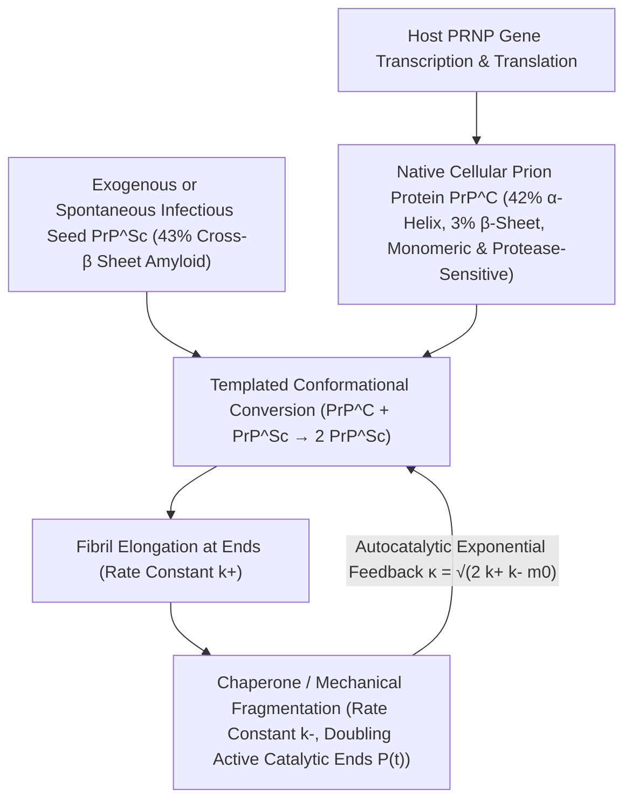

## 1. Ересь против Центральной догмы: как был открыт инфекционный агент без нуклеиновых кислот

В золотой век молекулярной биологии <strong>Центральная догма</strong>, сформулированная Фрэнсисом Криком, утвердила незыблемый постулат: любая наследственная информация и способность к самовоспроизведению в живой природе требуют наличия нуклеиновой кислоты (ДНК или РНК). Бактерии, вирусы и вироиды полностью теряют инфекционность при разрушении их генома коротковолновым ультрафиолетом ($254\,\text{нм}$), ионизирующим излучением или нуклеазами. Однако возбудитель <strong>трансмиссивных губчатых энцефалопатий (ТГЭ)</strong> — скрепи овец, куру в Папуа — Новой Гвинее, болезни Крейтцфельдта — Якоба (БКЯ) и коровьего бешенства (ГЭКРС) — опроверг эти правила.

В 1967 году радиобиолог Тиква Альпер показала, что агент скрепи выдерживает экстремальные дозы УФ- и ионизирующего излучения, уничтожающие любой вирусный геном, после чего математик Дж. С. Гриффит предложил первые теоретические модели чисто белковой саморепликации. В 1982 году Стэнли Прузинер (Нобелевская премия 1997 года) выделил инфекционный агент, доказал, что он состоит исключительно из одного хозяйского белка без следов ДНК или РНК, и ввел термин <strong>прион (Proteinaceous Infectious Particle — белковая инфекционная частица)</strong>. Еще более поразительным оказалось то, что ген <em>PRNP</em>, кодирующий этот белок, изначально присутствует в геноме всех здоровых млекопитающих! Нормальный клеточный прионный белок ($\text{PrP}^\text{C}$) и патогенная инфекционная изоформа ($\text{PrP}^{\text{Sc}}$) имеют <strong>абсолютно идентичную последовательность из 208 аминокислот и одинаковые ковалентные связи</strong>, различаясь исключительно трехмерной пространственной укладкой (конформацией):

$$
\Delta G_{\text{fold}} = \Delta H_{\text{fold}} - T \Delta S_{\text{conf}} + \Delta G_{\text{solv}}, \qquad k_{\text{conv}} = A \exp\!\left(-\frac{\Delta G^\ddagger_{\text{C}\to\text{Sc}}}{k_B T}\right)
$$

---

## 2. Ландшафт свободной энергии и матричная конверсия: от $\alpha$-спирали к кросс-$\beta$ амилоиду

Согласно термодинамической гипотезе Кристиана Анфинсена, глобулярный белок спонтанно сворачивается в глобальный минимум свободной энергии Гиббса $G$. Однако в многомерном конформационном пространстве ландшафт свободной энергии часто содержит несколько глубоких минимумов, разделенных высокими кинетическими барьерами активации $\Delta G^\ddagger$. Нативный $\text{PrP}^\text{C}$ содержит около $42\%$ $\alpha$-спиралей и лишь $3\%$ $\beta$-слоев; он мономерен, водорастворим и легко расщепляется протеиназой K. Напротив, изоформа $\text{PrP}^{\text{Sc}}$ состоит на $43\%$ из жестких <strong>кросс-$\beta$ слоев (Cross-$\beta$ Sheets)</strong>, упакованных в нерастворимые и устойчивые к протеазам <strong>амилоидные фибриллы</strong>.

Для изолированной молекулы $\text{PrP}^\text{C}$ спонтанное преодоление барьера $\Delta G^\ddagger_{\text{C}\to\text{Sc}}$ крайне маловероятно (спорадическая БКЯ возникает лишь у $1$ из миллиона человек в год). Но при появлении кристаллической затравки (Seed) $\text{PrP}^{\text{Sc}}$ ее открытый кросс-$\beta$ торец работает как <strong>стереохимическая матрица (Structural Template)</strong>: связывая нормальный мономер $\text{PrP}^\text{C}$, она резко снижает активационный барьер за счет сети водородных связей и переводит его в конформацию $\text{PrP}^{\text{Sc}}$. Таким образом, прион не синтезирует белок *de novo*, а захватывает нормальный $\text{PrP}^\text{C}$, непрерывно производимый клеткой хозяина (в 1993 году Чарльз Вайсман доказал, что мыши с нокаутом гена <em>Prnp</em> $Prnp^{0/0}$ абсолютно невосприимчивы к инъекции прионов!).

---

## 3. Почему возможен экспоненциальный рост без генов? Кинетика нуклеации-элонгации-фрагментации

Если бы амилоидная фибрилла лишь присоединяла мономеры на двух своих концах (константа скорости элонгации $k_+$), общая масса агрегатов $M(t)$ росла бы лишь линейно со временем и никогда не вызвала бы лавинообразного экспоненциального взрыва. <strong>Кинетическое мастер-уравнение нуклеированной полимеризации</strong>, выведенное Туомасом Ноулзом и Микеле Вендрусколо, показало, что физическим двигателем экспоненциального размножения является <strong>фрагментация фибрилл ($k_-$)</strong>:

$$
\left\{
\begin{aligned}
\frac{dP(t)}{dt} &= k_n m(t)^{n_c} + k_- \big[ M(t) - (2n_c - 1)P(t) \big] \approx k_- M(t) \\
\frac{dM(t)}{dt} &= 2 k_+ m(t) P(t) + n_c k_n m(t)^{n_c} \approx 2 k_+ m_0 P(t)
\end{aligned}
\right.
$$

---

## 4. Загадка безгеномных «штаммов», межвидовой барьер и «прионоподобное» распространение при нейродегенерации

Когда длинная фибрилла разламывается надвое под действием тепловых флуктуаций или молекулярных шаперонов (например, Hsp104) со скоростью $k_-$, <strong>число каталитически активных концов фибрилл $P(t)$ мгновенно удваивается</strong>! Взаимная связь элонгации ($k_+$) и фрагментации ($k_-$) порождает дифференциальное уравнение второго порядка $\ddot{M}(t) = 2 k_+ k_- m_0 M(t)$, обеспечивающее <strong>строгий экспоненциальный рост $M(t) \sim e^{\kappa t}$</strong> с инкрементом $\kappa = \sqrt{2 k_+ k_- m_0}$. Именно этот принцип лежит в основе сверхчувствительных методов диагностики <strong>PMCA</strong> и <strong>RT-QuIC</strong>, позволяющих в миллиарды раз амплифицировать единичные аттограммы ($10^{-18}\,\text{г}$) прионов в спинномозговой жидкости.

Криоэлектронная микроскопия (Cryo-EM) разрешила и загадку <strong>прионных штаммов (Prion Strains)</strong>: одна и та же аминокислотная последовательность может кристаллизоваться в различные <strong>конформационные полиморфы</strong> (разные топологии укладки $\beta$-листов и стерических молний), каждый из которых допускает эпитаксиальный рост только собственной геометрии. Сегодня установлено, что белки $\text{A}\beta$ и $\text{Tau}$ при болезни Альцгеймера, $\alpha$-синуклеин при болезни Паркинсона и TDP-43 при БАС распространяются по мозгу по точно такому же <strong>прионоподобному («prion-like») механизму</strong>, тогда как функциональные прионы $[\text{PSI}^+]$ у дрожжей и белок синаптической памяти CPEB служат примером полезной эпигенетической памяти.

| Критерий сравнения | Нативный прионный белок ($\text{PrP}^\text{C}$) | Инфекционный прион ($\text{PrP}^{\text{Sc}}$) | Классический вирус (Virus) |
| :--- | :--- | :--- | :--- |
| <strong>Геном (ДНК/РНК)</strong> | Отсутствует (кодируется геном хозяина <em>PRNP</em>) | <strong>Полностью лишен ДНК и РНК</strong> | Обязательно содержит геном ДНК или РНК |
| <strong>Вторичная структура</strong> | $\approx 42\%$ $\alpha$-спираль, $\approx 3\%$ $\beta$-слой | $\approx 30\%$ $\alpha$-спираль, <strong>$\approx 43\%$ кросс-$\beta$ слой</strong> | Белковый капсид, окружающий нуклеиновую кислоту |
| <strong>Физико-химические свойства</strong> | Растворимый мономер, чувствителен к протеиназе K | Нерастворимый амилоид, <strong>устойчив к протеазам, нагреву и УФ</strong> | Инактивируется УФ, радиацией и протеазами |
| <strong>Механизм размножения</strong> | Спонтанное сворачивание после трансляции | <strong>Матричная конверсия + элонгация/фрагментация ($e^{\kappa t}$)</strong> | Репликация нуклеиновой кислоты и трансляция |

$$
\frac{d^2 M(t)}{dt^2} - 2 k_+ k_- m_0 \, M(t) = 0 \implies M(t) \simeq C \cosh(\kappa t) \sim \exp(\kappa t), \qquad \kappa = \sqrt{2 \, k_+ \, k_- \, m_0}
$$

