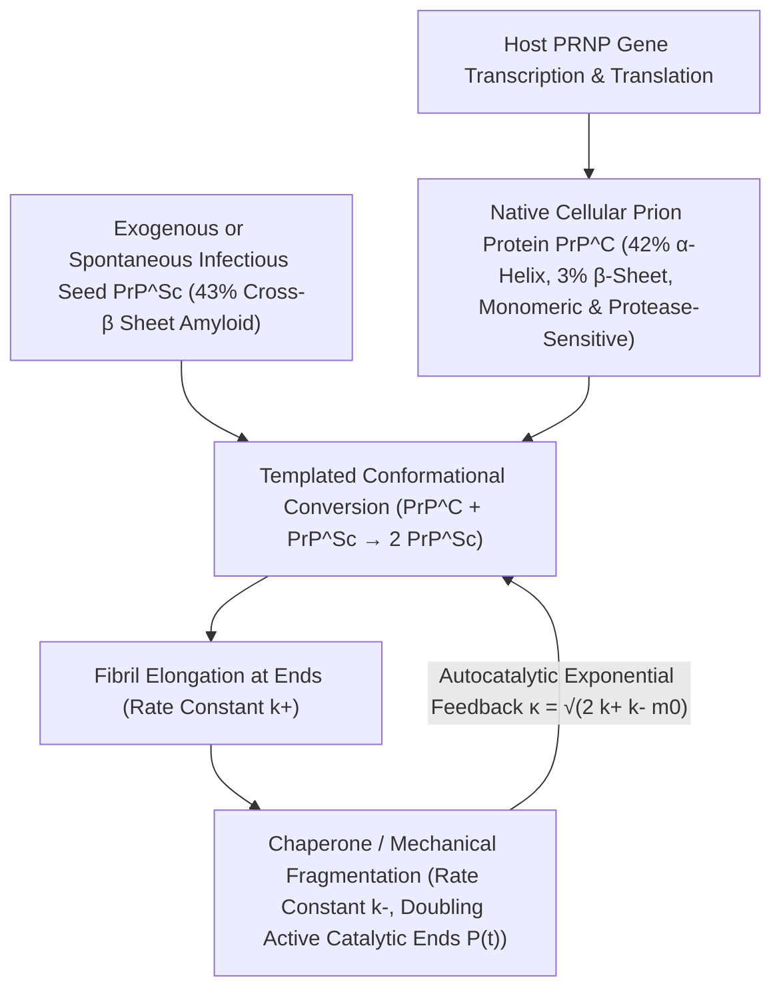

## 1. 挑战中心法则的异端：没有核酸的传染性因子是如何被发现的？

在20世纪分子生物学的黄金时代，弗朗西斯·克里克（Francis Crick）提出的<strong>中心法则（Central Dogma）</strong>确立了一条铁律：一切生物遗传信息与自我复制能力都必须以核酸（DNA或RNA）为载体。无论细菌、病毒还是类病毒（Viroids），当受到破坏核酸的短波紫外线（$254\,\text{nm}$）、电离辐射或核酸酶处理时，都会彻底丧失传染性。然而，羊瘙痒病（Scrapie）、新几内亚法雷人中的库鲁病（Kuru）、人类克雅氏病（CJD）以及疯牛病（BSE）等<strong>传染性海绵状脑病（TSE）</strong>的病原体却打破了这一常识。

1967年，放射生物学家蒂크瓦·阿尔珀（Tikvah Alper）发现，即使使用足以摧毁一切已知病毒基因组的极高剂量紫外线和电离辐射照射羊瘙痒病病原体，其传染性依然毫发无损；数学家J.S.格里菲斯（J.S. Griffith）随即提出了大胆的纯蛋白质自我复制数学假说。1982年，斯坦利·普鲁西纳（Stanley B. Prusiner，1997年诺贝尔奖得主）成功提纯了该感染因子，证实其完全由单一宿主蛋白质构成、不含任何可检测的核酸，并将其命名为<strong>朊病毒（Prion，Proteinaceous Infectious Particle，蛋白质传染性颗粒）</strong>。更令人震惊的是：编码该蛋白的基因 <em>PRNP</em> 原本就存在于每一个健康哺乳动物的染色体上！健康神经元表面的正常细胞型朊蛋白（$\text{PrP}^\text{C}$）与致命的感染型朊蛋白（$\text{PrP}^{\text{Sc}}$）拥有<strong>完全相同的208个氨基酸序列和相同的共价化学键</strong>，二者的唯一区别仅仅在于三维空间的折叠构象：

$$
\Delta G_{\text{fold}} = \Delta H_{\text{fold}} - T \Delta S_{\text{conf}} + \Delta G_{\text{solv}}, \qquad k_{\text{conv}} = A \exp\!\left(-\frac{\Delta G^\ddagger_{\text{C}\to\text{Sc}}}{k_B T}\right)
$$

---

## 2. 蛋白质折叠自由能景观与构象转换：从 $\alpha$-螺旋到交叉-$\beta$淀粉样纤维

根据安芬森（Christian Anfinsen）的热力学假说，普通球状蛋白在生理环境下会自发折叠为吉布斯自由能 $G$ 最低的唯一天然构象。然而，在多肽链构成的高维构象空间中，自由能景观（Free-Energy Landscape）往往并非单一平滑漏斗，而是存在多个局部极小值与高聳的动力学能垒 $\Delta G^\ddagger$。正常细胞型 $\text{PrP}^\text{C}$ 富含约 $42\%$ 的 $\alpha$-螺旋（$\alpha$-helix），仅含 $3\%$ 的 $\beta$-折叠，呈水溶性单体，极易被蛋白酶K（Proteinase K）完全水解。相反，感染型 $\text{PrP}^{\text{Sc}}$ 则含有高达 $43\%$ 的刚性<strong>交叉-$\beta$折叠（Cross-$\beta$ Sheet）</strong>，组装成不溶于水、耐蛋白酶K消化的<strong>淀粉样蛋白原纤维（Amyloid Fibrils）</strong>。

对于单个 $\text{PrP}^\text{C}$ 分子而言，自发跨越活化能垒 $\Delta G^\ddagger_{\text{C}\to\text{Sc}}$ 转变为 $\text{PrP}^{\text{Sc}}$ 的概率极低（散发性克雅氏病的自然发生率约为每年百万分之一）。然而，一旦外源性或自发形成的 $\text{PrP}^{\text{Sc}}$ 晶种（Seed）进入体内，其暴露的交叉-$\beta$端面就会充当<strong>立体化学结构模板（Structural Template）</strong>，通过致密的分子间氢键网络与疏水相互作用捕获正常的 $\text{PrP}^\text{C}$ 单体，大幅降低构象转换的活化能垒，将其诱导重折并同化为新的 $\text{PrP}^{\text{Sc}}$ 亚基。这表明朊病毒并没有“凭空合成”蛋白质，而是劫持宿主细胞持续合成的正常 $\text{PrP}^\text{C}$ 作为原料（查尔斯·魏斯曼1993年的实验证实：敲除 <em>Prnp</em> 基因的小鼠 $Prnp^{0/0}$ 即使直接向脑内注射高浓度朊病毒也绝对不会发病！）。

---

## 3. 为什么没有基因也能呈指数级增殖？成核-延伸-断裂的自动催化动力学

如果 $\text{PrP}^{\text{Sc}}$ 晶种仅在纤维两端结合单体（延伸速率常数为 $k_+$），那么聚集体总质量 $M(t)$ 只会随时间呈缓慢的线性或二次方增长，绝不可能表现出类似病毒的指数级潜伏期爆发。托马斯·诺尔斯（Tuomas Knowles）与米歇尔·文德鲁斯科洛（Michele Vendruscolo）建立的<strong>成核-延伸-断裂主方程（Master Equation of Nucleated Polymerization）</strong>揭示了朊病毒实现指数增殖的核心物理机制——<strong>纤维断裂（Fragmentation，$k_-$）</strong>：

$$
\left\{
\begin{aligned}
\frac{dP(t)}{dt} &= k_n m(t)^{n_c} + k_- \big[ M(t) - (2n_c - 1)P(t) \big] \approx k_- M(t) \\
\frac{dM(t)}{dt} &= 2 k_+ m(t) P(t) + n_c k_n m(t)^{n_c} \approx 2 k_+ m_0 P(t)
\end{aligned}
\right.
$$

---

## 4. 无核酸的“株系”之谜、物种屏障与神经退行性疾病的“类朊病毒”统一图景

当一条长淀粉样纤维在热涨落或细胞分子伴侣（如 Hsp104）的机械剪切下以速率 $k_-$ 断裂成两段时，<strong>具有催化活性的纤维自由端数目 $P(t)$ 瞬间翻倍</strong>！延伸（$k_+$）增加纤维长度，断裂（$k_-$）将长度转化为新的催化活性端，二者耦合形成二阶微分方程 $\ddot{M}(t) = 2 k_+ k_- m_0 M(t)$，从而驱动聚集体质量以有效增长率 $\kappa = \sqrt{2 k_+ k_- m_0}$ 呈<strong>严格的指数级爆发增长 $M(t) \sim e^{\kappa t}$</strong>！利用这一原理开发的<strong>蛋白质错误折叠循环扩增（PMCA）</strong>与<strong>实时震荡诱导转化（RT-QuIC）</strong>技术，已能将脑脊液中单个阿克（$10^{-18}\,\text{g}$）级别的朊病毒晶种放大十亿倍进行超早期诊断。

更深层的谜题在于<strong>朊病毒株系（Prion Strains）</strong>：完全相同的氨基酸序列为何能分化出潜伏期、脑部海绵状病变区域和糖基化比例截然不同的多种稳定“株系”？低温电子显微镜（Cryo-EM）高分辨率结构生物学证明，同一条多肽链可以折叠成具有不同 $\beta$-折叠拓扑走向、堆叠旋转角和侧链拉链界面的多种<strong>构象多晶型（Conformational Polymorphs）</strong>。每种多晶型模板只允许与其几何形状严格匹配的构象在端面外延生长，从而将“遗传信息”直接编码在三维几何晶体学之中；而不同物种间氨基酸序列的微小差异会导致立体空间位阻不匹配，构成<strong>物种屏障（Species Barrier）</strong>。如今，科学家发现阿尔茨海默病的 $\text{A}\beta$ 与 $\text{Tau}$ 蛋白、帕金森病的 $\alpha$-突触核蛋白（$\alpha$-Synuclein）以及渐冻症（ALS）的 TDP-43 均遵循完全相同的<strong>类朊病毒（Prion-like）构象伝播机制</strong>，同时酵母中的 $[\text{PSI}^+]$ 与神经元记忆维持蛋白 CPEB 则展现了大自然将这一物理相变机制转化为有益表观遗传记忆的精妙智慧。

| 比较维度 | 正常细胞型朊蛋白 ($\text{PrP}^\text{C}$) | 感染型朊病毒 ($\text{PrP}^{\text{Sc}}$) | 传统病毒 (Virus) |
| :--- | :--- | :--- | :--- |
| <strong>核酸基因组 (DNA/RNA)</strong> | 无（由宿主染色体 <em>PRNP</em> 编码） | <strong>完全不含核酸</strong>（纯蛋白质构象体） | 必含 DNA 或 RNA 基因组 |
| <strong>二级结构组成</strong> | $\approx 42\%$ $\alpha$-螺旋，$\approx 3\%$ $\beta$-折叠 | $\approx 30\%$ $\alpha$-螺旋，<strong>$\approx 43\%$ 交叉-$\beta$折叠</strong> | 衣壳蛋白包裹核酸链 |
| <strong>物理化学与酶学性质</strong> | 单体水溶性，对蛋白酶K完全敏感 | 不溶性淀粉样纤维，<strong>耐蛋白酶K、耐高温与紫外线</strong> | 对紫外线、辐射和蛋白酶敏感 |
| <strong>增殖与信息传递机制</strong> | 核糖体正常翻译后自发折叠 | <strong>模板诱导构象转换 + 延伸/断裂自动催化 ($e^{\kappa t}$)</strong> | 依赖宿主复制核酸并翻译衣壳 |

$$
\frac{d^2 M(t)}{dt^2} - 2 k_+ k_- m_0 \, M(t) = 0 \implies M(t) \simeq C \cosh(\kappa t) \sim \exp(\kappa t), \qquad \kappa = \sqrt{2 \, k_+ \, k_- \, m_0}
$$

