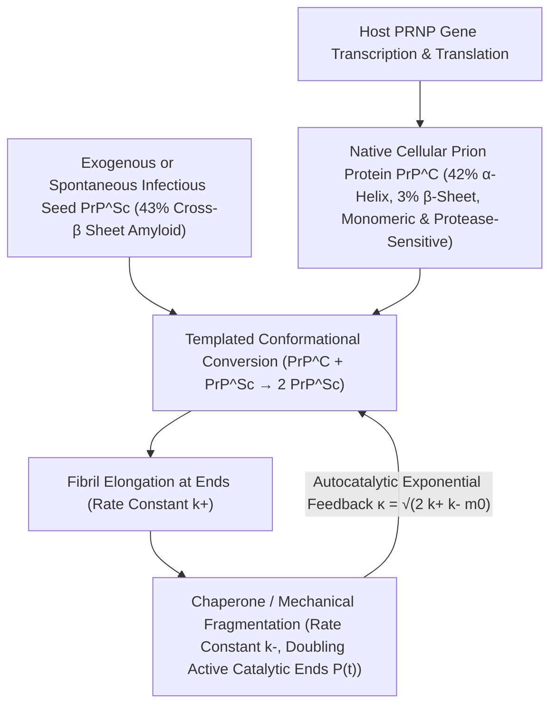

## 1. 挑戰中心法則的異端：沒有核酸的傳染性因子是如何被發現的？

在20世紀分子生物學的黃金時代，法蘭西斯·克里克（Francis Crick）提出的<strong>中心法則（Central Dogma）</strong>確立了一條鐵律：一切生物遺傳資訊與自我複製能力都必須以核酸（DNA或RNA）為載體。無論細菌、病毒還是類病毒（Viroids），當受到破壞核酸的短波紫外線（$254\,\text{nm}$）、游離輻射或核酸酶處理時，都會徹底喪失傳染性。然而，羊搔癢症（Scrapie）、新幾內亞法雷人中的庫魯病（Kuru）、人類庫賈氏病（CJD）以及狂牛症（BSE）等<strong>傳染性海綿狀腦病變（TSE）</strong>的病原體卻打破了這一常識。

1967年，放射生物學家蒂克瓦·阿爾珀（Tikvah Alper）發現，即使使用足以摧毀一切已知病毒基因組的極高劑量紫外線和游離輻射照射羊搔癢症病原體，其傳染性依然毫髮無損；數學家J.S.格里菲斯（J.S. Griffith）隨即提出了大膽的純蛋白質自我複製數學假說。1982年，史坦利·布魯希納（Stanley B. Prusiner，1997年諾貝爾獎得主）成功提純了該感染因子，證實其完全由單一宿主蛋白質構成、不含任何可檢測的核酸，並將其命名為<strong>普里昂蛋白（Prion，Proteinaceous Infectious Particle，蛋白質傳染性顆粒）</strong>。更令人震驚的是：編碼該蛋白的基因 <em>PRNP</em> 原本就存在於每一個健康哺乳動物的染色體上！健康神經元表面的正常細胞型普里昂蛋白（$\text{PrP}^\text{C}$）與致命的感染型普里昂蛋白（$\text{PrP}^{\text{Sc}}$）擁有<strong>完全相同的208個胺基酸序列和相同的共價化學鍵</strong>，二者的唯一區別僅僅在於三維空間的折疊構象：

$$
\Delta G_{\text{fold}} = \Delta H_{\text{fold}} - T \Delta S_{\text{conf}} + \Delta G_{\text{solv}}, \qquad k_{\text{conv}} = A \exp\!\left(-\frac{\Delta G^\ddagger_{\text{C}\to\text{Sc}}}{k_B T}\right)
$$

---

## 2. 蛋白質折疊自由能景觀與構象轉換：從 $\alpha$-螺旋到交叉-$\beta$類澱粉蛋白纖維

根據安芬森（Christian Anfinsen）的熱力學假說，普通球狀蛋白在生理環境下會自發折疊為吉布斯自由能 $G$ 最低的唯一天然構象。然而，在多肽鏈構成的高維構象空間中，自由能景觀（Free-Energy Landscape）往往並非單一平滑漏斗，而是存在多個局部極小值與高聳的動力學能壘 $\Delta G^\ddagger$。正常細胞型 $\text{PrP}^\text{C}$ 富含約 $42\%$ 的 $\alpha$-螺旋（$\alpha$-helix），僅含 $3\%$ 的 $\beta$-折疊，呈水溶性單體，極易被蛋白酶K（Proteinase K）完全水解。相反，感染型 $\text{PrP}^{\text{Sc}}$ 則含有高達 $43\%$ 的剛性<strong>交叉-$\beta$折疊（Cross-$\beta$ Sheet）</strong>，組裝成不溶於水、耐蛋白酶K消化的<strong>類澱粉蛋白原纖維（Amyloid Fibrils）</strong>。

對於單個 $\text{PrP}^\text{C}$ 分子而言，自發跨越活化能壘 $\Delta G^\ddagger_{\text{C}\to\text{Sc}}$ 轉變為 $\text{PrP}^{\text{Sc}}$ 的機率極低（散發性庫賈氏病的自然發生率約為每年百萬分之一）。然而，一旦外源性或自發形成的 $\text{PrP}^{\text{Sc}}$ 晶種（Seed）進入體內，其暴露的交叉-$\beta$端面就會充當<strong>立體化學結構模板（Structural Template）</strong>，透過致密的分子間氫鍵網路與疏水相互作用捕獲正常的 $\text{PrP}^\text{C}$ 單體，大幅降低構象轉換的活化能壘，將其誘導重折並同化為新的 $\text{PrP}^{\text{Sc}}$ 亞基。這表明普里昂蛋白並沒有「憑空合成」蛋白質，而是劫持宿主細胞持續合成的正常 $\text{PrP}^\text{C}$ 作為原料（查爾斯·魏斯曼1993年的實驗證實：剔除 <em>Prnp</em> 基因的小鼠 $Prnp^{0/0}$ 即使直接向腦內注射高濃度普里昂蛋白也絕對不會發病！）。

---

## 3. 為什麼沒有基因也能呈指數級增殖？成核-延伸-斷裂的自動催化動力學

如果 $\text{PrP}^{\text{Sc}}$ 晶種僅在纖維兩端結合單體（延伸速率常數為 $k_+$），那麼聚集體總質量 $M(t)$ 只會隨時間呈緩慢的線性或二次方增長，絕不可能表現出類似病毒的指數級潛伏期爆發。托馬斯·諾爾斯（Tuomas Knowles）與米歇爾·文德魯斯科洛（Michele Vendruscolo）建立的<strong>成核-延伸-斷裂主方程（Master Equation of Nucleated Polymerization）</strong>揭示了普里昂蛋白實現指數增殖的核心物理機制——<strong>纖維斷裂（Fragmentation，$k_-$）</strong>：

$$
\left\{
\begin{aligned}
\frac{dP(t)}{dt} &= k_n m(t)^{n_c} + k_- \big[ M(t) - (2n_c - 1)P(t) \big] \approx k_- M(t) \\
\frac{dM(t)}{dt} &= 2 k_+ m(t) P(t) + n_c k_n m(t)^{n_c} \approx 2 k_+ m_0 P(t)
\end{aligned}
\right.
$$

---

## 4. 無核酸的「株系」之謎、物種屏障與神經退化性疾病的「類普里昂」統一圖景

當一條長類澱粉蛋白纖維在熱漲落或細胞分子伴侶（如 Hsp104）的機械剪切下以速率 $k_-$ 斷裂成兩段時，<strong>具有催化活性的纖維自由端數目 $P(t)$ 瞬間翻倍</strong>！延伸（$k_+$）增加纖維長度，斷裂（$k_-$）將長度轉化為新的催化活性端，二者耦合形成二階微分方程 $\ddot{M}(t) = 2 k_+ k_- m_0 M(t)$，從而驅動聚集體質量以有效增長率 $\kappa = \sqrt{2 k_+ k_- m_0}$ 呈<strong>嚴格的指數級爆發增長 $M(t) \sim e^{\kappa t}$</strong>！利用這一原理開發的<strong>蛋白質錯誤折疊循環擴增（PMCA）</strong>與<strong>即時震盪誘導轉化（RT-QuIC）</strong>技術，已能將腦脊髓液中單個阿克（$10^{-18}\,\text{g}$）級別的普里昂晶種放大十億倍進行超早期診斷。

更深層的謎題在於<strong>普里昂株系（Prion Strains）</strong>：完全相同的胺基酸序列為何能分化出潛伏期、腦部海綿狀病變區域和糖基化比例截然不同的多種穩定「株系」？低溫電子顯微鏡（Cryo-EM）高解析度結構生物學證明，同一條多肽鏈可以折疊成具有不同 $\beta$-折疊拓撲走向、堆疊旋轉角和側鏈拉鍊介面的多種<strong>構象多晶型（Conformational Polymorphs）</strong>。每種多晶型模板只允許與其幾何形狀嚴格匹配的構象在端面外延生長，從而將「遺傳資訊」直接編碼在三維幾何晶體學之中；而不同物種間胺基酸序列的微小差異會導致立體空間位阻不匹配，構成<strong>物種屏障（Species Barrier）</strong>。如今，科學家發現阿茲海默症的 $\text{A}\beta$ 與 $\text{Tau}$ 蛋白、帕金森氏症的 $\alpha$-突觸核蛋白（$\alpha$-Synuclein）以及漸凍症（ALS）的 TDP-43 均遵循完全相同的<strong>類普里昂（Prion-like）構象傳播機制</strong>，同時酵母中的 $[\text{PSI}^+]$ 與神經元記憶維持蛋白 CPEB 則展現了大自然將這一物理相變機制轉化為有益表觀遺傳記憶的精妙智慧。

| 比較維度 | 正常細胞型普里昂蛋白 ($\text{PrP}^\text{C}$) | 感染型普里昂蛋白 ($\text{PrP}^{\text{Sc}}$) | 傳統病毒 (Virus) |
| :--- | :--- | :--- | :--- |
| <strong>核酸基因組 (DNA/RNA)</strong> | 無（由宿主染色體 <em>PRNP</em> 編碼） | <strong>完全不含核酸</strong>（純蛋白質構象體） | 必含 DNA 或 RNA 基因組 |
| <strong>二級結構組成</strong> | $\approx 42\%$ $\alpha$-螺旋，$\approx 3\%$ $\beta$-折疊 | $\approx 30\%$ $\alpha$-螺旋，<strong>$\approx 43\%$ 交叉-$\beta$折疊</strong> | 衣殼蛋白包裹核酸鏈 |
| <strong>物理化學與酶學性質</strong> | 單體水溶性，對蛋白酶K完全敏感 | 不溶性類澱粉纖維，<strong>耐蛋白酶K、耐高溫與紫外線</strong> | 對紫外線、輻射和蛋白酶敏感 |
| <strong>增殖與資訊傳遞機制</strong> | 核糖體正常轉譯後自發折疊 | <strong>模板誘導構象轉換 + 延伸/斷裂自動催化 ($e^{\kappa t}$)</strong> | 依賴宿主複製核酸並轉譯衣殼 |

$$
\frac{d^2 M(t)}{dt^2} - 2 k_+ k_- m_0 \, M(t) = 0 \implies M(t) \simeq C \cosh(\kappa t) \sim \exp(\kappa t), \qquad \kappa = \sqrt{2 \, k_+ \, k_- \, m_0}
$$

