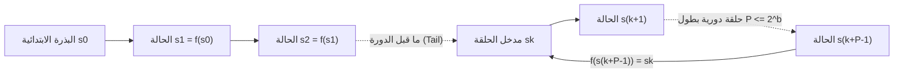
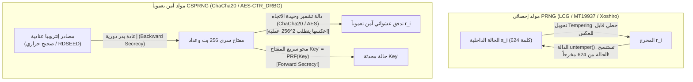

## مقدمة: «حالة الخطيئة» عند فون نيومان ومفارقة المصادفة الحتمية

في عام 1951، أطلق <strong>جون فون نيومان (John von Neumann)</strong> عبارته الشهيرة في تاريخ علوم الحاسوب: <strong>«كل من يفكر في طرائق حسابية لإنتاج أرقام عشوائية هو بالطبع في حالة خطيئة (in a state of sin).»</strong> فالحاسوب الرقمي آلة ذات حالات منتهية حتمية بصرامة: بإعطاء نفس الحالة الابتدائية والتعليمة، فإن كل بت ناتج محدد سلفاً بنسبة 100%. ومع ذلك، بدءاً من محاكاة مونت كارلو في الفيزياء النووية وتوليد عوالم الألعاب إجرائياً، وصولاً إلى مفاتيح TLS و SSH وتوقيعات ECDSA الرقمية، يستهلك عالمنا الرقمي تريليونات الأعداد العشوائية كل ثانية.

كيف يمكن لخوارزمية ثابتة أن تصنع عدم القابلية للتنبؤ؟ ولماذا يصبح مولد متفوق إحصائياً مثل <strong>ميرسين تويستر (`MT19937`)</strong> كارثياً أمنياً عند استخدامه لتوليد رموز إعادة تعيين كلمات المرور، حيث يكفي المهاجم رصد <strong>624 مخرجاً متتالياً فقط</strong> للتنبؤ بـ 100% من جميع مخرجاته المستقبلية والسابقة؟

---

## الفصل الأول: البنية الرياضية لمولد PRNG ── البذرة (Seed) وفضاء الحالات المنتهي ومبدأ برج الحمام

رياضياً، يُعرَّف <strong>مولد الأعداد شبه العشوائية (PRNG)</strong> بأنه آلة حتمية $(\mathcal{S}, \mathcal{O}, f, g, s_0)$ ذات فضاء حالات داخلي منتهٍ $\mathcal{S}$ بحجم $|\mathcal{S}| = 2^b$، و<strong>بذرة ابتدائية (Seed)</strong> $s_0 \in \mathcal{S}$، ودالة انتقال $f: \mathcal{S} \to \mathcal{S}$، ودالة إخراج $g: \mathcal{S} \to \mathcal{O}$:

$$s_{i+1} = f(s_i), \qquad r_i = g(s_i) \qquad \left(|\mathcal{S}| = 2^b \implies \text{Period } P \le 2^b\right)$$

بمجرد تثبيت البذرة $s_0$، تتحدد المتتالية $r_0, r_1, r_2, \dots$ بالكامل. وتُعد هذه <strong>القابلية للتكرار (Reproducibility)</strong> ميزة عظيمة في تنقيح المحاكاة العلمية. غير أنه بموجب <strong>مبدأ برج الحمام (Pigeonhole Principle)</strong>، لا بد أن تعود الآلة إلى حالة زارتها سابقاً $s_{k+P} = s_k$ خلال $2^b$ خطوة على الأكثر، لتدخل في حلقة دورية <strong>طول دورتها $P \le 2^b$</strong>.



وقد فشلت <strong>طريقة المربع الأوسط (Middle-Square Method, 1949)</strong> التي اقترحها فون نيومان (تربيع عدد من $2k$ خانة وأخذ الـ $2k$ خانة الوسطى) لأنها تنهار سريعاً نحو `0000` أو حلقات قصيرة جداً بطول 4 لافتقارها إلى بنية جبرية.

---

## الفصل الثاني: المولدات الخطية المتطابقة (LCG) ومبرهنة مارساليا ── مأساة المستويات الـ 15 في IBM `RANDU`

في عام 1949، قدّم د. هـ. ليمر <strong>المولد الخطي المتطابق (LCG)</strong>: $X_{n+1} = (a X_n + c) \bmod m$. وبموجب <strong>مبرهنة هال-دوبل (Hull-Dobell, 1962)</strong>، يحقق LCG الدورة الكاملة $P = m$ إذا وفقط إذا: (1) $\gcd(c, m) = 1$، و(2) كل عامل أولي $p$ يقسم $m$ يقسم أيضاً $a-1$، و(3) إذا كان $4 \mid m$ فإن $4 \mid (a-1)$.

وفي عام 1968، نشر الإحصائي <strong>جورج مارساليا (George Marsaglia)</strong> ورقته الشهيرة <strong>«الأعداد العشوائية تقع أساساً في المستويات (Random numbers fall mainly in the planes)»</strong>، مبرهناً أن النقاط ذات $d$ بُعداً $(X_n, \dots, X_{n+d-1})$ الناتجة عن أي مولد LCG تقع على الأكثر فوق $(d! \cdot m)^{1/d}$ مستويات فوقية متوازية تشكل شبكة بلورية!

وكان المثال الأكثر سوء سمعة في التاريخ هو مولد <strong>`RANDU`</strong> من شركة IBM ($m = 2^{31}, c = 0, a = 65539 = 2^{16} + 3$) في حواسيب System/360:

$$X_{n+1} = 65539 X_n \bmod 2^{31} = (2^{16} + 3) X_n \bmod 2^{31}$$

$$X_{n+2} \equiv (2^{16}+3)^2 X_n \equiv \left(\underbrace{2^{32}}_{\equiv 0} + 6\cdot 2^{16} + 9\right) X_n \equiv 6 X_{n+1} - 9 X_n \pmod{2^{31}}$$

$$\implies 9 u_n - 6 u_{n+1} + u_{n+2} = k \in \{-5, -4, \dots, 9\} \quad (\text{15 Parallel Planes!})$$

بسبب المتطابقة $X_{n+2} \equiv 6 X_{n+1} - 9 X_n \pmod{2^{31}}$، فإن جميع النقاط ثلاثية الأبعاد التي يولدها `RANDU` داخل المكعب الواحدي <strong>محبوسة فوق 15 مستوياً متوازياً فقط</strong> تفصل بينها فراغات شاسعة، مما أفسد آلاف دراسات محاكاة مونت كارلو لعقود!

---

## الفصل الثالث: ميرسين تويستر (`MT19937`) والمولدات الإحصائية الحديثة (`PCG64`, `Xoshiro256++`)

في عام 1997، ابتكر عالما الرياضيات اليابانيان <strong>ماكوتو ماتسوموتو وتاكوجي نيشيمورا</strong> خوارزمية <strong>ميرسين تويستر (`MT19937`)</strong> فوق الحقل المنتهي $\mathbb{F}_2 = \{0, 1\}$ (المعتمدة افتراضياً في Python `random` و R و MATLAB و C++ `std::mt19937`):
1. <strong>دورة فلكية وتوزيع متساوٍ في 623 بُعداً</strong>: مصفوفة حالة من $624$ كلمة بحجم 32 بت ($19,937$ بت نشط) تحقق دورة عدد ميرسين الأولي $P = 2^{19937} - 1 \approx 4.315 \times 10^{6001}$ و<strong>توزيعاً متساوياً تاماً حتى 623 بُعداً</strong>!
2. <strong>تحويل التعديل (Tempering)</strong>: تُضرب كل كلمة حالة $x$ قبل إخراجها بمصفوفة بتات قابلة للعكس $32\times 32$ فوق $\mathbb{F}_2$:

$$\begin{aligned}
y_1 &= x \oplus ((x \gg 11) \mathbin{\&} \texttt{0xFFFFFFFF}) \\
y_2 &= y_1 \oplus ((y_1 \ll 7) \mathbin{\&} \texttt{0x9D2C5680}) \\
y_3 &= y_2 \oplus ((y_2 \ll 15) \mathbin{\&} \texttt{0xEFC60000}) \\
z &= y_3 \oplus (y_3 \gg 18)
\end{aligned}$$

وللتغلب على حجم ذاكرة `MT19937` ($2.5\text{ KB}$) ورسوبه في اختبارين للخطية فوق $\mathbb{F}_2$ ضمن حزمة <strong>TestU01 (`BigCrush`)</strong>، ظهر مولد <strong>`PCG64`</strong> (ميليسا أونيل 2014: مولد LCG بحجم 128 بت مع تدوير بتات عشوائي يعتمد على البيانات؛ المحرك الافتراضي في NumPy) ومولد <strong>`Xoshiro256++`</strong> (بلاكمان وفينيا 2018: حالة 256 بت مع مشوش غير خطي؛ مستخدم في Rust و Java)، اللذان يجتازان 100% من اختبارات `BigCrush` في أقل من نانوثانية.

---

## الفصل الرابع: لماذا الكمال الإحصائي $\neq$ الأمان التعموي ── استنساخ `MT19937` ومولدات CSPRNG

### 4.1 عكس تحويل Tempering: استنساخ حالة `MT19937` من 624 مخرجاً

إن استخدام `MT19937` لتوليد رموز الجلسات أو كلمات المرور خطأ قاتل؛ لأن كل خطوة من خطوات Tempering الأربع هي <strong>تقابل خطي قابل للعكس في زمن $O(1)$</strong>:

```python
def untemper(z: int) -> int:
    # Invert MT19937 32-bit output z back to internal state word x in O(1)
    y3 = z ^ (z >> 18)
    y2 = y3 ^ ((y3 << 15) & 0xEFC60000)
    y1 = y2
    for _ in range(4):
        y1 = y2 ^ ((y1 << 7) & 0x9D2C5680)
    x = y1
    for _ in range(2):
        x = y1 ^ (x >> 11)
    return x & 0xFFFFFFFF
```

<strong>فالمهاجم الذي يرصد 624 مخرجاً متتالياً فقط بحجم 32 بت ($2,496\text{ بايت}$) من خادم يستخدم `MT19937` يطبّق الدالة `untemper(z)` على كل منها ليستنسخ بنسبة 100% جميع كلمات الحالة الداخلية الـ 624 للخادم!</strong> ومنذ تلك اللحظة يمكنه التنبؤ بـ 100% من الأعداد المستقبلية واسترجاع كافة الأعداد السابقة.

### 4.2 مبرهنة أندرو ياو (1982) ومولدات الأعداد شبه العشوائية الآمنة تعموياً (CSPRNG)

تتطلب التعمية استخدام <strong>مولد CSPRNG</strong> يحقق ثلاث مسلمات:
1. <strong>عدم قابلية التنبؤ بالبت التالي $\iff$ عدم قابلية التمييز الحسابي (مبرهنة ياو 1982 / بلوم-ميكالي)</strong>: لا يمكن لأي خوارزمية في زمن كثير حدود $\mathcal{A}$ تعرف أول $k$ بت أن تتنبأ بالبت $r_{k+1}$ باحتمال أفضل بشكل غير مهمل من رمية عملة ($1/2$):

$$\left| \Pr\left[\mathcal{A}(r_1, r_2, \dots, r_k) = r_{k+1}\right] - \frac{1}{2} \right| \le \text{negl}(\lambda)$$

2. <strong>السرية الأمامية (Forward Secrecy / مقاومة التتبع العكسي)</strong>: بعد كل إخراج، يُستبدل المفتاح الداخلي فوراً عبر دالة وحيدة الاتجاه (Fast-Key-Erasure)، مما يمنع استرجاع المفاتيح السابقة حتى لو تسربت الحالة الحالية.
3. <strong>السرية الخلفية (Backward Secrecy / مقاومة التنبؤ)</strong>: يؤدي حقن إنتروبيا عتادية جديدة دورياً (Reseeding) إلى استعادة الأمان بعد أي تسريب.



تعتمد مولدات CSPRNG الحديثة على خوارزميات التشفير مثل <strong>`ChaCha20-RNG`</strong> (نواة Linux و OpenBSD و Rust) و <strong>`AES-CTR_DRBG`</strong> (معيار NIST SP 800-90A)، أو على صعوبة التحليل إلى عوامل في <strong>Blum-Blum-Shub ($x_{n+1} = x_n^2 \bmod M$)</strong>. وفي المقابل، تبيّن أن مولد المنحنيات الإهليلجية <strong>`Dual_EC_DRBG`</strong> الذي اعتمده NIST عام 2006 كان يحتوي على <strong>باب خلفي لوكالة الأمن القومي الأمريكية (NSA)</strong> (أكدته وثائق سنودن عام 2013: فمن يعرف اللوغاريتم المتقطع السري $d$ حيث $P = d \cdot Q$ يمكنه حساب الحالة الداخلية من 32 بايت فقط وفك تشفير حركة TLS).

| فئة المولد | خوارزميات ممثلة | حجم الحالة | الدورة $P$ | اختبار `BigCrush` | الأمان التعموي | حالات الاستخدام |
| :--- | :--- | :--- | :--- | :---: | :---: | :--- |
| <strong>مولد خطي تقليدي (LCG)</strong> | `RANDU`, C `rand()` | 32–64 بت | $\le 2^{64}$ | يرسب (مستويات فوقية) | <strong>مكسور تماماً</strong> | الأنظمة القديمة فقط |
| <strong>مولد إحصائي حديث</strong> | <strong>`MT19937`</strong>, <strong>`PCG64`</strong>, <strong>`Xoshiro256++`</strong> | 128 بت – 2.5 KB | $2^{128} \sim 2^{19937}-1$ | <strong>ينجح</strong> | <strong>مكسور (624 مخرجاً / Z3)</strong> | محاكاة مونت كارلو، الألعاب |
| <strong>آمن تعموياً (CSPRNG)</strong> | <strong>`ChaCha20-RNG`</strong>, <strong>`AES-CTR_DRBG`</strong> | 256–512 بت | $\ge 2^{256}$ | <strong>ينجح 100%</strong> | <strong>آمن (Forward/Backward Secret)</strong> | <strong>مفاتيح TLS/SSH، كلمات المرور</strong> |
| <strong>عشوائي فيزيائي (TRNG)</strong> | ضجيج حراري، ثنائي انهياري، مذبذب (`RDSEED`) | متصل فيزيائي | <strong>غير دوري ($\infty$)</strong> | بعد التبييض | <strong>إنتروبيا فيزيائية حقيقية</strong> | بذر وإعادة بذر مولدات CSPRNG |

---

## الفصل الخامس: المولدات الفيزيائية الحقيقية (TRNG) والإنتروبيا الدنيا ($H_\infty$) ومجمعات إنتروبيا نظام التشغيل

تأتي البذرة الابتدائية لمولد CSPRNG من <strong>مولد أعداد عشوائية عتادي حقيقي (TRNG / HRNG)</strong> يلتقط الفوضى الفيزيائية المجهرية: <strong>الضجيج الحراري لجونسون-نايكويست</strong> في المقاومات، والضجيج الكمي للانهيار الثلجي في ثنائيات زينر، و<strong>ارتعاش الطور (Phase Jitter) في المذبذبات الحلقية</strong> (تعليمات `RDSEED`/`RDRAND` في معالجات Intel و AMD). وفي التعمية (NIST SP 800-90B)، تُقاس عدم القابلية للتنبؤ في أسوأ الحالات عبر <strong>الإنتروبيا الدنيا ($H_\infty$)</strong> بدلاً من إنتروبيا شانون المتوسطة $H_1$:

$$V_{\text{rms}} = \sqrt{4 k_B T R \Delta f}, \qquad H_\infty(X) = -\log_2 \left(\max_{x} P(X = x)\right) \le H_1(X)$$

يمر الضجيج الفيزيائي الخام بعملية <strong>تبييض (Whitening)</strong> عبر خوارزمية فون نيومان أو مستخرجات التجزئة التعموية (`BLAKE2s` في نواة Linux استناداً إلى <strong>Leftover Hash Lemma</strong>) قبل تغذية مولد CSPRNG.

وفي أنظمة Linux الحديثة (5.6+)، يستخدم كل من `/dev/random` و `/dev/urandom` نفس مولد النواة `ChaCha20`؛ وينبغي للمطورين دائماً استدعاء <strong>`getrandom(2)`</strong> (أو `secrets` في Python، و `crypto.getRandomValues()` في JS، و `OsRng`/`ThreadRng` في Rust، و `crypto/rand` في Go). إن كارثة <strong>Debian OpenSSL عام 2008 (CVE-2008-0166)</strong> —حيث أدى تعطيل سطر برمجي واحد لإخفاء تحذير في Valgrind إلى تقليص إنتروبيا جميع مفاتيح RSA/SSH المولدة عالمياً لمدة عامين إلى معرّف العملية PID المكون من 15 بت فقط ($32,768$ مفتاحاً ممكناً!)— وكذلك خطأ تثبيت الرقم العشوائي $k$ في توقيع ECDSA لجهاز PlayStation 3 من سوني (2010)، يثبتان قانوناً صارماً: <strong>لا يمكن لقوة أي نظام تعموي أن تتجاوز أبداً إنتروبيا مولد الأعداد العشوائية الذي صنع مفاتيحه.</strong>
