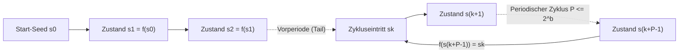
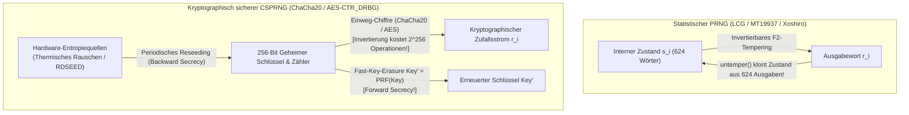

## Einleitung: Von Neumanns „Zustand der Sünde“ und das Paradoxon des deterministischen Zufalls

1951 prägte <strong>John von Neumann</strong> eines der berühmtesten Zitate der Informatikgeschichte: <strong>„Jeder, der arithmetische Methoden zur Erzeugung von Zufallsziffern in Betracht zieht, befindet sich natürlich im Zustand der Sünde (in a state of sin).“</strong> Ein digitaler Computer ist ein strikt deterministischer endlicher Automat: Bei gleichem Zustand und Befehl ist jedes folgende Bit zu 100 % vorherbestimmt. Dennoch benötigt unsere digitale Infrastruktur – von Monte-Carlo-Simulationen in der Teilchenphysik über prozedurale Spielwelten bis hin zu TLS-Sitzungsschlüsseln, SSH-Schlüsselpaaren und ECDSA-Signaturen – jede Sekunde Billionen von Zufallszahlen.

Wie kann ein festes Berechnungsverfahren Unvorhersagbarkeit erzeugen? Und warum ist ein Generator wie der berühmte <strong>Mersenne-Twister (`MT19937`)</strong>, der statistische Tests bravourös besteht, für Passwort-Tokens katastrophal unsicher, sodass ein Angreifer nach nur <strong>624 beobachteten Ausgaben</strong> 100 % aller zukünftigen und vergangenen Zufallszahlen berechnen kann?

---

## Kapitel 1: Mathematische Struktur eines PRNG ── Seed, endlicher Zustandsraum und Schubfachprinzip

Formal ist ein <strong>Pseudozufallszahlengenerator (PRNG)</strong> ein deterministischer Automat $(\mathcal{S}, \mathcal{O}, f, g, s_0)$ mit einem endlichen internen Zustandsraum $\mathcal{S}$ der Größe $|\mathcal{S}| = 2^b$, einem Startwert (<strong>Seed</strong>) $s_0 \in \mathcal{S}$, einer Zustandsübergangsfunktion $f: \mathcal{S} \to \mathcal{S}$ und einer Ausgabefunktion $g: \mathcal{S} \to \mathcal{O}$:

$$s_{i+1} = f(s_i), \qquad r_i = g(s_i) \qquad \left(|\mathcal{S}| = 2^b \implies \text{Period } P \le 2^b\right)$$

Ist der Seed $s_0$ fixiert, liegt die gesamte Folge $r_0, r_1, r_2, \dots$ fest. Diese <strong>Reproduzierbarkeit</strong> ist für wissenschaftliche Simulationen und das Debugging unverzichtbar. Nach dem <strong>Schubfachprinzip (Pigeonhole Principle)</strong> muss der Automat jedoch nach spätestens $2^b$ Schritten einen bereits besuchten Zustand $s_{k+P} = s_k$ wiederholen und läuft ab dann in einem endlosen Zyklus der <strong>Periode $P \le 2^b$</strong>.



Von Neumanns eigene <strong>Quadratmittenmethode (Middle-Square Method, 1949)</strong> (Quadrieren einer $2k$-stelligen Zahl und Extraktion der mittleren $2k$ Ziffern) scheiterte kläglich, da sie ohne algebraische Struktur rasch bei `0000` oder in winzigen Zyklen der Länge 4 kollabiert.

---

## Kapitel 2: Lineare Kongruenzgeneratoren (LCG) und Marsaglias Theorem ── Das 15-Ebenen-Debakel von IBM `RANDU`

1949 führte D. H. Lehmer den <strong>Linearen Kongruenzgenerator (LCG)</strong> ein: $X_{n+1} = (a X_n + c) \bmod m$. Nach dem <strong>Satz von Hull-Dobell (1962)</strong> erreicht ein LCG genau dann die maximale Periode $P = m$, wenn: (1) $\gcd(c, m) = 1$, (2) jeder Primfaktor $p$ von $m$ auch $a-1$ teilt, und (3) falls $4 \mid m$, auch $4 \mid (a-1)$ gilt.

1968 zerstörte der Statistiker <strong>George Marsaglia</strong> mit seiner Arbeit <strong>„Random numbers fall mainly in the planes“</strong> die Illusion, dass eine lange Periode für gute Zufallszahlen ausreicht: Fasst man je $d$ aufeinanderfolgende LCG-Ausgaben zu einem Punkt im $d$-dimensionalen Raum $\mathbb{R}^d$ zusammen, liegen sämtliche Punkte auf höchstens $(d! \cdot m)^{1/d}$ parallelen Hyperebenen eines Kristallgitters!

Das berüchtigtste Beispiel der Computergeschichte ist IBMs Standardgenerator <strong>`RANDU`</strong> ($m = 2^{31}, c = 0, a = 65539 = 2^{16} + 3$) auf System/360-Mainframes:

$$X_{n+1} = 65539 X_n \bmod 2^{31} = (2^{16} + 3) X_n \bmod 2^{31}$$

$$X_{n+2} \equiv (2^{16}+3)^2 X_n \equiv \left(\underbrace{2^{32}}_{\equiv 0} + 6\cdot 2^{16} + 9\right) X_n \equiv 6 X_{n+1} - 9 X_n \pmod{2^{31}}$$

$$\implies 9 u_n - 6 u_{n+1} + u_{n+2} = k \in \{-5, -4, \dots, 9\} \quad (\text{15 Parallel Planes!})$$

Weil $X_{n+2} \equiv 6 X_{n+1} - 9 X_n \pmod{2^{31}}$ gilt, liegen sämtliche 3D-Punkte von `RANDU` im Einheitswürfel <strong>auf nur 15 parallelen Ebenen</strong>, getrennt durch riesige leere Zwischenräume – was jahrzehntelang Monte-Carlo-Simulationen in der Physik verfälschte!

---

## Kapitel 3: Mersenne-Twister (`MT19937`) und moderne statistische PRNGs (`PCG64`, `Xoshiro256++`)

1997 entwickelten die japanischen Mathematiker <strong>Makoto Matsumoto und Takuji Nishimura</strong> den <strong>Mersenne-Twister (`MT19937`)</strong> auf Basis eines *Twisted Generalized Feedback Shift Register (TGFSR)* über dem Galoiskörper $\mathbb{F}_2 = \{0, 1\}$ (Standard in Python `random`, R, MATLAB, C++ `std::mt19937`):
1. <strong>Gigantische Periode & 623-dimensionale Gleichverteilung</strong>: Ein Zustandsarray aus $624$ Wörtern à 32 Bit ($19.937$ aktive Bits) garantiert die Mersenne-Primzahl-Periode $P = 2^{19937} - 1 \approx 4{,}315 \times 10^{6001}$ sowie exakte Gleichverteilung in bis zu <strong>623 Dimensionen</strong>!
2. <strong>Tempering-Transformation</strong>: Vor der Ausgabe wird jedes Zustandswort $x$ mit einer invertierbaren $32\times 32$-Bitmatrix über $\mathbb{F}_2$ multipliziert:

$$\begin{aligned}
y_1 &= x \oplus ((x \gg 11) \mathbin{\&} \texttt{0xFFFFFFFF}) \\
y_2 &= y_1 \oplus ((y_1 \ll 7) \mathbin{\&} \texttt{0x9D2C5680}) \\
y_3 &= y_2 \oplus ((y_2 \ll 15) \mathbin{\&} \texttt{0xEFC60000}) \\
z &= y_3 \oplus (y_3 \gg 18)
\end{aligned}$$

Um den großen Cache-Footprint von `MT19937` ($2{,}5\text{ KB}$) und das Scheitern an zwei $\mathbb{F}_2$-Linearitätstests in der Testsuite <strong>TestU01 (`BigCrush`)</strong> zu überwinden, wurden in den 2010er Jahren <strong>`PCG64`</strong> (Melissa O'Neill 2014: 128-Bit-LCG mit datenabhängiger Bit-Rotation; Standard in NumPy) und <strong>`Xoshiro256++`</strong> (Blackman & Vigna 2018: 256-Bit-Register mit nichtlinearem Scrambler; genutzt in Rust und Java) entwickelt, die mit nur 16–32 Byte Zustand alle 160 `BigCrush`-Tests bestehen.

---

## Kapitel 4: Warum statistische Perfektion $\neq$ kryptographische Sicherheit ist ── Der Angriff auf `MT19937` und CSPRNGs

### 4.1 Invertierung des Tempering: Zustandsklonen aus 624 Ausgaben

Wer `MT19937` für Passwort-Reset-Tokens oder Session-IDs verwendet, begeht einen fatalen Sicherheitsfehler: Jede der vier Tempering-Gleichungen ist über $\mathbb{F}_2^{32}$ <strong>in konstanter Zeit $O(1)$ exakt umkehrbar</strong>!

```python
def untemper(z: int) -> int:
    # Invert MT19937 32-bit output z back to internal state word x in O(1)
    y3 = z ^ (z >> 18)
    y2 = y3 ^ ((y3 << 15) & 0xEFC60000)
    y1 = y2
    for _ in range(4):
        y1 = y2 ^ ((y1 << 7) & 0x9D2C5680)
    x = y1
    for _ in range(2):
        x = y1 ^ (x >> 11)
    return x & 0xFFFFFFFF
```

<strong>Beobachtet ein Angreifer lediglich 624 aufeinanderfolgende 32-Bit-Ausgaben ($2.496\text{ Byte}$) eines Servers und wendet `untemper(z)` auf jede an, erhält er eine 100 % exakte Kopie des gesamten internen 624-Wort-Zustandsarrays!</strong> Ab diesem Moment kann er 100 % aller zukünftigen Zufallszahlen vorhersagen und sogar alle vergangenen Ausgaben rückwärts berechnen.

### 4.2 Andrew Yaos Theorem (1982) und kryptographisch sichere PRNGs (CSPRNGs)

Für Sicherheitsanwendungen ist ein <strong>Kryptographisch Sicherer PRNG (CSPRNG)</strong> zwingend erforderlich, definiert durch drei Axiome:
1. <strong>Next-Bit Unpredictability $\iff$ Berechnungs-Ununterscheidbarkeit (Yao 1982 / Blum-Micali)</strong>: Kein polynomieller Angreifer $\mathcal{A}$, der die ersten $k$ Bits kennt, kann das Bit $r_{k+1}$ signifikant besser als durch Münzwurf ($1/2$) erraten:

$$\left| \Pr\left[\mathcal{A}(r_1, r_2, \dots, r_k) = r_{k+1}\right] - \frac{1}{2} \right| \le \text{negl}(\lambda)$$

2. <strong>Forward Secrecy (Backtracking Resistance)</strong>: Nach jeder Ausgabe wird der interne Schlüssel über eine Einwegfunktion sofort überschrieben (Fast-Key-Erasure), sodass selbst bei einem späteren RAM-Leak vergangene Schlüssel unberechenbar bleiben.
3. <strong>Backward Secrecy (Prediction Resistance)</strong>: Durch kontinuierliches Nachmischen frischer Hardware-Entropie (Reseeding) heilt sich der Zustand nach einer Kompromittierung selbst.



Moderne CSPRNGs nutzen Strom- oder Blockchiffren wie <strong>`ChaCha20-RNG`</strong> (Linux-Kernel, OpenBSD, Rust) und <strong>`AES-CTR_DRBG`</strong> (NIST SP 800-90A) oder zahlentheoretische Probleme wie <strong>Blum-Blum-Shub ($x_{n+1} = x_n^2 \bmod M$)</strong>. Hingegen entpuppte sich der 2006 von NIST standardisierte elliptische Kurvengenerator <strong>`Dual_EC_DRBG`</strong> durch die Snowden-Enthüllungen 2013 als absichtliche <strong>kleptographische Hintertür der NSA</strong> (wer den geheimen Skalar $d$ mit $P = d \cdot Q$ kannte, konnte aus 32 Byte Ausgabe den internen Zustand berechnen und TLS-Verbindungen entschlüsseln).

| Generatorklasse | Repräsentative Algorithmen | Zustandsgröße | Periode $P$ | `BigCrush`-Test | Kryptographische Sicherheit | Anwendungsgebiet |
| :--- | :--- | :--- | :--- | :---: | :---: | :--- |
| <strong>Klassischer LCG</strong> | `RANDU`, C `rand()` | 32–64 Bit | $\le 2^{64}$ | Fällt durch (Hyperebenen) | <strong>Komplett unsicher</strong> | Nur Altsysteme |
| <strong>Moderner Statistik-PRNG</strong> | <strong>`MT19937`</strong>, <strong>`PCG64`</strong>, <strong>`Xoshiro256++`</strong> | 128 Bit – 2,5 KB | $2^{128} \sim 2^{19937}-1$ | <strong>Besteht</strong> | <strong>Unsicher (624 Ausgaben / Z3)</strong> | Monte-Carlo, Simulationen, Spiele |
| <strong>Kryptographisch (CSPRNG)</strong> | <strong>`ChaCha20-RNG`</strong>, <strong>`AES-CTR_DRBG`</strong> | 256–512 Bit | $\ge 2^{256}$ | <strong>Besteht 100 %</strong> | <strong>Sicher (Forward/Backward Secret)</strong> | <strong>TLS/SSH-Schlüssel, Passwörter, Tokens</strong> |
| <strong>Hardware-Zufall (TRNG)</strong> | Thermisches Rauschen, Lawinendiode, Ringoszillator (`RDSEED`) | Physikalisches Kontinuum | <strong>Aperiodisch ($\infty$)</strong> | Nach Whitening | <strong>Echte physikalische Entropie</strong> | Seeding & Reseeding von CSPRNGs |

---

## Kapitel 5: Physikalische Zufallsgeneratoren (TRNG), Min-Entropie und OS-Entropiepools

Die initiale Unvorhersagbarkeit eines CSPRNG stammt aus <strong>Hardware-Zufallsgeneratoren (TRNG / HRNG)</strong>, die mikroskopisches Chaos messen: <strong>thermische Johnson-Nyquist-Rauschspannung</strong> in Widerständen, Quanten-Schrotrauschen bei Zener-Lawinendurchbrüchen sowie <strong>Phasenjitter von Ringoszillatoren</strong> (genutzt in Intels/AMDs `RDSEED`- und `RDRAND`-Befehlen). Kryptographische Standards (NIST SP 800-90B) bewerten Rohdaten streng nach der <strong>Min-Entropie ($H_\infty$)</strong> (Worst-Case-Erratbarkeit) statt der mittleren Shannon-Entropie $H_1$:

$$V_{\text{rms}} = \sqrt{4 k_B T R \Delta f}, \qquad H_\infty(X) = -\log_2 \left(\max_{x} P(X = x)\right) \le H_1(X)$$

Über Zufallsextraktoren (Von-Neumann-Debiasing oder kryptographische Hashfunktionen wie `BLAKE2s` gemäß dem <strong>Leftover Hash Lemma</strong>) werden verzerrte Rohbits „geweißt“ (Whitening) und speisen den Kernel-CSPRNG.

Unter modernem Linux (ab 5.6+) nutzen `/dev/random` und `/dev/urandom` denselben `ChaCha20`-CSPRNG; Entwickler sollten stets <strong>`getrandom(2)`</strong> (bzw. Python `secrets`, JS `crypto.getRandomValues()`, Rust `OsRng`/`ThreadRng`, Go `crypto/rand`) verwenden. Das <strong>Debian-OpenSSL-Desaster von 2008 (CVE-2008-0166)</strong> – bei dem das Auskommentieren einer einzigen Codezeile wegen einer Valgrind-Warnung dazu führte, dass zwei Jahre lang alle erzeugten SSH- und TLS-Schlüssel nur noch von der 15-Bit-Prozess-ID ($\le 32.768$ Möglichkeiten) abhingen – sowie Sonys PS3-ECDSA-Nonce-Fehler (2010) mahnen für immer: <strong>Die Sicherheit eines Kryptosystems ist niemals größer als die Entropie seines Zufallsgenerators.</strong>
