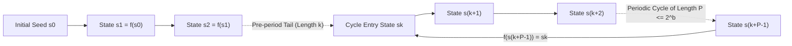
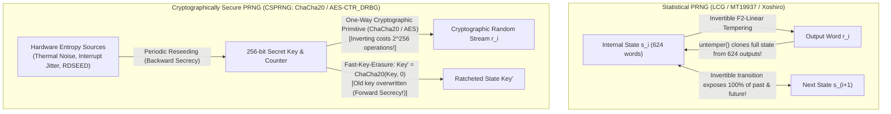

## Introduction: Von Neumann's "State of Sin" and the Paradox of Deterministic Chance

In 1951, <strong>John von Neumann</strong>—pioneer of the modern stored-program computer architecture, game theory, and the Monte Carlo method—delivered a remark that has echoed through seven decades of computer science:

> <strong>"Anyone who considers arithmetical methods of producing random digits is, of course, in a state of sin."</strong>
> — John von Neumann, *Various Techniques Used in Connection with Random Digits* (1951)

Why did von Neumann call algorithmic randomness a "state of sin"? Because a digital computer (a Turing machine) is the ultimate embodiment of <strong>strict determinism</strong>. Given an initial state and a sequence of instructions, every subsequent bit produced by a CPU is 100% predetermined. There is no coin toss inside an arithmetic logic unit (ALU); there is no quantum caprice in a bitwise XOR instruction.

Yet modern civilization depends on billions of random numbers every millisecond:
- <strong>Scientific Simulation (Monte Carlo Methods)</strong>: Simulating neutron transport in nuclear reactors, pricing financial derivatives, rendering photorealistic ray-traced light paths, and training deep neural networks via stochastic gradient descent.
- <strong>Randomized Algorithms & Systems</strong>: Hash tables with SipHash DoS protection, randomized quicksort pivots, skip lists, UUID generation, and distributed consensus timeouts.
- <strong>Cryptography & Information Security</strong>: Generating 256-bit AES session keys, RSA/ECC keypairs, TLS handshakes, ECDSA signature nonces, password salts, and CSRF tokens.

How can a purely deterministic machine follow a fixed recipe to produce numbers that behave as if they were chosen by chance? And why does a generator that passes every statistical test of randomness with flying colors—such as the celebrated <strong>Mersenne Twister (`MT19937`)</strong>—become catastrophically insecure the moment you use it to generate a password reset token, allowing an attacker who observes just <strong>624 consecutive outputs</strong> to predict 100% of all future and past outputs?

In this comprehensive guide, we explore the mathematics, physics, and engineering of randomness: the state-machine structure of <strong>Pseudorandom Number Generators (PRNGs)</strong> and the Pigeonhole Principle; <strong>Linear Congruential Generators (LCGs)</strong>, the Hull-Dobell Theorem, and George Marsaglia's discovery of how <strong>IBM's `RANDU`</strong> trapped 3D points on just 15 planes; the $\mathbb{F}_2$-linear algebra of <strong>Mersenne Twister (`MT19937`)</strong>, <strong>PCG</strong>, and <strong>Xoshiro256++</strong>; the state-recovery attack against `MT19937`; <strong>Andrew Yao's Next-Bit Unpredictability Theorem</strong> and <strong>Cryptographically Secure PRNGs (CSPRNGs)</strong> (`ChaCha20-RNG`, `AES-CTR_DRBG`, and the NSA `Dual_EC_DRBG` kleptographic backdoor); and how operating systems harvest physical entropy from <strong>Johnson-Nyquist thermal noise</strong> and ring-oscillator jitter while avoiding catastrophic failures like the <strong>2008 Debian OpenSSL 15-bit PID bug (CVE-2008-0166)</strong>.

---

## Chapter 1: The Mathematical Anatomy of a PRNG — Seeds, Finite State Spaces, and Inevitable Periods

### 1.1 Deterministic Finite Automata and the Power of Reproducibility

Formally, a <strong>Pseudorandom Number Generator (PRNG)</strong>—also called a <strong>Deterministic Random Bit Generator (DRBG)</strong>—is a deterministic finite-state automaton defined by a 5-tuple $(\mathcal{S}, \mathcal{O}, f, g, s_0)$:
1. A finite <strong>Internal State Space</strong> $\mathcal{S}$ of size $|\mathcal{S}| = 2^b$ (where $b$ is the number of bits of internal state memory).
2. An <strong>Initial Seed</strong> $s_0 \in \mathcal{S}$ that initializes the state at step $i = 0$.
3. A deterministic <strong>State Transition Function</strong> $f: \mathcal{S} \to \mathcal{S}$ that advances the internal state:
   $$s_{i+1} = f(s_i) \qquad (i = 0, 1, 2, \dots)$$
4. An <strong>Output Extraction Function</strong> $g: \mathcal{S} \to \mathcal{O}$ that maps the current internal state $s_i$ to a pseudorandom output word $r_i \in \mathcal{O}$:
   $$r_i = g(s_i)$$

Notice what this definition implies: <strong>Once the seed $s_0$ is fixed, the entire infinite sequence of outputs $r_0, r_1, r_2, \dots$ is completely determined.</strong>

In scientific computing, software testing, and procedural generation, this determinism is not a bug—it is a superpower:
- If a Monte Carlo physics simulation or a deep-learning training run exhibits an anomaly after ten billion iterations, recording the 64-bit seed $s_0$ allows researchers anywhere in the world to replay the exact same sequence of billions of "random" events bit-for-bit.
- In video games like *Minecraft* or *No Man's Sky*, an entire universe of mountains, caves, and biomes is compressed into a single 64-bit integer seed.

### 1.2 The Pigeonhole Principle and the Rho ($\rho$) Cycle Structure

Because the internal state space $\mathcal{S}$ is finite ($|\mathcal{S}| \le 2^b$) and the transition function $f: \mathcal{S} \to \mathcal{S}$ is deterministic, the <strong>Pigeonhole Principle</strong> guarantees that within at most $2^b + 1$ transitions, the generator must visit some state $s_{k+P}$ that is identical to an earlier state $s_k$ ($0 \le k < k + P \le 2^b$).

Once $s_{k+P} = s_k$, determinism forces $s_{k+P+1} = f(s_{k+P}) = f(s_k) = s_{k+1}$, trapping the generator forever in a periodic cycle of length $P$, called the <strong>Period</strong> of the PRNG:

$$s_{i + P} = s_i \quad \text{and} \quad r_{i + P} = r_i \qquad \forall i \ge k, \quad \text{where } P \le 2^b$$



If $f$ is a bijection (a permutation of $\mathcal{S}$), then every state has a unique predecessor, so the pre-period tail length is $k = 0$ and the sequence forms a pure cycle returning directly to the initial seed $s_0$.

### 1.3 Von Neumann's Middle-Square Method (1949) and Rapid Degeneration

To appreciate why designing $f$ is non-trivial, consider the very first arithmetical PRNG proposed by John von Neumann in 1949 for the ENIAC: the <strong>Middle-Square Method</strong>. Starting with a $2k$-digit decimal integer $X_n$ (say, $2k = 4$ digits), we square it to obtain a $4k$-digit (8-digit) number (padding with leading zeros if necessary) and extract the <strong>middle $2k$ digits</strong> as $X_{n+1}$:

$$X_{n+1} = \left\lfloor \frac{X_n^2}{10^k} \right\rfloor \bmod 10^{2k}$$

While simple to implement in hardware registers, the Middle-Square Method is a mathematical disaster:
- Whenever zeros appear in the middle digits, the state rapidly shrinks toward $0000$, which is an absorbing fixed point ($0000^2 \to 0000$ forever).
- Even when it avoids zero, trajectories quickly collapse into tiny cycles such as $6100 \to 2100 \to 4100 \to 8100 \to 6100$ (period $P = 4$). Out of $10^4 = 10,000$ possible 4-digit seeds, not a single seed achieves a long period!

---

## Chapter 2: Linear Congruential Generators (LCGs), Spectral Lattices, and the Tragedy of IBM `RANDU`

### 2.1 Lehmer's LCG and the Hull-Dobell Theorem (1962)

In 1949, number theorist <strong>Derrick Henry Lehmer</strong> introduced the <strong>Linear Congruential Generator (LCG)</strong>, which dominated scientific computing and standard libraries (such as C's `rand()`, POSIX `lrand48()`, and Java's `java.util.Random`) for nearly half a century. An LCG advances its state via an affine recurrence modulo $m$:

$$X_{n+1} = (a X_n + c) \bmod m$$

where $m > 0$ is the <strong>modulus</strong>, $0 < a < m$ is the <strong>multiplier</strong>, and $0 \le c < m$ is the <strong>increment</strong>.

Because the internal state is just the single integer $X_n \in \{0, 1, \dots, m-1\}$, the maximum possible period is $P = m$. When does an LCG achieve this full period $P = m$ (visiting every integer in $\{0, \dots, m-1\}$ exactly once per cycle regardless of seed $X_0$)? In 1962, <strong>T. E. Hull and A. R. Dobell</strong> proved the exact necessary and sufficient conditions:

> <strong>The Hull-Dobell Theorem (1962)</strong>:
> A Linear Congruential Generator $X_{n+1} = (a X_n + c) \bmod m$ with $c \neq 0$ has full period $P = m$ if and only if all three of the following conditions hold:
> 1. $\gcd(c, m) = 1$ ($c$ and $m$ are relatively prime).
> 2. Every prime factor $p$ that divides $m$ also divides $a - 1$ ($p \mid m \implies p \mid (a - 1)$).
> 3. If $4$ divides $m$, then $4$ also divides $a - 1$ ($4 \mid m \implies 4 \mid (a - 1)$).

On binary computers, choosing $m = 2^{32}$ or $m = 2^{64}$ makes the modulo operation completely free (natural unsigned integer overflow!). Since the only prime factor of $m = 2^w$ is $p = 2$, the Hull-Dobell Theorem states that choosing <strong>any odd increment $c$</strong> and <strong>any multiplier $a \equiv 1 \pmod 4$</strong> automatically guarantees a full period of $2^w$!

### 2.2 George Marsaglia's Theorem (1968): *"Random Numbers Fall Mainly in the Planes"*

For two decades, practitioners assumed that a full-period LCG whose 1D histogram is perfectly uniform over $\{0, \dots, m-1\}$ must be a great random number generator. In 1968, mathematician <strong>George Marsaglia</strong> shattered this complacency in his landmark *Proceedings of the National Academy of Sciences* paper, <strong>"Random numbers fall mainly in the planes."</strong>

Marsaglia considered what happens when you take $d$ consecutive outputs from an LCG to form a point in $d$-dimensional space:

$$\mathbf{P}_n = (u_n, u_{n+1}, \dots, u_{n+d-1}) \in [0, 1)^d, \qquad \text{where } u_n = \frac{X_n}{m}$$

Because $X_{n+k} \equiv a^k X_n + c\frac{a^k-1}{a-1} \pmod m$, the vectors $\mathbf{P}_n$ form a discrete <strong>crystalline lattice</strong> in $\mathbb{R}^d$. Marsaglia proved using the geometry of numbers (Minkowski's theorem) that <strong>all $d$-dimensional points produced by any LCG with modulus $m$ lie on at most $(d! \cdot m)^{1/d}$ parallel hyperplanes!</strong>

For $m = 2^{32}$ in $d = 3$ dimensions, even the *best possible* LCG must confine all points in the unit cube $[0,1)^3$ onto at most $(6 \cdot 2^{32})^{1/3} \approx 2,953$ parallel planes. And if the multiplier $a$ is chosen poorly, the number of planes collapses catastrophically!

### 2.3 The Infamous Case Study: IBM's `RANDU` and the 15 Planes of Doom

In the 1960s, IBM distributed a multiplicative LCG ($c = 0$) called <strong>`RANDU`</strong> as the standard random number generator in the IBM System/360 Scientific Subroutine Package (SSP). It was used in thousands of published physics, chemistry, and statistics papers for over a decade.

`RANDU` used modulus $m = 2^{31}$ and multiplier $a = 65539$:

$$X_{n+1} = 65539 X_n \bmod 2^{31}$$

Why did IBM's programmers pick $a = 65539$? Because in binary, $65539 = 2^{16} + 3$, allowing multiplication to be executed in hardware using just a single 16-bit left shift and two additions!

Let us examine the algebraic relationship between three consecutive outputs $(X_n, X_{n+1}, X_{n+2})$ of `RANDU`. Notice that $2^{16} = 65539 - 3 = a - 3$. Squaring $2^{16}$ modulo $2^{31}$ gives $(2^{16})^2 = 2^{32} \equiv 0 \pmod{2^{31}}$! Expanding $X_{n+2}$ in terms of $X_n$ modulo $2^{31}$ yields:

$$\begin{aligned}
X_{n+2} &\equiv (2^{16} + 3) X_{n+1} \equiv (2^{16} + 3)^2 X_n \pmod{2^{31}} \\
&\equiv \left( \underbrace{2^{32}}_{\equiv\, 0} + 6 \cdot 2^{16} + 9 \right) X_n \pmod{2^{31}} \\
&\equiv \left( 6(2^{16} + 3) - 9 \right) X_n \equiv \mathbf{6 X_{n+1} - 9 X_n \pmod{2^{31}}}
\end{aligned}$$

Rearranging this congruence over the real numbers (dividing by $m = 2^{31}$ so $u_n = X_n / 2^{31} \in (0, 1)$), every single 3D point $(u_n, u_{n+1}, u_{n+2})$ generated by `RANDU` satisfies the exact linear plane equation:

$$9 u_n - 6 u_{n+1} + u_{n+2} = k \qquad \text{for an integer } k \in \{-5, -4, -3, \dots, 8, 9\}$$

Because $u_n, u_{n+1}, u_{n+2} \in (0, 1)$, the left-hand side $9u_n - 6u_{n+1} + u_{n+2}$ lies strictly between $-6$ and $+10$, so the integer $k$ can take <strong>only 15 possible values</strong> ($k = -5, -4, \dots, 9$)! Every single 3D point generated by `RANDU` is trapped on one of <strong>just 15 parallel planes</strong> slicing through the unit cube, with vast empty chasms of width $1/\sqrt{9^2 + (-6)^2 + 1^2} = 1/\sqrt{118} \approx 0.092$ between them where no random point can ever land!

*(Worse still, in any LCG with a power-of-two modulus $m = 2^w$, the lowest $j$ bits depend only on the lowest $j$ bits of the previous state, meaning the least significant bit $X_n \bmod 2$ simply alternates $0, 1, 0, 1, \dots$ with period $2$, and the $j$-th bit has period at most $2^j$!)*

---

## Chapter 3: Mersenne Twister (`MT19937`) and Modern Statistical Generators (`PCG`, `Xoshiro256++`)

### 3.1 Matsumoto & Nishimura's Mersenne Twister (`MT19937`, 1997)

To banish both short periods and low-dimensional lattice hyperplanes, Japanese mathematicians <strong>Makoto Matsumoto</strong> and <strong>Takuji Nishimura</strong> invented the <strong>Mersenne Twister (`MT19937`)</strong> in 1997. It rapidly became the default statistical PRNG across Python (`random`), R, MATLAB, C++11 (`std::mt19937`), Ruby, and PHP.

Instead of integer arithmetic modulo $m$, `MT19937` operates over the two-element Galois field $\mathbb{F}_2 = \{0, 1\}$ (where addition is bitwise XOR $\oplus$ and multiplication is bitwise AND $\mathbin{\&}$) as a <strong>Twisted Generalized Feedback Shift Register (TGFSR)</strong>:

1. <strong>Massive State Space & Mersenne Prime Period</strong>:
   `MT19937` maintains an internal state array of $n = 624$ unsigned 32-bit words ($624 \times 32 = 19,968$ bits), of which 31 bits in one word are masked out, leaving exactly <strong>$19,937$ bits of active state</strong>. Its linear recurrence over $\mathbb{F}_2$ has an irreducible characteristic polynomial of degree $19,937$, achieving a provable period equal to the 24th Mersenne prime:
   $$P = 2^{19937} - 1 \approx 4.315 \times 10^{6001}$$
2. <strong>623-Dimensional Equidistribution</strong>:
   Unlike `RANDU`, which failed in $d = 3$ dimensions, `MT19937` is mathematically proved to be <strong>$k$-distributed to 32-bit accuracy for all dimensions $k \le 623$</strong>! Every possible 623-tuple of 32-bit integers appears the exact same number of times over a full period (except the all-zero tuple, which appears once less).
3. <strong>The Tempering Transform</strong>:
   To ensure that every output word has uniform bit correlations even across short runs, `MT19937` does not output the raw state word $x \in \mathbb{F}_2^{32}$ directly. Instead, it multiplies $x$ by an invertible $32 \times 32$ bit-matrix $T$ over $\mathbb{F}_2$, implemented as four fast shift-and-XOR steps called <strong>Tempering</strong>:

$$\begin{aligned}
y_1 &= x \oplus ((x \gg 11) \mathbin{\&} \texttt{0xFFFFFFFF}) \\
y_2 &= y_1 \oplus ((y_1 \ll 7) \mathbin{\&} \texttt{0x9D2C5680}) \\
y_3 &= y_2 \oplus ((y_2 \ll 15) \mathbin{\&} \texttt{0xEFC60000}) \\
z &= y_3 \oplus (y_3 \gg 18)
\end{aligned}$$

### 3.2 Beyond `MT19937`: `PCG64` and `Xoshiro256++` Under TestU01 (BigCrush)

Despite its historic triumph, `MT19937` has two notable drawbacks in modern high-performance computing:
1. Its $2.5\text{ KB}$ state array (624 words) pollutes CPU L1 caches when thousands of independent Monte Carlo streams are instantiated, and initialization from a tiny seed suffers from "zeroland" lag if many state bits start as zero.
2. When subjected to Pierre L'Ecuyer and Richard Simard's exhaustive <strong>TestU01 (`BigCrush`)</strong> statistical battery (160 stringent tests), `MT19937` fails two tests—`LinearComp` (Berlekamp-Massey linear complexity) and `MatrixRank`—because its entire state transition and output transformation are purely $\mathbb{F}_2$-linear!

In the 2010s, two families of compact, ultra-fast statistical generators solved both problems and pass 100% of `BigCrush`:
- <strong>PCG (Permuted Congruential Generator, Melissa O'Neill 2014)</strong>: Uses a fast 128-bit LCG for its internal state transition ($s_{i+1} = a s_i + c \bmod 2^{128}$), which provides trivial jump-ahead ($\mathcal{O}(\log N)$ skipping forward by $N$ steps for parallel streams!), but applies a non-linear <strong>permutation output function $g(s)$</strong> (such as `XSH-RR`: Xorshift High bits followed by a <strong>data-dependent random bitwise rotation</strong> controlled by the top bits of the state). It is now the default generator (`PCG64`) in Python's NumPy.
- <strong>Xoshiro256++ / Xoroshiro128++ (David Blackman & Sebastiano Vigna 2018)</strong>: Uses a 256-bit (four 64-bit words) $\mathbb{F}_2$-linear shift-register engine combined with a non-linear arithmetic scrambler (`rotl(s[1] * 5, 7) * 9`), generating a 64-bit random number in under $0.8\text{ ns}$ while passing all of `BigCrush`.

---

## Chapter 4: Why Statistical Perfection $\neq$ Cryptographic Security — Breaking `MT19937` and Defining CSPRNGs

### 4.1 Cloning `MT19937` from 624 Outputs via Untempering

Here we confront one of the most pervasive and dangerous misconceptions in software engineering: <strong>Using a statistical PRNG (`random.randint()` in Python, `Math.random()` in JavaScript, `rand()` in PHP/C, or `std::mt19937` in C++) to generate session IDs, password reset tokens, API keys, or lottery numbers.</strong>

Why is `MT19937` completely insecure against an intelligent adversary? Because every step of its 4-stage Tempering transform is an <strong>invertible linear bijection over $\mathbb{F}_2^{32}$</strong>!

Look closely at the fourth tempering step: $z = y_3 \oplus (y_3 \gg 18)$.
- Because shifting right by 18 bits fills the upper 18 bits of $(y_3 \gg 18)$ with zeros, the upper 18 bits of $z$ are <strong>identical</strong> to the upper 18 bits of $y_3$!
- Shifting $z$ right by 18 bits therefore gives us the exact upper 18 bits of $y_3$ aligned over the lower 14 bits of $z$. XORing $z$ with $(z \gg 18)$ cancels $(y_3 \gg 18)$ and recovers all 32 bits of $y_3$ in a single instruction: $y_3 = z \oplus (z \gg 18)$!
- By applying the exact same bit-by-bit substitution in reverse to the remaining three steps, anyone can write a 15-line <strong>`untemper(z)`</strong> function that recovers the exact raw internal state word $x = s_i$ from a single 32-bit output $z = r_i$:

```python
def untemper(z: int) -> int:
    # Invert MT19937's tempering transform to recover raw state word x from output z.
    # Invert Step 4: z = y3 ^ (y3 >> 18)
    y3 = z ^ (z >> 18)
    # Invert Step 3: y3 = y2 ^ ((y2 << 15) & 0xEFC60000)
    y2 = y3 ^ ((y3 << 15) & 0xEFC60000)
    # Invert Step 2: y2 = y1 ^ ((y1 << 7) & 0x9D2C5680) in 4 chunks of 7 bits
    y1 = y2
    for _ in range(4):
        y1 = y2 ^ ((y1 << 7) & 0x9D2C5680)
    # Invert Step 1: y1 = x ^ (x >> 11) in 2 chunks of 11 bits
    x = y1
    for _ in range(2):
        x = y1 ^ (x >> 11)
    return x & 0xFFFFFFFF
```

Because `MT19937`'s internal state consists of exactly $624$ words ($32$ bits each), <strong>an attacker who observes any 624 consecutive 32-bit outputs ($2,496\text{ bytes}$) from a server using `MT19937` simply applies `untemper()` to each output to reconstruct the server's entire 624-word internal state array!</strong> From that instant onward, the attacker can:
1. Run the `MT19937` twist function forward to <strong>predict 100% of all future random numbers</strong> the server will ever generate (stealing the next victim's password-reset token the instant it is requested!).
2. Invert the linear twist recurrence backward to <strong>reconstruct all past random numbers</strong> generated before the 624 observations!

*(Even for `PCG64` or JavaScript's `Xoroshiro128+` in V8, where the output function loses bits or mixes arithmetic and XOR, feeding a handful of consecutive outputs into an SMT solver like <strong>Z3</strong> recovers the entire 64-bit or 128-bit internal state in less than a second!)*

### 4.2 Andrew Yao's Theorem (1982) and the Three Axioms of a CSPRNG

To survive an adversary equipped with algebraic cryptanalysis and SAT/SMT solvers, cryptography requires a <strong>Cryptographically Secure Pseudorandom Number Generator (CSPRNG)</strong>. Grounded in the complexity-theoretic foundations laid by <strong>Manuel Blum and Silvio Micali (1982)</strong> and <strong>Andrew Yao (1982)</strong>, a CSPRNG must satisfy three rigorous security properties:

1. <strong>Next-Bit Unpredictability $\iff$ Computational Indistinguishability (Yao's Theorem, 1982)</strong>:
   Given the first $k$ output bits $(r_1, r_2, \dots, r_k)$ generated from a secret seed $s_0 \in \{0,1\}^\lambda$, no probabilistic polynomial-time (PPT) adversary $\mathcal{A}$ can predict the $(k+1)$-th bit $r_{k+1}$ with probability non-negligibly better than a $50/50$ coin flip:
   $$\left| \Pr\left[\mathcal{A}(r_1, r_2, \dots, r_k) = r_{k+1}\right] - \frac{1}{2} \right| \le \text{negl}(\lambda)$$
   Andrew Yao proved a remarkable equivalence: <strong>A generator passes the Next-Bit Test if and only if it passes ALL polynomial-time statistical tests</strong>—meaning no polynomial-time algorithm can distinguish its output stream from true physical coin tosses!
2. <strong>Forward Secrecy (Backtracking Resistance)</strong>:
   Even if an attacker compromises the server at time $t$ and dumps the CSPRNG's entire current internal state $s_t$ from RAM, it must be computationally infeasible to invert the state transition function $f$ to recover earlier states $s_{t-1}, s_{t-2}, \dots$ or any past random numbers/keys generated prior to time $t$. CSPRNGs achieve this by immediately overwriting their internal key $K_t \gets \text{PRF}(K_t)$ via a one-way cryptographic function after every output request (<strong>Fast-Key-Erasure</strong>).
3. <strong>Backward Secrecy (Prediction Resistance / Self-Healing via Reseeding)</strong>:
   If the internal state $s_t$ is leaked at time $t$, the generator must periodically mix fresh, unpredictable hardware entropy $e_{t+1}$ into its state ($s_{t+1} = \text{KDF}(s_t, e_{t+1})$) so that future outputs become unpredictable again as soon as a reseed occurs.



### 4.3 Canonical CSPRNG Designs and the NSA `Dual_EC_DRBG` Backdoor Scandal

Modern cryptographic systems rely on three families of CSPRNG constructions:

1. <strong>Number-Theoretic Provable CSPRNG — Blum-Blum-Shub (`BBS`, 1986)</strong>:
   Choose two large secret primes $p, q \equiv 3 \pmod 4$, set the Blum integer $M = p \cdot q$, and iterate:
   $$x_{n+1} = x_n^2 \bmod M, \qquad b_n = x_{n+1} \bmod 2$$
   Blum, Blum, and Shub proved that predicting the next bit of `BBS` is polynomially equivalent to the <strong>Quadratic Residuosity Problem (and integer factorization of $M$)</strong>! While `BBS` is too slow for bulk random generation, it proved that computational hardness directly yields cryptographic randomness.
2. <strong>Symmetric Stream/Block Cipher CSPRNGs — `ChaCha20-RNG` and `AES-CTR_DRBG`</strong>:
   In practice, operating systems (Linux `/dev/urandom`, OpenBSD `arc4random`), TLS libraries, and language runtimes (Rust's `ThreadRng`, Go's `crypto/rand`) use <strong>Daniel J. Bernstein's `ChaCha20`</strong> stream cipher or <strong>`AES-256` in Counter Mode (`CTR_DRBG`, NIST SP 800-90A)</strong> with Fast-Key-Erasure. A 256-bit secret key $K$ encrypts a monotonically incrementing 64-bit/128-bit counter $(0, 1, 2, \dots)$ to produce a stream of pseudorandom blocks; at the end of every request, the first 256 bits of output immediately overwrite the key $K$ and erase the old key from memory.
3. <strong>The NSA Kleptographic Backdoor — `Dual_EC_DRBG` (2006–2013)</strong>:
   In 2006, NIST standardized four CSPRNGs in SP 800-90A: `Hash_DRBG`, `HMAC_DRBG`, `CTR_DRBG`, and an anomalously slow elliptic-curve generator pushed by the NSA called <strong>`Dual_EC_DRBG`</strong>. Its specification mandated two fixed points $P$ and $Q$ on the NIST P-256 elliptic curve, advancing the internal scalar state $s_i$ via $s_{i+1} = x(s_i \cdot P)$ and outputting the lower 240 bits of $r_i = x(s_{i+1} \cdot Q)$.
   In 2007, Dan Shumow and Niels Ferguson demonstrated a devastating trapdoor: because $P$ and $Q$ generate the same cyclic subgroup, there exists some secret integer $d$ such that $P = d \cdot Q$. <strong>Anyone who knows the secret discrete logarithm $d$ (i.e., the person who generated the constants $P$ and $Q$!) can take a single 32-byte output $r_i$, guess the missing 16 top bits ($2^{16} = 65,536$ tries), reconstruct the curve point $R = s_{i+1} \cdot Q$, and compute $d \cdot R = s_{i+1} \cdot (d \cdot Q) = s_{i+1} \cdot P$, instantly recovering the next internal state $s_{i+2} = x(s_{i+1} \cdot P)$ and decrypting all TLS traffic!</strong> In 2013, Edward Snowden's leaked NSA documents confirmed that `Dual_EC_DRBG` was indeed an intentional NSA kleptographic backdoor, prompting NIST to retract it in disgrace.

| Generator Class | Representative Algorithms | State Size | Period $P$ | Statistical Suite (`BigCrush`) | Cryptographic Security | Canonical Use Cases |
| :--- | :--- | :--- | :--- | :---: | :---: | :--- |
| <strong>Classical LCG</strong> | `RANDU`, C `rand()`, Java `Random` | 32–48 bits | $\le 2^{48}$ | <strong>Fails</strong> (Hyperplane lattices) | <strong>Broken</strong> (1–2 outputs invert state) | Legacy code only |
| <strong>Modern Statistical PRNG</strong> | <strong>`MT19937`</strong>, <strong>`PCG64`</strong>, <strong>`Xoshiro256++`</strong> | 128 bits – 2.5 KB | $2^{128}$ to $2^{19937}-1$ | <strong>Passes</strong> (`MT19937` fails 2 $\mathbb{F}_2$ tests) | <strong>Broken</strong> (624 outputs or Z3 clones state) | Monte Carlo physics, ML, simulations, games |
| <strong>Cryptographic (CSPRNG)</strong> | <strong>`ChaCha20-RNG`</strong>, <strong>`AES-CTR_DRBG`</strong>, `HMAC_DRBG` | 256–512 bits | $\ge 2^{256}$ | <strong>Passes 100%</strong> | <strong>Secure</strong> (Next-bit unpredictable, Forward/Backward secret) | <strong>TLS/SSH keys, passwords, tokens, nonces</strong> |
| <strong>Hardware True RNG (TRNG)</strong> | Thermal noise, Avalanche diode, Ring Oscillator (`RDSEED`) | Physical continuum | <strong>Aperiodic ($\infty$)</strong> | Passes after whitening | <strong>True physical entropy</strong> | Seeding and reseeding OS CSPRNG pools |

---

## Chapter 5: True Random Number Generators (TRNGs), Entropy Physics, and OS Randomness Pools

### 5.1 Harvesting Physical Chaos: Thermal Noise, Quantum Tunneling, and Ring Oscillators

Because every CSPRNG is still a deterministic algorithm, its unpredictability depends entirely on the unpredictability of its <strong>initial seed $s_0$ and reseed inputs</strong>. Where does a deterministic computer obtain non-deterministic bits in the first place? From a <strong>True Random Number Generator (TRNG)</strong>—also called a <strong>Hardware Random Number Generator (HRNG)</strong>—that amplifies microscopic thermal and quantum fluctuations in silicon:

1. <strong>Johnson-Nyquist Thermal Noise</strong>:
   Inside any conductor at temperature $T > 0\text{ K}$, thermal agitation of charge carriers generates a continuous random voltage across a resistor $R$ over bandwidth $\Delta f$, governed by the fluctuation-dissipation theorem:
   $$V_{\text{rms}} = \sqrt{4 k_B T R \Delta f}$$
   where $k_B \approx 1.380649 \times 10^{-23}\text{ J/K}$ is Boltzmann's constant.
2. <strong>Zener Diode Avalanche Breakdown & Quantum Shot Noise</strong>:
   When a reverse-biased p-n junction operates near breakdown, discrete electrons quantum-tunnel across the barrier and trigger stochastic avalanche multiplication bursts.
3. <strong>Ring-Oscillator Phase Jitter (`RDRAND` / `RDSEED`)</strong>:
   Modern Intel and AMD CPUs integrate on-die digital TRNGs (standardized under NIST SP 800-90B/C and exposed via the <strong>`RDSEED`</strong> and <strong>`RDRAND`</strong> assembly instructions). These circuits pit two or more free-running <strong>Ring Oscillators</strong> (loops of an odd number of inverter gates) against each other; thermal noise causes unpredictable picosecond phase jitter between their clock edges, yielding raw physical entropy at $\sim 3\text{ Gbps}$.

### 5.2 Shannon Entropy vs. Min-Entropy ($H_\infty$) and Randomness Extractors

Raw physical bitstreams from a hardware sensor are never perfectly uniform: temperature drift or power-supply ripple may bias the sensor so that $\Pr(X = 0) = 0.53$ and $\Pr(X = 1) = 0.47$.

While information theory measures average surprise using <strong>Shannon Entropy</strong> $H_1(X) = -\sum_{x} P(x)\log_2 P(x)$, cryptography must defend against an adversary who always guesses the single most probable outcome $\max_x P(x)$. Therefore, cryptographic entropy assessment (NIST SP 800-90B) measures <strong>Min-Entropy ($H_\infty$)</strong>—the Rényi entropy of order $\infty$:

$$H_\infty(X) = -\log_2 \left( \max_{x \in \mathcal{X}} P(X = x) \right) \le H_1(X)$$

For example, if an 8-bit sensor outputs `0x00` with probability $2^{-4} = 1/16$ and the remaining 255 byte values uniformly, its Shannon entropy is high ($\sim 7.6\text{ bits}$), but its Min-Entropy is only $H_\infty(X) = -\log_2(2^{-4}) = \mathbf{4\text{ bits}}$ of worst-case unpredictability per byte!

To distill $m$ nearly uniform cryptographic bits from an $n$-bit raw physical source with Min-Entropy $H_\infty(X) \ge k$ ($k > m$), hardware and OS kernels pass the raw bits through a <strong>Randomness Extractor (Conditioner / Whitener)</strong>:
- <strong>Von Neumann's Debiasing Algorithm (1951)</strong>: Group independent biased coin flips ($\Pr(1)=p, \Pr(0)=1-p$) into non-overlapping pairs: map `01` $\to$ `0`, map `10` $\to$ `1`, and discard `00` and `11`. Because $\Pr(01) = (1-p)p = p(1-p) = \Pr(10)$, the surviving output bits are <strong>100% unbiased ($\Pr = 1/2$) regardless of $p$</strong>!
- <strong>Cryptographic Hash / CBC-MAC Extractors & the Leftover Hash Lemma</strong>: Modern OS entropy pools accumulate interrupt cycle counters (`RDTSC`), keyboard/mouse/disk timings, and `RDSEED` outputs into a cryptographic hash function (`BLAKE2s` in the Linux kernel, `SHA-256`/`AES-CBC-MAC` in hardware TPMs). By the <strong>Leftover Hash Lemma (Impagliazzo, Levin, & Luby 1989)</strong>, hashing an source of Min-Entropy $k$ down to $m \le k - 2\log_2(1/\varepsilon)$ bits produces an output within statistical distance $\varepsilon$ of a true uniform distribution!

### 5.3 Linux `/dev/random` vs. `/dev/urandom` (`getrandom(2)`) and Catastrophic Real-World Failures

Let us conclude with the essential engineering rules for every developer:

1. <strong>The Truth About Linux `/dev/random` vs. `/dev/urandom` and `getrandom(2)`</strong>:
   For decades, outdated tutorials warned that `/dev/random` was "true blocking random" while `/dev/urandom` was "inferior pseudorandom." In modern Linux kernels (especially since Linux 5.6+ and Jason Donenfeld's Linux 5.17+ `BLAKE2s`/`ChaCha20` overhaul), <strong>both `/dev/random` and `/dev/urandom` draw from the exact same cryptographically secure `ChaCha20` kernel CSPRNG</strong>! Once the kernel has collected its initial 256 bits of boot entropy (which happens within milliseconds on modern hardware), `/dev/urandom` and the ++`getrandom(2)`++ system call never block and provide maximum cryptographic security. Always use ++`getrandom(2)`++ (or language wrappers like Python's `secrets`, Rust's `OsRng`/`ThreadRng`, Go's `crypto/rand`, and Web Crypto's `crypto.getRandomValues()`), which safely blocks *only* during early boot before the entropy pool is initialized and never blocks thereafter.
2. <strong>Three Catastrophic RNG Failures That Shook the Internet</strong>:
   - <strong>The 2008 Debian OpenSSL 15-Bit PID Disaster (CVE-2008-0166)</strong>: In 2006, a Debian maintainer commented out two lines of code (`MD_Update(&m, buf, j);`) in OpenSSL's random number generator to silence a Valgrind "uninitialized memory read" warning. That single edit inadvertently blocked OpenSSL from mixing `/dev/urandom` into its entropy pool! For two years (2006–2008), every SSH key, OpenVPN key, and TLS certificate generated on Debian and Ubuntu systems worldwide was seeded <strong>solely by the current Linux Process ID (`getpid()`, which had a default maximum of $32,768 = 2^{15}$ values)</strong>! Attackers precomputed all $32,768$ possible 2048-bit RSA keys on a single laptop in hours and compromised servers globally.
   - <strong>Mining Your Ps and Qs (Heninger et al., 2012)</strong>: Scanning millions of headless IoT routers and firewalls on the public internet revealed that thousands of devices shared identical RSA prime factors $p$ because they generated their SSH/HTTPS keys during the first second of boot before the Linux entropy pool had gathered enough interrupt noise—allowing researchers to compute $\gcd(N_1, N_2) = p$ in microseconds and factor their RSA public keys!
   - <strong>Sony PlayStation 3 ECDSA Nonce Failure (2010)</strong>: The Elliptic Curve Digital Signature Algorithm (ECDSA) signs a message hash $z$ using a secret key $d_A$ and a per-signature random nonce $k$: $s = k^{-1}(z + r d_A) \bmod n$. If the RNG ever outputs the <strong>same random number $k$ twice</strong> for two different firmware signatures $(z_1, s_1)$ and $(z_2, s_2)$, anyone can subtract the two equations to compute $k = (z_1 - z_2)(s_1 - s_2)^{-1} \bmod n$ and immediately solve for Sony's master private key $d_A = r^{-1}(s_1 k - z_1) \bmod n$! In 2010, the *fail0verflow* hacker group discovered that Sony's PS3 firmware signing tool used a static constant instead of a CSPRNG for $k$, exposing the PS3 master root key in two lines of algebra.
