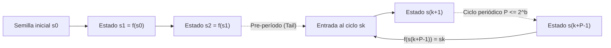
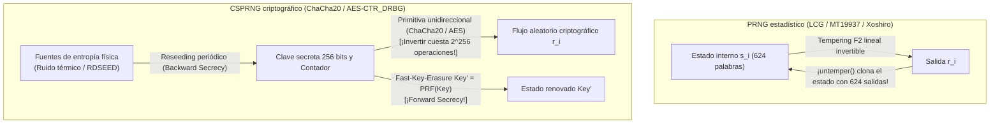

## Introducción: El «estado de pecado» de von Neumann y la paradoja del azar determinista

En 1951, <strong>John von Neumann</strong> pronunció una sentencia célebre en la historia de la computación: <strong>«Cualquiera que considere métodos aritméticos para producir dígitos aleatorios está, por supuesto, en estado de pecado (in a state of sin).»</strong> Una computadora digital es una máquina de estados finitos estrictamente determinista: dado un estado inicial y una instrucción, cada bit resultante está predeterminado al 100%. Sin embargo, desde las simulaciones de Monte Carlo en física nuclear y la generación procedural de videojuegos hasta las claves TLS, SSH y firmas ECDSA, nuestra civilización consume billones de números aleatorios cada segundo.

¿Cómo puede un algoritmo fijo producir imprevisibilidad? ¿Y por qué un generador estadísticamente sobresaliente como <strong>Mersenne Twister (`MT19937`)</strong> resulta catastróficamente inseguro al generar tokens de contraseñas, permitiendo que un atacante que observe apenas <strong>624 salidas consecutivas</strong> prediga el 100% de todas sus salidas futuras y pasadas?

---

## Capítulo 1: Anatomía matemática de un PRNG ── Semilla (Seed), espacio de estados finito y principio del palomar

Formalmente, un <strong>generador de números pseudoaleatorios (PRNG)</strong> es un autómata determinista $(\mathcal{S}, \mathcal{O}, f, g, s_0)$ con un espacio de estados interno finito $\mathcal{S}$ de tamaño $|\mathcal{S}| = 2^b$, una <strong>semilla inicial (Seed)</strong> $s_0 \in \mathcal{S}$, una función de transición $f: \mathcal{S} \to \mathcal{S}$ y una función de salida $g: \mathcal{S} \to \mathcal{O}$:

$$s_{i+1} = f(s_i), \qquad r_i = g(s_i) \qquad \left(|\mathcal{S}| = 2^b \implies \text{Period } P \le 2^b\right)$$

Fijada la semilla $s_0$, toda la sucesión $r_0, r_1, r_2, \dots$ queda completamente determinada. Esta <strong>reproducibilidad</strong> es vital para depurar simulaciones científicas. Pero por el <strong>principio del palomar (Pigeonhole Principle)</strong>, el autómata debe repetir algún estado previo $s_{k+P} = s_k$ en a lo sumo $2^b$ pasos, quedando atrapado en un ciclo periódico de <strong>período $P \le 2^b$</strong>.



El <strong>método del cuadrado medio (Middle-Square Method, 1949)</strong> de von Neumann (elevar al cuadrado un número de $2k$ dígitos y extraer los $2k$ dígitos centrales) colapsa rápidamente hacia `0000` o en ciclos minúsculos de longitud 4 por carecer de estructura algebraica.

---

## Capítulo 2: Generadores congruenciales lineales (LCG) y el teorema de Marsaglia ── La tragedia de los 15 planos de IBM `RANDU`

En 1949, D. H. Lehmer introdujo el <strong>generador congruencial lineal (LCG)</strong>: $X_{n+1} = (a X_n + c) \bmod m$. Por el <strong>teorema de Hull-Dobell (1962)</strong>, un LCG alcanza el período completo $P = m$ si y solo si: (1) $\gcd(c, m) = 1$, (2) todo factor primo $p$ de $m$ divide a $a-1$, y (3) si $4 \mid m$, entonces $4 \mid (a-1)$.

En 1968, el estadístico <strong>George Marsaglia</strong> publicó su famoso artículo <strong>«Random numbers fall mainly in the planes»</strong>, demostrando que los puntos $d$-dimensionales $(X_n, \dots, X_{n+d-1})$ de cualquier LCG caen sobre a lo sumo $(d! \cdot m)^{1/d}$ hiperplanos paralelos formando una red cristalina.

El caso más infame de la historia fue <strong>`RANDU`</strong> de IBM ($m = 2^{31}, c = 0, a = 65539 = 2^{16} + 3$) en los mainframes System/360:

$$X_{n+1} = 65539 X_n \bmod 2^{31} = (2^{16} + 3) X_n \bmod 2^{31}$$

$$X_{n+2} \equiv (2^{16}+3)^2 X_n \equiv \left(\underbrace{2^{32}}_{\equiv 0} + 6\cdot 2^{16} + 9\right) X_n \equiv 6 X_{n+1} - 9 X_n \pmod{2^{31}}$$

$$\implies 9 u_n - 6 u_{n+1} + u_{n+2} = k \in \{-5, -4, \dots, 9\} \quad (\text{15 Parallel Planes!})$$

Debido a la identidad $X_{n+2} \equiv 6 X_{n+1} - 9 X_n \pmod{2^{31}}$, ¡todos los puntos 3D generados por `RANDU` en el cubo unitario están <strong>atrapados en tan solo 15 planos paralelos</strong> con enormes vacíos entre ellos, invalidando miles de simulaciones de Monte Carlo durante décadas!

---

## Capítulo 3: Mersenne Twister (`MT19937`) y generadores estadísticos modernos (`PCG64`, `Xoshiro256++`)

En 1997, los matemáticos japoneses <strong>Makoto Matsumoto y Takuji Nishimura</strong> crearon el <strong>Mersenne Twister (`MT19937`)</strong> sobre el cuerpo finito $\mathbb{F}_2 = \{0, 1\}$ (adoptado por defecto en Python `random`, R, MATLAB, C++ `std::mt19937`):
1. <strong>Período astronómico y equidistribución en 623 dimensiones</strong>: Una matriz de estado de $624$ palabras de 32 bits ($19.937$ bits activos) logra un período igual al primo de Mersenne $P = 2^{19937} - 1 \approx 4,315 \times 10^{6001}$ y <strong>equidistribución exacta en hasta 623 dimensiones</strong>.
2. <strong>Transformación de templado (Tempering)</strong>: Cada palabra de estado $x$ se multiplica por una matriz invertible sobre $\mathbb{F}_2^{32}$ mediante cuatro desplazamientos y XOR:

$$\begin{aligned}
y_1 &= x \oplus ((x \gg 11) \mathbin{\&} \texttt{0xFFFFFFFF}) \\
y_2 &= y_1 \oplus ((y_1 \ll 7) \mathbin{\&} \texttt{0x9D2C5680}) \\
y_3 &= y_2 \oplus ((y_2 \ll 15) \mathbin{\&} \texttt{0xEFC60000}) \\
z &= y_3 \oplus (y_3 \gg 18)
\end{aligned}$$

Para superar el tamaño de estado de `MT19937` ($2,5\text{ KB}$) y su fallo en dos pruebas de linealidad $\mathbb{F}_2$ de la suite <strong>TestU01 (`BigCrush`)</strong>, surgieron <strong>`PCG64`</strong> (Melissa O'Neill 2014: LCG de 128 bits con rotación aleatoria dependiente de datos; estándar en NumPy) y <strong>`Xoshiro256++`</strong> (Blackman & Vigna 2018: estado de 256 bits con mezclador no lineal; usado en Rust y Java), que superan el 100% de `BigCrush` a velocidades sub-nanosegundo.

---

## Capítulo 4: Por qué perfección estadística $\neq$ seguridad criptográfica ── Clonación de `MT19937` y CSPRNG

### 4.1 Inversión del Tempering: clonar `MT19937` observando 624 salidas

Usar `MT19937` para tokens de sesión o restablecimiento de contraseñas es un error letal: cada paso del Tempering es una <strong>biyección lineal invertible en tiempo $O(1)$</strong>:

```python
def untemper(z: int) -> int:
    # Invert MT19937 32-bit output z back to internal state word x in O(1)
    y3 = z ^ (z >> 18)
    y2 = y3 ^ ((y3 << 15) & 0xEFC60000)
    y1 = y2
    for _ in range(4):
        y1 = y2 ^ ((y1 << 7) & 0x9D2C5680)
    x = y1
    for _ in range(2):
        x = y1 ^ (x >> 11)
    return x & 0xFFFFFFFF
```

<strong>¡Un atacante que observe solo 624 salidas consecutivas de 32 bits ($2.496\text{ bytes}$) de un servidor que use `MT19937` aplica `untemper(z)` a cada una para clonar al 100% las 624 palabras del estado interno del servidor!</strong> A partir de ese instante, puede predecir el 100% de los números futuros y reconstruir todos los pasados.

### 4.2 Teorema de Andrew Yao (1982) y generadores criptográficamente seguros (CSPRNG)

La criptografía exige un <strong>CSPRNG (Cryptographically Secure PRNG)</strong> basado en tres axiomas:
1. <strong>Imprevisibilidad del siguiente bit $\iff$ Indistinguibilidad computacional (Teorema de Yao, 1982 / Blum-Micali)</strong>: Ningún adversario de tiempo polinómico $\mathcal{A}$ que conozca los primeros $k$ bits puede predecir el bit $r_{k+1}$ con ventaja no despreciable sobre $1/2$:

$$\left| \Pr\left[\mathcal{A}(r_1, r_2, \dots, r_k) = r_{k+1}\right] - \frac{1}{2} \right| \le \text{negl}(\lambda)$$

2. <strong>Secreto hacia adelante (Forward Secrecy / Resistencia al retroceso)</strong>: Tras cada salida, la clave interna se sobrescribe mediante una función unidireccional (Fast-Key-Erasure), impidiendo recuperar claves pasadas incluso si se filtra el estado actual.
3. <strong>Secreto hacia atrás (Backward Secrecy / Resistencia a la predicción)</strong>: La inyección periódica de entropía física fresca (Reseeding) permite recuperar la seguridad tras una filtración.



Los CSPRNG modernos emplean cifradores como <strong>`ChaCha20-RNG`</strong> (kernel Linux, OpenBSD, Rust) y <strong>`AES-CTR_DRBG`</strong> (NIST SP 800-90A), o problemas numéricos como <strong>Blum-Blum-Shub ($x_{n+1} = x_n^2 \bmod M$)</strong>. Por el contrario, el generador de curvas elípticas <strong>`Dual_EC_DRBG`</strong> estandarizado por el NIST en 2006 contenía una <strong>puerta trasera kleptográfica de la NSA</strong> (confirmada por los documentos de Snowden en 2013: quien conociera el logaritmo discreto secreto $d$ tal que $P = d \cdot Q$ podía deducir el estado interno con solo 32 bytes de salida y descifrar TLS).

| Clase de generador | Algoritmos representativos | Tamaño de estado | Período $P$ | Suite `BigCrush` | Seguridad criptográfica | Casos de uso |
| :--- | :--- | :--- | :--- | :---: | :---: | :--- |
| <strong>LCG clásico</strong> | `RANDU`, C `rand()` | 32–64 bits | $\le 2^{64}$ | Falla (Hiperplanos) | <strong>Roto</strong> | Solo código heredado |
| <strong>PRNG estadístico moderno</strong> | <strong>`MT19937`</strong>, <strong>`PCG64`</strong>, <strong>`Xoshiro256++`</strong> | 128 bits – 2,5 KB | $2^{128} \sim 2^{19937}-1$ | <strong>Aprueba</strong> | <strong>Roto (624 salidas / Z3)</strong> | Monte Carlo, simulaciones, juegos |
| <strong>Criptográfico (CSPRNG)</strong> | <strong>`ChaCha20-RNG`</strong>, <strong>`AES-CTR_DRBG`</strong> | 256–512 bits | $\ge 2^{256}$ | <strong>100% Aprueba</strong> | <strong>Seguro (Forward/Backward Secret)</strong> | <strong>Claves TLS/SSH, contraseñas, tokens</strong> |
| <strong>Aleatorio físico (TRNG)</strong> | Ruido térmico, diodo avalancha, oscilador (`RDSEED`) | Continuo físico | <strong>Aperiódico ($\infty$)</strong> | Tras blanqueo | <strong>Entropía física real</strong> | Semilla y reseeding de CSPRNG |

---

## Capítulo 5: Generadores físicos (TRNG), min-entropía ($H_\infty$) y piscinas de entropía del sistema operativo

La semilla de un CSPRNG proviene de un <strong>generador de números aleatorios por hardware (TRNG / HRNG)</strong> que captura el caos físico: <strong>ruido térmico de Johnson-Nyquist</strong> en resistencias, ruido de disparo cuántico por ruptura en avalancha de diodos Zener y <strong>jitter de fase en osciladores en anillo</strong> (instrucciones `RDSEED`/`RDRAND` en CPUs Intel/AMD). En criptografía (NIST SP 800-90B), la imprevisibilidad en el peor caso se mide con la <strong>min-entropía ($H_\infty$)</strong> en lugar de la entropía media de Shannon $H_1$:

$$V_{\text{rms}} = \sqrt{4 k_B T R \Delta f}, \qquad H_\infty(X) = -\log_2 \left(\max_{x} P(X = x)\right) \le H_1(X)$$

El ruido físico bruto se somete a «blanqueo» (Whitening) mediante el algoritmo de von Neumann o extractores hash criptográficos (`BLAKE2s` en el kernel Linux, respaldado por el <strong>Leftover Hash Lemma</strong>) antes de alimentar al CSPRNG.

En Linux moderno (5.6+), `/dev/random` y `/dev/urandom` usan exactamente el mismo CSPRNG `ChaCha20`; los desarrolladores deben usar siempre <strong>`getrandom(2)`</strong> (o Python `secrets`, JS `crypto.getRandomValues()`, Rust `OsRng`/`ThreadRng`, Go `crypto/rand`). El desastre de <strong>Debian OpenSSL de 2008 (CVE-2008-0166)</strong> —donde comentar una línea por una advertencia de Valgrind redujo la entropía de todas las claves RSA/SSH al ID de proceso PID de 15 bits ($32.768$ claves posibles) durante dos años— y el fallo del nonce estático ECDSA en la PlayStation 3 de Sony (2010) demuestran una ley inquebrantable: <strong>la fortaleza de cualquier sistema criptográfico jamás puede superar la entropía de su generador de números aleatorios.</strong>
