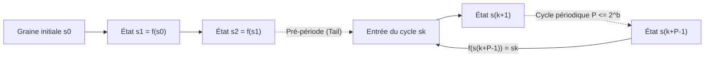
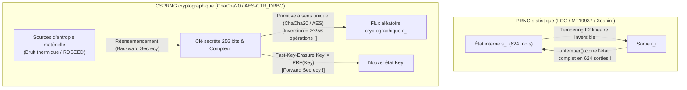

## Introduction : L'« état de péché » de von Neumann et le paradoxe du hasard déterministe

En 1951, <strong>John von Neumann</strong> prononça une phrase restée célèbre dans l'histoire de l'informatique : <strong>« Quiconque envisage des méthodes arithmétiques pour produire des chiffres aléatoires est, bien entendu, en état de péché (in a state of sin). »</strong> Un ordinateur numérique est une machine à états finis strictement déterministe : à partir d'un état initial et d'une instruction, chaque bit produit est prédéterminé à 100 %. Pourtant, de la simulation de Monte-Carlo en physique nucléaire à la génération procédurale de mondes virtuels, jusqu'aux clés TLS, SSH et signatures ECDSA, notre civilisation consomme des milliards de nombres aléatoires chaque milliseconde.

Comment un algorithme entièrement déterministe peut-il engendrer l'imprévisibilité ? Et pourquoi un générateur statistiquement remarquable comme le <strong>Mersenne Twister (`MT19937`)</strong> devient-il catastrophiquement vulnérable dès qu'on l'utilise pour générer un jeton de réinitialisation de mot de passe, permettant à un attaquant qui observe <strong>624 sorties consécutives</strong> de prédire 100 % des sorties futures et passées ?

---

## Chapitre 1 : Anatomie mathématique d'un PRNG ── Graine (Seed), espace d'états fini et principe des tiroirs

Formellement, un <strong>générateur de nombres pseudo-aléatoires (PRNG)</strong> est un automate déterministe $(\mathcal{S}, \mathcal{O}, f, g, s_0)$ doté d'un espace d'états interne fini $\mathcal{S}$ de taille $|\mathcal{S}| = 2^b$, d'une <strong>graine initiale (Seed)</strong> $s_0 \in \mathcal{S}$, d'une fonction de transition $f: \mathcal{S} \to \mathcal{S}$ et d'une fonction de sortie $g: \mathcal{S} \to \mathcal{O}$ :

$$s_{i+1} = f(s_i), \qquad r_i = g(s_i) \qquad \left(|\mathcal{S}| = 2^b \implies \text{Period } P \le 2^b\right)$$

Dès que la graine $s_0$ est fixée, toute la suite $r_0, r_1, r_2, \dots$ est figée. Cette <strong>reproductibilité</strong> est précieuse pour le débogage scientifique. Mais en vertu du <strong>principe des tiroirs (Pigeonhole Principle)</strong>, l'automate doit nécessairement revisiter un état antérieur $s_{k+P} = s_k$ en au plus $2^b$ étapes, s'enfermant alors dans un cycle périodique de <strong>période $P \le 2^b$</strong>.



La <strong>méthode du carré médian (Middle-Square Method, 1949)</strong> de von Neumann (élever au carré un nombre de $2k$ chiffres et extraire les $2k$ chiffres centraux) s'effondre rapidement vers `0000` ou dans des cycles minuscules de longueur 4 faute de structure algébrique.

---

## Chapitre 2 : Générateurs congruentiels linéaires (LCG) et théorème de Marsaglia ── Le désastre des 15 plans d'IBM `RANDU`

En 1949, D. H. Lehmer introduisit le <strong>générateur congruentiel linéaire (LCG)</strong> : $X_{n+1} = (a X_n + c) \bmod m$. Selon le <strong>théorème de Hull-Dobell (1962)</strong>, un LCG atteint la période maximale $P = m$ si et seulement si : (1) $\gcd(c, m) = 1$, (2) tout facteur premier $p$ de $m$ divise $a-1$, et (3) si $4 \mid m$, alors $4 \mid (a-1)$.

En 1968, le statisticien <strong>George Marsaglia</strong> publia son célèbre article <strong>« Random numbers fall mainly in the planes »</strong>, démontrant que les points $d$-dimensionnels $(X_n, \dots, X_{n+d-1})$ produits par tout LCG s'alignent sur au plus $(d! \cdot m)^{1/d}$ hyperplans parallèles d'un réseau cristallin !

Le cas le plus tristement célèbre est le générateur <strong>`RANDU`</strong> d'IBM ($m = 2^{31}, c = 0, a = 65539 = 2^{16} + 3$) sur les mainframes System/360 :

$$X_{n+1} = 65539 X_n \bmod 2^{31} = (2^{16} + 3) X_n \bmod 2^{31}$$

$$X_{n+2} \equiv (2^{16}+3)^2 X_n \equiv \left(\underbrace{2^{32}}_{\equiv 0} + 6\cdot 2^{16} + 9\right) X_n \equiv 6 X_{n+1} - 9 X_n \pmod{2^{31}}$$

$$\implies 9 u_n - 6 u_{n+1} + u_{n+2} = k \in \{-5, -4, \dots, 9\} \quad (\text{15 Parallel Planes!})$$

À cause de l'identité $X_{n+2} \equiv 6 X_{n+1} - 9 X_n \pmod{2^{31}}$, tous les triplets 3D générés par `RANDU` dans le cube unité sont <strong>piégés sur seulement 15 plans parallèles</strong>, séparés par d'immenses zones vides, faussant des milliers de simulations de Monte-Carlo dans les années 1960 et 1970 !

---

## Chapitre 3 : Mersenne Twister (`MT19937`) et générateurs statistiques modernes (`PCG64`, `Xoshiro256++`)

En 1997, les mathématiciens japonais <strong>Makoto Matsumoto et Takuji Nishimura</strong> ont créé le <strong>Mersenne Twister (`MT19937`)</strong>, fondé sur un registre à décalage à rétroaction généralisée tordue (TGFSR) sur le corps fini $\mathbb{F}_2 = \{0, 1\}$ (adopté par défaut dans Python `random`, R, MATLAB, C++ `std::mt19937`) :
1. <strong>Période colossale et équidistribution en dimension 623</strong> : Un tableau d'état de $624$ mots de 32 bits ($19\,937$ bits actifs) assure une période égale au nombre premier de Mersenne $P = 2^{19937} - 1 \approx 4,315 \times 10^{6001}$ et une <strong>équidistribution parfaite jusqu'à la dimension 623</strong> !
2. <strong>Transformation de tempérament (Tempering)</strong> : Chaque mot d'état $x$ subit une multiplication matricielle inversible sur $\mathbb{F}_2^{32}$ en quatre étapes :

$$\begin{aligned}
y_1 &= x \oplus ((x \gg 11) \mathbin{\&} \texttt{0xFFFFFFFF}) \\
y_2 &= y_1 \oplus ((y_1 \ll 7) \mathbin{\&} \texttt{0x9D2C5680}) \\
y_3 &= y_2 \oplus ((y_2 \ll 15) \mathbin{\&} \texttt{0xEFC60000}) \\
z &= y_3 \oplus (y_3 \gg 18)
\end{aligned}$$

Pour pallier la taille mémoire de `MT19937` ($2,5\text{ Ko}$) et son échec aux deux tests de linéarité $\mathbb{F}_2$ de la batterie <strong>TestU01 (`BigCrush`)</strong>, les années 2010 ont vu naître <strong>`PCG64`</strong> (Melissa O'Neill 2014 : LCG 128 bits couplé à une rotation aléatoire dépendante des données ; moteur par défaut de NumPy) et <strong>`Xoshiro256++`</strong> (Blackman & Vigna 2018 : état de 256 bits avec brouilleur non linéaire ; utilisé par Rust et Java), qui passent 100 % de `BigCrush` en moins d'une nanoseconde par mot.

---

## Chapitre 4 : Pourquoi perfection statistique $\neq$ sécurité cryptographique ── Clonage de `MT19937` et CSPRNG

### 4.1 Inversion du Tempering : cloner l'état de `MT19937` avec 624 sorties

Utiliser `MT19937` pour des jetons de session ou de réinitialisation de mot de passe est une erreur fatale : chacune des quatre étapes du Tempering est une <strong>bijection linéaire inversible en temps $O(1)$</strong> !

```python
def untemper(z: int) -> int:
    # Invert MT19937 32-bit output z back to internal state word x in O(1)
    y3 = z ^ (z >> 18)
    y2 = y3 ^ ((y3 << 15) & 0xEFC60000)
    y1 = y2
    for _ in range(4):
        y1 = y2 ^ ((y1 << 7) & 0x9D2C5680)
    x = y1
    for _ in range(2):
        x = y1 ^ (x >> 11)
    return x & 0xFFFFFFFF
```

<strong>Un attaquant qui observe seulement 624 sorties consécutives de 32 bits ($2\,496\text{ octets}$) d'un serveur utilisant `MT19937` applique simplement `untemper(z)` à chacune pour cloner à 100 % les 624 mots de l'état interne du serveur !</strong> Il peut dès lors prédire l'intégralité des nombres futurs et reconstituer tous les jetons passés.

### 4.2 Théorème d'Andrew Yao (1982) et générateurs cryptographiquement sûrs (CSPRNG)

La cryptographie exige un <strong>CSPRNG (Cryptographically Secure PRNG)</strong> vérifiant trois axiomes :
1. <strong>Imprévisibilité du bit suivant $\iff$ Indistinguabilité calculatoire (Théorème de Yao, 1982 / Blum-Micali)</strong> : Aucun adversaire polynomial $\mathcal{A}$ connaissant les $k$ premiers bits ne peut prédire le bit $r_{k+1}$ avec une probabilité sensiblement supérieure à $1/2$ :

$$\left| \Pr\left[\mathcal{A}(r_1, r_2, \dots, r_k) = r_{k+1}\right] - \frac{1}{2} \right| \le \text{negl}(\lambda)$$

2. <strong>Confidentialité persistante (Forward Secrecy / Résistance au retour en arrière)</strong> : Après chaque requête, la clé interne est immédiatement écrasée via une fonction à sens unique (Fast-Key-Erasure), empêchant de retrouver les sorties passées même si l'état présent fuite.
3. <strong>Confidentialité future (Backward Secrecy / Résistance à la prédiction)</strong> : Le réensemencement continu (Reseeding) avec de l'entropie matérielle fraîche rétablit la sécurité après une compromission.



Les CSPRNG modernes reposent sur des chiffrements comme <strong>`ChaCha20-RNG`</strong> (noyau Linux, OpenBSD, Rust) et <strong>`AES-CTR_DRBG`</strong> (NIST SP 800-90A), ou sur la factorisation avec <strong>Blum-Blum-Shub ($x_{n+1} = x_n^2 \bmod M$)</strong>. À l'inverse, le générateur sur courbes elliptiques <strong>`Dual_EC_DRBG`</strong> standardisé par le NIST en 2006 contenait une <strong>porte dérobée kleptographique de la NSA</strong> (révélée par Shumow & Ferguson en 2007 puis confirmée par les archives Snowden en 2013 : connaître le logarithme discret secret $d$ tel que $P = d \cdot Q$ permettait de calculer l'état interne à partir de 32 octets de sortie et de déchiffrer TLS).

| Classe de générateur | Algorithmes représentatifs | Taille d'état | Période $P$ | Batterie `BigCrush` | Sécurité cryptographique | Cas d'usage |
| :--- | :--- | :--- | :--- | :---: | :---: | :--- |
| <strong>LCG classique</strong> | `RANDU`, C `rand()` | 32–64 bits | $\le 2^{64}$ | Échec (Hyperplans) | <strong>Brisé</strong> | Code patrimonial |
| <strong>PRNG statistique moderne</strong> | <strong>`MT19937`</strong>, <strong>`PCG64`</strong>, <strong>`Xoshiro256++`</strong> | 128 bits – 2,5 Ko | $2^{128} \sim 2^{19937}-1$ | <strong>Réussite</strong> | <strong>Brisé (624 sorties / Z3)</strong> | Monte-Carlo, simulations, jeux |
| <strong>Cryptographique (CSPRNG)</strong> | <strong>`ChaCha20-RNG`</strong>, <strong>`AES-CTR_DRBG`</strong> | 256–512 bits | $\ge 2^{256}$ | <strong>100 % Réussite</strong> | <strong>Sûr (Forward/Backward Secret)</strong> | <strong>Clés TLS/SSH, mots de passe, jetons</strong> |
| <strong>Aléa physique (TRNG)</strong> | Bruit thermique, diode avalanche, oscillateur (`RDSEED`) | Continuum physique | <strong>Apériodique ($\infty$)</strong> | Après blanchiment | <strong>Entropie physique pure</strong> | Amorçage et réensemencement des CSPRNG |

---

## Chapitre 5 : Générateurs physiques (TRNG), min-entropie ($H_\infty$) et pools d'entropie du système d'exploitation

La graine initiale d'un CSPRNG provient d'un <strong>générateur matériel de nombres aléatoires (TRNG / HRNG)</strong> exploitant le chaos physique : <strong>bruit thermique de Johnson-Nyquist</strong> dans les conducteurs, bruit de grenaille quantique par claquage en avalanche de diodes Zener, et <strong>gigue de phase (phase jitter) d'oscillateurs en anneau</strong> (instructions `RDSEED`/`RDRAND` des processeurs Intel/AMD). En cryptographie (NIST SP 800-90B), l'imprévisibilité dans le pire des cas est mesurée par la <strong>min-entropie ($H_\infty$)</strong> plutôt que par l'entropie moyenne de Shannon $H_1$ :

$$V_{\text{rms}} = \sqrt{4 k_B T R \Delta f}, \qquad H_\infty(X) = -\log_2 \left(\max_{x} P(X = x)\right) \le H_1(X)$$

Le signal physique brut est « blanchi » (Whitening) par l'algorithme de von Neumann ou un extracteur cryptographique (`BLAKE2s` dans le noyau Linux, appuyé sur le <strong>Leftover Hash Lemma</strong>) avant d'alimenter le CSPRNG.

Sous Linux moderne (5.6+), `/dev/random` et `/dev/urandom` utilisent exactement le même CSPRNG noyau `ChaCha20` ; il faut toujours appeler <strong>`getrandom(2)`</strong> (ou Python `secrets`, JS `crypto.getRandomValues()`, Rust `OsRng`/`ThreadRng`, Go `crypto/rand`). La catastrophique <strong>faille Debian OpenSSL de 2008 (CVE-2008-0166)</strong> — où la mise en commentaire d'une ligne pour faire taire Valgrind réduisit l'entropie de toutes les clés RSA/SSH au seul identifiant de processus PID de 15 bits ($32\,768$ clés possibles !) pendant deux ans — ainsi que la réutilisation du nonce ECDSA $k$ sur la PlayStation 3 de Sony (2010) rappellent une loi d'airain : <strong>la sécurité d'un système cryptographique ne dépasse jamais l'entropie de son générateur aléatoire.</strong>
