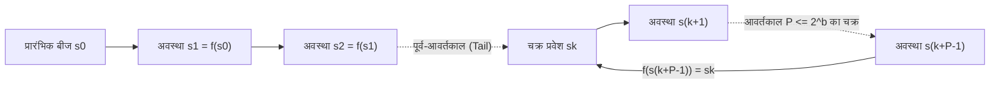
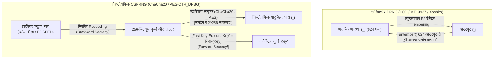

## प्रस्तावना: वॉन न्यूमैन की "पाप की अवस्था" और नियतिवादी संयोग का विरोधाभास

1951 में, आधुनिक कंप्यूटर के जनक <strong>जॉन वॉन न्यूमैन (John von Neumann)</strong> ने कंप्यूटर विज्ञान के इतिहास का एक अमर वाक्य कहा था: <strong>"जो कोई भी यादृच्छिक अंक (random digits) उत्पन्न करने के लिए अंकगणितीय विधियों पर विचार करता है, वह निस्संदेह 'पाप की अवस्था (in a state of sin)' में है।"</strong> एक डिजिटल कंप्यूटर पूर्णतः नियतिवादी परिमित-अवस्था मशीन (deterministic finite-state machine) है: समान प्रारंभिक अवस्था और निर्देश दिए जाने पर उसका प्रत्येक अगला बिट 100% पूर्वनिर्धारित होता है। फिर भी, परमाणु भौतिकी में मोंटे कार्लो सिमुलेशन और वीडियो गेम की दुनिया के निर्माण से लेकर TLS सत्र कुंजियों, SSH की-पेयर्स और ECDSA डिजिटल हस्ताक्षरों तक, हमारी आधुनिक सभ्यता प्रति सेकंड खरबों यादृच्छिक संख्याओं का उपभोग करती है।

एक पूर्णतः निर्धारित एल्गोरिदम अप्रत्याशितता कैसे पैदा कर सकता है? और क्यों सांख्यिकीय रूप से उत्कृष्ट जनरेटर जैसे <strong>मर्सेन ट्विस्टर (`MT19937`)</strong> को पासवर्ड रीसेट टोकन बनाने में उपयोग करने पर वह भयानक रूप से असुरक्षित हो जाता है, जिससे केवल <strong>624 क्रमिक आउटपुट</strong> देखने वाला हमलावर भविष्य और अतीत की 100% संख्याओं की भविष्यवाणी कर सकता है?

---

## अध्याय 1: PRNG की गणितीय संरचना ── बीज (Seed), परिमित अवस्था समष्टि और कबूतरखाना सिद्धांत

औपचारिक रूप से, एक <strong>छद्म-यादृच्छिक संख्या जनरेटर (PRNG)</strong> एक नियतिवादी ऑटोमैटोन $(\mathcal{S}, \mathcal{O}, f, g, s_0)$ है जिसमें $|\mathcal{S}| = 2^b$ आकार की परिमित आंतरिक अवस्था समष्टि $\mathcal{S}$, एक प्रारंभिक <strong>बीज (Seed)</strong> $s_0 \in \mathcal{S}$, अवस्था संक्रमण फलन $f: \mathcal{S} \to \mathcal{S}$ और आउटपुट फलन $g: \mathcal{S} \to \mathcal{O}$ होता है:

$$s_{i+1} = f(s_i), \qquad r_i = g(s_i) \qquad \left(|\mathcal{S}| = 2^b \implies \text{Period } P \le 2^b\right)$$

एक बार बीज $s_0$ तय हो जाने पर संपूर्ण अनुक्रम $r_0, r_1, r_2, \dots$ पूर्णतः निर्धारित हो जाता है। यह <strong>पुनरुत्पादनीयता (Reproducibility)</strong> वैज्ञानिक सिमुलेशन की डिबगिंग के लिए अमूल्य है। किंतु <strong>कबूतरखाना सिद्धांत (Pigeonhole Principle)</strong> के अनुसार, अधिकतम $2^b$ चरणों के भीतर मशीन को किसी पूर्व अवस्था $s_{k+P} = s_k$ पर लौटना ही पड़ता है, जिससे वह <strong>आवर्तकाल (Period) $P \le 2^b$</strong> के अनंत चक्र में फँस जाती है।



वॉन न्यूमैन की 1949 की <strong>मध्य-वर्ग विधि (Middle-Square Method)</strong> ($2k$ अंकों की संख्या का वर्ग करके बीच के $2k$ अंक निकालना) बीजगणितीय संरचना के अभाव में तुरंत `0000` या लंबाई 4 के छोटे चक्रों में सिमट जाती है।

---

## अध्याय 2: लीनियर कॉन्ग्रुएंशियल जनरेटर (LCG) और मार्सग्लिया का प्रमेय ── IBM `RANDU` की 15-समतल त्रासदी

1949 में डी. एच. लेहमर ने <strong>लीनियर कॉन्ग्रुएंशियल जनरेटर (LCG)</strong> प्रस्तुत किया: $X_{n+1} = (a X_n + c) \bmod m$। <strong>हल-डोबेल प्रमेय (Hull-Dobell Theorem, 1962)</strong> के अनुसार, LCG पूर्ण आवर्तकाल $P = m$ तभी प्राप्त करता है जब: (1) $\gcd(c, m) = 1$, (2) $m$ का प्रत्येक अभाज्य गुणनखंड $p$, $a-1$ को विभाजित करे, और (3) यदि $4 \mid m$ तो $4 \mid (a-1)$ हो।

1968 में सांख्यिकीविद् <strong>जॉर्ज मार्सग्लिया (George Marsaglia)</strong> ने अपने प्रसिद्ध शोधपत्र <strong>"Random numbers fall mainly in the planes"</strong> में सिद्ध किया कि किसी भी LCG द्वारा उत्पन्न क्रमिक $d$-आयामी बिंदु $(X_n, \dots, X_{n+d-1})$ अधिकतम $(d! \cdot m)^{1/d}$ समानांतर हाइपरप्लेन (क्रिस्टल जालक) पर ही स्थित होते हैं!

इतिहास का सबसे कुख्यात उदाहरण IBM System/360 मेनफ़्रेम का मानक जनरेटर <strong>`RANDU`</strong> ($m = 2^{31}, c = 0, a = 65539 = 2^{16} + 3$) था:

$$X_{n+1} = 65539 X_n \bmod 2^{31} = (2^{16} + 3) X_n \bmod 2^{31}$$

$$X_{n+2} \equiv (2^{16}+3)^2 X_n \equiv \left(\underbrace{2^{32}}_{\equiv 0} + 6\cdot 2^{16} + 9\right) X_n \equiv 6 X_{n+1} - 9 X_n \pmod{2^{31}}$$

$$\implies 9 u_n - 6 u_{n+1} + u_{n+2} = k \in \{-5, -4, \dots, 9\} \quad (\text{15 Parallel Planes!})$$

सर्वसमिका $X_{n+2} \equiv 6 X_{n+1} - 9 X_n \pmod{2^{31}}$ के कारण, इकाई घन (unit cube) में `RANDU` द्वारा उत्पन्न सभी 3D बिंदु <strong>केवल 15 समानांतर समतलों पर कैद हो गए</strong> जिनके बीच विशाल खाली अंतराल थे, जिससे दशकों तक हज़ारों मोंटे कार्लो भौतिकी सिमुलेशन दूषित हो गए!

---

## अध्याय 3: मर्सेन ट्विस्टर (`MT19937`) और आधुनिक सांख्यिकीय PRNG (`PCG64`, `Xoshiro256++`)

1997 में जापानी गणितज्ञ <strong>माकोतो मात्सुमोतो और ताकुजी निशिमुरा</strong> ने परिमित क्षेत्र $\mathbb{F}_2 = \{0, 1\}$ पर आधारित <strong>मर्सेन ट्विस्टर (`MT19937`)</strong> का आविष्कार किया (जो Python `random`, R, MATLAB, C++ `std::mt19937` का डिफ़ॉल्ट इंजन बना):
1. <strong>विशाल आवर्तकाल और 623-आयामी समवितरण</strong>: 32-बिट के $624$ शब्दों ($19,937$ सक्रिय बिट) की आंतरिक अवस्था मर्सेन अभाज्य आवर्तकाल $P = 2^{19937} - 1 \approx 4.315 \times 10^{6001}$ और <strong>623 आयामों तक पूर्ण समवितरण (equidistribution)</strong> सुनिश्चित करती है!
2. <strong>टेम्परिंग रूपांतरण (Tempering)</strong>: आउटपुट से पहले प्रत्येक अवस्था शब्द $x$ को $\mathbb{F}_2^{32}$ पर एक व्युत्क्रमणीय (invertible) मैट्रिक्स से गुणा किया जाता है:

$$\begin{aligned}
y_1 &= x \oplus ((x \gg 11) \mathbin{\&} \texttt{0xFFFFFFFF}) \\
y_2 &= y_1 \oplus ((y_1 \ll 7) \mathbin{\&} \texttt{0x9D2C5680}) \\
y_3 &= y_2 \oplus ((y_2 \ll 15) \mathbin{\&} \texttt{0xEFC60000}) \\
z &= y_3 \oplus (y_3 \gg 18)
\end{aligned}$$

`MT19937` के बड़े स्टेट आकार ($2.5\text{ KB}$) और <strong>TestU01 (`BigCrush`)</strong> में दो $\mathbb{F}_2$-रैखिकता परीक्षणों में विफलता को दूर करने के लिए, 2010 के दशक में <strong>`PCG64`</strong> (मेलिसा ओ'नील 2014: डेटा-निर्भर बिट रोटेशन के साथ 128-बिट LCG; NumPy में डिफ़ॉल्ट) और <strong>`Xoshiro256++`</strong> (ब्लैकमैन और विग्ना 2018: गैर-रैखिक स्क्रैम्बलर के साथ 256-बिट स्टेट; Rust और Java में प्रयुक्त) विकसित किए गए, जो 100% `BigCrush` परीक्षणों को उत्तीर्ण करते हैं।

---

## अध्याय 4: सांख्यिकीय पूर्णता $\neq$ क्रिप्टोग्राफिक सुरक्षा ── 624 आउटपुट से `MT19937` का क्लोन और CSPRNG

### 4.1 Tempering का व्युत्क्रमण: 624 आउटपुट से `MT19937` की आंतरिक अवस्था चुराना

सेशन टोकन या पासवर्ड के लिए `MT19937` का उपयोग एक घातक भूल है: Tempering के चारों चरण $\mathbb{F}_2^{32}$ पर <strong>$O(1)$ समय में पूर्णतः व्युत्क्रमणीय (invertible)</strong> हैं!

```python
def untemper(z: int) -> int:
    # Invert MT19937 32-bit output z back to internal state word x in O(1)
    y3 = z ^ (z >> 18)
    y2 = y3 ^ ((y3 << 15) & 0xEFC60000)
    y1 = y2
    for _ in range(4):
        y1 = y2 ^ ((y1 << 7) & 0x9D2C5680)
    x = y1
    for _ in range(2):
        x = y1 ^ (x >> 11)
    return x & 0xFFFFFFFF
```

<strong>यदि कोई हमलावर `MT19937` का उपयोग करने वाले सर्वर के केवल 624 क्रमिक 32-बिट आउटपुट ($2,496\text{ बाइट्स}$) देख लेता है, तो वह प्रत्येक पर `untemper(z)` चलाकर सर्वर की संपूर्ण 624-शब्द आंतरिक अवस्था को 100% क्लोन कर लेता है!</strong> उस क्षण से वह भविष्य के 100% आउटपुट की भविष्यवाणी कर सकता है और अतीत के सभी टोकन भी निकाल सकता है।

### 4.2 एंड्रयू याओ का प्रमेय (1982) और क्रिप्टोग्राफिक रूप से सुरक्षित जनरेटर (CSPRNG)

क्रिप्टोग्राफी के लिए <strong>CSPRNG (Cryptographically Secure PRNG)</strong> अनिवार्य है, जो तीन सिद्धांतों पर आधारित है:
1. <strong>अगले बिट की अप्रत्याशितता $\iff$ कम्प्यूटेशनल अविभेद्यता (याओ का प्रमेय 1982 / ब्लम-मिकाली)</strong>: प्रथम $k$ बिट्स जानने वाला कोई भी बहुपद-समय हमलावर $\mathcal{A}$, $(k+1)$-वें बिट का अनुमान सिक्का उछालने ($1/2$) से बेहतर नहीं लगा सकता:

$$\left| \Pr\left[\mathcal{A}(r_1, r_2, \dots, r_k) = r_{k+1}\right] - \frac{1}{2} \right| \le \text{negl}(\lambda)$$

2. <strong>फॉरवर्ड सीक्रेसी (Forward Secrecy / पश्चगामी प्रतिरोध)</strong>: प्रत्येक आउटपुट के तुरंत बाद आंतरिक कुंजी को एकदिशीय फलन द्वारा मिटाकर बदल दिया जाता है (Fast-Key-Erasure), जिससे वर्तमान अवस्था लीक होने पर भी पुरानी कुंजियाँ सुरक्षित रहती हैं।
3. <strong>बैकवर्ड सीक्रेसी (Backward Secrecy / भविष्यवाणी प्रतिरोध)</strong>: ताज़ा हार्डवेयर एन्ट्रॉपी के निरंतर मिश्रण (Reseeding) से लीक के बाद भी भविष्य की सुरक्षा बहाल हो जाती है।



आधुनिक CSPRNG में <strong>`ChaCha20-RNG`</strong> (Linux कर्नेल, OpenBSD, Rust) और <strong>`AES-CTR_DRBG`</strong> (NIST SP 800-90A) या गुणनखंडन समस्या पर आधारित <strong>Blum-Blum-Shub ($x_{n+1} = x_n^2 \bmod M$)</strong> शामिल हैं। इसके विपरीत, 2006 में NIST द्वारा मानकीकृत दीर्घवृत्तीय वक्र जनरेटर <strong>`Dual_EC_DRBG`</strong> में <strong>NSA का क्लेप्टोग्राफिक बैकडोर</strong> छिपा था (जिसकी पुष्टि 2013 के स्नोडेन दस्तावेजों से हुई: $P = d \cdot Q$ का गुप्त असतत लघुगणक $d$ जानने वाला व्यक्ति केवल 32 बाइट आउटपुट से आंतरिक अवस्था निकालकर संपूर्ण TLS ट्रैफ़िक डिक्रिप्ट कर सकता था)।

| जनरेटर वर्ग | प्रतिनिधि एल्गोरिदम | अवस्था आकार | आवर्तकाल $P$ | `BigCrush` परीक्षण | क्रिप्टोग्राफिक सुरक्षा | मुख्य उपयोग |
| :--- | :--- | :--- | :--- | :---: | :---: | :--- |
| <strong>शास्त्रीय LCG</strong> | `RANDU`, C `rand()` | 32–64 बिट | $\le 2^{64}$ | विफल (हाइपरप्लेन) | <strong>असुरक्षित</strong> | केवल पुराने कोड में |
| <strong>आधुनिक सांख्यिकीय PRNG</strong> | <strong>`MT19937`</strong>, <strong>`PCG64`</strong>, <strong>`Xoshiro256++`</strong> | 128 बिट – 2.5 KB | $2^{128} \sim 2^{19937}-1$ | <strong>उत्तीर्ण</strong> | <strong>असुरक्षित (624 आउटपुट / Z3)</strong> | मोंटे कार्लो, सिमुलेशन, गेम |
| <strong>क्रिप्टोग्राफिक (CSPRNG)</strong> | <strong>`ChaCha20-RNG`</strong>, <strong>`AES-CTR_DRBG`</strong> | 256–512 बिट | $\ge 2^{256}$ | <strong>100% उत्तीर्ण</strong> | <strong>सुरक्षित (Forward/Backward Secret)</strong> | <strong>TLS/SSH कुंजियाँ, पासवर्ड, टोकन</strong> |
| <strong>भौतिक यादृच्छिक (TRNG)</strong> | थर्मल नॉइज़, ज़ेनर ब्रेकडाउन, रिंग ऑसिलेटर (`RDSEED`) | भौतिक सातत्य | <strong>अनावर्ती ($\infty$)</strong> | व्हाइटनिंग के बाद | <strong>सच्ची भौतिक एन्ट्रॉपी</strong> | CSPRNG सीडिंग और रीसीडिंग |

---

## अध्याय 5: भौतिक जनरेटर (TRNG), मिन-एन्ट्रॉपी ($H_\infty$) और OS एन्ट्रॉपी पूल

CSPRNG का प्रारंभिक बीज <strong>हार्डवेयर ट्रू रैंडम नंबर जनरेटर (TRNG / HRNG)</strong> से आता है जो सूक्ष्म भौतिक हलचल को मापता है: प्रतिरोधकों में <strong>जॉनसन-नाइक्विस्ट थर्मल नॉइज़</strong>, ज़ेनर डायोड एवलांच ब्रेकडाउन का क्वांटम शॉट नॉइज़, और <strong>रिंग ऑसिलेटर फेज़ जिटर</strong> (Intel/AMD CPU में `RDSEED`/`RDRAND` निर्देश)। क्रिप्टोग्राफी (NIST SP 800-90B) में सबसे खराब स्थिति की अप्रत्याशितता को औसत शैनन एन्ट्रॉपी $H_1$ के बजाय <strong>मिन-एन्ट्रॉपी ($H_\infty$)</strong> से मापा जाता है:

$$V_{\text{rms}} = \sqrt{4 k_B T R \Delta f}, \qquad H_\infty(X) = -\log_2 \left(\max_{x} P(X = x)\right) \le H_1(X)$$

कच्चे भौतिक शोर को वॉन न्यूमैन डीबायसिंग या क्रिप्टोग्राफिक हैश एक्सट्रैक्टर (Linux कर्नेल में `BLAKE2s`, <strong>Leftover Hash Lemma</strong> के तहत) द्वारा <strong>व्हाइटनिंग (Whitening)</strong> करके CSPRNG में भेजा जाता है।

आधुनिक Linux (5.6+) में `/dev/random` और `/dev/urandom` दोनों एक ही `ChaCha20` कर्नेल CSPRNG का उपयोग करते हैं; डेवलपर्स को हमेशा <strong>`getrandom(2)`</strong> (या Python `secrets`, JS `crypto.getRandomValues()`, Rust `OsRng`/`ThreadRng`, Go `crypto/rand`) का उपयोग करना चाहिए। <strong>2008 की डेबियन OpenSSL त्रासदी (CVE-2008-0166)</strong> — जहाँ Valgrind चेतावनी हटाने के लिए एक पंक्ति को कमेंट करने से दो वर्षों तक दुनिया भर में बनी सभी RSA/SSH कुंजियों की एन्ट्रॉपी केवल 15-बिट प्रोसेस ID ($32,768$ संभावित कुंजियाँ!) तक सिमट गई — और सोनी PlayStation 3 की ECDSA स्थैतिक नॉनस ($k$) विफलता (2010) यह अकाट्य नियम सिद्ध करती हैं: <strong>किसी भी क्रिप्टोग्राफिक प्रणाली की सुरक्षा कभी भी उसकी कुंजियाँ बनाने वाले रैंडम नंबर जनरेटर की एन्ट्रॉपी से अधिक नहीं हो सकती।</strong>
