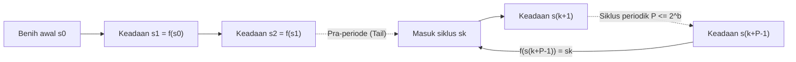
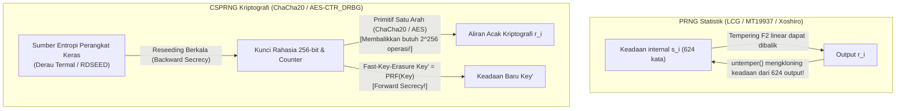

## Pendahuluan: "Keadaan Berdosa" von Neumann dan Paradoks Keacakan Deterministik

Pada tahun 1951, <strong>John von Neumann</strong> mengucapkan kalimat legendaris dalam sejarah ilmu komputer: <strong>"Siapa pun yang mempertimbangkan metode aritmetika untuk menghasilkan digit acak, tentu saja berada dalam keadaan berdosa (in a state of sin)."</strong> Komputer digital adalah mesin keadaan hingga (finite-state machine) yang sepenuhnya deterministik: dengan status awal dan instruksi yang sama, setiap bit berikutnya 100% telah ditentukan. Namun, mulai dari simulasi Monte Carlo dalam fisika nuklir dan pembuatan dunia game prosedural hingga kunci TLS, SSH, dan tanda tangan ECDSA, peradaban modern mengonsumsi triliunan angka acak setiap detik.

Bagaimana algoritma yang pasti dapat menciptakan ketidakpastian? Dan mengapa generator yang secara statistik luar biasa seperti <strong>Mersenne Twister (`MT19937`)</strong> menjadi sangat tidak aman saat digunakan untuk membuat token reset kata sandi, memungkinkan penyerang yang mengamati <strong>624 output berturut-turut</strong> untuk memprediksi 100% dari seluruh output masa depan dan masa lalunya?

---

## Bab 1: Anatomi Matematika PRNG ── Benih (Seed), Ruang Keadaan Hingga, dan Prinsip Sarang Merpati

Secara formal, <strong>Pseudorandom Number Generator (PRNG)</strong> adalah automata deterministik $(\mathcal{S}, \mathcal{O}, f, g, s_0)$ dengan ruang keadaan internal hingga $\mathcal{S}$ berukuran $|\mathcal{S}| = 2^b$, <strong>benih awal (Seed)</strong> $s_0 \in \mathcal{S}$, fungsi transisi $f: \mathcal{S} \to \mathcal{S}$, dan fungsi output $g: \mathcal{S} \to \mathcal{O}$:

$$s_{i+1} = f(s_i), \qquad r_i = g(s_i) \qquad \left(|\mathcal{S}| = 2^b \implies \text{Period } P \le 2^b\right)$$

Begitu benih $s_0$ ditetapkan, seluruh barisan $r_0, r_1, r_2, \dots$ sepenuhnya ditentukan. <strong>Reprodusibilitas</strong> ini sangat berharga untuk debugging simulasi ilmiah. Namun menurut <strong>Prinsip Sarang Merpati (Pigeonhole Principle)</strong>, automata pasti akan mengunjungi kembali keadaan sebelumnya $s_{k+P} = s_k$ dalam paling banyak $2^b$ langkah, terjebak dalam siklus periodik dengan <strong>periode $P \le 2^b$</strong>.



<strong>Metode Kuadrat Tengah (Middle-Square Method, 1949)</strong> milik von Neumann (mengkuadratkan bilangan $2k$ digit dan mengambil $2k$ digit tengah) cepat runtuh menuju `0000` atau siklus pendek sepanjang 4 karena tidak memiliki struktur aljabar.

---

## Bab 2: Linear Congruential Generator (LCG) dan Teorema Marsaglia ── Tragedi 15 Bidang IBM `RANDU`

Pada tahun 1949, D. H. Lehmer memperkenalkan <strong>Linear Congruential Generator (LCG)</strong>: $X_{n+1} = (a X_n + c) \bmod m$. Berdasarkan <strong>Teorema Hull-Dobell (1962)</strong>, LCG mencapai periode penuh $P = m$ jika dan hanya jika: (1) $\gcd(c, m) = 1$, (2) setiap faktor prima $p$ dari $m$ membagi $a-1$, dan (3) jika $4 \mid m$, maka $4 \mid (a-1)$.

Pada tahun 1968, ahli statistik <strong>George Marsaglia</strong> menerbitkan makalah terkenal <strong>"Random numbers fall mainly in the planes"</strong>, membuktikan bahwa titik-titik $d$-dimensi $(X_n, \dots, X_{n+d-1})$ dari LCG mana pun jatuh pada paling banyak $(d! \cdot m)^{1/d}$ bidang hiper sejajar yang membentuk kisi kristal!

Kasus paling terkenal dalam sejarah adalah <strong>`RANDU`</strong> milik IBM ($m = 2^{31}, c = 0, a = 65539 = 2^{16} + 3$) pada mainframe System/360:

$$X_{n+1} = 65539 X_n \bmod 2^{31} = (2^{16} + 3) X_n \bmod 2^{31}$$

$$X_{n+2} \equiv (2^{16}+3)^2 X_n \equiv \left(\underbrace{2^{32}}_{\equiv 0} + 6\cdot 2^{16} + 9\right) X_n \equiv 6 X_{n+1} - 9 X_n \pmod{2^{31}}$$

$$\implies 9 u_n - 6 u_{n+1} + u_{n+2} = k \in \{-5, -4, \dots, 9\} \quad (\text{15 Parallel Planes!})$$

Akibat identitas $X_{n+2} \equiv 6 X_{n+1} - 9 X_n \pmod{2^{31}}$, semua titik 3D yang dihasilkan `RANDU` dalam kubus satuan <strong>terjebak hanya pada 15 bidang sejajar</strong> dengan ruang kosong yang luas di antaranya, merusak ribuan simulasi Monte Carlo selama puluhan tahun!

---

## Bab 3: Mersenne Twister (`MT19937`) dan PRNG Statistik Modern (`PCG64`, `Xoshiro256++`)

Pada tahun 1997, matematikawan Jepang <strong>Makoto Matsumoto dan Takuji Nishimura</strong> menciptakan <strong>Mersenne Twister (`MT19937`)</strong> di atas medan hingga $\mathbb{F}_2 = \{0, 1\}$ (standar di Python `random`, R, MATLAB, C++ `std::mt19937`):
1. <strong>Periode Raksasa & Ekuidistribusi 623 Dimensi</strong>: Array keadaan $624$ kata 32-bit ($19.937$ bit aktif) menghasilkan periode bilangan prima Mersenne $P = 2^{19937} - 1 \approx 4,315 \times 10^{6001}$ dan <strong>ekuidistribusi sempurna hingga 623 dimensi</strong>!
2. <strong>Transformasi Tempering</strong>: Setiap kata keadaan $x$ dikalikan dengan matriks bit $32\times 32$ yang dapat dibalik di atas $\mathbb{F}_2$:

$$\begin{aligned}
y_1 &= x \oplus ((x \gg 11) \mathbin{\&} \texttt{0xFFFFFFFF}) \\
y_2 &= y_1 \oplus ((y_1 \ll 7) \mathbin{\&} \texttt{0x9D2C5680}) \\
y_3 &= y_2 \oplus ((y_2 \ll 15) \mathbin{\&} \texttt{0xEFC60000}) \\
z &= y_3 \oplus (y_3 \gg 18)
\end{aligned}$$

Untuk mengatasi ukuran memori `MT19937` ($2,5\text{ KB}$) dan kegagalannya pada dua uji linearitas $\mathbb{F}_2$ dalam <strong>TestU01 (`BigCrush`)</strong>, lahirlah <strong>`PCG64`</strong> (Melissa O'Neill 2014: LCG 128-bit dengan rotasi bit acak bergantung data; standar di NumPy) dan <strong>`Xoshiro256++`</strong> (Blackman & Vigna 2018: keadaan 256-bit dengan pengacak non-linear; digunakan di Rust dan Java), yang lulus 100% uji `BigCrush` dalam waktu kurang dari satu nanodetik.

---

## Bab 4: Mengapa Kesempurnaan Statistik $\neq$ Keamanan Kriptografi ── Mengkloning `MT19937` dan CSPRNG

### 4.1 Membalikkan Tempering: Mengkloning `MT19937` dari 624 Output

Menggunakan `MT19937` untuk token sesi atau kata sandi adalah kesalahan fatal: setiap tahap Tempering adalah <strong>bijeksi linear yang dapat dibalik dalam waktu $O(1)$</strong>:

```python
def untemper(z: int) -> int:
    # Invert MT19937 32-bit output z back to internal state word x in O(1)
    y3 = z ^ (z >> 18)
    y2 = y3 ^ ((y3 << 15) & 0xEFC60000)
    y1 = y2
    for _ in range(4):
        y1 = y2 ^ ((y1 << 7) & 0x9D2C5680)
    x = y1
    for _ in range(2):
        x = y1 ^ (x >> 11)
    return x & 0xFFFFFFFF
```

<strong>Penyerang yang mengamati hanya 624 output 32-bit berturut-turut ($2.496\text{ byte}$) dari server yang menggunakan `MT19937` cukup menerapkan `untemper(z)` pada masing-masing output untuk mengkloning 100% dari 624 kata keadaan internal server!</strong> Sejak saat itu, penyerang dapat memprediksi 100% angka di masa depan dan merekonstruksi semua angka di masa lalu.

### 4.2 Teorema Andrew Yao (1982) dan CSPRNG

Kriptografi mewajibkan <strong>CSPRNG (Cryptographically Secure PRNG)</strong> dengan tiga aksioma:
1. <strong>Ketidakpastian Bit Berikutnya $\iff$ Ketidakbedakan Komputasional (Teorema Yao, 1982 / Blum-Micali)</strong>: Tidak ada algoritma waktu polinomial $\mathcal{A}$ yang mengetahui $k$ bit pertama yang dapat menebak bit $r_{k+1}$ secara signifikan lebih baik daripada lemparan koin ($1/2$):

$$\left| \Pr\left[\mathcal{A}(r_1, r_2, \dots, r_k) = r_{k+1}\right] - \frac{1}{2} \right| \le \text{negl}(\lambda)$$

2. <strong>Forward Secrecy (Ketahanan Lacak Balik)</strong>: Setelah setiap output, kunci internal segera ditimpa melalui fungsi satu arah (Fast-Key-Erasure), mencegah pemulihan kunci masa lalu meskipun keadaan saat ini bocor.
3. <strong>Backward Secrecy (Ketahanan Prediksi)</strong>: Penyemaian ulang (Reseeding) berkala dengan entropi perangkat keras memulihkan keamanan setelah kebocoran.



CSPRNG modern menggunakan cipher seperti <strong>`ChaCha20-RNG`</strong> (kernel Linux, OpenBSD, Rust) dan <strong>`AES-CTR_DRBG`</strong> (NIST SP 800-90A), atau masalah pemfaktoran seperti <strong>Blum-Blum-Shub ($x_{n+1} = x_n^2 \bmod M$)</strong>. Sebaliknya, generator kurva eliptik <strong>`Dual_EC_DRBG`</strong> yang distandarisasi NIST pada 2006 ternyata menyimpan <strong>backdoor kleptografi NSA</strong> (dikonfirmasi dokumen Snowden 2013: siapa pun yang mengetahui logaritma diskrit rahasia $d$ di mana $P = d \cdot Q$ dapat menghitung keadaan internal hanya dari 32 byte output dan mendekripsi lalu lintas TLS).

| Kelas Generator | Algoritma Representatif | Ukuran Keadaan | Periode $P$ | Uji `BigCrush` | Keamanan Kriptografi | Kasus Penggunaan |
| :--- | :--- | :--- | :--- | :---: | :---: | :--- |
| <strong>LCG Klasik</strong> | `RANDU`, C `rand()` | 32–64 bit | $\le 2^{64}$ | Gagal (Bidang hiper) | <strong>Rusak</strong> | Hanya kode warisan |
| <strong>PRNG Statistik Modern</strong> | <strong>`MT19937`</strong>, <strong>`PCG64`</strong>, <strong>`Xoshiro256++`</strong> | 128 bit – 2,5 KB | $2^{128} \sim 2^{19937}-1$ | <strong>Lulus</strong> | <strong>Rusak (624 output / Z3)</strong> | Monte Carlo, simulasi, game |
| <strong>Kriptografi (CSPRNG)</strong> | <strong>`ChaCha20-RNG`</strong>, <strong>`AES-CTR_DRBG`</strong> | 256–512 bit | $\ge 2^{256}$ | <strong>100% Lulus</strong> | <strong>Aman (Forward/Backward Secret)</strong> | <strong>Kunci TLS/SSH, sandi, token</strong> |
| <strong>Acak Fisik (TRNG)</strong> | Derau termal, dioda longsoran, osilator (`RDSEED`) | Kontinum fisik | <strong>Aperiodik ($\infty$)</strong> | Setelah pemutihan | <strong>Entropi fisik murni</strong> | Seeding & reseeding CSPRNG |

---

## Bab 5: Generator Fisik (TRNG), Min-Entropi ($H_\infty$), dan Pool Entropi OS

Benih awal CSPRNG berasal dari <strong>Hardware Random Number Generator (TRNG / HRNG)</strong> yang menangkap kekacauan fisik: <strong>derau termal Johnson-Nyquist</strong> pada resistor, derau tembakan kuantum dari kerusakan longsoran dioda Zener, dan <strong>jitter fase osilator cincin</strong> (instruksi `RDSEED`/`RDRAND` pada CPU Intel/AMD). Dalam kriptografi (NIST SP 800-90B), ketidakpastian kasus terburuk diukur dengan <strong>Min-Entropi ($H_\infty$)</strong> alih-alih entropi rata-rata Shannon $H_1$:

$$V_{\text{rms}} = \sqrt{4 k_B T R \Delta f}, \qquad H_\infty(X) = -\log_2 \left(\max_{x} P(X = x)\right) \le H_1(X)$$

Derau fisik mentah melewati proses <strong>pemutihan (Whitening)</strong> melalui algoritma von Neumann atau ekstraktor hash kriptografi (`BLAKE2s` di kernel Linux berdasarkan <strong>Leftover Hash Lemma</strong>) sebelum masuk ke CSPRNG.

Di Linux modern (5.6+), `/dev/random` dan `/dev/urandom` menggunakan CSPRNG kernel `ChaCha20` yang sama persis; pengembang harus selalu memanggil <strong>`getrandom(2)`</strong> (atau Python `secrets`, JS `crypto.getRandomValues()`, Rust `OsRng`/`ThreadRng`, Go `crypto/rand`). Bencana <strong>Debian OpenSSL 2008 (CVE-2008-0166)</strong> — di mana mengomentari satu baris kode demi menghilangkan peringatan Valgrind menurunkan entropi semua kunci RSA/SSH menjadi hanya ID proses PID 15-bit ($32.768$ kemungkinan kunci) selama dua tahun — serta kegagalan nonce statis ECDSA pada Sony PlayStation 3 (2010) membuktikan hukum mutlak: <strong>kekuatan sistem kriptografi tidak pernah bisa melampaui entropi generator angka acaknya.</strong>
