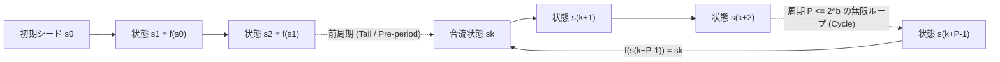
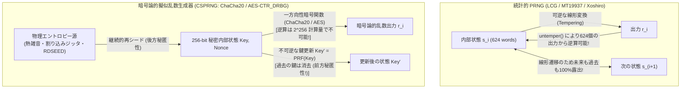

## 序論：ノイマンの「原罪」と決定論的機械が紡ぐ偶然

1951年、現代コンピュータの父である<strong>ジョン・フォン・ノイマン（John von Neumann）</strong>は、数値計算における乱数生成に関する講演の中で、計算機科学の歴史に永遠に刻まれることになった有名な警句を残した。

> <strong>「算術的な手順によって乱数を作り出そうなどと考える者は、誰であれ、もちろん『罪の状態（in a state of sin）』にある。」</strong>
> （*“Anyone who considers arithmetical methods of producing random digits is, of course, in a state of sin.”* ── John von Neumann, 1951）

ノイマンが「罪（Sin）」と呼んだ理由は明白である。私たちが日常使っているデジタルコンピュータ（チューリングマシン）は、与えられた命令と現在の内部状態から次の状態が100%一意に定まる<strong>完全な決定論的機械（Deterministic State Machine）</strong>である。そこにはサイコロを振る神の手も、気まぐれな揺らぎも一切存在しない。それにもかかわらず、現代のデジタル社会は、モンテカルロ法による素粒子・気象・金融シミュレーションから、ビデオゲームのプロシージャル生成、そしてインターネットの根幹を守るTLS通信・SSH鍵生成・暗号資産の署名に至るまで、毎秒何조個もの「乱数（Random Numbers）」を消費し続けている。

完全に決められた手順（アルゴリズム）しか実行できないはずのコンピュータが、どうやって「予測不能な乱数」をつくり出しているのか？ そして、<strong>「科学計算やゲームで使える統計的に優れた乱数（メルセンヌ・ツイスタなど）」をパスワード生成や暗号鍵に使うと、なぜたった数千バイトの出力を見られただけで未来も過去も100%完全に予測・解読されてしまうのか？</strong>

本稿では、真の物理乱数（TRNG）と擬似乱数（PRNG）の数理的構造から出発し、線形合同法（LCG）とIBMの伝説的失敗作「RANDU」が3次元空間に描いた15枚の平面、松本眞と西村拓士が開発した<strong>メルセンヌ・ツイスタ（MT19937）</strong>の驚異的な周期 $2^{19937}-1$ と624個の出力からの内部状態完全復元攻撃、アンドリュー・ヤオ（Andrew Yao）による<strong>暗号論的擬似乱数生成器（CSPRNG）</strong>の次ビット予測不能性定理、ChaCha20・AES-CTR・NSAバックドア事件（Dual_EC_DRBG）、さらには熱雑音・量子トンネル効果からエントロピーを抽出するLinuxカーネル `/dev/random`・`/dev/urandom` の内部設計と、2008年Debian OpenSSL脆弱性（CVE-2008-0166）の教訓までを体系的に解き明かす。

---

## 第1章：擬似乱数生成器（PRNG）の数理構造 ── シード、有限状態空間、鳩の巣原理による周期

### 1.1 決定論的オートマトンとしての PRNG

数学的に厳密に定義すると、<strong>擬似乱数生成器（Pseudorandom Number Generator: PRNG）</strong>とは、有限集合である<strong>内部状態空間（Internal State Space）</strong> $\mathcal{S}$、初期状態 $s_0 \in \mathcal{S}$（これを<strong>シード：Seed</strong> と呼ぶ）、状態の遷移関数 $f: \mathcal{S} \to \mathcal{S}$、および内部状態から乱数値を取り出す出力関数 $g: \mathcal{S} \to \mathcal{O}$ の組 $(\mathcal{S}, \mathcal{O}, f, g, s_0)$ によって記述される決定論的有限オートマトンである。

$$s_{i+1} = f(s_i), \qquad r_i = g(s_i) \qquad (i = 0, 1, 2, \dots)$$

この数式には、いかなる「ランダム性」も含まれていない。初期値である<strong>シード $s_0$ が同じであれば、地球上のどのコンピュータで何度実行しようとも、出力される数列 $r_0, r_1, r_2, \dots$ は1ビットの狂いもなく100%完全に同一となる</strong>。

この「同じシードからは必ず同じ乱数列が再現される」という性質は、一見すると欠陥のように思えるかもしれないが、科学技術計算やソフトウェア工学においては<strong>かけがえのない長所（Reproducibility：再現性）</strong>となる。たとえば、超大規模な流体シミュレーションや機械学習の学習過程で稀なバグが発生したとき、あるいはゲームの広大な地形生成（Minecraftのワールドシードなど）を共有したいとき、たった64ビットや128ビットのシード値 $s_0$ さえ記録しておけば、何十億ステップ後の現象をいつでも完璧に再現して検証できるのである。

### 1.2 鳩の巣原理（Pigeonhole Principle）と周期（Period）の必然性

しかし、決定論的かつ有限のメモリしか持たないことには、避けられない数学的宿命がある。内部状態が $b$ ビットのメモリで表現されているとき、取り得る状態の総数は高々 $|\mathcal{S}| = 2^b$ 通りである。

したがって、<strong>鳩の巣原理（Pigeonhole Principle）</strong>により、状態遷移 $s_0 \to s_1 \to s_2 \to \dots$ を最大でも $2^b$ 回繰り返すうちに、必ず過去に一度通過した状態 $s_k = s_{k+P}$（$P \le 2^b$）に再び戻る。一度同じ内部状態に入った瞬間、その後の遷移も決定論的であるため、出力列は永遠に長さ $P$ の同じループを繰り返すことになる。この $P$ を擬似乱数生成器の<strong>周期（Period）</strong>と呼ぶ。



### 1.3 ノイマンの中央二乗法（Middle-Square Method, 1949）とその崩壊

黎明期のENIACにおいてフォン・ノイマン自身が考案した最初の算術的PRNGは、<strong>中央二乗法（Middle-Square Method）</strong>と呼ばれる極めてシンプルなアルゴリズムだった。$2k$ 桁（たとえば4桁）の整数 $X_n$ を2乗して $4k$ 桁（8桁）の数値を作り、その<strong>中央の $2k$ 桁（4桁）</strong>を切り出して次の乱数 $X_{n+1}$ とする。

$$X_{n+1} = \left\lfloor \frac{X_n^2}{10^k} \right\rfloor \bmod 10^{2k}$$

たとえば4桁（$k=2$）でシード $X_0 = 1234$ から始めると、
- $X_0 = 1234 \implies X_0^2 = 01\mathbf{5227}56 \implies X_1 = 5227$
- $X_1 = 5227 \implies X_1^2 = 27\mathbf{3215}29 \implies X_2 = 3215$

一見うまく動いているように見えるが、この手法には致命的な欠陥があった。中央の桁に偶然 `00` が現れると急速に値が縮退し、一度 $0000$ になると $0000^2 = 00000000$ となって二度と抜け出せなくなるだけでなく、$6100 \to 2100 \to 4100 \to 8100 \to 6100$ のような<strong>わずか数ステップの極小サイクル（短周期トラップ）</strong>に吸い込まれてしまうのである。優れたPRNGを設計するには、経験則ではなく厳密な数論と代数学が必要だった。

---

## 第2章：線形合同法（LCG）と「乱数は主に平面に落ちる」── IBM RANDU の悲劇

### 2.1 線形合同法（Linear Congruential Generator: LCG）とハル＝ドベルの定理

1949年にデリック・ヘンリー・レーマー（D. H. Lehmer）が提唱し、その後数十年にわたってC言語の標準ライブラリ `rand()` やJavaの `java.util.Random` などで広く使われたのが<strong>線形合同法（Linear Congruential Generator: LCG）</strong>である。LCGは、法（Modulus）$m$、乗数（Multiplier）$a$、増分（Increment）$c$ を用いて、たった1行の漸化式で定義される。

$$X_{n+1} = (a X_n + c) \bmod m$$

このシンプルな式が最大の周期 $P = m$（すなわち $0$ から $m-1$ までのすべての整数を重複なく1回ずつ巡回する完全周期）を達成するための必要十分条件は、1962年に証明された<strong>ハル＝ドベルの定理（Hull-Dobell Theorem）</strong>によって完全に解明されている。

> <strong>ハル＝ドベルの定理（1962）</strong>：
> 線形合同法 $X_{n+1} = (a X_n + c) \bmod m$（ただし $c \neq 0$）が任意のシード $X_0$ に対して最大周期 $P = m$ を持つための必要十分条件は、以下の3条件をすべて満たすことである：
> 1. 増分 $c$ と法 $m$ が互いに素である（$\gcd(c, m) = 1$）。
> 2. $m$ を割り切るすべての素因数 $p$ について、$a - 1$ が $p$ の倍数である（$p \mid m \implies p \mid (a - 1)$）。
> 3. もし $m$ が $4$ の倍数ならば、$a - 1$ も $4$ の倍数である（$4 \mid m \implies 4 \mid (a - 1)$）。

特にコンピュータでは32ビットや64ビットのオーバーフロー演算をそのまま利用できる $m = 2^{32}$ や $m = 2^{64}$ が好まれる。このとき $m$ の素因数は $2$ だけであるため、<strong>「$c$ を奇数にし、$a$ を $4$ で割って $1$ 余る数（$a \equiv 1 \pmod 4$）にする」</strong>だけで、必ず周期 $2^{32}$ または $2^{64}$ が保証される！

### 2.2 マーサグリアの定理（1968）と IBM `RANDU` の大惨事

「周期が長くて、1次元のヒストグラムが均等なら、それで良い乱数なのではないか？」── 1960年代の多くの科学者がそう信じていた。その幻想を木っ端微塵に打ち砕いたのが、1968年に統計学者<strong>ジョージ・マーサグリア（George Marsaglia）</strong>が米国科学アカデミー紀要（PNAS）に発表した歴史的論文 <strong>『Random numbers fall mainly in the planes（乱数は主に平面に落ちる）』</strong> である。

マーサグリアは、いかなる線形合同法（LCG）であっても、連続する $d$ 個の乱数を組にして $d$ 次元空間の座標点 $\mathbf{P}_n = (X_n, X_{n+1}, \dots, X_{n+d-1}) \in [0, m)^d$ としてプロットすると、それらの点は空間を一様に埋め尽くすのではなく、<strong>最大でも $(d! \cdot m)^{1/d}$ 枚しか存在しない平行な結晶格子平面（超平面）の上に規則正しく並んでしまう</strong>ことを数学的に証明したのである（この平面間の最大間隔を測定する検定を<strong>スペクトル検定：Spectral Test</strong>と呼ぶ）。

その最悪の実例として科学史に悪名を轟かせているのが、1960年代から70年代にかけてIBMのメインフレーム System/360 の科学計算ライブラリに標準搭載され、世界中の物理学・化学のモンテカルロ計算を汚染した擬似乱数生成器 <strong>`RANDU`</strong> である。

`RANDU` は乗算をビットシフトと加算だけで高速化するため、$m = 2^{31}$、$c = 0$（乗算合同法）、そして乗数に $a = 65539 = 2^{16} + 3$ を採用していた。

$$X_{n+1} = 65539 X_n \bmod 2^{31} = (2^{16} + 3) X_n \bmod 2^{31}$$

この式を2ステップ進めて、$X_{n+2}$ を $X_{n+1}$ と $X_n$ で表してみよう。$2^{16} = 65539 - 3$ なので、法 $2^{31}$ のもとで $(2^{16})^2 = 2^{32} \equiv 0 \pmod{2^{31}}$ となることを利用すると、背筋が凍るような恒等式が導かれる。

$$\begin{aligned}
X_{n+2} &\equiv (2^{16} + 3) X_{n+1} \equiv (2^{16} + 3)(2^{16} + 3) X_n \pmod{2^{31}} \\
&\equiv \left( \underbrace{2^{32}}_{\equiv\, 0} + 6 \cdot 2^{16} + 9 \right) X_n \pmod{2^{31}} \\
&\equiv \left( 6(2^{16} + 3) - 9 \right) X_n \equiv \mathbf{6 X_{n+1} - 9 X_n \pmod{2^{31}}}
\end{aligned}$$

なんと、連続する3つの乱数 $(X_n, X_{n+1}, X_{n+2})$ の間には、常に次の厳密な一次方程式が成り立っているのである！

$$X_{n+2} - 6 X_{n+1} + 9 X_n = k \cdot 2^{31} \qquad (k \in \{-5, -4, -3, \dots, 8, 9\})$$

これは幾何学的には、3次元立方体 $[0, 2^{31})^3$ の中にプロットされたすべての3次元座標点 $(X_n, X_{n+1}, X_{n+2})$ が、法線ベクトル $(9, -6, 1)$ を持つ<strong>たった15枚の平行な平面の上にしか絶対に存在できない</strong>ことを意味する！ 平面と平面の間には広大な「真空の隙間」が空いており、3次元空間でランダムな方向や配置をサンプリングしていた当時の多くのモンテカルロ計算は、知らぬ間にこの15枚の板の上だけをなぞっていたのである。

*(補足：さらに $m = 2^k$ のLCGには、「下位ビットの周期が極端に短い」というもう一つの弱点がある。最下位ビット（LSB: $X_n \bmod 2$）は `0, 1, 0, 1...` と周期2で交互に反転するだけであり、下位 $j$ ビットの周期は高々 $2^j$ に過ぎない。)*

---

## 第3章：メルセンヌ・ツイスタ（MT19937）と現代の高速統計的乱数（PCG, Xoshiro）

### 3.1 松本眞・西村拓士によるメルセンヌ・ツイスタ（Mersenne Twister, 1997）の革命

LCGの短周期と高次元結晶格子（超平面への集中）という構造的欠陥を根底から解決し、現代の科学技術計算におけるデファクトスタンダードとなったのが、1997年に日本人数学者の<strong>松本眞（Makoto Matsumoto）</strong>と<strong>西村拓士（Takuji Nishimura）</strong>が発表した<strong>メルセンヌ・ツイスタ（Mersenne Twister: MT19937）</strong>である。Pythonの `random` モジュール、R言語、MATLAB、C++11の `std::mt19937`、Rubyなど、世界中の主要言語が標準PRNGとしてMT19937を採用している。

MT19937は、整数環 $\mathbb{Z}/m\mathbb{Z}$ 上の乗算ではなく、2元体（ガロア体）$\mathbb{F}_2 = \{0, 1\}$ 上の<strong>ひねり一般化フィードバックシフトレジスタ（Twisted Generalized Feedback Shift Register: TGFSR）</strong>という線形代数構造に基づいている。内部状態として $w = 32$ ビットのワードを $n = 624$ 個（合計 $624 \times 32 = 19,968$ ビット、そのうち有効状態は $19,937$ ビット）保持し、以下の2段階の線形変換を行う。

1. <strong>状態遷移（Twist変換）</strong>：624個のワード配列から、第 $k$ ワードの上位1ビットと第 $k+1$ ワードの下位31ビットを連結し、行列 $A$ を掛けて第 $k+m$ ワード（$m=397$）とXORする線形漸化式により、有効ビット空間全体を一巡させる。これにより、メルセンヌ素数である<strong>周期 $P = 2^{19937} - 1 \approx 4.315 \times 10^{6001}$</strong>（10進数で6002桁！ 観測可能な宇宙の全素粒子数 $\sim 10^{80}$ を遥かに超越する周期）を達成している。
2. <strong>出力変換（Tempering：調律変換）</strong>：状態配列のワード $x$ をそのまま出力すると高次元でのビット分布に偏りが残るため、出力直前に $32 \times 32$ の正則ビット行列 $T$ に相当する4段階のビットシフト＆マスクXOR変換（Tempering）を施して出力する：

$$\begin{aligned}
y_1 &= x \oplus ((x \gg 11) \mathbin{\&} \texttt{0xFFFFFFFF}) \\
y_2 &= y_1 \oplus ((y_1 \ll 7) \mathbin{\&} \texttt{0x9D2C5680}) \\
y_3 &= y_2 \oplus ((y_2 \ll 15) \mathbin{\&} \texttt{0xEFC60000}) \\
z &= y_3 \oplus (y_3 \gg 18)
\end{aligned}$$

この設計により、MT19937は「3次元で15枚の平面に落ちたRANDU」とは比較にならない、<strong>623次元超立方体における完全な均等分布性（623-dimensional equidistribution）</strong>を数学的に証明した。すなわち、連続する623個の出力を623次元空間の点としてプロットしても、超平面への偏りが一切生じないのである！

### 3.2 次世代の高速・省メモリ統計的PRNG：PCG と Xoshiro256++

MT19937は歴史的傑作だが、内部状態が $2.5\text{ KB}$（624ワード）と大きくCPUキャッシュを圧迫することや、現代の最も過酷な統計検定スイートである <strong>TestU01（BigCrush）</strong> のうち $\mathbb{F}_2$-線形性を突く2つの検定（`LinearComp` と `MatrixRank`）に不合格となることが知られている。そのため、2010年代以降、内部状態がわずか16〜32バイトでBigCrushの全検定を通過する超高速PRNGが相次いで登場した。

- <strong>PCG（Permuted Congruential Generator, Melissa O'Neill 2014）</strong>：内部状態遷移には64ビットや128ビットの単純な線形合同法（LCG）を使いつつ、出力関数 $g(s)$ に「状態の上位ビットに応じて回転量自身が変化するデータ依存ビット回転（Random XSH-RR）」を組み合わせることで、LCGの規則性を完全に破壊しBigCrushを完全通過する（NumPyの現行デフォルト乱数生成器 `PCG64` などに採用）。
- <strong>Xoshiro256++ / Xoroshiro128++（David Blackman & Sebastiano Vigna 2018）</strong>：XOR・Shift・Rotateのみで構成されたわずか256ビット（32バイト）の状態遷移に非線形の乗算スクランブラ（`++` や `++`）を組み合わせ、1サイクルあたり数ナノ秒以下で動作する（現代のRust `rand::rngs::SmallRng`、Java、`V8` JavaScriptエンジンなどで採用）。

---

## 第4章：なぜ「統計的に完璧な乱数」を暗号に使ってはならないのか？ ── MT19937 の完全解読と CSPRNG

### 4.1 624個の出力からすべてが暴かれる：MT19937 の逆変換攻撃

ここからがセキュリティ上、最も重要な核心である。<strong>「統計検定（BigCrush）に合格し、何千次元でも均等に分布し、周期が $2^{19937}-1$ あるメルセンヌ・ツイスタなら、パスワード生成やセッショントークンに使っても安全だろう」と考えるエンジニアが後を絶たないが、これは致命的な誤りである。</strong>

なぜなら、MT19937（およびLCGやXoshiro）の出力関数と状態遷移は、<strong>代数学的に「逆算（Inversion）が容易な関数」で作られている</strong>からである！

前節で見たMT19937の出力調律変換（Tempering）の4つの式をもう一度見てほしい。これらは体 $\mathbb{F}_2$ 上のビット単位の正則な三角行列演算に他ならない。たとえば最後の式 $z = y_3 \oplus (y_3 \gg 18)$ において、$z$ の上位18ビットは $y_3 \gg 18$ がすべて `0` になるため、<strong>$z$ の上位18ビットは $y_3$ の上位18ビットと完全に一致している</strong>！ そしてその既知の上位18ビットを18ビット右シフトして $z$ の下位14ビットとXORすれば、一瞬にして $y_3$ の全32ビットが1ビットの狂いもなく逆算できる（$y_3 = z \oplus (z \gg 18)$）。全く同じ手順で下位ビットから順にXORを剥がしていけば、4段階のTempering変換はすべて<strong>定数時間 $O(1)$ で完全に逆変換（Untempering）可能</strong>である。

```python
def untemper(z: int) -> int:
    # Invert MT19937's tempering transform to recover raw state word x from output z
    # 1. z = y3 ^ (y3 >> 18) の逆変換
    y3 = z ^ (z >> 18)
    # 2. y3 = y2 ^ ((y2 << 15) & 0xEFC60000) の逆変換
    y2 = y3 ^ ((y3 << 15) & 0xEFC60000)
    # 3. y2 = y1 ^ ((y1 << 7) & 0x9D2C5680) の逆変換（7ビットずつ4回復元）
    y1 = y2
    for _ in range(4):
        y1 = y2 ^ ((y1 << 7) & 0x9D2C5680)
    # 4. y1 = x ^ (x >> 11) の逆変換（11ビットずつ2回復元）
    x = y1
    for _ in range(2):
        x = y1 ^ (x >> 11)
    return x & 0xFFFFFFFF
```

このわずか十数行の関数が意味する事実は戦慄すべきものである。もしWebアプリケーションがMT19937を使ってパスワードリセット用トークンやユーザーID、ガチャの乱数を生成していた場合、攻撃者が<strong>連続するたった624個の32ビット出力（わずか $2,496$ バイト！）を観測して `untemper()` に通すだけで、サーバ内部にある624ワードの内部状態配列が100%完全にクローン（複製）されてしまう</strong>！ 一度内部状態が復元されれば、攻撃者は<strong>これからサーバが未来に生成するすべての乱数を100%予測できるだけでなく、状態遷移行列の逆行列を掛けることで過去に他のユーザーへ発行されたトークンまで遡って解読できる</strong>のである。

### 4.2 暗号論的擬似乱数生成器（CSPRNG）の3大要件とヤオの定理

統計的な一様性（見た目がバラバラであること）と、暗号学的な安全性（攻撃者が次を予測できないこと）は全く別次元の概念である。1982年、アンドリュー・ヤオ（Andrew Yao）とマヌエル・ブラム、シルヴィオ・ミカリ（Blum & Micali）は、<strong>暗号論的擬似乱数生成器（Cryptographically Secure PRNG: CSPRNG）</strong>が満たすべき数学的定義を確立した。

1. <strong>次ビット予測不能性（Next-Bit Unpredictability / ヤオの基準）</strong>：
   過去の出力ビット列 $r_1, r_2, \dots, r_k$ をすべて与えられたいかなる多項式時間アルゴリズム（攻撃者）$\mathcal{A}$ にとっても、次の1ビット $r_{k+1}$ を正しく言い当てる確率が、コイン投げの当て推量（$1/2$）より有意に大きくならないこと（無視可能関数 $\text{negl}(n)$ 以下であること）：
   $$\left| \Pr[\mathcal{A}(r_1, r_2, \dots, r_k) = r_{k+1}] - \frac{1}{2} \right| \le \text{negl}(n)$$
   ヤオは1982年の定理において、この「次ビット予測不能性」が<strong>「計算量的識別不可能性（Computational Indistinguishability：いかなる多項式時間アルゴリズムも、CSPRNGの出力列と真の物理乱数列を見分けることができない）」</strong>と数学的に完全に同値であることを証明した！
2. <strong>前方秘匿性（Forward Secrecy / Backtracking Resistance：過去への遡及不能性）</strong>：
   仮にある時刻 $t$ でシステムが侵入され、その瞬間のCSPRNGの内部状態 $s_t$ が攻撃者にすべて漏洩したとしても、一方向性関数 $s_{t+1} = H(s_t)$ によって状態が不可逆更新されているため、<strong>漏洩より過去（$t' < t$）に生成された乱数や暗号鍵を逆算することが計算量的に不可能であること</strong>。
3. <strong>後方秘匿性 / 予測耐性（Backward Secrecy / Prediction Resistance：未来への自己回復性）</strong>：
   仮に時刻 $t$ で内部状態 $s_t$ が漏洩したとしても、OSが継続的に物理的なハードウェア乱数（エントロピー）を内部状態へ注入（Reseeding）し続けることで、<strong>再シード後の未来の乱数が再び攻撃者から予測不能へと回復すること</strong>。



### 4.3 代表的な CSPRNG アルゴリズムと NSA バックドア事件（Dual_EC_DRBG）

現代の実システムで使われている代表的なCSPRNGには以下の3系統がある。

- <strong>Blum-Blum-Shub（BBS, 1986）</strong>：$p \equiv q \equiv 3 \pmod 4$ である2つの巨大な秘密素数の積 $M = p \cdot q$ を法として、$x_{n+1} = x_n^2 \bmod M$ を計算し、毎ステップ最下位ビット（$x_{n+1} \bmod 2$）だけを出力する。その安全性が<strong>「合成数 $M$ の素因数分解困難性（平方剰余問題）」に数学的に直接帰着される</strong>という理論的に最も美しいCSPRNGだが、1ビットあたり大整数乗算が必要なため低速であり、実務では高速な共通鍵ベースCSPRNGが使われる。
- <strong>ChaCha20-RNG / AES-CTR_DRBG（NIST SP 800-90A）</strong>：現代のOSカーネル（Linux `/dev/urandom`、OpenBSD `arc4random`）やTLSライブラリ、Rustの `rand::ThreadRng`、Pythonの `secrets` モジュールが採用する主流方式である。256ビットの秘密鍵 $K$ で暗号プリミティブ（ダニエル・バーンスタイン設計のARXストリーム暗号 <strong>ChaCha20</strong> や <strong>AES-256</strong>）を駆動し、カウンタ値 $0, 1, 2, \dots$ を暗号化したブロックを乱数として出力する。さらに一定バイト出力するごとに、出力の一部を新しい鍵 $K'$ として上書きすることで完全な前方秘匿性を実現する。
- <strong>Dual_EC_DRBG と NSA クレプトグラフィ（Kleptography）事件の教訓</strong>：
  「標準規格だから無条件に安全」とは限らないことを世界に突きつけたのが、2006年にNIST（米国立標準技術研究所）がSP 800-90A標準の一つとして承認した楕円曲線ベースの乱数生成器 <strong>`Dual_EC_DRBG`</strong> である。このアルゴリズムには規格書で天下り的に指定された2つの楕円曲線上の定数点 $P$ と $Q$ が含まれていた。2007年、マイクロソフトの研究者ダン・シュモウとニールス・ファーガソンは、<strong>「もし規格作成者が $Q = d \cdot P$ となる秘密の離散対数（スカラー倍の関係）$d$ を知っていた場合、わずか32バイトの乱数出力を見ただけで内部状態を逆算し、将来のすべてのTLS秘密鍵を解読できる」</strong>という数学的バックドア（クレプトグラフィ）の存在を指摘した。そして2013年、エドワード・スノーデンの内部告発文書によって、この定数 $P, Q$ が実際にNSA（米国家安全保障局）によって意図的に仕込まれたバックドアであったことが暴露され、NISTは `Dual_EC_DRBG` を規格から全面撤回するに至った（これに対しChaCha20などは、定数に `"expand 32-byte k"` というASCII文字列を使う <strong>Nothing-up-my-sleeve numbers（袖の下に隠し事のない定数）</strong>を採用してバックドアの不在を証明している）。

| 乱数生成器の分類 | 代表的アルゴリズム | 内部状態サイズ | 周期 $P$ | 統計検定 (BigCrush) | 暗号学的安全性 (CSPRNG) | 主な用途 |
| :--- | :--- | :--- | :--- | :---: | :---: | :--- |
| <strong>古典的統計 PRNG</strong> | 線形合同法 (LCG / `RANDU`) | 32〜64 bit | $\le 2^{64}$ | 不合格（超平面集中） | <strong>極めて危険（数個で逆算可）</strong> | レガシーコード、最小限の組み込み |
| <strong>現代の統計 PRNG</strong> | <strong>MT19937</strong>, <strong>PCG64</strong>, <strong>Xoshiro256++</strong> | 128 bit 〜 2.5 KB | $2^{128} \sim 2^{19937}-1$ | <strong>合格</strong>（MTは線形検定のみ除外） | <strong>危険（624個出力等で状態完全復元）</strong> | モンテカルロ計算、機械学習、ゲーム |
| <strong>暗号論的擬似乱数 (CSPRNG)</strong> | <strong>ChaCha20-RNG</strong>, <strong>AES-CTR_DRBG</strong>, HMAC_DRBG | 256〜512 bit | $\ge 2^{256}$ | <strong>完全合格</strong> | <strong>安全（次ビット予測不能・前方秘匿）</strong> | <strong>暗号鍵・パスワード・トークン生成、TLS</strong> |
| <strong>物理乱数生成器 (TRNG / HRNG)</strong> | 熱雑音、ツェナー降伏、リングオシレータ (`RDSEED`) | 物理系（無限） | <strong>非周期（$\infty$）</strong> | 偏り除去後合格 | <strong>真のエントロピー源</strong> | CSPRNGへのシード注入・再シード |

---

## 第5章：物理乱数（TRNG）とエントロピーの源泉 ── 熱雑音、量子効果、OS乱数プール

### 5.1 シードはどこから来るのか？ ハードウェア乱数生成器（TRNG / HRNG）の物理原理

どれほど完璧なCSPRNG（ChaCha20やAES-CTR）であっても、それ自体は決定論的なアルゴリズムである。もし初期シード $s_0$ に「現在時刻（ミリ秒単位のUNIXタイムスタンプ）」のような推測可能な値を使ってしまえば、攻撃者は時刻の候補（数万〜数百万通り）を総当たり（ブルートフォース）するだけで一瞬で暗号鍵を特定できてしまう（実際、1995年のNetscape NavigatorのSSL破綻や、オンラインポーカーサイトの山札完全予測事件は、ミリ秒時刻とプロセスIDだけでシードを作っていたために起きた！）。

したがって、CSPRNGを安全に起動するには、自然界の非決定論的な物理現象から真の予測不能性──すなわち<strong>エントロピー（Entropy）</strong>──を採取する<strong>物理乱数生成器（True Random Number Generator: TRNG / Hardware RNG）</strong>が不可欠である。現代のCPUやセキュリティチップは以下の物理現象を利用している。

1. <strong>ジョンソン・ナイキスト熱雑音（Thermal Noise）</strong>：
   導体内部の電子が熱運動によってランダムに衝突・揺動することで、抵抗器 $R$ の両端に発生する微小なランダム電圧揺らぎであり、その実効電圧は熱力学温度 $T$ とボルツマン定数 $k_B$、帯域幅 $\Delta f$ によって次式で与えられる。
   $$V_{\text{rms}} = \sqrt{4 k_B T R \Delta f}$$
2. <strong>ツェナーダイオードの雪崩降伏雑音（Avalanche / Shot Noise）と量子トンネル効果</strong>：
   逆バイアスをかけたPN接合を電子が量子力学的なトンネル効果やなだれ増倍で通過する際のポアソン過程的な離散揺らぎ（ショット雑音）を増幅する。
3. <strong>リングオシレータの位相ジッタ（Ring Oscillator Phase Jitter）</strong>：
   奇数個のNOTゲート（インバータ）を環状に繋いだ複数の発振回路（リングオシレータ）を走らせると、熱雑音や量子揺らぎによって発振周期に予測不能な微小なズレ（位相ジッタ）が蓄積する。IntelやAMDのCPUに内蔵されているハードウェア乱数命令 <strong>`RDRAND`</strong> および <strong>`RDSEED`</strong> は、この熱雑音ジッタを毎秒数ギガビットの速度でサンプリングし、AES-CBC-MAC等のコンディショナ（偏り除去回路）を通してCPUレジスタへ直接供給している。

### 5.2 シャノンエントロピー vs 最小エントロピー（Min-Entropy）と偏り除去（Whitening）

生の物理ノイズ源（Raw Entropy Source）から得られるビット列には、温度変化や回路の非対称性によって「`0` が $52\%$、`1` が $48\%$ 出る」といった統計的な偏り（Bias）や自己相関が必ず含まれる。

情報理論では平均的な情報量を<strong>シャノンエントロピー（Shannon Entropy）</strong> $H(X) = -\sum_x P(X=x)\log_2 P(X=x)$ で測るが、暗号学では「攻撃者が最も出やすい1つの値を狙い撃ちしたときの最悪ケースの安全性」を評価しなければならない。そのため、NIST SP 800-90Bなどの暗号標準では、より厳しい<strong>最小エントロピー（Min-Entropy）</strong> $H_\infty(X)$ を用いる。

$$H_\infty(X) = -\log_2 \left( \max_{x} P(X = x) \right) \le H(X)$$

この偏った物理ビット列から一様分布の純粋な乱数を取り出す処理を<strong>ホワイトニング（Whitening：偏り除去）</strong>または<strong>エントロピー抽出（Randomness Extraction）</strong>と呼ぶ。古典的にはフォン・ノイマンの偏り除去法（連続する2ビットが `01` なら `0`、`10` なら `1` を出力し、`00` と `11` は捨てることで、未知の偏り $p$ を完全に消去して厳密に確率 $1/2$ を得る手法）が知られており、現代のOSカーネルではBLAKE2sやSHA-256などの暗号学的ハッシュ関数（ユニバーサルハッシュと<strong>Leftover Hash Lemma：残り物ハッシュ補題</strong>）を用いて、物理ノイズを圧縮・抽出してCSPRNGのプールへ注入している。

### 5.3 Linux カーネルの乱数アーキテクチャ（`/dev/random` と `/dev/urandom`）と歴史的脆弱性

最後に、私たちがプログラムを書く際にどのAPIを呼ぶべきか、そして歴史上の大失敗から何を学ぶべきかを整理しよう。

- <strong>Linux `/dev/random` と `/dev/urandom`（および `getrandom(2)` システムコール）</strong>：
  かつて長年にわたり「`/dev/random` は真の乱数で安全だがブロックし、`/dev/urandom` は擬似乱数で安全性が低い」という都市伝説が流布していたが、<strong>現代のLinuxカーネル（特にLinux 5.6以降）では両者ともまったく同じ ChaCha20 ベースのカーネルCSPRNG（CRNG）から乱数を出力しており、暗号学的安全性は完全に同一である</strong>。ハードウェアの割り込みタイミングのナノ秒ジッタ、ディスク・ネットワークI/O、およびCPUの `RDRAND`/`RDSEED` から256ビットの初期エントロピーが溜まった後は、<strong>決して途中で枯渇して止まることのない `getrandom(2)` システムコールまたは `/dev/urandom` を使用するのが現代のベストプラクティス</strong>である（唯一注意すべきは、IoTルータや仮想マシンがOS起動直後の数ミリ秒でまだエントロピーが溜まる前にSSHホスト鍵を生成してしまう「ブート時エントロピー枯渇問題」であり、`getrandom()` は起動直後の初期化完了までだけを安全に待機してくれる）。
- <strong>各プログラミング言語で使うべきAPI</strong>：
  - <strong>Python</strong>：`random` モジュール（MT19937）は暗号・トークン生成には<strong>絶対に使用禁止</strong>。必ずOSのCSPRNGを呼ぶ標準ライブラリ <strong>`secrets`</strong>（または `os.urandom()`）を使うこと。
  - <strong>JavaScript / Node.js</strong>：`Math.random()`（Xorshift128+）は<strong>絶対に使用禁止</strong>。必ず <strong>`crypto.getRandomValues()`</strong> または `crypto.randomBytes()` を使うこと。
  - <strong>C++ / Rust / Go</strong>：C++の `std::mt19937` は統計用。暗号用にはOSの `getrandom` / `BCryptGenRandom` または `libsodium` / OpenSSL `RAND_bytes()`、Rustなら `rand::thread_rng()`（ChaCha12 CSPRNG）や `OsRng`、Goなら `math/rand` ではなく `crypto/rand` を使うこと。

> [!CAUTION] <strong>歴史が示す乱数破綻の教訓：2008年 Debian OpenSSL 脆弱性（CVE-2008-0166）</strong>
> 2006年、Debian LinuxのメンテナがOpenSSLのコードをメモリ検査ツール（Valgrind）にかけた際、「未初期化メモリを読み取っている」という警告を消すために、エントロピープールへデータを追加する `MD_Update(&m, buf, j);` という1行を誤ってコメントアウトしてしまった。その結果、2006年から2008年までの2年間、世界中のDebianおよびUbuntuサーバで生成されたすべてのSSL証明書とSSH秘密鍵は、<strong>エントロピー源として「現在のプロセスID（PID：最大 $32,768 = 2^{15}$ 通り）」しか持たない状態</strong>になっていたのである！ どれほど強固な2048ビットRSA暗号やAES暗号を使っていようとも、鍵を生む乱数のエントロピーが $15$ ビット（32,768通り）に落ちた瞬間、ノートPC1台で数分間のうちに世界中の秘密鍵がすべて総当たりで解読されてしまった。<strong>暗号システムの強度は、その鍵を生成した乱数生成器のエントロピーを決して超えることはできないのである。</strong>
