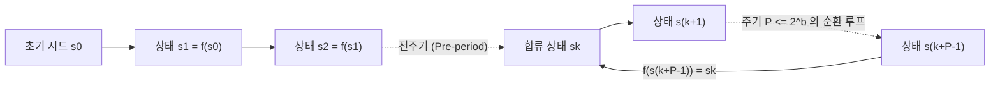
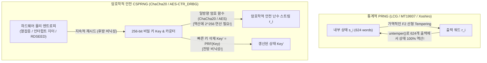

## 들어가며: 폰 노이만의 '원죄'와 결정론적 기계가 빚어내는 우연

1951년 현대 컴퓨터의 아버지 <strong>존 폰 노이만(John von Neumann)</strong>은 역사에 남을 경구를 남겼다. <strong>"산술적인 방법으로 난수를 만들어내려는 사람은 누구든 당연히 '죄악의 상태(in a state of sin)'에 있다."</strong> 디지털 컴퓨터는 초기 상태와 명령어가 주어지면 다음 상태가 100% 하나로 결정되는 엄격한 결정론적 유한 상태 기계다. 그럼에도 현대 사회는 몬테카를로 물리 시뮬레이션, 게임 지형 생성부터 TLS 세션 키, SSH 키쌍, ECDSA 전자서명에 이르기까지 매초 수조 개의 난수를 소비한다.

정해진 절차만 따르는 컴퓨터가 어떻게 '예측 불가능한 난수'를 만들까? 그리고 왜 통계 검정을 완벽히 통과한 <strong>메르센 트위스터(Mersenne Twister, `MT19937`)</strong>를 비밀번호 재설정 토큰 생성에 사용하면, 공격자가 <strong>연속된 단 624개의 출력만 보고도 미래와 과거의 모든 난수를 100% 예측·해독</strong>할 수 있을까?

---

## 제1장: 의사난수 생성기(PRNG)의 수학적 구조 ── 시드, 유한 상태 공간, 비둘기집 원리 주기

수학적으로 <strong>의사난수 생성기(PRNG)</strong>는 유한한 내부 상태 공간 $\mathcal{S}$($|\mathcal{S}| = 2^b$), 초기 <strong>시드(Seed)</strong> $s_0 \in \mathcal{S}$, 결정론적 상태 전이 함수 $f: \mathcal{S} \to \mathcal{S}$, 그리고 출력 함수 $g: \mathcal{S} \to \mathcal{O}$로 정의된다:

$$s_{i+1} = f(s_i), \qquad r_i = g(s_i) \qquad \left(|\mathcal{S}| = 2^b \implies \text{Period } P \le 2^b\right)$$

시드 $s_0$가 같으면 출력 수열 $r_0, r_1, \dots$은 1비트도 틀리지 않고 100% 동일하다. 이러한 <strong>재현성(Reproducibility)</strong>은 과학 시뮬레이션 디버깅과 게임 월드 시드 공유에서 큰 장점이 된다. 그러나 유한한 메모리($2^b$개 상태)를 가지므로 <strong>비둘기집 원리(Pigeonhole Principle)</strong>에 의해 최대 $2^b$번 전이 이내에 반드시 과거 상태와 다시 만나($s_{k+P} = s_k$) 길이 $P \le 2^b$의 무한 루프에 빠지며, 이를 <strong>주기(Period)</strong>라 부른다.



1949년 폰 노이만이 고안한 <strong>중앙제곱법(Middle-Square Method)</strong>($2k$자리 수를 제곱해 가운데 $2k$자리를 추출)은 대수적 보장이 없어 금세 `0000`이나 길이 4짜리 짧은 사이클에 갇히는 치명적 한계를 보였다.

---

## 제2장: 선형합동법(LCG)과 마살리아의 정리 ── IBM `RANDU`의 15평면 참사

1949년 D. H. Lehmer는 <strong>선형합동 생성기(LCG)</strong> $X_{n+1} = (a X_n + c) \bmod m$을 제안했다. 1962년 증명된 <strong>헐-도벨 정리(Hull-Dobell Theorem)</strong>에 의해 (1) $\gcd(c, m) = 1$, (2) $m$의 모든 소인수 $p$가 $a-1$을 나누고, (3) $4 \mid m \implies 4 \mid (a-1)$일 때 최대 주기 $P = m$을 달성한다.

그러나 1968년 통계학자 <strong>조지 마살리아(George Marsaglia)</strong>는 전설적인 논문 <strong>《난수는 주로 평면에 떨어진다(Random numbers fall mainly in the planes)》</strong>에서, 어떤 LCG든 연속된 $d$개의 출력을 $d$차원 좌표 $(X_n, \dots, X_{n+d-1})$로 찍으면 최대 $(d! \cdot m)^{1/d}$개의 평행한 초평면(결정 격자) 위에만 늘어선다는 사실을 증명했다!

가장 악명 높은 사례가 1960~70년대 IBM System/360 과학 라이브러리의 표준 난수 생성기였던 <strong>`RANDU`</strong>($m = 2^{31}, c = 0, a = 65539 = 2^{16} + 3$)다:

$$X_{n+1} = 65539 X_n \bmod 2^{31} = (2^{16} + 3) X_n \bmod 2^{31}$$

$$X_{n+2} \equiv (2^{16}+3)^2 X_n \equiv \left(\underbrace{2^{32}}_{\equiv 0} + 6\cdot 2^{16} + 9\right) X_n \equiv 6 X_{n+1} - 9 X_n \pmod{2^{31}}$$

$$\implies 9 u_n - 6 u_{n+1} + u_{n+2} = k \in \{-5, -4, \dots, 9\} \quad (\text{15 Parallel Planes!})$$

$X_{n+2} \equiv 6 X_{n+1} - 9 X_n \pmod{2^{31}}$이라는 항등식 때문에, `RANDU`가 생성한 모든 3차원 점들은 단위 정육면체 내부의 <strong>단 15개의 평행한 평면 위에만 갇혀 있었고</strong>, 그로 인해 당시 수천 편의 몬테카를로 물리 계산 논문이 오염되었다!

---

## 제3장: 메르센 트위스터(MT19937)와 현대 고속 통계적 PRNG (PCG64, Xoshiro256++)

1997년 일본 수학자 <strong>마쓰모토 마코토(松本眞)와 니시무라 다쿠지(西村拓士)</strong>는 유한체 $\mathbb{F}_2$ 위의 뒤틀린 일반화 피드백 시프트 레지스터(TGFSR)에 기반한 <strong>메르센 트위스터(`MT19937`)</strong>를 발표하여 Python `random`, R, MATLAB, C++ `std::mt19937`의 표준이 되었다:
1. <strong>경이로운 주기와 623차원 균등 분포</strong>: 624개의 32비트 워드($19,937$ 유효 비트)를 유지하여 메르센 소수 주기 $P = 2^{19937} - 1 \approx 4.315 \times 10^{6001}$을 달성하고, <strong>623차원 초입방체에서의 완전 균등 분포(623-dimensional equidistribution)</strong>를 수학적으로 보장한다!
2. <strong>템퍼링(Tempering) 변환</strong>: 상태 워드 $x$를 출력하기 직전 4단계 비트 시프트 및 XOR 연산을 수행한다:

$$\begin{aligned}
y_1 &= x \oplus ((x \gg 11) \mathbin{\&} \texttt{0xFFFFFFFF}) \\
y_2 &= y_1 \oplus ((y_1 \ll 7) \mathbin{\&} \texttt{0x9D2C5680}) \\
y_3 &= y_2 \oplus ((y_2 \ll 15) \mathbin{\&} \texttt{0xEFC60000}) \\
z &= y_3 \oplus (y_3 \gg 18)
\end{aligned}$$

최근에는 `MT19937`의 큰 상태 크기(2.5 KB)와 TestU01(`BigCrush`)의 $\mathbb{F}_2$ 선형성 검정 2개 실패를 극복하기 위해, 128비트 LCG에 데이터 의존 비트 회전을 결합한 <strong>`PCG64`</strong>(NumPy 기본 엔진)와 256비트 상태에 비선형 곱셈 스크램블러를 결합한 <strong>`Xoshiro256++`</strong>(Rust/Java 채택)가 등장하여 `BigCrush`를 100% 통과하며 초고속으로 동작한다.

---

## 제4장: 왜 통계적 완벽함 $\neq$ 암호학적 안전성인가? ── 624개 출력으로 MT19937 복제하기와 CSPRNG

### 4.1 Tempering 역변환 공격: 단 624개의 출력으로 `MT19937` 완전 복제

많은 개발자가 `MT19937`의 주기가 $2^{19937}-1$이니 비밀번호 토큰이나 세션 ID 생성에 써도 안전하다고 착각한다. 하지만 `MT19937`의 4단계 Tempering 변환은 $\mathbb{F}_2^{32}$ 위에서 <strong>완전히 가역(Invertible)</strong>이다! 단 10여 줄의 코드로 출력 $z$에서 내부 상태 워드 $x$를 $O(1)$에 역산할 수 있다:

```python
def untemper(z: int) -> int:
    # Invert MT19937 32-bit output z back to internal state word x in O(1)
    y3 = z ^ (z >> 18)
    y2 = y3 ^ ((y3 << 15) & 0xEFC60000)
    y1 = y2
    for _ in range(4):
        y1 = y2 ^ ((y1 << 7) & 0x9D2C5680)
    x = y1
    for _ in range(2):
        x = y1 ^ (x >> 11)
    return x & 0xFFFFFFFF
```

즉, <strong>공격자가 서버에서 생성된 연속 624개의 32비트 난수(단 2,496바이트!)만 관찰하여 `untemper(z)`에 넣으면, 서버의 624워드 내부 상태 배열 전체가 100% 그대로 복제된다!</strong> 그 순간부터 공격자는 미래의 모든 난수를 100% 예측할 수 있을 뿐 아니라 과거에 발행된 다른 사용자의 토큰까지 역추적할 수 있다.

### 4.2 야오의 정리(1982)와 암호학적 안전 의사난수 생성기(CSPRNG)

보안 시스템에서는 반드시 <strong>암호학적 안전 의사난수 생성기(CSPRNG)</strong>를 사용해야 하며, 그 3대 요건은 다음과 같다:
1. <strong>다음 비트 예측 불가능성(Next-Bit Unpredictability / 야오의 정리, 1982)</strong>: 과거 $k$비트를 모두 아는 어떤 다항 시간 공격자 $\mathcal{A}$라도 $(k+1)$번째 비트를 맞힐 확률이 동전 던지기($1/2$)보다 유의미하게 클 수 없다(계산적 구별 불가능성과 동치):

$$\left| \Pr\left[\mathcal{A}(r_1, r_2, \dots, r_k) = r_{k+1}\right] - \frac{1}{2} \right| \le \text{negl}(\lambda)$$

2. <strong>전방 비닉성(Forward Secrecy / 역추적 저항성)</strong>: 출력 직후 일방향 함수로 내부 키를 즉시 덮어쓰고 삭제(Fast-Key-Erasure)하여, 현재 상태가 유출되더라도 과거의 난수나 암호 키를 역산할 수 없어야 한다.
3. <strong>후방 비닉성(Backward Secrecy / 예측 저항성)</strong>: 하드웨어 물리 엔트로피를 지속적으로 재주입(Reseeding)하여 상태 유출 이후에도 미래의 안전성을 스스로 회복해야 한다.



현대의 대표적인 CSPRNG로는 스트림/블록 암호 기반의 <strong>`ChaCha20-RNG`</strong>(Linux 커널, OpenBSD, Rust 채택)와 <strong>`AES-CTR_DRBG`</strong>(NIST SP 800-90A), 소인수분해 난제에 기반한 <strong>Blum-Blum-Shub($x_{n+1} = x_n^2 \bmod M$)</strong>이 있다. 반면 NIST가 표준화했던 타원곡선 기반 <strong>`Dual_EC_DRBG`</strong>는 상수 점 $P = d \cdot Q$의 비밀 이산대수 $d$를 아는 자가 32바이트 출력만으로 모든 TLS 비밀키를 해독할 수 있는 <strong>NSA의 클렙토그래피(Kleptography) 백도어</strong>였음이 2013년 스노든 문건으로 폭로되어 폐기되었다.

| 생성기 분류 | 대표 알고리즘 | 상태 크기 | 주기 $P$ | BigCrush 검정 | 암호학적 안전성 | 주요 용도 |
| :--- | :--- | :--- | :--- | :---: | :---: | :--- |
| <strong>고전 선형합동 (LCG)</strong> | `RANDU`, C `rand()` | 32~64 bit | $\le 2^{64}$ | 탈락 (초평면 격자) | <strong>매우 위험</strong> | 레거시 코드 |
| <strong>현대 통계적 PRNG</strong> | <strong>`MT19937`</strong>, <strong>`PCG64`</strong>, <strong>`Xoshiro256++`</strong> | 128 bit ~ 2.5 KB | $2^{128} \sim 2^{19937}-1$ | <strong>통과</strong> | <strong>위험 (624개 출력/Z3로 복제)</strong> | 몬테카를로 시뮬레이션, 게임, ML |
| <strong>암호학적 난수 (CSPRNG)</strong> | <strong>`ChaCha20-RNG`</strong>, <strong>`AES-CTR_DRBG`</strong> | 256~512 bit | $\ge 2^{256}$ | <strong>100% 통과</strong> | <strong>안전 (예측 불가·전/후방 비닉)</strong> | <strong>암호 키, 토큰, 비밀번호, TLS</strong> |
| <strong>하드웨어 진성 난수 (TRNG)</strong> | 열잡음, 제너 항복, 링 오실레이터 (`RDSEED`) | 물리 연속체 | <strong>비주기 ($\infty$)</strong> | 화이트닝 후 통과 | <strong>진정한 물리 엔트로피</strong> | OS CSPRNG 시드 주입 및 재시드 |

---

## 제5장: 물리 진성 난수(TRNG), 최소 엔트로피(Min-Entropy), OS 엔트로피 풀

CSPRNG의 시드는 <strong>하드웨어 진성 난수 생성기(TRNG / HRNG)</strong>가 포착하는 미시적 물리 요동에서 온다: 도체 내 전자의 <strong>존슨-나이퀴스트 열잡음(Thermal Noise)</strong>, 제너 다이오드 눈사태 항복의 양자 터널링 샷 잡음, 그리고 현대 CPU(`RDSEED`/`RDRAND` 명령어)의 <strong>링 오실레이터(Ring Oscillator) 위상 지터</strong>다. 암호학(NIST SP 800-90B)에서는 평균적인 섀넌 엔트로피 $H_1$ 대신 최악의 예측 확률을 제어하는 <strong>최소 엔트로피(Min-Entropy $H_\infty$)</strong>를 사용한다:

$$V_{\text{rms}} = \sqrt{4 k_B T R \Delta f}, \qquad H_\infty(X) = -\log_2 \left(\max_{x} P(X = x)\right) \le H_1(X)$$

물리 노이즈는 폰 노이만 편향 제거법이나 암호학적 해시 추출기(Linux 커널의 `BLAKE2s`, <strong>Leftover Hash Lemma</strong> 적용)를 통해 <strong>화이트닝(Whitening)</strong>된 후 커널 CSPRNG에 주입된다.

현대 Linux(5.6+)에서는 `/dev/random`과 `/dev/urandom` 모두 동일한 `ChaCha20` 커널 CSPRNG를 사용하므로, 실무에서는 부팅 직후 엔트로피 초기화만 안전하게 대기하고 이후 절대 블로킹되지 않는 <strong>`getrandom(2)`</strong>(또는 Python `secrets`, JS `crypto.getRandomValues()`, Rust `OsRng`/`ThreadRng`, Go `crypto/rand`)를 사용해야 한다. 2008년 Valgrind 경고를 없애려다 엔트로피 주입 코드를 주석 처리하여 전 세계 서버의 2048비트 RSA 키 엔트로피를 프로세스 ID(15비트 = 32,768가지)로 추락시킨 <strong>데비안 OpenSSL 취약점(CVE-2008-0166)</strong>과 소니 PS3의 ECDSA 난수 $k$ 고정 사건이 증명하듯, <strong>암호 시스템의 강도는 그 키를 만든 난수 생성기의 엔트로피를 절대 넘어설 수 없다.</strong>
