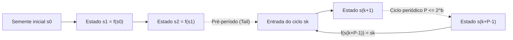
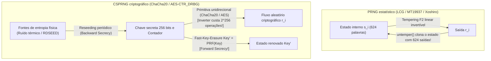

## Introdução: O «estado de pecado» de von Neumann e o paradoxo do acaso determinístico

Em 1951, <strong>John von Neumann</strong> proferiu uma frase imortal na ciência da computação: <strong>«Qualquer um que considere métodos aritméticos para produzir dígitos aleatórios está, claro, em estado de pecado (in a state of sin).»</strong> Um computador digital é uma máquina de estados finitos estritamente determinística: dado um estado inicial e uma instrução, cada bit produzido é 100% predeterminado. Ainda assim, desde simulações de Monte Carlo em física nuclear e geração procedural em jogos até chaves TLS, SSH e assinaturas ECDSA, nossa civilização consome trilhões de números aleatórios por segundo.

Como um algoritmo fixo pode criar imprevisibilidade? E por que um gerador estatisticamente brilhante como o <strong>Mersenne Twister (`MT19937`)</strong> torna-se catastroficamente inseguro ao gerar tokens de redefinição de senha, permitindo que um invasor que observe apenas <strong>624 saídas consecutivas</strong> preveja 100% de todas as saídas futuras e passadas?

---

## Capítulo 1: Anatomia matemática de um PRNG ── Semente (Seed), espaço de estados finito e princípio da casa dos pombos

Formalmente, um <strong>gerador de números pseudoaleatórios (PRNG)</strong> é um autômato determinístico $(\mathcal{S}, \mathcal{O}, f, g, s_0)$ com um espaço de estados interno finito $\mathcal{S}$ de tamanho $|\mathcal{S}| = 2^b$, uma <strong>semente inicial (Seed)</strong> $s_0 \in \mathcal{S}$, uma função de transição $f: \mathcal{S} \to \mathcal{S}$ e uma função de saída $g: \mathcal{S} \to \mathcal{O}$:

$$s_{i+1} = f(s_i), \qquad r_i = g(s_i) \qquad \left(|\mathcal{S}| = 2^b \implies \text{Period } P \le 2^b\right)$$

Fixada a semente $s_0$, toda a sequência $r_0, r_1, r_2, \dots$ está completamente determinada. Essa <strong>reprodutibilidade</strong> é essencial para depurar simulações científicas. Mas pelo <strong>princípio da casa dos pombos (Pigeonhole Principle)</strong>, o autômato deve revisitar algum estado anterior $s_{k+P} = s_k$ em no máximo $2^b$ passos, entrando em um ciclo periódico de <strong>período $P \le 2^b$</strong>.



O <strong>método do quadrado do meio (Middle-Square Method, 1949)</strong> de von Neumann (elevar ao quadrado um número de $2k$ dígitos e extrair os $2k$ dígitos centrais) colapsa rapidamente para `0000` ou em ciclos minúsculos de comprimento 4 por falta de estrutura algébrica.

---

## Capítulo 2: Geradores congruenciais lineares (LCG) e o teorema de Marsaglia ── A tragédia dos 15 planos do IBM `RANDU`

Em 1949, D. H. Lehmer introduziu o <strong>gerador congruencial linear (LCG)</strong>: $X_{n+1} = (a X_n + c) \bmod m$. Pelo <strong>teorema de Hull-Dobell (1962)</strong>, um LCG atinge o período completo $P = m$ se e somente se: (1) $\gcd(c, m) = 1$, (2) todo fator primo $p$ de $m$ divide $a-1$, e (3) se $4 \mid m$, então $4 \mid (a-1)$.

Em 1968, o estatístico <strong>George Marsaglia</strong> publicou seu célebre artigo <strong>«Random numbers fall mainly in the planes»</strong>, provando que os pontos $d$-dimensionais $(X_n, \dots, X_{n+d-1})$ de qualquer LCG caem sobre no máximo $(d! \cdot m)^{1/d}$ hiperplanos paralelos de uma rede cristalina!

O caso mais infame da história foi o <strong>`RANDU`</strong> da IBM ($m = 2^{31}, c = 0, a = 65539 = 2^{16} + 3$) nos mainframes System/360:

$$X_{n+1} = 65539 X_n \bmod 2^{31} = (2^{16} + 3) X_n \bmod 2^{31}$$

$$X_{n+2} \equiv (2^{16}+3)^2 X_n \equiv \left(\underbrace{2^{32}}_{\equiv 0} + 6\cdot 2^{16} + 9\right) X_n \equiv 6 X_{n+1} - 9 X_n \pmod{2^{31}}$$

$$\implies 9 u_n - 6 u_{n+1} + u_{n+2} = k \in \{-5, -4, \dots, 9\} \quad (\text{15 Parallel Planes!})$$

Devido à identidade $X_{n+2} \equiv 6 X_{n+1} - 9 X_n \pmod{2^{31}}$, todos os pontos 3D gerados pelo `RANDU` no cubo unitário ficam <strong>presos em apenas 15 planos paralelos</strong> com imensos vazios entre eles, comprometendo milhares de simulações de Monte Carlo por décadas!

---

## Capítulo 3: Mersenne Twister (`MT19937`) e geradores estatísticos modernos (`PCG64`, `Xoshiro256++`)

Em 1997, os matemáticos japoneses <strong>Makoto Matsumoto e Takuji Nishimura</strong> criaram o <strong>Mersenne Twister (`MT19937`)</strong> sobre o corpo finito $\mathbb{F}_2 = \{0, 1\}$ (padrão em Python `random`, R, MATLAB, C++ `std::mt19937`):
1. <strong>Período colossal e equidistribuição em 623 dimensões</strong>: Um vetor de estado de $624$ palavras de 32 bits ($19.937$ bits ativos) garante um período igual ao primo de Mersenne $P = 2^{19937} - 1 \approx 4,315 \times 10^{6001}$ e <strong>equidistribuição exata em até 623 dimensões</strong>!
2. <strong>Transformação de têmpera (Tempering)</strong>: Cada palavra de estado $x$ é multiplicada por uma matriz invertível sobre $\mathbb{F}_2^{32}$ em quatro etapas de deslocamento e XOR:

$$\begin{aligned}
y_1 &= x \oplus ((x \gg 11) \mathbin{\&} \texttt{0xFFFFFFFF}) \\
y_2 &= y_1 \oplus ((y_1 \ll 7) \mathbin{\&} \texttt{0x9D2C5680}) \\
y_3 &= y_2 \oplus ((y_2 \ll 15) \mathbin{\&} \texttt{0xEFC60000}) \\
z &= y_3 \oplus (y_3 \gg 18)
\end{aligned}$$

Para superar o tamanho de estado do `MT19937` ($2,5\text{ KB}$) e sua falha em dois testes de linearidade $\mathbb{F}_2$ da suíte <strong>TestU01 (`BigCrush`)</strong>, surgiram o <strong>`PCG64`</strong> (Melissa O'Neill 2014: LCG de 128 bits com rotação aleatória dependente de dados; padrão no NumPy) e o <strong>`Xoshiro256++`</strong> (Blackman & Vigna 2018: estado de 256 bits com embaralhador não linear; usado em Rust e Java), que passam em 100% do `BigCrush` em menos de um nanossegundo.

---

## Capítulo 4: Por que perfeição estatística $\neq$ segurança criptográfica ── Clonagem do `MT19937` e CSPRNG

### 4.1 Inversão do Tempering: clonando o `MT19937` com 624 saídas

Usar `MT19937` para tokens de sessão ou senhas é um erro fatal: cada etapa do Tempering é uma <strong>bijeção linear invertível em tempo $O(1)$</strong>:

```python
def untemper(z: int) -> int:
    # Invert MT19937 32-bit output z back to internal state word x in O(1)
    y3 = z ^ (z >> 18)
    y2 = y3 ^ ((y3 << 15) & 0xEFC60000)
    y1 = y2
    for _ in range(4):
        y1 = y2 ^ ((y1 << 7) & 0x9D2C5680)
    x = y1
    for _ in range(2):
        x = y1 ^ (x >> 11)
    return x & 0xFFFFFFFF
```

<strong>Um invasor que observe apenas 624 saídas consecutivas de 32 bits ($2.496\text{ bytes}$) de um servidor usando `MT19937` aplica `untemper(z)` a cada uma para clonar 100% das 624 palavras do estado interno do servidor!</strong> A partir daí, ele prevê 100% dos números futuros e reconstrói todos os passados.

### 4.2 Teorema de Andrew Yao (1982) e geradores criptograficamente seguros (CSPRNG)

A criptografia exige um <strong>CSPRNG (Cryptographically Secure PRNG)</strong> baseado em três axiomas:
1. <strong>Imprevisibilidade do próximo bit $\iff$ Indistinguibilidade computacional (Teorema de Yao, 1982 / Blum-Micali)</strong>: Nenhum adversário de tempo polinomial $\mathcal{A}$ que conheça os primeiros $k$ bits pode prever o bit $r_{k+1}$ com vantagem não desprezível sobre $1/2$:

$$\left| \Pr\left[\mathcal{A}(r_1, r_2, \dots, r_k) = r_{k+1}\right] - \frac{1}{2} \right| \le \text{negl}(\lambda)$$

2. <strong>Sigilo direto (Forward Secrecy / Resistência ao retrocesso)</strong>: Após cada saída, a chave interna é sobrescrita por uma função unidirecional (Fast-Key-Erasure), impedindo recuperar chaves passadas mesmo se o estado atual vazar.
3. <strong>Sigilo reverso (Backward Secrecy / Resistência à previsão)</strong>: A injeção contínua de entropia física fresca (Reseeding) restaura a segurança após um vazamento.



Os CSPRNGs modernos utilizam cifras como <strong>`ChaCha20-RNG`</strong> (kernel Linux, OpenBSD, Rust) e <strong>`AES-CTR_DRBG`</strong> (NIST SP 800-90A), ou problemas teóricos como <strong>Blum-Blum-Shub ($x_{n+1} = x_n^2 \bmod M$)</strong>. Em contrapartida, o gerador de curvas elípticas <strong>`Dual_EC_DRBG`</strong> padronizado pelo NIST em 2006 continha um <strong>backdoor kleptográfico da NSA</strong> (confirmado pelos documentos de Snowden em 2013: quem conhecesse o logaritmo discreto secreto $d$ tal que $P = d \cdot Q$ podia deduzir o estado interno com apenas 32 bytes de saída e descriptografar o tráfego TLS).

| Classe de gerador | Algoritmos representativos | Tamanho do estado | Período $P$ | Suíte `BigCrush` | Segurança criptográfica | Casos de uso |
| :--- | :--- | :--- | :--- | :---: | :---: | :--- |
| <strong>LCG clássico</strong> | `RANDU`, C `rand()` | 32–64 bits | $\le 2^{64}$ | Falha (Hiperplanos) | <strong>Quebrado</strong> | Apenas código legado |
| <strong>PRNG estatístico moderno</strong> | <strong>`MT19937`</strong>, <strong>`PCG64`</strong>, <strong>`Xoshiro256++`</strong> | 128 bits – 2,5 KB | $2^{128} \sim 2^{19937}-1$ | <strong>Passa</strong> | <strong>Quebrado (624 saídas / Z3)</strong> | Monte Carlo, simulações, jogos |
| <strong>Criptográfico (CSPRNG)</strong> | <strong>`ChaCha20-RNG`</strong>, <strong>`AES-CTR_DRBG`</strong> | 256–512 bits | $\ge 2^{256}$ | <strong>100% Passa</strong> | <strong>Seguro (Forward/Backward Secret)</strong> | <strong>Chaves TLS/SSH, senhas, tokens</strong> |
| <strong>Aleatório físico (TRNG)</strong> | Ruído térmico, diodo avalanche, oscilador (`RDSEED`) | Contínuo físico | <strong>Aperiódico ($\infty$)</strong> | Após branqueamento | <strong>Entropia física real</strong> | Semeadura e reseeding de CSPRNG |

---

## Capítulo 5: Geradores físicos (TRNG), min-entropia ($H_\infty$) e pools de entropia do sistema operacional

A semente de um CSPRNG vem de um <strong>gerador de números aleatórios por hardware (TRNG / HRNG)</strong> que coleta caos físico: <strong>ruído térmico de Johnson-Nyquist</strong> em resistores, ruído quântico de disparo por ruptura em avalanche de diodos Zener e <strong>jitter de fase em osciladores em anel</strong> (instruções `RDSEED`/`RDRAND` em CPUs Intel/AMD). Na criptografia (NIST SP 800-90B), a imprevisibilidade no pior caso é medida pela <strong>min-entropia ($H_\infty$)</strong> em vez da entropia média de Shannon $H_1$:

$$V_{\text{rms}} = \sqrt{4 k_B T R \Delta f}, \qquad H_\infty(X) = -\log_2 \left(\max_{x} P(X = x)\right) \le H_1(X)$$

O ruído físico bruto passa por «branqueamento» (Whitening) via algoritmo de von Neumann ou extratores hash criptográficos (`BLAKE2s` no kernel Linux, apoiado pelo <strong>Leftover Hash Lemma</strong>) antes de alimentar o CSPRNG.

No Linux moderno (5.6+), `/dev/random` e `/dev/urandom` usam exatamente o mesmo CSPRNG `ChaCha20`; desenvolvedores devem usar sempre <strong>`getrandom(2)`</strong> (ou Python `secrets`, JS `crypto.getRandomValues()`, Rust `OsRng`/`ThreadRng`, Go `crypto/rand`). O desastre do <strong>Debian OpenSSL de 2008 (CVE-2008-0166)</strong> — onde comentar uma linha por causa de um aviso do Valgrind reduziu a entropia de todas as chaves RSA/SSH ao ID de processo PID de 15 bits ($32.768$ chaves possíveis) por dois anos — e a falha do nonce estático ECDSA no PlayStation 3 da Sony (2010) provam uma regra de ouro: <strong>a segurança de qualquer sistema criptográfico jamais pode superar a entropia de seu gerador de números aleatórios.</strong>
