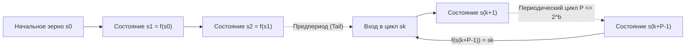
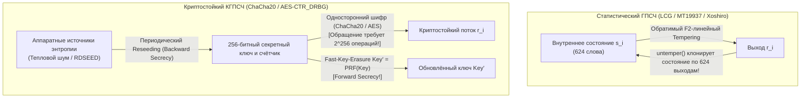

## Введение: «Состояние греха» фон Неймана и парадокс детерминированной случайности

В 1951 году <strong>Джон фон Нейман</strong> произнёс фразу, навсегда вошедшую в историю информатики: <strong>«Всякий, кто рассматривает арифметические методы получения случайных цифр, разумеется, пребывает в состоянии греха (in a state of sin)».</strong> Цифровой компьютер — это строго детерминированный конечный автомат: при заданном начальном состоянии и инструкции каждый следующий бит предопределён на 100%. Тем не менее от моделирования методом Монте-Карло в ядерной физике и процедурной генерации миров в играх до ключей TLS, SSH и подписей ECDSA современная цивилизация потребляет триллионы случайных чисел каждую секунду.

Как жёсткий алгоритм может порождать непредсказуемость? И почему статистически безупречный генератор вроде <strong>вихря Мерсенна (`MT19937`)</strong> оказывается катастрофически уязвимым при генерации токенов сброса пароля, позволяя атакующему по <strong>624 последовательным выходам</strong> на 100% предсказать все будущие и прошлые значения?

---

## Глава 1: Математическая анатомия ГПСЧ ── Зерно (Seed), конечное пространство состояний и принцип Дирихле

Формально <strong>генератор псевдослучайных чисел (ГПСЧ / PRNG)</strong> — это детерминированный автомат $(\mathcal{S}, \mathcal{O}, f, g, s_0)$ с конечным внутренним пространством состояний $\mathcal{S}$ размера $|\mathcal{S}| = 2^b$, начальным <strong>зерном (Seed)</strong> $s_0 \in \mathcal{S}$, функцией перехода $f: \mathcal{S} \to \mathcal{S}$ и функцией вывода $g: \mathcal{S} \to \mathcal{O}$:

$$s_{i+1} = f(s_i), \qquad r_i = g(s_i) \qquad \left(|\mathcal{S}| = 2^b \implies \text{Period } P \le 2^b\right)$$

Как только зерно $s_0$ зафиксировано, вся последовательность $r_0, r_1, r_2, \dots$ полностью предопределена. Эта <strong>воспроизводимость</strong> бесценна при отладке научных расчётов. Однако по <strong>принципу Дирихле (Pigeonhole Principle)</strong> автомат неизбежно повторит одно из предыдущих состояний $s_{k+P} = s_k$ не более чем через $2^b$ шагов, замкнувшись в периодический цикл <strong>периода $P \le 2^b$</strong>.



Предложенный фон Нейманом в 1949 году <strong>метод серединных квадратов (Middle-Square Method)</strong> (возведение $2k$-значного числа в квадрат и извлечение средних $2k$ цифр) без алгебраической структуры быстро вырождается в `0000` или короткие циклы длины 4.

---

## Глава 2: Линейные конгруэнтные генераторы (LCG) и теорема Марсальи ── Трагедия 15 плоскостей IBM `RANDU`

В 1949 году Д. Г. Лемер предложил <strong>линейный конгруэнтный генератор (LCG)</strong>: $X_{n+1} = (a X_n + c) \bmod m$. Согласно <strong>теореме Халла — Добелла (1962)</strong>, LCG достигает полного периода $P = m$ тогда и только тогда, когда: (1) $\gcd(c, m) = 1$, (2) каждый простой делитель $p$ числа $m$ делит $a-1$, и (3) если $4 \mid m$, то $4 \mid (a-1)$.

В 1968 году статистик <strong>Джордж Марсалья (George Marsaglia)</strong> опубликовал знаменитую статью <strong>«Random numbers fall mainly in the planes»</strong>, доказав, что $d$-мерные точки $(X_n, \dots, X_{n+d-1})$ любого LCG ложатся не более чем на $(d! \cdot m)^{1/d}$ параллельных гиперплоскостей кристаллической решётки!

Самым печально известным примером стал стандартный генератор <strong>`RANDU`</strong> корпорации IBM ($m = 2^{31}, c = 0, a = 65539 = 2^{16} + 3$) на мейнфреймах System/360:

$$X_{n+1} = 65539 X_n \bmod 2^{31} = (2^{16} + 3) X_n \bmod 2^{31}$$

$$X_{n+2} \equiv (2^{16}+3)^2 X_n \equiv \left(\underbrace{2^{32}}_{\equiv 0} + 6\cdot 2^{16} + 9\right) X_n \equiv 6 X_{n+1} - 9 X_n \pmod{2^{31}}$$

$$\implies 9 u_n - 6 u_{n+1} + u_{n+2} = k \in \{-5, -4, \dots, 9\} \quad (\text{15 Parallel Planes!})$$

Из-за тождества $X_{n+2} \equiv 6 X_{n+1} - 9 X_n \pmod{2^{31}}$ все 3D-точки `RANDU` в единичном кубе <strong>оказались заперты всего на 15 параллельных плоскостях</strong> с огромными пустыми промежутками, что исказило тысячи расчётов методом Монте-Карло в 1960–70-х годах!

---

## Глава 3: Вихрь Мерсенна (`MT19937`) и современные статистические ГПСЧ (`PCG64`, `Xoshiro256++`)

В 1997 году японские математики <strong>Макото Мацумото и Такудзи Нисимура</strong> создали <strong>вихрь Мерсенна (`MT19937`)</strong> на основе скрученного обобщённого регистра сдвига с обратной связью (TGFSR) над полем $\mathbb{F}_2 = \{0, 1\}$ (стандарт в Python `random`, R, MATLAB, C++ `std::mt19937`):
1. <strong>Гигантский период и 623-мерная равномерность</strong>: Массив состояния из $624$ 32-битных слов ($19\,937$ активных бит) обеспечивает период, равный простому числу Мерсенна $P = 2^{19937} - 1 \approx 4{,}315 \times 10^{6001}$, и <strong>строгую равномерность распределения вплоть до размерности 623</strong>!
2. <strong>Закалка (Tempering)</strong>: Перед выводом каждое слово состояния $x$ умножается на обратимую битовую матрицу $32\times 32$ над $\mathbb{F}_2$:

$$\begin{aligned}
y_1 &= x \oplus ((x \gg 11) \mathbin{\&} \texttt{0xFFFFFFFF}) \\
y_2 &= y_1 \oplus ((y_1 \ll 7) \mathbin{\&} \texttt{0x9D2C5680}) \\
y_3 &= y_2 \oplus ((y_2 \ll 15) \mathbin{\&} \texttt{0xEFC60000}) \\
z &= y_3 \oplus (y_3 \gg 18)
\end{aligned}$$

Чтобы преодолеть большой объём состояния `MT19937` ($2{,}5\text{ КБ}$) и провал двух тестов на $\mathbb{F}_2$-линейность в пакете <strong>TestU01 (`BigCrush`)</strong>, в 2010-х годах были созданы <strong>`PCG64`</strong> (Мелисса О'Нил, 2014: 128-битный LCG с вращением битов, зависящим от данных; стандарт в NumPy) и <strong>`Xoshiro256++`</strong> (Блэкман и Винья, 2018: 256-битное состояние с нелинейным скремблером; используется в Rust и Java), проходящие 100% тестов `BigCrush`.

---

## Глава 4: Почему статистическое совершенство $\neq$ криптостойкость ── Взлом `MT19937` по 624 выходам и КГПСЧ

### 4.1 Обращение Tempering: клонирование `MT19937` по 624 выходам

Использование `MT19937` для генерации токенов сессий или паролей — фатальная ошибка: каждый из четырёх шагов Tempering является <strong>обратимой линейной биекцией над $\mathbb{F}_2^{32}$ за время $O(1)$</strong>!

```python
def untemper(z: int) -> int:
    # Invert MT19937 32-bit output z back to internal state word x in O(1)
    y3 = z ^ (z >> 18)
    y2 = y3 ^ ((y3 << 15) & 0xEFC60000)
    y1 = y2
    for _ in range(4):
        y1 = y2 ^ ((y1 << 7) & 0x9D2C5680)
    x = y1
    for _ in range(2):
        x = y1 ^ (x >> 11)
    return x & 0xFFFFFFFF
```

<strong>Атакующий, увидевший всего 624 последовательных 32-битных выхода ($2\,496\text{ байт}$) сервера на `MT19937`, применяет `untemper(z)` к каждому числу и на 100% восстанавливает внутренний массив из 624 слов!</strong> С этого момента он может со 100%-ной точностью предсказывать все будущие числа и вычислять прошлые.

### 4.2 Теорема Эндрю Яо (1982) и криптографически стойкие генераторы (КГПСЧ / CSPRNG)

В криптографии необходим <strong>криптографически стойкий ГПСЧ (CSPRNG)</strong>, удовлетворяющий трём аксиомам:
1. <strong>Непредсказуемость следующего бита $\iff$ Вычислительная неотличимость (Теорема Яо, 1982 / Блюм — Микали)</strong>: Никакой полиномиальный алгоритм $\mathcal{A}$, зная первые $k$ бит, не может угадать бит $r_{k+1}$ существенно лучше, чем подбрасыванием монеты ($1/2$):

$$\left| \Pr\left[\mathcal{A}(r_1, r_2, \dots, r_k) = r_{k+1}\right] - \frac{1}{2} \right| \le \text{negl}(\lambda)$$

2. <strong>Прямая секретность (Forward Secrecy / Защита от ретроспективного взлома)</strong>: После каждой выдачи внутренний ключ немедленно перезаписывается односторонней функцией (Fast-Key-Erasure), поэтому даже при утечке текущего состояния невозможно восстановить прошлые ключи.
3. <strong>Обратная секретность (Backward Secrecy / Защита от предсказания)</strong>: Периодическое подмешивание свежей аппаратной энтропии (Reseeding) восстанавливает безопасность после компрометации.



Современные CSPRNG строятся на потоковых и блочных шифрах <strong>`ChaCha20-RNG`</strong> (ядро Linux, OpenBSD, Rust) и <strong>`AES-CTR_DRBG`</strong> (NIST SP 800-90A), либо на теоретико-числовой задаче факторизации в <strong>Blum-Blum-Shub ($x_{n+1} = x_n^2 \bmod M$)</strong>. Напротив, стандартизированный NIST в 2006 году генератор на эллиптических кривых <strong>`Dual_EC_DRBG`</strong> содержал <strong>клептографический бэкдор АНБ</strong> (подтверждённый документами Сноудена в 2013 году: знание секретного дискретного логарифма $d$ в $P = d \cdot Q$ позволяло по 32 байтам выхода вычислить внутреннее состояние и расшифровать TLS-трафик).

| Класс генератора | Примеры алгоритмов | Размер состояния | Период $P$ | Тест `BigCrush` | Криптостойкость | Применение |
| :--- | :--- | :--- | :--- | :---: | :---: | :--- |
| <strong>Классический LCG</strong> | `RANDU`, C `rand()` | 32–64 бит | $\le 2^{64}$ | Провал (Гиперплоскости) | <strong>Взломан</strong> | Устаревший код |
| <strong>Современный стат. ГПСЧ</strong> | <strong>`MT19937`</strong>, <strong>`PCG64`</strong>, <strong>`Xoshiro256++`</strong> | 128 бит – 2,5 КБ | $2^{128} \sim 2^{19937}-1$ | <strong>Проходит</strong> | <strong>Взломан (624 выхода / Z3)</strong> | Монте-Карло, симуляции, игры |
| <strong>Криптостойкий (CSPRNG)</strong> | <strong>`ChaCha20-RNG`</strong>, <strong>`AES-CTR_DRBG`</strong> | 256–512 бит | $\ge 2^{256}$ | <strong>100% Проходит</strong> | <strong>Безопасен (Forward/Backward)</strong> | <strong>Ключи TLS/SSH, пароли, токены</strong> |
| <strong>Физический ГСЧ (TRNG)</strong> | Тепловой шум, лавинный пробой, генератор (`RDSEED`) | Физический континуум | <strong>Апериодичен ($\infty$)</strong> | После отбеливания | <strong>Истинная физическая энтропия</strong> | Инициализация и Reseeding CSPRNG |

---

## Глава 5: Физические генераторы (TRNG), мин-энтропия ($H_\infty$) и пулы энтропии ОС

Начальное зерно CSPRNG поступает от <strong>аппаратных генераторов истинно случайных чисел (TRNG / HRNG)</strong>, улавливающих физический хаос: <strong>тепловой шум Джонсона — Найквиста</strong> в проводниках, квантовый дробовой шум лавинного пробоя стабилитронов и <strong>фазовый джиттер кольцевых осцилляторов</strong> (инструкции `RDSEED`/`RDRAND` в процессорах Intel/AMD). В криптографии (NIST SP 800-90B) непредсказуемость в худшем случае оценивается через <strong>мин-энтропию ($H_\infty$)</strong>, а не среднюю энтропию Шеннона $H_1$:

$$V_{\text{rms}} = \sqrt{4 k_B T R \Delta f}, \qquad H_\infty(X) = -\log_2 \left(\max_{x} P(X = x)\right) \le H_1(X)$$

«Сырой» физический шум проходит <strong>отбеливание (Whitening)</strong> методом фон Неймана или криптографическими хеш-экстракторами (`BLAKE2s` в ядре Linux согласно <strong>Leftover Hash Lemma</strong>) перед подачей в CSPRNG.

В современном Linux (5.6+) `/dev/random` и `/dev/urandom` используют один и тот же ядерный CSPRNG на базе `ChaCha20`; разработчикам следует всегда вызывать <strong>`getrandom(2)`</strong> (или Python `secrets`, JS `crypto.getRandomValues()`, Rust `OsRng`/`ThreadRng`, Go `crypto/rand`). Катастрофа <strong>Debian OpenSSL 2008 года (CVE-2008-0166)</strong> — когда из-за закомментированной ради Valgrind строки энтропия всех генерируемых в мире ключей RSA/SSH на два года сжалась до 15-битного идентификатора процесса PID ($32\,768$ вариантов!) — и ошибка со статическим одноразовым числом $k$ в ECDSA на Sony PlayStation 3 (2010) напоминают железный закон: <strong>стойкость любой криптосистемы никогда не превышает энтропию генератора случайных чисел, создавшего её ключи.</strong>
