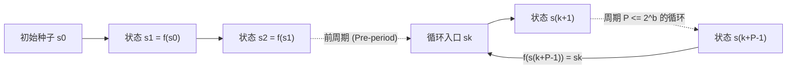
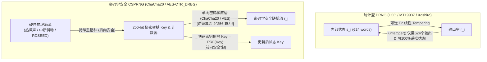

## 引言：冯·诺依曼的“原罪”与确定性机器中的偶然

1951年，现代计算机之父<strong>约翰·冯·诺依曼（John von Neumann）</strong>留下了一句名言：<strong>“任何考虑用算术方法产生随机数字的人，当然都处于罪恶的状态（in a state of sin）。”</strong> 数字计算机是严格确定性的有限状态机，给定相同的输入和内部状态，其下一步输出100%唯一确定。然而，从蒙特卡洛物理模拟、游戏地形生成，到TLS会话密钥、SSH密钥对与ECDSA数字签名，现代数字世界每秒都在消耗数万亿个随机数。

确定性的算法究竟如何制造“随机”？为什么像<strong>梅森旋转（Mersenne Twister, `MT19937`）</strong>这样通过了严苛统计检验的优秀随机数生成器，一旦用于生成密码重置令牌，攻击者<strong>只需观察连续624个输出就能100%预测其未来与过去的所有输出</strong>？本文将从数论、代数学、密码学与硬件物理学四个维度彻底揭开随机数的奥秘。

---

## 第一章：伪随机数生成器（PRNG）的数学结构 ── 种子、有限状态与鸽巢原理周期

数学上，<strong>伪随机数生成器（PRNG）</strong>是由有限内部状态空间 $\mathcal{S}$（大小为 $|\mathcal{S}| = 2^b$）、初始<strong>种子（Seed）</strong>$s_0 \in \mathcal{S}$、确定性状态转移函数 $f: \mathcal{S} \to \mathcal{S}$ 以及输出提取函数 $g: \mathcal{S} \to \mathcal{O}$ 构成的确定性自动机：

$$s_{i+1} = f(s_i), \qquad r_i = g(s_i) \qquad \left(|\mathcal{S}| = 2^b \implies \text{Period } P \le 2^b\right)$$

一旦种子 $s_0$ 固定，整个输出序列 $r_0, r_1, r_2, \dots$ 即完全确定。这种<strong>可重现性（Reproducibility）</strong>在科学计算调试与游戏程序化生成中是无价之宝。但根据<strong>鸽巢原理（Pigeonhole Principle）</strong>，在至多 $2^b$ 次转移内，状态必然重逢（$s_{k+P} = s_k$），从而陷入长度 $P \le 2^b$ 的无限循环，称为<strong>周期（Period）</strong>。



冯·诺依曼在1949年提出的<strong>平方取中法（Middle-Square Method）</strong>（将 $2k$ 位数平方后取中间 $2k$ 位）由于缺乏代数保障，极易迅速坍缩到 `0000` 或长度为4的短周期陷阱。

---

## 第二章：线性同余法（LCG）与马萨利亚定理 ── IBM `RANDU` 的15平面灾难

1949年 D. H. Lehmer 提出了<strong>线性同余生成器（LCG）</strong>：$X_{n+1} = (a X_n + c) \bmod m$。根据1962年的<strong>Hull-Dobell定理</strong>，当且仅当：(1) $\gcd(c, m) = 1$；(2) $m$ 的所有质因数整除 $a-1$；(3) 若 $4 \mid m$ 则 $4 \mid (a-1)$ 时，LCG 达到满周期 $P = m$。

然而，1968年统计学家<strong>乔治·马萨利亚（George Marsaglia）</strong>在《美国国家科学院院刊》发表了著名的<strong>《随机数主要落在平面上（Random numbers fall mainly in the planes）》</strong>，证明任何 LCG 生成的连续 $d$ 维坐标点 $(X_n, \dots, X_{n+d-1})$ 都严格受限于至多 $(d! \cdot m)^{1/d}$ 个平行超平面构成的晶格！

历史上最惨痛的教训是 IBM System/360 科学计算库中的标准生成器 <strong>`RANDU`</strong>（$m = 2^{31}, c = 0, a = 65539 = 2^{16} + 3$）：

$$X_{n+1} = 65539 X_n \bmod 2^{31} = (2^{16} + 3) X_n \bmod 2^{31}$$

$$X_{n+2} \equiv (2^{16}+3)^2 X_n \equiv \left(\underbrace{2^{32}}_{\equiv 0} + 6\cdot 2^{16} + 9\right) X_n \equiv 6 X_{n+1} - 9 X_n \pmod{2^{31}}$$

$$\implies 9 u_n - 6 u_{n+1} + u_{n+2} = k \in \{-5, -4, \dots, 9\} \quad (\text{15 Parallel Planes!})$$

由于 $X_{n+2} \equiv 6 X_{n+1} - 9 X_n \pmod{2^{31}}$，`RANDU` 在三维单位立方体中生成的所有点<strong>全部被困在区区15个平行平面上</strong>，平面之间存在巨大的真空地带，导致20世纪60至70年代无数蒙特卡洛物理模拟结果失真！

---

## 第三章：梅森旋转（MT19937）与现代高速统计 PRNG（PCG64, Xoshiro256++）

1997年，日本数学家<strong>松本真（Makoto Matsumoto）与西村拓士（Takuji Nishimura）</strong>发明了基于二元域 $\mathbb{F}_2$ 扭曲广义反馈移位寄存器（TGFSR）的<strong>梅森旋转算法（Mersenne Twister, `MT19937`）</strong>，成为 Python `random`、R、MATLAB、C++ `std::mt19937` 的默认引擎：
1. <strong>超长周期与高维均匀分布</strong>：维护 $624$ 个32位字（共 $19,937$ 个有效状态比特），实现了梅森素数周期 $P = 2^{19937} - 1 \approx 4.315 \times 10^{6001}$，并在高达 <strong>623维超立方体中严格等分布（623-dimensional equidistribution）</strong>！
2. <strong>调律变换（Tempering）</strong>：输出前对状态字 $x$ 乘以 $\mathbb{F}_2$ 上的 $32\times 32$ 可逆矩阵（四步移位异或）：

$$\begin{aligned}
y_1 &= x \oplus ((x \gg 11) \mathbin{\&} \texttt{0xFFFFFFFF}) \\
y_2 &= y_1 \oplus ((y_1 \ll 7) \mathbin{\&} \texttt{0x9D2C5680}) \\
y_3 &= y_2 \oplus ((y_2 \ll 15) \mathbin{\&} \texttt{0xEFC60000}) \\
z &= y_3 \oplus (y_3 \gg 18)
\end{aligned}$$

近年来，针对 `MT19937` 状态体积较大（2.5 KB）且未能通过 TestU01 (`BigCrush`) 中两项 $\mathbb{F}_2$ 线性复杂度检验的问题，<strong>Melissa O'Neill 的 `PCG64`</strong>（128位LCG配合数据依赖随机旋转置换，NumPy默认引擎）与 <strong>Blackman & Vigna 的 `Xoshiro256++`</strong>（256位状态配合非线性乘法扰频器，Rust/Java采用）以仅16~32字节的状态实现了100%通过 `BigCrush` 的极速生成。

---

## 第四章：为什么统计完美 $\neq$ 密码学安全？── 624个输出破解 MT19937 与 CSPRNG

### 4.1 逆转 Tempering：仅需 624 个输出完全克隆 `MT19937`

许多开发者误以为 `MT19937` 周期长达 $2^{19937}-1$ 就可用于生成会话 Token 或密码。然而，`MT19937` 的四步 Tempering 变换在 $\mathbb{F}_2^{32}$ 上<strong>完全可逆</strong>！只需十几行 Python 代码即可在 $O(1)$ 时间内从输出 $z$ 精确反推内部状态字 $x$：

```python
def untemper(z: int) -> int:
    # Invert MT19937 32-bit output z back to internal state word x in O(1)
    y3 = z ^ (z >> 18)
    y2 = y3 ^ ((y3 << 15) & 0xEFC60000)
    y1 = y2
    for _ in range(4):
        y1 = y2 ^ ((y1 << 7) & 0x9D2C5680)
    x = y1
    for _ in range(2):
        x = y1 ^ (x >> 11)
    return x & 0xFFFFFFFF
```

这意味着：<strong>攻击者只要观察到服务器连续输出的 624 个 32 位随机数（仅 2,496 字节），对每个数调用 `untemper(z)`，就能100%完整重建服务器的 624 字内部状态数组，从而精确预测未来生成的所有 Token，甚至倒推过去已发出的所有随机数！</strong>

### 4.2 姚期智定理（1982）与密码学安全伪随机数生成器（CSPRNG）

密码学要求使用<strong>密码学安全伪随机数生成器（CSPRNG）</strong>，满足三大公理：
1. <strong>下一比特不可预测性（姚期智定理 / Blum-Micali 准则, 1982）</strong>：给定前 $k$ 个输出比特，任何多项式时间攻击者 $\mathcal{A}$ 预测第 $k+1$ 比特的优势可忽略不计（等价于<strong>计算不可区分性</strong>）：

$$\left| \Pr\left[\mathcal{A}(r_1, r_2, \dots, r_k) = r_{k+1}\right] - \frac{1}{2} \right| \le \text{negl}(\lambda)$$

2. <strong>前向安全性（Forward Secrecy / 抗回溯性）</strong>：每次输出后立即通过单向函数更新并擦除旧密钥（Fast-Key-Erasure），即使当前状态泄露，也无法反推过去的随机数。
3. <strong>后向安全性（Backward Secrecy / 预测抗性）</strong>：持续注入物理硬件熵源进行重播种（Reseeding），使状态泄露后未来能自我恢复安全。



现代主流 CSPRNG 包括基于流密码的 <strong>`ChaCha20-RNG`</strong>（Linux内核、OpenBSD、Rust采用）、<strong>`AES-CTR_DRBG`</strong>（NIST SP 800-90A）以及理论基于大数分解困难性的 <strong>Blum-Blum-Shub ($x_{n+1} = x_n^2 \bmod M$)</strong>。相反，2013年斯诺登文件证实，NIST 曾标准化的椭圆曲线生成器 <strong>`Dual_EC_DRBG`</strong> 含有 NSA 植入的陷门（掌握定点数 $P = d \cdot Q$ 离散对数 $d$ 的攻击者仅凭32字节输出即可推算内部状态并解密所有TLS流量）。

| 生成器类别 | 代表算法 | 状态大小 | 周期 $P$ | BigCrush 统计检验 | 密码学安全性 | 适用场景 |
| :--- | :--- | :--- | :--- | :---: | :---: | :--- |
| <strong>传统线性同余 (LCG)</strong> | `RANDU`, C `rand()` | 32~64 bit | $\le 2^{64}$ | 失败（超平面晶格） | <strong>极度危险</strong> | 仅限遗留代码 |
| <strong>现代统计型 PRNG</strong> | <strong>`MT19937`</strong>, <strong>`PCG64`</strong>, <strong>`Xoshiro256++`</strong> | 128 bit ~ 2.5 KB | $2^{128} \sim 2^{19937}-1$ | <strong>通过</strong> | <strong>危险（624个输出或Z3可逆推）</strong> | 蒙特卡洛模拟、科学计算、游戏 |
| <strong>密码学安全 (CSPRNG)</strong> | <strong>`ChaCha20-RNG`</strong>, <strong>`AES-CTR_DRBG`</strong> | 256~512 bit | $\ge 2^{256}$ | <strong>100%通过</strong> | <strong>安全（不可预测、前/后向保密）</strong> | <strong>密钥、Token、密码生成、TLS</strong> |
| <strong>硬件真随机数 (TRNG)</strong> | 热噪声、雪崩二极管、环形振荡器 (`RDSEED`) | 物理连续统 | <strong>非周期 ($\infty$)</strong> | 白化后通过 | <strong>真实物理熵源</strong> | 为 OS CSPRNG 提供种子与重播种 |

---

## 第五章：物理真随机数（TRNG）、最小熵（Min-Entropy）与操作系统熵池

CSPRNG 的根基来自<strong>硬件真随机数生成器（TRNG / HRNG）</strong>采集的微观物理混沌：导体中的<strong>约翰逊-奈奎斯特热噪声（Thermal Noise）</strong>、齐纳二极管反向击穿的量子隧穿雪崩噪声，以及现代 CPU（Intel/AMD `RDSEED`/`RDRAND` 指令）中<strong>环形振荡器（Ring Oscillator）的皮秒级相位抖动</strong>。在密码学评估（NIST SP 800-90B）中，必须使用衡量最坏情况可预测性的<strong>最小熵（Min-Entropy $H_\infty$）</strong>而非香农平均熵 $H_1$：

$$V_{\text{rms}} = \sqrt{4 k_B T R \Delta f}, \qquad H_\infty(X) = -\log_2 \left(\max_{x} P(X = x)\right) \le H_1(X)$$

采集到的原始物理噪声通过冯·诺依曼去偏法或密码学哈希提取器（Linux 内核中的 `BLAKE2s`，遵循<strong>剩余哈希引理 Leftover Hash Lemma</strong>）进行<strong>白化（Whitening）</strong>后注入内核 CSPRNG。

在现代 Linux（5.6+）中，`/dev/random` 与 `/dev/urandom` 均由同一个基于 `ChaCha20` 的内核 CSPRNG 驱动；工程上应始终使用 <strong>`getrandom(2)`</strong>（或 Python `secrets`、JS `crypto.getRandomValues()`、Rust `OsRng`/`ThreadRng`、Go `crypto/rand`）。切记<strong>2008年 Debian OpenSSL 漏洞（CVE-2008-0166）</strong>与<strong>2010年索尼 PS3 ECDSA 签名静态随机数 $k$ 漏洞</strong>的惨痛教训：当时 Debian 维护者为消除 Valgrind 警告误删了一行熵注入代码，导致全球无数服务器生成的 2048 位 RSA 密钥仅依赖 15 比特进程 ID（PID $\le 32,768$），在数小时内被全数暴力破解！<strong>任何密码系统的安全强度，永远不可能超过生成其密钥的随机数生成器的熵。</strong>
