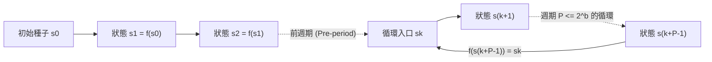
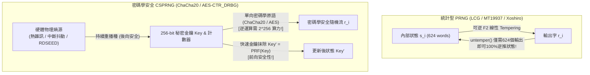

## 引言：馮·諾伊曼的「原罪」與確定性機器中的偶然

1951年，現代電腦之父<strong>約翰·馮·諾伊曼（John von Neumann）</strong>留下了一句名言：<strong>「任何考慮用算術方法產生隨機數字的人，當然都處於罪惡的狀態（in a state of sin）。」</strong> 數位電腦是嚴格確定性的有限狀態機，給定相同的輸入和內部狀態，其下一步輸出100%唯一確定。然而，從蒙地卡羅物理模擬、遊戲地形生成，到TLS工作階段金鑰、SSH金鑰對與ECDSA數位簽章，現代數位世界每秒都在消耗數兆個亂數。

確定性的演算法究竟如何製造「隨機」？為什麼像<strong>梅森旋轉（Mersenne Twister, `MT19937`）</strong>這樣通過了嚴苛統計檢定的優秀亂數產生器，一旦用於產生密碼重設權杖（Token），攻擊者<strong>只需觀察連續624個輸出就能100%預測其未來與過去的所有輸出</strong>？本文將從數論、代數學、密碼學與硬體物理學四個維度徹底揭開亂數的奧秘。

---

## 第一章：偽亂數產生器（PRNG）的數學結構 ── 種子、有限狀態與鴿巢原理週期

數學上，<strong>偽亂數產生器（PRNG）</strong>是由有限內部狀態空間 $\mathcal{S}$（大小為 $|\mathcal{S}| = 2^b$）、初始<strong>種子（Seed）</strong>$s_0 \in \mathcal{S}$、確定性狀態轉移函數 $f: \mathcal{S} \to \mathcal{S}$ 以及輸出提取函數 $g: \mathcal{S} \to \mathcal{O}$ 構成的確定性自動機：

$$s_{i+1} = f(s_i), \qquad r_i = g(s_i) \qquad \left(|\mathcal{S}| = 2^b \implies \text{Period } P \le 2^b\right)$$

一旦種子 $s_0$ 固定，整個輸出序列 $r_0, r_1, r_2, \dots$ 即完全確定。這種<strong>可重現性（Reproducibility）</strong>在科學計算除錯與遊戲程序化生成中是無價之寶。但根據<strong>鴿巢原理（Pigeonhole Principle）</strong>，在至多 $2^b$ 次轉移內，狀態必然重逢（$s_{k+P} = s_k$），從而陷入長度 $P \le 2^b$ 的無限循環，稱為<strong>週期（Period）</strong>。



馮·諾伊曼在1949年提出的<strong>平方取中法（Middle-Square Method）</strong>（將 $2k$ 位數平方後取中間 $2k$ 位）由於缺乏代數保障，極易迅速坍縮到 `0000` 或長度為4的短週期陷阱。

---

## 第二章：線性同餘法（LCG）與馬薩利亞定理 ── IBM `RANDU` 的15平面災難

1949年 D. H. Lehmer 提出了<strong>線性同餘產生器（LCG）</strong>：$X_{n+1} = (a X_n + c) \bmod m$。根據1962年的<strong>Hull-Dobell定理</strong>，當且僅當：(1) $\gcd(c, m) = 1$；(2) $m$ 的所有質因數整除 $a-1$；(3) 若 $4 \mid m$ 則 $4 \mid (a-1)$ 時，LCG 達到滿週期 $P = m$。

然而，1968年統計學家<strong>喬治·馬薩利亞（George Marsaglia）</strong>在《美國國家科學院院刊》發表了著名的<strong>《亂數主要落在平面上（Random numbers fall mainly in the planes）》</strong>，證明任何 LCG 產生的連續 $d$ 維座標點 $(X_n, \dots, X_{n+d-1})$ 都嚴格受限於至多 $(d! \cdot m)^{1/d}$ 個平行超平面構成的晶格！

歷史上最慘痛的教訓是 IBM System/360 科學計算庫中的標準產生器 <strong>`RANDU`</strong>（$m = 2^{31}, c = 0, a = 65539 = 2^{16} + 3$）：

$$X_{n+1} = 65539 X_n \bmod 2^{31} = (2^{16} + 3) X_n \bmod 2^{31}$$

$$X_{n+2} \equiv (2^{16}+3)^2 X_n \equiv \left(\underbrace{2^{32}}_{\equiv 0} + 6\cdot 2^{16} + 9\right) X_n \equiv 6 X_{n+1} - 9 X_n \pmod{2^{31}}$$

$$\implies 9 u_n - 6 u_{n+1} + u_{n+2} = k \in \{-5, -4, \dots, 9\} \quad (\text{15 Parallel Planes!})$$

由於 $X_{n+2} \equiv 6 X_{n+1} - 9 X_n \pmod{2^{31}}$，`RANDU` 在三維單位立方體中產生的所有點<strong>全部被困在區區15個平行平面上</strong>，平面之間存在巨大的真空地帶，導致1960至70年代無數蒙地卡羅物理模擬結果失真！

---

## 第三章：梅森旋轉（MT19937）與現代高速統計 PRNG（PCG64, Xoshiro256++）

1997年，日本數學家<strong>松本真（Makoto Matsumoto）與西村拓士（Takuji Nishimura）</strong>發明了基於二元體 $\mathbb{F}_2$ 扭曲廣義回饋移位暫存器（TGFSR）的<strong>梅森旋轉演算法（Mersenne Twister, `MT19937`）</strong>，成為 Python `random`、R、MATLAB、C++ `std::mt19937` 的預設引擎：
1. <strong>超長週期與高維均勻分佈</strong>：維護 $624$ 個32位元字（共 $19,937$ 個有效狀態位元），實現了梅森質數週期 $P = 2^{19937} - 1 \approx 4.315 \times 10^{6001}$，並在高達 <strong>623維超立方體中嚴格等分佈（623-dimensional equidistribution）</strong>！
2. <strong>調律變換（Tempering）</strong>：輸出前對狀態字 $x$ 乘以 $\mathbb{F}_2$ 上的 $32\times 32$ 可逆矩陣（四步移位互斥或）：

$$\begin{aligned}
y_1 &= x \oplus ((x \gg 11) \mathbin{\&} \texttt{0xFFFFFFFF}) \\
y_2 &= y_1 \oplus ((y_1 \ll 7) \mathbin{\&} \texttt{0x9D2C5680}) \\
y_3 &= y_2 \oplus ((y_2 \ll 15) \mathbin{\&} \texttt{0xEFC60000}) \\
z &= y_3 \oplus (y_3 \gg 18)
\end{aligned}$$

近年來，針對 `MT19937` 狀態體積較大（2.5 KB）且未能通過 TestU01 (`BigCrush`) 中兩項 $\mathbb{F}_2$ 線性複雜度檢定的問題，<strong>Melissa O'Neill 的 `PCG64`</strong>（128位元LCG配合資料相依隨機旋轉置換，NumPy預設引擎）與 <strong>Blackman & Vigna 的 `Xoshiro256++`</strong>（256位元狀態配合非線性乘法擾頻器，Rust/Java採用）以僅16~32位元組的狀態實現了100%通過 `BigCrush` 的極速生成。

---

## 第四章：為什麼統計完美 $\neq$ 密碼學安全？── 624個輸出破解 MT19937 與 CSPRNG

### 4.1 逆轉 Tempering：僅需 624 個輸出完全複製 `MT19937`

許多開發者誤以為 `MT19937` 週期長達 $2^{19937}-1$ 就可用於產生工作階段 Token 或密碼。然而，`MT19937` 的四步 Tempering 變換在 $\mathbb{F}_2^{32}$ 上<strong>完全可逆</strong>！只需十幾行 Python 程式碼即可在 $O(1)$ 時間內從輸出 $z$ 精確反推內部狀態字 $x$：

```python
def untemper(z: int) -> int:
    # Invert MT19937 32-bit output z back to internal state word x in O(1)
    y3 = z ^ (z >> 18)
    y2 = y3 ^ ((y3 << 15) & 0xEFC60000)
    y1 = y2
    for _ in range(4):
        y1 = y2 ^ ((y1 << 7) & 0x9D2C5680)
    x = y1
    for _ in range(2):
        x = y1 ^ (x >> 11)
    return x & 0xFFFFFFFF
```

這意味著：<strong>攻擊者只要觀察到伺服器連續輸出的 624 個 32 位元亂數（僅 2,496 位元組），對每個數呼叫 `untemper(z)`，就能100%完整重建伺服器的 624 字內部狀態陣列，從而精確預測未來產生的所有 Token，甚至倒推過去已發出的所有亂數！</strong>

### 4.2 姚期智定理（1982）與密碼學安全偽亂數產生器（CSPRNG）

密碼學要求使用<strong>密碼學安全偽亂數產生器（CSPRNG）</strong>，滿足三大公理：
1. <strong>下一位元不可預測性（姚期智定理 / Blum-Micali 準則, 1982）</strong>：給定前 $k$ 個輸出位元，任何多項式時間攻擊者 $\mathcal{A}$ 預測第 $k+1$ 位元的優勢可忽略不計（等價於<strong>計算不可區分性</strong>）：

$$\left| \Pr\left[\mathcal{A}(r_1, r_2, \dots, r_k) = r_{k+1}\right] - \frac{1}{2} \right| \le \text{negl}(\lambda)$$

2. <strong>前向安全性（Forward Secrecy / 抗回溯性）</strong>：每次輸出後立即透過單向函數更新並抹除舊金鑰（Fast-Key-Erasure），即使當前狀態洩露，也無法反推過去的亂數。
3. <strong>後向安全性（Backward Secrecy / 預測抗性）</strong>：持續注入物理硬體熵源進行重播種（Reseeding），使狀態洩露後未來能自我恢復安全。



現代主流 CSPRNG 包括基於串流加密的 <strong>`ChaCha20-RNG`</strong>（Linux核心、OpenBSD、Rust採用）、<strong>`AES-CTR_DRBG`</strong>（NIST SP 800-90A）以及理論基於大數分解困難性的 <strong>Blum-Blum-Shub ($x_{n+1} = x_n^2 \bmod M$)</strong>。相反，2013年史諾登文件證實，NIST 曾標準化的橢圓曲線產生器 <strong>`Dual_EC_DRBG`</strong> 含有 NSA 植入的陷門（掌握定點數 $P = d \cdot Q$ 離散對數 $d$ 的攻擊者僅憑32位元組輸出即可推算內部狀態並解密所有TLS流量）。

| 產生器類別 | 代表演算法 | 狀態大小 | 週期 $P$ | BigCrush 統計檢定 | 密碼學安全性 | 適用場景 |
| :--- | :--- | :--- | :--- | :---: | :---: | :--- |
| <strong>傳統線性同餘 (LCG)</strong> | `RANDU`, C `rand()` | 32~64 bit | $\le 2^{64}$ | 失敗（超平面晶格） | <strong>極度危險</strong> | 僅限遺留程式碼 |
| <strong>現代統計型 PRNG</strong> | <strong>`MT19937`</strong>, <strong>`PCG64`</strong>, <strong>`Xoshiro256++`</strong> | 128 bit ~ 2.5 KB | $2^{128} \sim 2^{19937}-1$ | <strong>通過</strong> | <strong>危險（624個輸出或Z3可逆推）</strong> | 蒙地卡羅模擬、科學計算、遊戲 |
| <strong>密碼學安全 (CSPRNG)</strong> | <strong>`ChaCha20-RNG`</strong>, <strong>`AES-CTR_DRBG`</strong> | 256~512 bit | $\ge 2^{256}$ | <strong>100%通過</strong> | <strong>安全（不可預測、前/後向保密）</strong> | <strong>金鑰、Token、密碼產生、TLS</strong> |
| <strong>硬體真亂數 (TRNG)</strong> | 熱雜訊、雪崩二極體、環形振盪器 (`RDSEED`) | 物理連續統 | <strong>非週期 ($\infty$)</strong> | 白化後通過 | <strong>真實物理熵源</strong> | 為 OS CSPRNG 提供種子與重播種 |

---

## 第五章：物理真亂數（TRNG）、最小熵（Min-Entropy）與作業系統熵池

CSPRNG 的根基來自<strong>硬體真亂數產生器（TRNG / HRNG）</strong>採集的微觀物理混沌：導體中的<strong>強森-奈奎斯特熱雜訊（Thermal Noise）</strong>、齊納二極體反向擊穿的量子穿隧雪崩雜訊，以及現代 CPU（Intel/AMD `RDSEED`/`RDRAND` 指令）中<strong>環形振盪器（Ring Oscillator）的皮秒級相位抖動</strong>。在密碼學評估（NIST SP 800-90B）中，必須使用衡量最壞情況可預測性的<strong>最小熵（Min-Entropy $H_\infty$）</strong>而非香農平均熵 $H_1$：

$$V_{\text{rms}} = \sqrt{4 k_B T R \Delta f}, \qquad H_\infty(X) = -\log_2 \left(\max_{x} P(X = x)\right) \le H_1(X)$$

採集到的原始物理雜訊透過馮·諾伊曼去偏法或密碼學雜湊提取器（Linux 核心中的 `BLAKE2s`，遵循<strong>剩餘雜湊引理 Leftover Hash Lemma</strong>）進行<strong>白化（Whitening）</strong>後注入核心 CSPRNG。

在現代 Linux（5.6+）中，`/dev/random` 與 `/dev/urandom` 均由同一個基於 `ChaCha20` 的核心 CSPRNG 驅動；工程上應始終使用 <strong>`getrandom(2)`</strong>（或 Python `secrets`、JS `crypto.getRandomValues()`、Rust `OsRng`/`ThreadRng`、Go `crypto/rand`）。切記<strong>2008年 Debian OpenSSL 漏洞（CVE-2008-0166）</strong>與<strong>2010年索尼 PS3 ECDSA 簽章靜態亂數 $k$ 漏洞</strong>的慘痛教訓：當時 Debian 維護者為消除 Valgrind 警告誤刪了一行熵注入程式碼，導致全球無數伺服器產生的 2048 位元 RSA 金鑰僅依賴 15 位元行程 ID（PID $\le 32,768$），在數小時內被全數暴力破解！<strong>任何密碼系統的安全強度，永遠不可能超過產生其金鑰的亂數產生器的熵。</strong>
