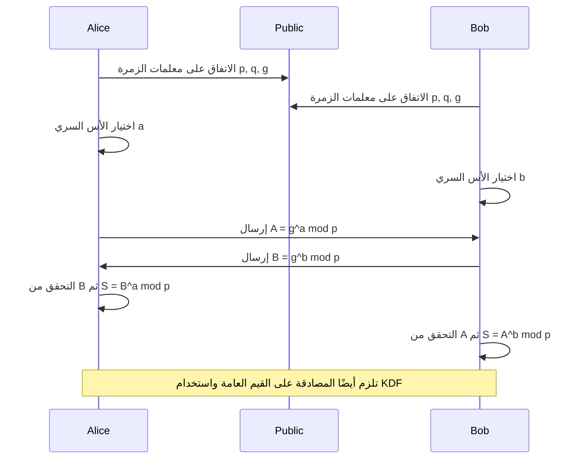
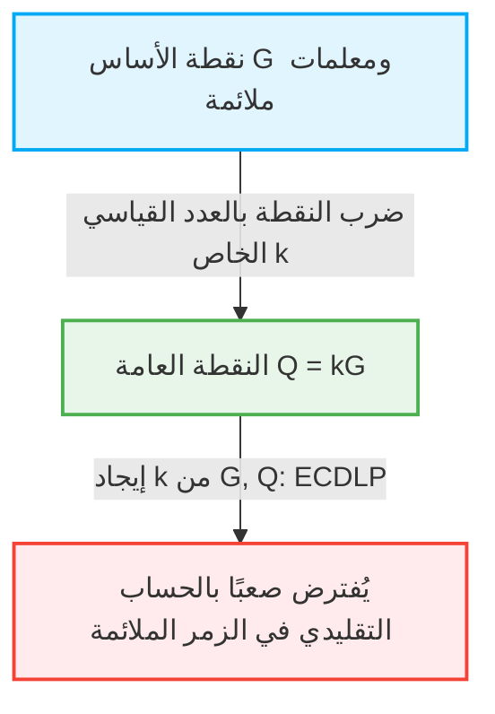

يساعد التشفير بالمفتاح العام على التواصل بين أطراف لا تملك مسبقًا مفتاحًا سريًا مشتركًا. يشرح المقال رياضيات الاتفاق على المفاتيح بطريقة ديفي–هيلمان (DH)، وRSA، والتشفير بالمنحنيات الإهليلجية (ECC). تساوي طول المفتاح لا يعني تساوي الأمان المقدّر بين الأنظمة المختلفة، كما أن المعادلات وحدها لا تضمن أمان الاتصال كله.

## 1. التشفير المتماثل وتوزيع المفاتيح

تشفير قيصر وآلة إنجما مثالان تاريخيان يشترك فيهما المرسل والمستقبل في إعدادات سرية. يستخدم التشفير المتماثل الحديث أيضًا مفتاحًا سريًا مشتركًا. لكن لا يجوز مساواة هذين النظامين التاريخيين بالخوارزميات الحديثة الآمنة.

### مشكلة توزيع المفاتيح

إرسال مفتاح متماثل مباشرة عبر قناة غير محمية يكشفه أيضًا للمتنصت. لذا فالسؤال هو كيف ننشئ سرًا مشتركًا، ومع مَن. تساعد تقنيات المفتاح العام، لكن المصادقة على هوية الطرف الآخر ضرورية أيضًا.

يبقى للتشفير المتماثل دوره. مثلًا يجمع TLS 1.3 بين الاتفاق على المفاتيح والمصادقة وبين التشفير الموثّق للبيانات باستخدام مفاتيح مشتقة. لا تُشفَّر جميع بيانات التطبيق بعمليات المفتاح العام.

## 2. الاتفاق على المفاتيح بطريقة ديفي–هيلمان

وصفت ورقة ديفي وهيلمان عام 1976 طريقةً يستطيع بها طرفان حساب القيمة السرية نفسها انطلاقًا من معلومات متبادلة علنًا. نتناول هنا DH على حقل منتهٍ.

### اللوغاريتم المنفصل والقيمة المشتركة

داخل زمرة الضرب بترديد عدد أولي $p$، نفترض استخدام زمرة جزئية ذات رتبة أولية كبيرة $q$ يولدها $g$، حيث $q$ يقسم $p-1$. هذا $g$ مولّد للزمرة الجزئية، ولا يلزم أن يكون جذرًا بدائيًا لزمرة الضرب كاملة. تستخدم البروتوكولات الفعلية معلمات محددة وقوية بما يكفي، لا أعدادًا صغيرة مبتكرة لحماية بيانات حقيقية.

1. تختار أليس أسًا سريًا $1\le a\le q-1$ باحتمالات متساوية باستخدام عشوائية آمنة تشفيريًا، وترسل $A=g^a\bmod p$.
2. يختار بوب بالطريقة نفسها $1\le b\le q-1$ ويرسل $B=g^b\bmod p$.
3. بعد التحقق من صلاحية القيمة العامة للطرف الآخر وفق المخطط، تحسب أليس $B^a\bmod p$ ويحسب بوب $A^b\bmod p$.

$$
B^a\equiv (g^b)^a\equiv g^{ab}\equiv(g^a)^b\equiv A^b\pmod p.
$$

نسمي القيمة المشتركة $S$. إيجاد $a$ من $A$ هو مسألة اللوغاريتم المنفصل (DLP)، بينما حساب $S$ من $g,A,B$ هو مسألة ديفي–هيلمان الحسابية (CDH). حل DLP يتيح حل CDH، لكن ذلك لا يثبت تساوي صعوبتهما دائمًا. أي ادعاء بأمان DH يجب أن يحدد الزمرة والبروتوكول وقدرات المهاجم.

### المصادقة والتحقق من القيم العامة واشتقاق المفاتيح

لا يمنع DH دون مصادقة هجوم الوسيط القادر على تغيير الاتصال. باستبدال القيم العامة، يستطيع المهاجم إنشاء قيم مشتركة منفصلة مع أليس ومع بوب. التحقق من صلاحية القيمة العامة لا يحل محل المصادقة على هوية الطرف الآخر.

تعتمد قواعد التحقق أيضًا على المعلمات. في الزمرة الجزئية ذات الرتبة الأولية أعلاه، تشمل فحص المجال الصحيح والانتماء إلى الزمرة الجزئية واستبعاد العنصر المحايد. لا يجوز اعتبار فحص $1<Y<p-1$ في RFC 7919، المخصص لزمر معروفة مبنية على أعداد أولية آمنة، تحققًا كاملًا لأي زمرة اعتباطية.

لا تُستخدم $S$ مباشرة كمفتاح متماثل. تُرمَّز وفق البروتوكول وتُعالَج بدالة اشتقاق مفاتيح (KDF) مع معلومات السياق لإنتاج مفاتيح لأغراض مختلفة. يستخدم جدول مفاتيح TLS 1.3 دالة HKDF وسجل رسائل المصافحة.

يوضح الرسم الهيكل الحسابي، لا رسائل المصادقة المحددة أو إجراء KDF كاملًا.

## 3. RSA ومبرهنة أويلر

طوّر ريفست وشامير وأدليمان RSA باستخدام رياضيات مختلفة عن DH. مخططات التشفير والتوقيع القائمة على RSA لها تصميمات مختلفة.

### المفاتيح والعمليات على الأعداد الصحيحة

كنموذج تعليمي لـRSA ذي عاملين أوليين، نختار عددين أوليين فرديين كبيرين ومختلفين $p,q$ ونضع $N=pq$. هذا $q$ عامل أولي في RSA، وليس رتبة الزمرة الجزئية في القسم السابق.

$$
\phi(N)=(p-1)(q-1),\qquad ed\equiv1\pmod{\phi(N)}.
$$

نختار الأس العام $e$ بحيث $1<e<\phi(N)$ و$\gcd(e,\phi(N))=1$، ونحسب معكوسه ليكون أسًا خاصًا موجبًا $d<\phi(N)$. هذه شروط كافية لهذا الشرح. يستخدم RFC 8017 الشرط $ed\equiv1\pmod{\lambda(N)}$، حيث $\lambda(N)=\operatorname{lcm}(p-1,q-1)$. المفتاح العام هو $(N,e)$، وأحد تمثيلات المفتاح الخاص هو $(N,d)$. يجب التمييز بين الأس الخاص $d$ ومعلومات المفتاح الكاملة.

للعدد الصحيح الممثِّل $0\le M<N$، تكون العمليات الأساسية:

$$
C=M^e\bmod N,\qquad M=C^d\bmod N.
$$

ممثل النص المشفّر $C$ عدد صحيح أيضًا يحقق $0\le C<N$. هنا لا يكون $M$ هو النص نفسه أو سلسلة بايتات ذات طول اعتباطي.

### لماذا تُستعاد القيمة الأصلية

إذا كان $\gcd(M,N)=1$، تعطي مبرهنة أويلر $M^{\phi(N)}\equiv1\pmod N$. بكتابة $ed=1+t\phi(N)$ مع $t\ge0$ نحصل على:

$$
M^{ed}=M\bigl(M^{\phi(N)}\bigr)^t\equiv M\pmod N.
$$

إذا لم يكن $M$ و$N$ أوليين نسبيًا، فلا تُطبَّق مبرهنة أويلر مباشرة. لكن لكل عامل أولي $r\in\{p,q\}$، إذا كان $M\equiv0\pmod r$ فإن $M^{ed}\equiv M\equiv0\pmod r$. وإلا فإن مبرهنة فيرما الصغرى وكون $ed-1$ مضاعفًا لـ$r-1$ يعطيان $M^{ed}\equiv M\pmod r$. تجمع مبرهنة البواقي الصينية النتيجتين بترديد $N$. لذلك يمكن استعادة كل ممثل $0\le M<N$.

### الصحة الرياضية والأمان

تحليل $N$ إلى عوامله يتيح حساب $\phi(N)$ و$d$. لا يثبت ذلك أن كل هجوم على RSA يتطلب التحليل إلى العوامل. قد تؤدي العشوائية الضعيفة والترميز الخاطئ وتسريبات التنفيذ إلى فشل الأمان أيضًا.

استخدام عملية رفع العدد إلى أس، وهي حتمية (deterministic)، مباشرة للتشفير يسمح، مثلًا، بتجريب مجموعة صغيرة من الرسائل المحتملة بالمفتاح العام. تحتاج المخططات العملية إلى ترميز وفحوص مخصصة، مثل RSAES-OAEP للتشفير وRSASSA-PSS للتوقيع. التوقيع ليس هو تشفير الرسالة بالمفتاح الخاص. كما يجب التحقق من أن المفتاح العام يعود إلى الطرف المقصود.

## 4. طول المفتاح والأمان المقدّر

يعني طول مفتاح RSA عادةً طول المقياس $N$ بالبتات. تؤثر الموارد الحسابية وخوارزميات الهجوم في التقديرات. انتهاء التوصية بطول معين لا يعني أن مقاييس RSA-1024 قد حُلّلت إلى عواملها بصورة عامة.

للمقارنة المحددة، يضع الجدول 2 من NIST SP 800-57 Part 1 Rev.5 المنشور عام 2020 مقياس RSA بطول 2048 بت في صف القوة الأمنية القصوى المقدّرة بـ112 بت، ومقياس 3072 بت في صف 128 بت. هذه تقديرات ضد الحساب التقليدي وفق افتراضات الوثيقة، وليست توصيات حديثة عامة لجميع الاستخدامات أو سجلات لفك تشفير ناجح.

يزيد المقياس الأطول عمومًا تكلفة العمليات على الأعداد الصحيحة وتخزين المفاتيح والتوقيعات ونقلها. لكن الأداء يتوقف أيضًا على الأس العام وتحسينات CRT والتنفيذ والعتاد ونوع العملية. لا يحدد طول المفتاح وحده أي نظام أسرع.

## 5. رياضيات المنحنيات الإهليلجية

اقترح ميلر وكوبليتز بصورة مستقلة الاستخدام التشفيري للمنحنيات الإهليلجية في ثمانينيات القرن العشرين. يورد RFC 6090 ورقة ميلر في CRYPTO '85 وورقة كوبليتز عام 1987. يجب التمييز بين وقت الاقتراح وسنة النشر.

يضع جدول NIST نفسه ECC ذات رتبة نقطة أساس طولها 256–383 بت في صف القوة الأمنية القصوى المقدّرة بـ128 بت. هذا سياق مقارنة RSA-3072 مع ECC-256. يقيس عمود ECC طول رتبة نقطة الأساس، ولا يعني أن ملف المفتاح العام المسلسل الذي يضم الإحداثيات حجمه 256 بت. تفترض المقارنة، ضمن شروط أخرى، اختيار معلمات ملائمة وإدارة مفاتيح سليمة.

### منحنى على حقل منتهٍ

نقتصر على الحقل الأولي $\mathbb F_p$ حيث $p>3$ و$a,b,x,y\in\mathbb F_p$. هذه معلمات مختلفة عن الأعداد الأولية في RSA أعلاه.

$$
y^2\equiv x^3+ax+b\pmod p,\qquad 4a^3+27b^2\not\equiv0\pmod p.
$$

يضمن الشرط الثاني أن المنحنى غير شاذ على هذا الحقل. لا يكفي أن يكون التعبير غير صفري كعدد صحيح. نعرّف الجمع على نقاط المنحنى مع العنصر المحايد، أي نقطة اللانهاية $\mathcal O$. هذا التمثيل وحده لا يشمل الحالة العامة للحقول ذات المميزة 2 أو 3.

### جمع النقاط والحالات الاستثنائية

على الأعداد الحقيقية، يمكن توضيح الجمع برسم مستقيم عبر نقطتين ثم عكس تقاطعه الثالث مع المنحنى حول المحور الأفقي. على الحقل المنتهي نحسب الصيغ الجبرية المقابلة بترديد $p$. للنقطتين $P=(x_1,y_1)$ و$Q=(x_2,y_2)$ يكون الميل في الحالات المعتادة:

$$
s=\begin{cases}
(y_2-y_1)(x_2-x_1)^{-1} & (x_1\ne x_2),\\
(3x_1^2+a)(2y_1)^{-1} & (P=Q,\ y_1\ne0).
\end{cases}
$$

$$
x_3=s^2-x_1-x_2,\qquad y_3=s(x_1-x_3)-y_1\quad\text{in }\mathbb F_p.
$$

العناصر غير الصفرية فقط لها معكوس ضربي في الحقل. لا يجوز استخدام هذه الصيغ إذا كان المقام صفرًا.

$$
P+\mathcal O=P,\qquad -P=(x_1,-y_1),\qquad P+(-P)=\mathcal O.
$$

إذا كان $P=Q$ و$y_1=0$ فإن $2P=\mathcal O$. حساب $P+P$ هو مضاعفة النقطة، وهي حالة خاصة من ضرب النقطة بعدد صحيح لحساب مضاعفات صحيحة عامة.

### ضرب النقطة بعدد صحيح وECDLP

نستخدم نقطة أساس $G$ تولّد زمرة جزئية ذات رتبة أولية كبيرة $n$. الرتبة هي أصغر عدد صحيح موجب يحقق $nG=\mathcal O$. نختار العدد القياسي الخاص $1\le k\le n-1$ باحتمالات متساوية باستخدام عشوائية آمنة تشفيريًا.

$$
Q=kG=\underbrace{G+\cdots+G}_{k\text{ terms}}.
$$

$k$ هو المفتاح الخاص و$Q$ المفتاح العام. للعدد الأولي للحقل $p$ ورتبة الزمرة الجزئية $n$ والعدد القياسي الخاص $k$ أدوار مختلفة. إيجاد $k$ من $G,Q$ هو مسألة اللوغاريتم المنفصل على المنحنى الإهليلجي (ECDLP).

يصف RFC 6090 هجمات تقليدية عامة مثل طريقة رو لبولارد (Pollard rho) بتكلفة تقارب $O(\sqrt n)$ عملية زمرة. إذا كان طول $n$ نحو 256 بت، فالمقياس نحو $2^{128}$. هذا تقدير أسي بالنسبة إلى طول البتات، وليس برهان صعوبة لكل المنحنيات. توجد هجمات على منحنيات خاصة أيضًا؛ لذا يهم اختيار المنحنى والزمرة الجزئية والتحقق من النقاط العامة ومنع تسرب معلومات التنفيذ.

## 6. الأدوار داخل البروتوكولات والحساب الكمي

ليست ECC اسم مخطط تشفير واحد. مثلًا تُستخدم ECDH للاتفاق على المفاتيح وECDSA للتوقيع. تتطلب ECDH أيضًا اشتقاق مفاتيح من النقطة المشتركة وفق البروتوكول والتحقق من القيم العامة والمصادقة.

في TLS 1.3، للاتفاق على المفاتيح مثل ECDHE، وللتوقيعات مثل ECDSA أو RSA-PSS، وللتشفير الموثّق بالمفاتيح المتماثلة المشتقة أدوار مختلفة. توجد أيضًا أوضاع بمفاتيح مشتركة مسبقًا. أزال TLS 1.3 نقل مفاتيح RSA، لكن ذلك لا يعني إزالة توقيعات RSA. الانتقال إلى ECC لا يضمن تسريع كل عملية.

### الحواسيب الكمية والتشفير ما بعد الكمي

تحل خوارزمية شور التحليل إلى العوامل واللوغاريتم المنفصل بعدد خطوات متعدد الحدود في طول المدخل بالبتات، على حاسوب كمي قادر بما يكفي. تهدد RSA وECC التقليدية، لكن الزمن متعدد الحدود لا يعني التنفيذ الفوري ولا يتنبأ بموعد وجود مثل هذا الجهاز.

يسعى التشفير ما بعد الكمي (PQC) إلى توفير إنشاء المفاتيح والتوقيع ونحوهما وفق افتراضات أخرى تراعي الهجمات الكمية. لا يضمن استحالة الكسر حتى بالحواسيب الكمية. يجب تقييم المخططات والتنفيذ والبروتوكولات التي ستُنقل إليها.

## الخلاصة

تحسب DH قيمًا مشتركة، وتستخدم RSA رفع الأعداد الصحيحة إلى قوى بترديد، وتستخدم ECC عمليات زمرة على نقاط حقل منتهٍ. بعد استيفاء الشروط الرياضية، تجمع البروتوكولات المصادقة واشتقاق المفاتيح والترميز والتحقق الملائمين وإدارة المفاتيح لحماية الاتصال. لا تثبت المفاتيح القصيرة أو المعادلات الصحيحة وحدها أمان النظام كله.

## المراجع

- [RFC 7919 §5.1: التحقق من القيم العامة في زمر FFDHE المعروفة](https://www.rfc-editor.org/rfc/rfc7919.html#section-5.1)
- [RFC 8017: مفاتيح RSA والعمليات الأساسية وOAEP وPSS](https://www.rfc-editor.org/rfc/rfc8017.html)
- [RFC 6090 §§2–4 و10: الحقول المنتهية وعمليات المنحنى وECDH وشروط الأمان](https://www.rfc-editor.org/rfc/rfc6090.html)
- [NIST SP 800-57 Part 1 Rev.5 (2020)، §5.6.1.1 والجدول 2: القوة الأمنية المقدّرة](https://csrc.nist.gov/pubs/sp/800/57/pt1/r5/final)
- [RFC 8446: أدوار البروتوكول وجدول المفاتيح في TLS 1.3](https://www.rfc-editor.org/rfc/rfc8446.html)
- [Shor: ملخص ورقة التحليل إلى العوامل واللوغاريتم المنفصل بالحساب الكمي](https://arxiv.org/abs/quant-ph/9508027)
