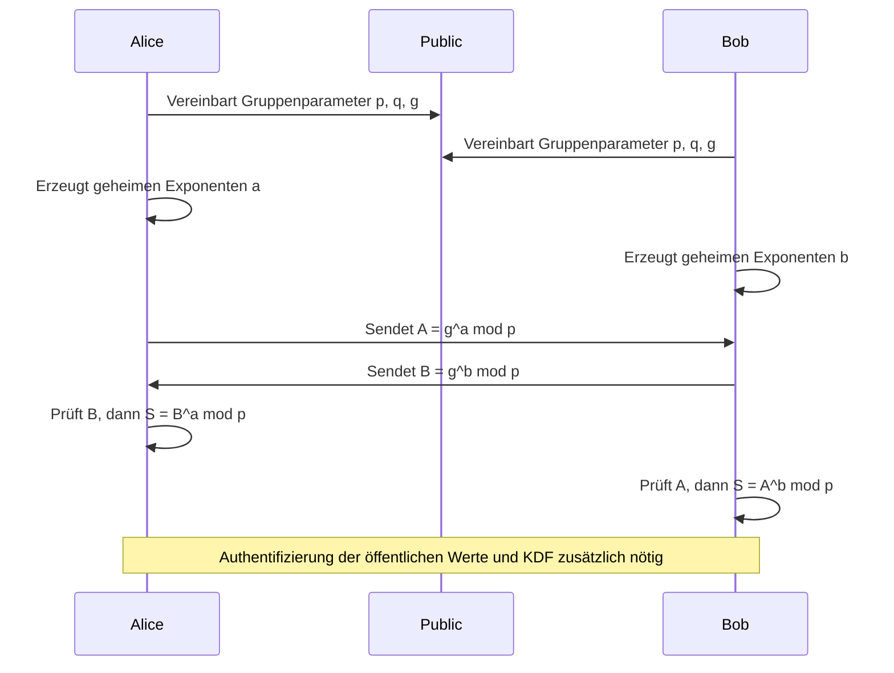
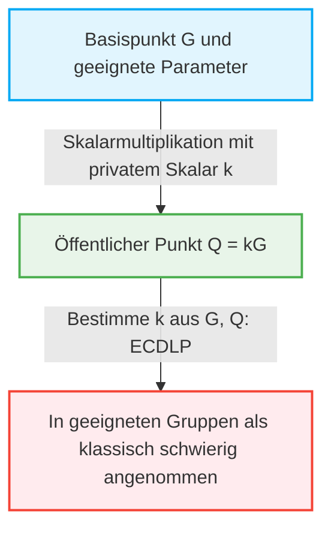

Public-Key-Kryptographie ermöglicht Kommunikation zwischen Parteien, die vorher keinen gemeinsamen geheimen Schlüssel besitzen. Dieser Artikel erklärt die Mathematik der Diffie–Hellman-Schlüsselvereinbarung (DH), von RSA und der Kryptographie mit elliptischen Kurven (ECC). Gleiche Schlüssellängen bedeuten bei unterschiedlichen Verfahren nicht dieselbe geschätzte Sicherheit. Die Gleichungen allein garantieren auch nicht die Sicherheit der gesamten Kommunikation.

## 1. Symmetrische Kryptographie und Schlüsselverteilung

Die Caesar-Chiffre und Enigma sind historische Beispiele, bei denen Sender und Empfänger geheime Einstellungen teilen. Auch moderne symmetrische Kryptographie verwendet einen gemeinsamen geheimen Schlüssel. Die historischen Verfahren dürfen jedoch nicht mit sicheren modernen Algorithmen gleichgesetzt werden.

### Das Schlüsselverteilungsproblem

Wird ein symmetrischer Schlüssel unverändert über einen ungeschützten Kanal übertragen, erfährt ihn auch ein Lauscher. Die Frage ist daher, wie und mit wem ein gemeinsames Geheimnis vereinbart wird. Public-Key-Techniken helfen dabei, doch auch die Authentifizierung des Gegenübers ist erforderlich.

Symmetrische Kryptographie behält ihre Aufgabe. TLS 1.3 verbindet beispielsweise Schlüsselvereinbarung und Authentifizierung mit authentifizierter Verschlüsselung der Daten unter abgeleiteten Schlüsseln. Es verschlüsselt nicht sämtliche Anwendungsdaten durch Public-Key-Operationen.

## 2. Diffie–Hellman-Schlüsselvereinbarung

Diffie und Hellman beschrieben 1976, wie zwei Parteien aus öffentlich ausgetauschten Informationen denselben geheimen Wert berechnen können. Hier betrachten wir DH über einem endlichen Körper.

### Diskrete Logarithmen und gemeinsamer Wert

In der multiplikativen Gruppe modulo einer Primzahl $p$ verwenden wir eine von $g$ erzeugte Untergruppe mit großer Primzahlordnung $q$, wobei $q$ ein Teiler von $p-1$ ist. Dieses $g$ erzeugt die Untergruppe und muss keine Primitivwurzel der gesamten multiplikativen Gruppe sein. Reale Protokolle verwenden festgelegte, ausreichend starke Parameter statt selbst erfundener kleiner Werte zum Schutz echter Daten.

1. Alice wählt mit kryptographisch sicherem Zufall gleichverteilt einen geheimen Exponenten $1\le a\le q-1$ und sendet $A=g^a\bmod p$.
2. Bob wählt ebenso $1\le b\le q-1$ und sendet $B=g^b\bmod p$.
3. Nach der verfahrensgemäßen Prüfung des öffentlichen Werts des Gegenübers berechnet Alice $B^a\bmod p$ und Bob $A^b\bmod p$.

$$
B^a\equiv (g^b)^a\equiv g^{ab}\equiv(g^a)^b\equiv A^b\pmod p.
$$

Den gemeinsamen Wert nennen wir $S$. Aus $A$ den Exponenten $a$ zu bestimmen, ist das diskrete Logarithmusproblem (DLP). Aus $g,A,B$ den Wert $S$ zu berechnen, ist das Computational-Diffie–Hellman-Problem (CDH). Wer DLP lösen kann, kann auch CDH lösen; daraus folgt aber kein Beweis, dass beide Probleme immer gleich schwierig sind. Sicherheitsaussagen über DH müssen die Gruppe, das Protokoll und die Fähigkeiten des Angreifers benennen.

### Authentifizierung, Prüfung öffentlicher Werte und Schlüsselableitung

DH ohne Authentifizierung verhindert keinen Man-in-the-Middle-Angriff, der den Austausch verändert. Durch das Ersetzen öffentlicher Werte kann ein Angreifer mit Alice und Bob jeweils unterschiedliche gemeinsame Werte vereinbaren. Die Prüfung der öffentlichen Werte ersetzt die Authentifizierung des Gegenübers nicht.

Auch die Prüfung hängt von den Parametern ab. Bei der obigen Untergruppe mit Primzahlordnung gehören der korrekte Wertebereich, die Untergruppenzugehörigkeit und der Ausschluss des neutralen Elements dazu. Die Prüfung $1<Y<p-1$ aus RFC 7919 für die dort festgelegten Gruppen mit sicheren Primzahlen ist keine vollständige Prüfvorschrift für beliebige Gruppen.

$S$ wird nicht unmittelbar als symmetrischer Schlüssel verwendet. Der Wert wird protokollgemäß kodiert und mit einer Schlüsselableitungsfunktion (KDF) unter Einbeziehung von Kontextinformationen in Schlüssel für verschiedene Zwecke überführt. Der Schlüsselplan von TLS 1.3 verwendet HKDF und die Aufzeichnung der Handshake-Nachrichten.

Das Diagramm zeigt den arithmetischen Ablauf, nicht die konkreten Authentifizierungsnachrichten oder das vollständige KDF-Verfahren.

## 3. RSA und der Satz von Euler

RSA wurde von Rivest, Shamir und Adleman entwickelt und verwendet andere Mathematik als DH. RSA-basierte Verschlüsselungs- und Signaturverfahren werden unterschiedlich konstruiert.

### Schlüssel und Operationen mit ganzen Zahlen

Als Lehrmodell für RSA mit zwei Primfaktoren wählen wir große, unterschiedliche ungerade Primzahlen $p,q$ und setzen $N=pq$. Dieses $q$ ist ein RSA-Primfaktor und nicht die Untergruppenordnung aus dem vorherigen Abschnitt.

$$
\phi(N)=(p-1)(q-1),\qquad ed\equiv1\pmod{\phi(N)}.
$$

Wir wählen einen öffentlichen Exponenten mit $1<e<\phi(N)$ und $\gcd(e,\phi(N))=1$ und bestimmen seine Inverse als positiven privaten Exponenten $d<\phi(N)$. Dies sind hinreichende Bedingungen für die Erklärung. RFC 8017 verwendet die Bedingung $ed\equiv1\pmod{\lambda(N)}$ mit $\lambda(N)=\operatorname{lcm}(p-1,q-1)$. Der öffentliche Schlüssel ist $(N,e)$; eine Darstellung des privaten Schlüssels ist $(N,d)$. Der private Exponent $d$ ist von der vollständigen Schlüsselinformation zu unterscheiden.

Für einen ganzzahligen Repräsentanten $0\le M<N$ lauten die Grundoperationen:

$$
C=M^e\bmod N,\qquad M=C^d\bmod N.
$$

Auch der Chiffratrepräsentant $C$ ist eine ganze Zahl mit $0\le C<N$. Hier ist $M$ nicht unmittelbar ein beliebig langer Text oder eine Bytefolge.

### Warum erhält man den ursprünglichen Wert zurück?

Für $\gcd(M,N)=1$ liefert der Satz von Euler $M^{\phi(N)}\equiv1\pmod N$. Mit $ed=1+t\phi(N)$ und $t\ge0$ folgt:

$$
M^{ed}=M\bigl(M^{\phi(N)}\bigr)^t\equiv M\pmod N.
$$

Sind $M$ und $N$ nicht teilerfremd, darf der Satz von Euler nicht direkt angewendet werden. Für jeden Primfaktor $r\in\{p,q\}$ gilt jedoch: Falls $M\equiv0\pmod r$, dann ist $M^{ed}\equiv M\equiv0\pmod r$. Andernfalls liefern der kleine Satz von Fermat und die Teilbarkeit von $ed-1$ durch $r-1$ die Kongruenz $M^{ed}\equiv M\pmod r$. Der chinesische Restsatz verbindet beide Ergebnisse modulo $N$. Damit wird jeder Repräsentant $0\le M<N$ wiederhergestellt.

### Mathematische Korrektheit und Sicherheit

Wer $N$ faktorisieren kann, kann $\phi(N)$ und $d$ berechnen. Dies beweist nicht, dass jeder RSA-Angriff eine Faktorisierung benötigt. Schwacher Zufall, fehlerhafte Kodierung und Informationsabflüsse aus der Implementierung können ebenfalls zum Versagen führen.

Die obige deterministische Potenzierung direkt zur Verschlüsselung zu verwenden, erlaubt etwa das Testen weniger möglicher Nachrichten mit dem öffentlichen Schlüssel. Praktische Verfahren benötigen eigene Kodierungen und Prüfungen, beispielsweise RSAES-OAEP zur Verschlüsselung und RSASSA-PSS für Signaturen. Signieren ist nicht dasselbe wie das Verschlüsseln der Nachricht mit einem privaten Schlüssel. Auch die Zuordnung des öffentlichen Schlüssels zum erwarteten Gegenüber muss authentifiziert werden.

## 4. Schlüssellänge und geschätzte Sicherheit

Die RSA-Schlüssellänge bezeichnet gewöhnlich die Bitlänge des Modulus $N$. Rechenressourcen und Angriffsalgorithmen beeinflussen Sicherheitsschätzungen. Wird eine Schlüssellänge nicht mehr empfohlen, bedeutet dies nicht, dass RSA-1024-Moduli allgemein faktorisiert worden wären.

Als konkreten Vergleich ordnet Tabelle 2 von NIST SP 800-57 Part 1 Rev.5 aus dem Jahr 2020 einen RSA-Modulus mit 2048 Bit der Zeile mit geschätzter maximaler Sicherheitsstärke von 112 Bit zu, einen mit 3072 Bit der Zeile mit 128 Bit. Das sind Schätzungen gegenüber klassischer Berechnung unter den Annahmen dieses Dokuments. Sie sind weder universelle heutige Schlüssellängenempfehlungen noch Aufzeichnungen erfolgreicher Entschlüsselungen.

Ein längerer Modulus erhöht im Allgemeinen den Aufwand für Ganzzahloperationen sowie das Speichern und Übertragen von Schlüsseln und Signaturen. Die Leistung hängt aber auch vom öffentlichen Exponenten, CRT-Optimierungen, der Implementierung, der Hardware und der Operation ab. Allein aus der Schlüssellänge lässt sich nicht ableiten, welches Verfahren schneller ist.

## 5. Die Mathematik elliptischer Kurven

Miller und Koblitz schlugen unabhängig voneinander in den 1980er-Jahren vor, elliptische Kurven für Kryptographie zu verwenden. RFC 6090 nennt Millers Beitrag zu CRYPTO '85 und Koblitz' Veröffentlichung von 1987. Vorschlagszeitpunkt und Erscheinungsjahr sind zu unterscheiden.

Dieselbe NIST-Tabelle ordnet ECC mit einer Basispunktordnung von 256–383 Bit der Zeile mit geschätzter maximaler Sicherheitsstärke von 128 Bit zu. Dies ist der Hintergrund des Vergleichs RSA-3072 mit ECC-256. Die ECC-Spalte misst die Bitlänge der Basispunktordnung, nicht die Dateigröße eines serialisierten öffentlichen Schlüssels mit Koordinaten. Der Vergleich setzt unter anderem geeignete Parameter und sachgerechte Schlüsselverwaltung voraus.

### Eine Kurve über einem endlichen Körper

Wir beschränken uns auf den Primkörper $\mathbb F_p$ mit $p>3$ und $a,b,x,y\in\mathbb F_p$. Diese Parameter sind von den obigen RSA-Primzahlen unabhängig.

$$
y^2\equiv x^3+ax+b\pmod p,\qquad 4a^3+27b^2\not\equiv0\pmod p.
$$

Die zweite Bedingung stellt sicher, dass die Kurve über diesem Körper nichtsingulär ist. Es genügt nicht, dass der Ausdruck als ganze Zahl ungleich null ist. Auf den Kurvenpunkten zusammen mit dem neutralen Element, dem unendlich fernen Punkt $\mathcal O$, wird eine Addition definiert. Die allgemeine Behandlung von Körpern der Charakteristik 2 oder 3 ist mit dieser Gleichung allein nicht abgedeckt.

### Punktaddition und Ausnahmefälle

Über den reellen Zahlen veranschaulicht man die Addition durch eine Gerade durch zwei Punkte, deren dritter Schnittpunkt mit der Kurve an der waagerechten Achse gespiegelt wird. Über einem endlichen Körper berechnet man die entsprechenden algebraischen Formeln modulo $p$. Für $P=(x_1,y_1)$ und $Q=(x_2,y_2)$ ist die Steigung in den gewöhnlichen Fällen:

$$
s=\begin{cases}
(y_2-y_1)(x_2-x_1)^{-1} & (x_1\ne x_2),\\
(3x_1^2+a)(2y_1)^{-1} & (P=Q,\ y_1\ne0).
\end{cases}
$$

$$
x_3=s^2-x_1-x_2,\qquad y_3=s(x_1-x_3)-y_1\quad\text{in }\mathbb F_p.
$$

Nur von null verschiedene Körperelemente besitzen eine multiplikative Inverse. Bei einem Nenner von null dürfen diese Formeln nicht verwendet werden.

$$
P+\mathcal O=P,\qquad -P=(x_1,-y_1),\qquad P+(-P)=\mathcal O.
$$

Für $P=Q$ und $y_1=0$ gilt $2P=\mathcal O$. Die Berechnung von $P+P$ ist eine Punktverdopplung, ein Spezialfall der Skalarmultiplikation, die allgemeine ganzzahlige Vielfache berechnet.

### Skalarmultiplikation und ECDLP

Wir verwenden einen Basispunkt $G$, der eine Untergruppe mit großer Primzahlordnung $n$ erzeugt. Die Ordnung ist die kleinste positive ganze Zahl mit $nG=\mathcal O$. Ein privater Skalar $1\le k\le n-1$ wird mit kryptographisch sicherem Zufall gleichverteilt gewählt.

$$
Q=kG=\underbrace{G+\cdots+G}_{k\text{ terms}}.
$$

$k$ ist der private und $Q$ der öffentliche Schlüssel. Die Körperprimzahl $p$, die Untergruppenordnung $n$ und der private Skalar $k$ haben verschiedene Rollen. Aus $G,Q$ den Wert $k$ zu bestimmen, ist das elliptische diskrete Logarithmusproblem (ECDLP).

RFC 6090 beschreibt generische klassische Angriffe wie Pollard rho mit ungefähr $O(\sqrt n)$ Gruppenoperationen. Für ein etwa 256 Bit langes $n$ liegt diese Größenordnung bei etwa $2^{128}$. Diese Schätzung ist exponentiell in der Bitlänge, aber kein Beweis der Schwierigkeit für alle Kurven. Es gibt Angriffe auf besondere Kurven. Deshalb sind die Wahl von Kurve und Untergruppe, die Prüfung öffentlicher Punkte und der Schutz vor Informationsabflüssen der Implementierung wichtig.

## 6. Rollen in Protokollen und Quantenberechnung

ECC ist nicht der Name eines einzigen Verschlüsselungsverfahrens. Beispielsweise dient ECDH der Schlüsselvereinbarung und ECDSA der Signatur. Auch bei ECDH sind eine protokollgemäße Schlüsselableitung aus dem gemeinsamen Punkt, die Prüfung öffentlicher Werte und Authentifizierung erforderlich.

In TLS 1.3 haben Schlüsselvereinbarung wie ECDHE, Signaturen wie ECDSA oder RSA-PSS und authentifizierte Verschlüsselung mit abgeleiteten symmetrischen Schlüsseln unterschiedliche Aufgaben. Es gibt auch Modi mit vorab geteilten Schlüsseln. TLS 1.3 hat den RSA-Schlüsseltransport entfernt, nicht aber deshalb auch RSA-Signaturen. Ein Wechsel zu ECC garantiert nicht, dass jede Operation schneller wird.

### Quantencomputer und Post-Quanten-Kryptographie

Der Shor-Algorithmus löst Faktorisierung und diskrete Logarithmen auf einem ausreichend leistungsfähigen Quantencomputer mit einer in der Eingabebitlänge polynomialen Schrittzahl. Er bedroht RSA und herkömmliche ECC. Polynomialzeit bedeutet jedoch weder sofortige Ausführung noch eine Vorhersage, wann eine solche Maschine existiert.

Post-Quanten-Kryptographie (PQC) soll unter anderen Annahmen, die Quantenangriffe berücksichtigen, etwa Schlüsseletablierung und Signaturen ermöglichen. Sie garantiert keine absolute Unbrechbarkeit auch gegenüber Quantencomputern. Einzelne Verfahren, Implementierungen und die umzustellenden Protokolle müssen bewertet werden.

## Fazit

DH berechnet gemeinsame Werte, RSA verwendet modulare Potenzierung ganzer Zahlen und ECC Gruppenoperationen auf Punkten über einem endlichen Körper. Nach Erfüllung der mathematischen Voraussetzungen kombinieren Protokolle Authentifizierung, Schlüsselableitung, geeignete Kodierung und Prüfung sowie Schlüsselverwaltung zum Schutz der Kommunikation. Kurze Schlüssel oder korrekte Gleichungen allein belegen nicht die Sicherheit des gesamten Systems.

## Quellen

- [RFC 7919 §5.1: Prüfung öffentlicher Werte in bekannten FFDHE-Gruppen](https://www.rfc-editor.org/rfc/rfc7919.html#section-5.1)
- [RFC 8017: RSA-Schlüssel, Grundoperationen, OAEP und PSS](https://www.rfc-editor.org/rfc/rfc8017.html)
- [RFC 6090 §§2–4 und 10: endliche Körper, Kurvenoperationen, ECDH und Sicherheitsbedingungen](https://www.rfc-editor.org/rfc/rfc6090.html)
- [NIST SP 800-57 Part 1 Rev.5 (2020), §5.6.1.1 und Tabelle 2: geschätzte Sicherheitsstärke](https://csrc.nist.gov/pubs/sp/800/57/pt1/r5/final)
- [RFC 8446: Protokollrollen und Schlüsselableitung in TLS 1.3](https://www.rfc-editor.org/rfc/rfc8446.html)
- [Shor: Zusammenfassung zur Quantenfaktorisierung und zu diskreten Logarithmen](https://arxiv.org/abs/quant-ph/9508027)
