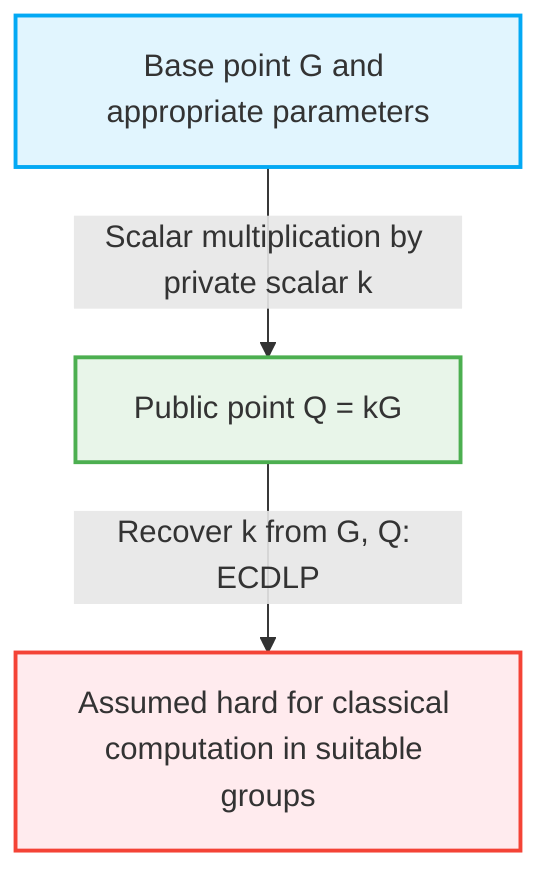

Public key cryptography supports communication between parties that do not already share a secret key. This article explains the mathematics of Diffie–Hellman (DH) key agreement, RSA, and elliptic curve cryptography (ECC). Equal key lengths do not imply equal estimated security across these systems, and their equations alone do not guarantee the security of a whole communication system.

## 1. Symmetric Cryptography and Key Distribution

The Caesar cipher and Enigma are historical examples in which the sender and receiver share secret settings. Modern symmetric cryptography also uses a shared secret key. These historical systems should not, however, be treated as equivalent to secure modern algorithms.

### The Key Distribution Problem

Sending a symmetric key directly over an unprotected channel exposes it to eavesdroppers. The problem is therefore how to establish a shared secret, and with whom. Public key techniques help address this problem, but authenticating the peer is also necessary.

Symmetric cryptography still has a role. For example, TLS 1.3 combines key agreement and authentication with authenticated encryption of data using derived keys. It does not encrypt all application data through public key operations.

## 2. Diffie–Hellman Key Agreement

Diffie and Hellman's 1976 paper described a way for two parties to compute the same secret value using publicly exchanged information. Here we consider finite-field DH.

### Discrete Logarithms and the Shared Value

Within the multiplicative group modulo a prime $p$, suppose we use a subgroup of large prime order $q$, generated by $g$. Here $q$ divides $p-1$. This $g$ generates the subgroup; it need not be a primitive root of the entire multiplicative group. Real protocols use specified, sufficiently strong parameters rather than small, independently invented values.

1. Alice uniformly selects a secret exponent $1\le a\le q-1$ using cryptographically secure randomness and sends $A=g^a\bmod p$.
2. Bob likewise selects $1\le b\le q-1$ and sends $B=g^b\bmod p$.
3. After validating the peer's public value as required by the scheme, Alice computes $B^a\bmod p$ and Bob computes $A^b\bmod p$.

$$
B^a\equiv (g^b)^a\equiv g^{ab}\equiv(g^a)^b\equiv A^b\pmod p.
$$

Call the resulting shared value $S$. Recovering $a$ from $A$ is the discrete logarithm problem (DLP); computing $S$ from $g,A,B$ is the computational Diffie–Hellman problem (CDH). Solving DLP also solves CDH, but this does not establish that they are always equally difficult. Security claims about DH must specify the group, protocol, and attacker's capabilities.

### Authentication, Public Value Validation, and Key Derivation

Unauthenticated DH does not prevent a man-in-the-middle attacker from modifying the exchange. By substituting public values, an attacker can establish separate shared values with Alice and Bob. Public value validation does not replace peer authentication.

Validation also depends on the parameters. For the prime-order subgroup above, checks include the correct range, subgroup membership, and exclusion of the identity. The $1<Y<p-1$ check in RFC 7919 for its known safe-prime groups must not be applied as a complete validation rule for arbitrary groups.

The value $S$ is not used directly as a symmetric key. Following the protocol, it is encoded and passed through a key derivation function (KDF) that binds contextual information and derives keys for specific purposes. The TLS 1.3 key schedule uses HKDF and the handshake transcript.

```mermaid
sequenceDiagram
    participant Alice
    participant Public
    participant Bob
    Alice->>Public: Agree on group parameters p, q, g
    Bob->>Public: Agree on group parameters p, q, g
    Alice->>Alice: Generate secret exponent a
    Bob->>Bob: Generate secret exponent b
    Alice->>Bob: Send A = g^a mod p
    Bob->>Alice: Send B = g^b mod p
    Alice->>Alice: Validate B, then S = B^a mod p
    Bob->>Bob: Validate A, then S = A^b mod p
    Note over Alice,Bob: Public values also require authentication; a KDF is needed
```

This diagram shows the arithmetic outline. It does not specify the authentication messages or the complete KDF procedure.

## 3. RSA and Euler's Theorem

RSA, developed by Rivest, Shamir, and Adleman, uses different mathematics from DH. Encryption schemes and signature schemes based on RSA have distinct designs.

### Keys and Integer Operations

For an educational account of two-prime RSA, choose distinct large odd primes $p,q$ and set $N=pq$. This $q$ is an RSA prime factor, separate from the subgroup order in the previous section.

$$
\phi(N)=(p-1)(q-1),\qquad ed\equiv1\pmod{\phi(N)}.
$$

Choose a public exponent satisfying $1<e<\phi(N)$ and $\gcd(e,\phi(N))=1$, and compute its inverse as a positive private exponent $d<\phi(N)$. These are sufficient conditions for this explanation. RFC 8017 instead specifies $ed\equiv1\pmod{\lambda(N)}$, where $\lambda(N)=\operatorname{lcm}(p-1,q-1)$. The public key is $(N,e)$; one private key representation is $(N,d)$. The private exponent $d$ is distinct from the complete key information.

For an integer representative $0\le M<N$, the basic operations are:

$$
C=M^e\bmod N,\qquad M=C^d\bmod N.
$$

The ciphertext representative $C$ is also an integer with $0\le C<N$. Here $M$ is not an arbitrary-length text or byte string itself.

### Why the Original Value Is Recovered

If $\gcd(M,N)=1$, Euler's theorem gives $M^{\phi(N)}\equiv1\pmod N$. Writing $ed=1+t\phi(N)$ with $t\ge0$ yields:

$$
M^{ed}=M\bigl(M^{\phi(N)}\bigr)^t\equiv M\pmod N.
$$

Euler's theorem cannot be applied directly when $M$ is not coprime to $N$. Instead, for each prime factor $r\in\{p,q\}$, if $M\equiv0\pmod r$, then $M^{ed}\equiv M\equiv0\pmod r$. Otherwise, Fermat's little theorem and the fact that $ed-1$ is a multiple of $r-1$ give $M^{ed}\equiv M\pmod r$. The Chinese remainder theorem combines these results modulo $N$. Recovery therefore works for every representative $0\le M<N$.

### Separating Correctness from Security

Factoring $N$ lets an attacker compute $\phi(N)$ and $d$. This does not prove that every attack on RSA requires factoring. Weak randomness, incorrect encoding, and implementation leakage can also cause failures.

Using the deterministic exponentiation above directly for encryption permits attacks such as testing a small set of candidates with the public key. Practical encryption schemes require dedicated encoding and checks, as in RSAES-OAEP; signature schemes do likewise, as in RSASSA-PSS. Signing is not the same as encrypting the message with a private key. Authenticating that a public key belongs to the intended party is also necessary.

## 4. Key Length and Estimated Security

RSA key length usually means the bit length of the modulus $N$. Computing resources and attack algorithms affect security estimates. A key length falling out of recommended use must not be confused with a claim that RSA-1024 moduli have universally been factored.

As a specific comparison, Table 2 of NIST SP 800-57 Part 1 Rev.5, published in 2020, places a 2048-bit RSA modulus in the row for an estimated maximum security strength of 112 bits, and a 3072-bit modulus in the 128-bit row. These are classical-computing estimates under that document's assumptions. They are neither universal present-day key-size recommendations nor records of successful decryption.

A longer modulus generally increases the costs of integer operations and storing or transmitting keys and signatures. Performance also depends on the public exponent, CRT optimizations, implementation, hardware, and operation being performed. Key length alone cannot establish which system is faster.

## 5. The Mathematics of Elliptic Curve Cryptography

Miller and Koblitz independently proposed using elliptic curves for cryptography in the 1980s. RFC 6090 cites Miller's CRYPTO '85 paper and Koblitz's 1987 paper. Proposal dates and publication years should be distinguished.

The same NIST table places ECC with a base-point order of 256–383 bits in the row for an estimated maximum security strength of 128 bits. This is the background to the RSA-3072 versus ECC-256 comparison. The ECC column measures the base-point order, not a 256-bit file size for a serialized public key containing coordinates. The comparison assumes appropriate parameters and key management, among other conditions.

### A Curve over a Finite Field

We restrict this explanation to a prime field $\mathbb F_p$ with $p>3$ and $a,b,x,y\in\mathbb F_p$. These parameters are separate from the RSA primes above.

$$
y^2\equiv x^3+ax+b\pmod p,\qquad 4a^3+27b^2\not\equiv0\pmod p.
$$

The second condition ensures that the curve is nonsingular over this field. Being nonzero as an integer is insufficient. We define addition on the curve's points together with the identity element, the point at infinity $\mathcal O$. This equation alone does not give the general treatment of fields of characteristic 2 or 3.

### Point Addition and Its Exceptional Cases

Over the real numbers, addition can be pictured by drawing a line through two points and reflecting its third intersection with the curve across the horizontal axis. Over a finite field, we compute the corresponding algebraic formulas modulo $p$. For $P=(x_1,y_1)$ and $Q=(x_2,y_2)$, the slope in the ordinary cases is:

$$
s=\begin{cases}
(y_2-y_1)(x_2-x_1)^{-1} & (x_1\ne x_2),\\
(3x_1^2+a)(2y_1)^{-1} & (P=Q,\ y_1\ne0).
\end{cases}
$$

$$
x_3=s^2-x_1-x_2,\qquad y_3=s(x_1-x_3)-y_1\quad\text{in }\mathbb F_p.
$$

Only nonzero field elements have multiplicative inverses. These formulas must not be used with a zero denominator.

$$
P+\mathcal O=P,\qquad -P=(x_1,-y_1),\qquad P+(-P)=\mathcal O.
$$

If $P=Q$ and $y_1=0$, then $2P=\mathcal O$. Computing $P+P$ is point doubling, a particular instance of scalar multiplication, which computes general integer multiples.

### Scalar Multiplication and ECDLP

Use a base point $G$ generating a subgroup of large prime order $n$. Its order is the smallest positive integer satisfying $nG=\mathcal O$. Uniformly select a private scalar $1\le k\le n-1$ using cryptographically secure randomness.

$$
Q=kG=\underbrace{G+\cdots+G}_{k\text{ terms}}.
$$

Here $k$ is the private key and $Q$ the public key. The field prime $p$, subgroup order $n$, and private scalar $k$ have different roles. Recovering $k$ from $G,Q$ is the elliptic curve discrete logarithm problem (ECDLP).

RFC 6090 describes generic classical attacks such as Pollard rho as taking roughly $O(\sqrt n)$ group operations. For an approximately 256-bit $n$, that scale is about $2^{128}$. This estimate is exponential in the bit length; it is not a proof of hardness for every curve. Attacks on special curves also exist, so curve and subgroup selection, public point validation, and defenses against implementation leakage matter.



## 6. Protocol Roles and Quantum Computing

ECC is not the name of a single encryption scheme. For example, ECDH provides key agreement, whereas ECDSA provides signatures. ECDH also requires protocol-specific key derivation from the shared point, public value validation, and authentication.

In TLS 1.3, key agreement such as ECDHE, signatures such as ECDSA or RSA-PSS, and authenticated encryption using derived symmetric keys have different roles. Pre-shared-key modes also exist. RSA key transport was removed from TLS 1.3; that does not mean RSA signatures were removed. Changing to ECC does not guarantee that every operation becomes faster.

### Quantum Computers and Post-Quantum Cryptography

Shor's algorithm solves factoring and discrete logarithms in a number of steps polynomial in the input bit length on a sufficiently capable quantum computer. It threatens RSA and conventional ECC, but polynomial time does not mean instant execution or predict when such a machine will exist.

Post-quantum cryptography (PQC) aims to provide functions such as key establishment and signatures under different assumptions that account for quantum attacks. It is not a guarantee of being unbreakable even by quantum computers. Individual schemes, implementations, and the protocols being migrated need evaluation.

## Conclusion

DH computes shared values, RSA uses modular exponentiation of integers, and ECC uses group operations on finite-field points. After meeting the mathematical conditions, protocols combine authentication, key derivation, appropriate encoding and validation, and key management to protect communication. Short keys or correct equations alone do not establish the security of the whole system.

## References

- [RFC 7919 §5.1: public value validation for known FFDHE groups](https://www.rfc-editor.org/rfc/rfc7919.html#section-5.1)
- [RFC 8017: RSA keys, primitives, OAEP, and PSS](https://www.rfc-editor.org/rfc/rfc8017.html)
- [RFC 6090 §§2–4 and 10: finite fields, curve operations, ECDH, and security conditions](https://www.rfc-editor.org/rfc/rfc6090.html)
- [NIST SP 800-57 Part 1 Rev.5 (2020), §5.6.1.1 and Table 2: estimated security strengths](https://csrc.nist.gov/pubs/sp/800/57/pt1/r5/final)
- [RFC 8446: TLS 1.3 protocol roles and key schedule](https://www.rfc-editor.org/rfc/rfc8446.html)
- [Shor: abstract of the quantum factoring and discrete logarithm paper](https://arxiv.org/abs/quant-ph/9508027)
