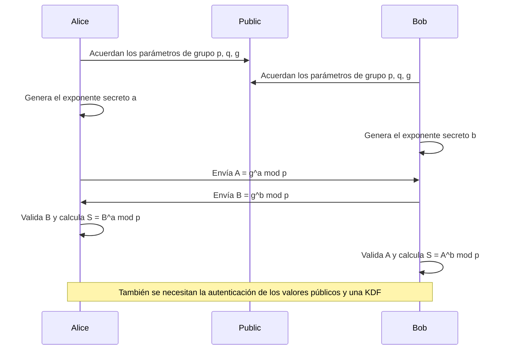
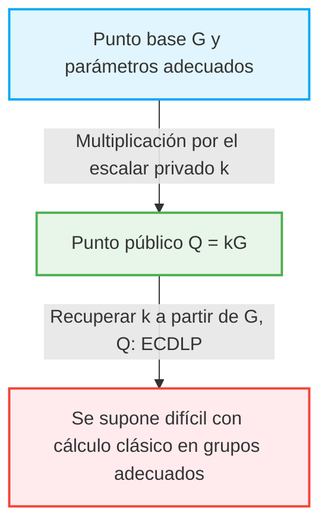

La criptografía de clave pública permite establecer comunicaciones entre partes que no comparten previamente una clave secreta. Este artículo explica las matemáticas del acuerdo de claves Diffie–Hellman (DH), RSA y la criptografía de curvas elípticas (ECC). Una misma longitud de clave no implica la misma seguridad estimada en sistemas diferentes, y las ecuaciones por sí solas no garantizan la seguridad de toda la comunicación.

## 1. Criptografía simétrica y distribución de claves

El cifrado César y Enigma son ejemplos históricos en los que emisor y receptor comparten una configuración secreta. La criptografía simétrica moderna también utiliza una clave secreta compartida. Sin embargo, esos sistemas históricos no deben considerarse equivalentes a los algoritmos modernos seguros.

### El problema de distribución de claves

Enviar directamente una clave simétrica por un canal sin protección la expone a quien escuche. El problema es cómo establecer un secreto compartido y con quién. Las técnicas de clave pública ayudan a resolverlo, pero también es necesario autenticar a la otra parte.

La criptografía simétrica conserva su función. Por ejemplo, TLS 1.3 combina acuerdo de claves y autenticación con cifrado autenticado de los datos mediante claves derivadas. No cifra todos los datos de aplicación mediante operaciones de clave pública.

## 2. Acuerdo de claves Diffie–Hellman

El artículo de Diffie y Hellman de 1976 describió cómo dos partes pueden calcular el mismo valor secreto a partir de información intercambiada públicamente. Aquí consideramos DH sobre un cuerpo finito.

### Logaritmos discretos y valor compartido

Dentro del grupo multiplicativo módulo un primo $p$, supongamos que usamos un subgrupo de orden primo grande $q$, generado por $g$, donde $q$ divide a $p-1$. Este $g$ genera el subgrupo; no tiene por qué ser una raíz primitiva de todo el grupo multiplicativo. Los protocolos reales utilizan parámetros especificados y suficientemente fuertes, no valores pequeños inventados para proteger datos reales.

1. Alice elige uniformemente un exponente secreto $1\le a\le q-1$ con un generador aleatorio criptográficamente seguro y envía $A=g^a\bmod p$.
2. Bob elige del mismo modo $1\le b\le q-1$ y envía $B=g^b\bmod p$.
3. Tras validar el valor público recibido según el esquema, Alice calcula $B^a\bmod p$ y Bob calcula $A^b\bmod p$.

$$
B^a\equiv (g^b)^a\equiv g^{ab}\equiv(g^a)^b\equiv A^b\pmod p.
$$

Llamamos $S$ al valor compartido. Recuperar $a$ a partir de $A$ es el problema del logaritmo discreto (DLP); calcular $S$ a partir de $g,A,B$ es el problema computacional de Diffie–Hellman (CDH). Resolver DLP permite resolver CDH, pero esto no demuestra que siempre tengan la misma dificultad. Una afirmación de seguridad sobre DH debe especificar el grupo, el protocolo y las capacidades del atacante.

### Autenticación, validación de valores públicos y derivación de claves

DH sin autenticación no impide un ataque de intermediario que modifique el intercambio. Sustituyendo valores públicos, el atacante puede establecer valores compartidos distintos con Alice y Bob. Validar los valores públicos no sustituye la autenticación de la otra parte.

La validación también depende de los parámetros. Para el subgrupo de orden primo anterior, incluye comprobar el intervalo correcto, la pertenencia al subgrupo y la exclusión del elemento neutro. La comprobación $1<Y<p-1$ de RFC 7919 para sus grupos conocidos de primos seguros no debe aplicarse como regla completa para grupos arbitrarios.

El valor $S$ no se utiliza directamente como clave simétrica. Se codifica según el protocolo y pasa por una función de derivación de claves (KDF), que incorpora información de contexto y deriva claves para fines distintos. El esquema de derivación de TLS 1.3 utiliza HKDF y el registro de mensajes del intercambio inicial.

El diagrama muestra el esquema aritmético, no los mensajes concretos de autenticación ni el procedimiento completo de la KDF.

## 3. RSA y el teorema de Euler

RSA, desarrollado por Rivest, Shamir y Adleman, utiliza matemáticas diferentes de las de DH. Los esquemas de cifrado y de firma basados en RSA tienen diseños distintos.

### Claves y operaciones con enteros

Como modelo didáctico de RSA con dos primos, elegimos primos impares grandes y distintos $p,q$, y fijamos $N=pq$. Este $q$ es un factor primo de RSA, diferente del orden del subgrupo de la sección anterior.

$$
\phi(N)=(p-1)(q-1),\qquad ed\equiv1\pmod{\phi(N)}.
$$

Elegimos un exponente público que cumpla $1<e<\phi(N)$ y $\gcd(e,\phi(N))=1$, y calculamos su inverso como exponente privado positivo $d<\phi(N)$. Son condiciones suficientes para esta explicación. RFC 8017 utiliza la condición $ed\equiv1\pmod{\lambda(N)}$, donde $\lambda(N)=\operatorname{lcm}(p-1,q-1)$. La clave pública es $(N,e)$; una representación de la clave privada es $(N,d)$. El exponente privado $d$ se distingue de la información completa de la clave.

Para un representante entero $0\le M<N$, las operaciones básicas son:

$$
C=M^e\bmod N,\qquad M=C^d\bmod N.
$$

El representante del texto cifrado $C$ también es un entero con $0\le C<N$. Aquí $M$ no es directamente un texto o una cadena de bytes de longitud arbitraria.

### Por qué se recupera el valor original

Si $\gcd(M,N)=1$, el teorema de Euler da $M^{\phi(N)}\equiv1\pmod N$. Escribiendo $ed=1+t\phi(N)$, con $t\ge0$, obtenemos:

$$
M^{ed}=M\bigl(M^{\phi(N)}\bigr)^t\equiv M\pmod N.
$$

El teorema de Euler no se aplica directamente si $M$ no es coprimo con $N$. Para cada factor primo $r\in\{p,q\}$, si $M\equiv0\pmod r$, entonces $M^{ed}\equiv M\equiv0\pmod r$. En otro caso, el pequeño teorema de Fermat y el hecho de que $ed-1$ sea múltiplo de $r-1$ dan $M^{ed}\equiv M\pmod r$. El teorema chino del resto combina ambos resultados módulo $N$. Así se recupera cualquier representante $0\le M<N$.

### Corrección matemática y seguridad

Factorizar $N$ permite calcular $\phi(N)$ y $d$. Esto no demuestra que todo ataque contra RSA requiera factorizar. Una aleatoriedad débil, una codificación incorrecta o las filtraciones de la implementación también pueden provocar fallos.

Usar directamente la exponenciación determinista anterior para cifrar permite ataques como probar un conjunto pequeño de mensajes candidatos con la clave pública. Los esquemas prácticos necesitan codificaciones y comprobaciones específicas: por ejemplo, RSAES-OAEP para cifrar y RSASSA-PSS para firmar. Firmar no equivale a cifrar el mensaje con una clave privada. También es necesario autenticar que la clave pública pertenece a la parte prevista.

## 4. Longitud de clave y seguridad estimada

La longitud de una clave RSA suele ser la longitud en bits del módulo $N$. Los recursos de cálculo y los algoritmos de ataque afectan a las estimaciones. Que una longitud deje de recomendarse no equivale a afirmar que los módulos RSA-1024 hayan sido factorizados de forma general.

Como comparación concreta, la tabla 2 de NIST SP 800-57 Part 1 Rev.5, publicada en 2020, sitúa los módulos RSA de 2048 bits en la fila de resistencia máxima estimada de 112 bits y los de 3072 bits en la de 128 bits. Son estimaciones frente al cálculo clásico bajo las hipótesis del documento, no recomendaciones universales actuales ni registros de descifrado exitoso.

Un módulo mayor suele aumentar el costo de las operaciones con enteros y del almacenamiento y transmisión de claves y firmas. El rendimiento también depende del exponente público, las optimizaciones CRT, la implementación, el hardware y la operación realizada. La longitud de clave por sí sola no determina qué sistema es más rápido.

## 5. Las matemáticas de la criptografía de curvas elípticas

Miller y Koblitz propusieron de forma independiente el uso criptográfico de curvas elípticas en la década de 1980. RFC 6090 cita el artículo de Miller de CRYPTO '85 y el de Koblitz de 1987. Conviene distinguir la fecha de propuesta del año de publicación.

La misma tabla de NIST sitúa ECC con un orden del punto base de 256–383 bits en la fila de resistencia máxima estimada de 128 bits. Este es el contexto de la comparación RSA-3072 frente a ECC-256. La columna de ECC mide la longitud del orden del punto base; no dice que un archivo de clave pública serializada con coordenadas ocupe 256 bits. La comparación presupone parámetros y gestión de claves adecuados, entre otras condiciones.

### Una curva sobre un cuerpo finito

Nos restringimos a un cuerpo primo $\mathbb F_p$, con $p>3$ y $a,b,x,y\in\mathbb F_p$. Estos parámetros son distintos de los primos de RSA anteriores.

$$
y^2\equiv x^3+ax+b\pmod p,\qquad 4a^3+27b^2\not\equiv0\pmod p.
$$

La segunda condición garantiza que la curva no sea singular sobre ese cuerpo. No basta con que la expresión sea distinta de cero como entero. Se define una suma sobre los puntos de la curva junto con el elemento neutro, el punto del infinito $\mathcal O$. Esta ecuación no cubre el tratamiento general de los cuerpos de característica 2 o 3.

### Suma de puntos y casos excepcionales

Sobre los reales, la suma se ilustra trazando una recta por dos puntos y reflejando su tercera intersección con la curva respecto al eje horizontal. Sobre un cuerpo finito, se calculan las fórmulas algebraicas correspondientes módulo $p$. Para $P=(x_1,y_1)$ y $Q=(x_2,y_2)$, la pendiente en los casos ordinarios es:

$$
s=\begin{cases}
(y_2-y_1)(x_2-x_1)^{-1} & (x_1\ne x_2),\\
(3x_1^2+a)(2y_1)^{-1} & (P=Q,\ y_1\ne0).
\end{cases}
$$

$$
x_3=s^2-x_1-x_2,\qquad y_3=s(x_1-x_3)-y_1\quad\text{in }\mathbb F_p.
$$

Solo los elementos no nulos del cuerpo tienen inverso multiplicativo. Estas fórmulas no deben usarse cuando el denominador es cero.

$$
P+\mathcal O=P,\qquad -P=(x_1,-y_1),\qquad P+(-P)=\mathcal O.
$$

Si $P=Q$ y $y_1=0$, entonces $2P=\mathcal O$. Calcular $P+P$ es la duplicación de un punto, un caso particular de la multiplicación escalar, que calcula múltiplos enteros generales.

### Multiplicación escalar y ECDLP

Usamos un punto base $G$ que genere un subgrupo de orden primo grande $n$. Su orden es el menor entero positivo que cumple $nG=\mathcal O$. Elegimos uniformemente un escalar privado $1\le k\le n-1$ usando aleatoriedad criptográficamente segura.

$$
Q=kG=\underbrace{G+\cdots+G}_{k\text{ terms}}.
$$

$k$ es la clave privada y $Q$ la pública. El primo del cuerpo $p$, el orden del subgrupo $n$ y el escalar privado $k$ tienen funciones distintas. Recuperar $k$ a partir de $G,Q$ es el problema del logaritmo discreto en curvas elípticas (ECDLP).

RFC 6090 describe ataques clásicos genéricos como Pollard rho con un costo aproximado de $O(\sqrt n)$ operaciones de grupo. Para un $n$ de unos 256 bits, la escala es aproximadamente $2^{128}$. Es una estimación exponencial en la longitud en bits, no una demostración de dificultad para todas las curvas. Existen ataques específicos contra curvas especiales; por ello importan la elección de curva y subgrupo, la validación de puntos públicos y la protección frente a filtraciones de la implementación.

## 6. Funciones en los protocolos y cálculo cuántico

ECC no es el nombre de un único esquema de cifrado. Por ejemplo, ECDH sirve para acordar claves y ECDSA para firmar. ECDH también requiere derivar claves a partir del punto compartido según el protocolo, validar los valores públicos y autenticar a las partes.

En TLS 1.3, el acuerdo de claves, por ejemplo ECDHE, las firmas, como ECDSA o RSA-PSS, y el cifrado autenticado con claves simétricas derivadas cumplen funciones distintas. También hay modos con claves precompartidas. TLS 1.3 eliminó el transporte de claves RSA, pero no por ello las firmas RSA. Cambiar a ECC no garantiza que todas las operaciones sean más rápidas.

### Computadoras cuánticas y criptografía poscuántica

El algoritmo de Shor resuelve la factorización y los logaritmos discretos en un número de pasos polinómico en la longitud en bits de la entrada, sobre una computadora cuántica suficientemente capaz. Amenaza RSA y ECC convencional, pero tiempo polinómico no significa ejecución instantánea ni predice cuándo existirá esa máquina.

La criptografía poscuántica (PQC) busca proporcionar funciones como establecimiento de claves y firmas bajo otros supuestos que tengan en cuenta los ataques cuánticos. No garantiza que sea imposible romperla incluso con computadoras cuánticas. Hay que evaluar cada esquema, su implementación y los protocolos que se migren.

## Conclusión

DH calcula valores compartidos, RSA utiliza exponenciación modular de enteros y ECC usa operaciones de grupo sobre puntos de un cuerpo finito. Tras cumplir las condiciones matemáticas, los protocolos combinan autenticación, derivación de claves, codificación y validación apropiadas y gestión de claves para proteger la comunicación. Las claves cortas o las ecuaciones correctas, por sí solas, no establecen la seguridad de todo el sistema.

## Referencias

- [RFC 7919 §5.1: validación de valores públicos en grupos FFDHE conocidos](https://www.rfc-editor.org/rfc/rfc7919.html#section-5.1)
- [RFC 8017: claves RSA, primitivas, OAEP y PSS](https://www.rfc-editor.org/rfc/rfc8017.html)
- [RFC 6090 §§2–4 y 10: cuerpos finitos, operaciones de curva, ECDH y condiciones de seguridad](https://www.rfc-editor.org/rfc/rfc6090.html)
- [NIST SP 800-57 Part 1 Rev.5 (2020), §5.6.1.1 y Table 2: resistencia estimada](https://csrc.nist.gov/pubs/sp/800/57/pt1/r5/final)
- [RFC 8446: funciones del protocolo y derivación de claves en TLS 1.3](https://www.rfc-editor.org/rfc/rfc8446.html)
- [Shor: resumen del artículo sobre factorización y logaritmos discretos cuánticos](https://arxiv.org/abs/quant-ph/9508027)
