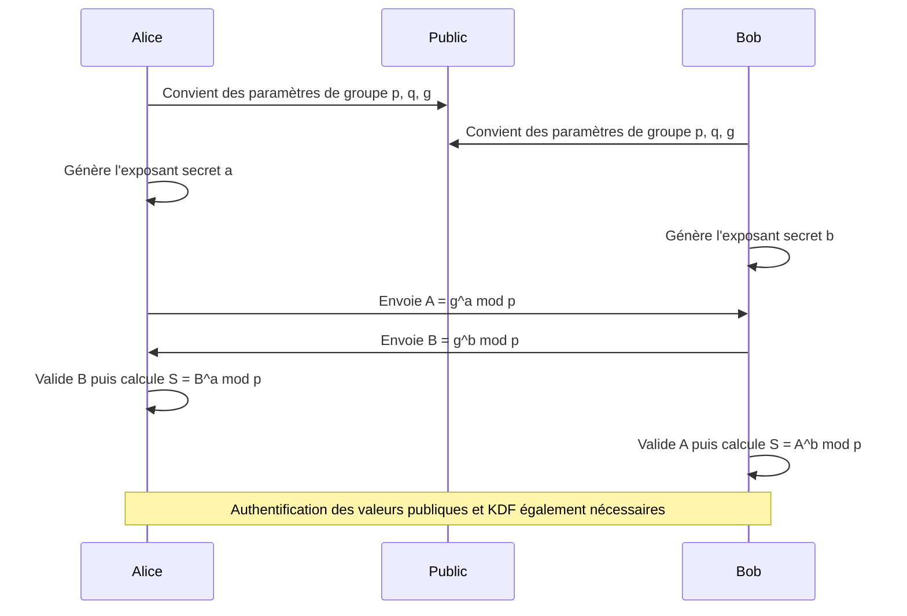
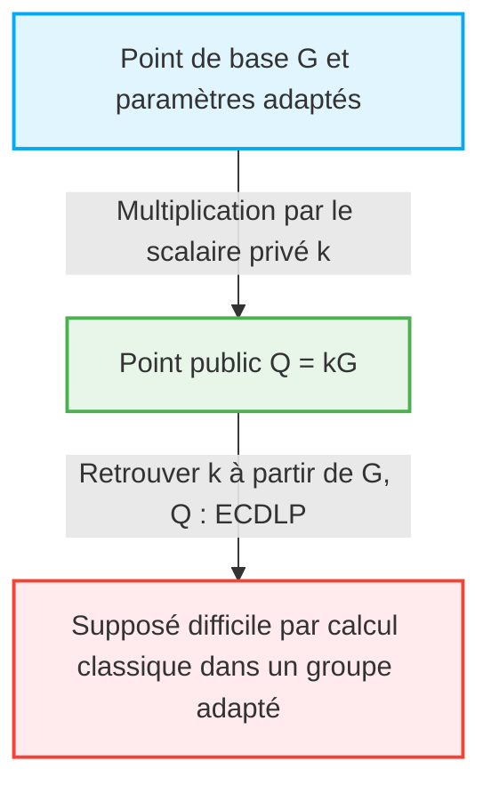

La cryptographie à clé publique permet d'établir des communications entre des parties qui ne partagent pas déjà une clé secrète. Cet article explique les mathématiques de l'accord de clés Diffie–Hellman (DH), de RSA et de la cryptographie sur les courbes elliptiques (ECC). Une même longueur de clé n'implique pas la même sécurité estimée dans des systèmes différents, et les équations ne garantissent pas, à elles seules, la sécurité de toute la communication.

## 1. Cryptographie symétrique et distribution des clés

Le chiffre de César et Enigma sont des exemples historiques dans lesquels l'émetteur et le destinataire partagent des réglages secrets. La cryptographie symétrique moderne utilise elle aussi une clé secrète partagée. Ces systèmes historiques ne doivent toutefois pas être assimilés aux algorithmes modernes sûrs.

### Le problème de distribution des clés

Envoyer directement une clé symétrique sur un canal non protégé la révèle aussi à quiconque écoute. Le problème consiste donc à établir un secret partagé, et à savoir avec qui. Les techniques à clé publique y contribuent, mais l'authentification de l'interlocuteur reste nécessaire.

La cryptographie symétrique conserve son rôle. Par exemple, TLS 1.3 combine accord de clés et authentification avec le chiffrement authentifié des données au moyen de clés dérivées. Il ne chiffre pas toutes les données applicatives par des opérations à clé publique.

## 2. Accord de clés Diffie–Hellman

L'article de Diffie et Hellman de 1976 décrivait comment deux parties peuvent calculer la même valeur secrète à partir d'informations échangées publiquement. Nous considérons ici DH sur un corps fini.

### Logarithmes discrets et valeur partagée

Dans le groupe multiplicatif modulo un nombre premier $p$, supposons que l'on utilise un sous-groupe d'ordre premier élevé $q$, engendré par $g$, où $q$ divise $p-1$. Ce $g$ engendre le sous-groupe ; il n'est pas nécessairement une racine primitive du groupe multiplicatif entier. Les protocoles réels utilisent des paramètres spécifiés et suffisamment robustes, plutôt que de petites valeurs inventées pour protéger des données réelles.

1. Alice choisit uniformément un exposant secret $1\le a\le q-1$ à l'aide d'un générateur aléatoire cryptographiquement sûr, et envoie $A=g^a\bmod p$.
2. Bob choisit de même $1\le b\le q-1$ et envoie $B=g^b\bmod p$.
3. Après validation de la valeur publique reçue selon le schéma, Alice calcule $B^a\bmod p$ et Bob calcule $A^b\bmod p$.

$$
B^a\equiv (g^b)^a\equiv g^{ab}\equiv(g^a)^b\equiv A^b\pmod p.
$$

Notons $S$ la valeur partagée. Retrouver $a$ à partir de $A$ est le problème du logarithme discret (DLP) ; calculer $S$ à partir de $g,A,B$ est le problème calculatoire de Diffie–Hellman (CDH). Résoudre DLP permet de résoudre CDH, sans démontrer que les deux problèmes ont toujours la même difficulté. Une affirmation de sécurité concernant DH doit préciser le groupe, le protocole et les capacités de l'attaquant.

### Authentification, validation des valeurs publiques et dérivation des clés

DH sans authentification n'empêche pas une attaque de l'homme du milieu qui modifie les échanges. En substituant des valeurs publiques, l'attaquant peut établir des valeurs partagées distinctes avec Alice et Bob. La validation des valeurs publiques ne remplace pas l'authentification de l'interlocuteur.

La validation dépend aussi des paramètres. Pour le sous-groupe d'ordre premier décrit ci-dessus, elle comprend le contrôle de l'intervalle, de l'appartenance au sous-groupe et de l'exclusion de l'élément neutre. Le contrôle $1<Y<p-1$ de la RFC 7919 pour ses groupes connus fondés sur des nombres premiers sûrs ne constitue pas une règle complète pour des groupes arbitraires.

La valeur $S$ ne sert pas directement de clé symétrique. Elle est encodée conformément au protocole, puis traitée par une fonction de dérivation de clés (KDF) qui incorpore des informations de contexte et produit des clés pour des usages distincts. Le mécanisme de dérivation de TLS 1.3 utilise HKDF et la transcription des messages de négociation.

Le diagramme montre la structure arithmétique, pas les messages d'authentification ni la procédure complète de la KDF.

## 3. RSA et le théorème d'Euler

RSA, développé par Rivest, Shamir et Adleman, repose sur des mathématiques différentes de celles de DH. Les schémas de chiffrement et de signature fondés sur RSA sont conçus différemment.

### Clés et opérations sur les entiers

Pour un modèle pédagogique de RSA à deux facteurs premiers, choisissons des nombres premiers impairs, grands et distincts $p,q$, et posons $N=pq$. Ce $q$ est un facteur premier de RSA, distinct de l'ordre du sous-groupe de la section précédente.

$$
\phi(N)=(p-1)(q-1),\qquad ed\equiv1\pmod{\phi(N)}.
$$

Choisissons un exposant public vérifiant $1<e<\phi(N)$ et $\gcd(e,\phi(N))=1$, puis calculons son inverse comme exposant privé positif $d<\phi(N)$. Ces conditions suffisent pour cette explication. La RFC 8017 utilise la condition $ed\equiv1\pmod{\lambda(N)}$, où $\lambda(N)=\operatorname{lcm}(p-1,q-1)$. La clé publique est $(N,e)$ ; une représentation de la clé privée est $(N,d)$. L'exposant privé $d$ se distingue des informations complètes de la clé.

Pour un représentant entier $0\le M<N$, les opérations de base sont :

$$
C=M^e\bmod N,\qquad M=C^d\bmod N.
$$

Le représentant du chiffré $C$ est également un entier avec $0\le C<N$. Ici, $M$ n'est pas directement un texte ou une chaîne d'octets de longueur arbitraire.

### Pourquoi retrouve-t-on la valeur initiale ?

Si $\gcd(M,N)=1$, le théorème d'Euler donne $M^{\phi(N)}\equiv1\pmod N$. En écrivant $ed=1+t\phi(N)$ avec $t\ge0$, on obtient :

$$
M^{ed}=M\bigl(M^{\phi(N)}\bigr)^t\equiv M\pmod N.
$$

Le théorème d'Euler ne s'applique pas directement si $M$ et $N$ ne sont pas premiers entre eux. Pour chaque facteur premier $r\in\{p,q\}$, si $M\equiv0\pmod r$, alors $M^{ed}\equiv M\equiv0\pmod r$. Sinon, le petit théorème de Fermat et le fait que $ed-1$ soit un multiple de $r-1$ donnent $M^{ed}\equiv M\pmod r$. Le théorème chinois des restes combine les deux résultats modulo $N$. On retrouve ainsi chaque représentant $0\le M<N$.

### Correction mathématique et sécurité

Factoriser $N$ permet de calculer $\phi(N)$ et $d$. Cela ne prouve pas que toute attaque contre RSA exige une factorisation. Un aléa insuffisant, un encodage incorrect ou des fuites de l'implémentation peuvent aussi provoquer des défaillances.

Employer directement l'exponentiation déterministe ci-dessus pour chiffrer permet notamment de tester un petit ensemble de messages candidats avec la clé publique. Les schémas pratiques exigent des encodages et vérifications dédiés, comme RSAES-OAEP pour le chiffrement et RSASSA-PSS pour la signature. Signer ne revient pas à chiffrer le message avec une clé privée. Il faut aussi authentifier le lien entre la clé publique et son propriétaire attendu.

## 4. Longueur de clé et sécurité estimée

La longueur d'une clé RSA désigne généralement celle du module $N$ en bits. Les ressources de calcul et les algorithmes d'attaque influencent les estimations. L'abandon d'une longueur dans des recommandations ne signifie pas que les modules RSA-1024 ont été factorisés de manière générale.

À titre de comparaison précise, le tableau 2 de NIST SP 800-57 Part 1 Rev.5, publié en 2020, place les modules RSA de 2048 bits sur la ligne de résistance maximale estimée de 112 bits, et ceux de 3072 bits sur celle de 128 bits. Il s'agit d'estimations face au calcul classique sous les hypothèses du document, et non de recommandations actuelles universelles ou de relevés de déchiffrements réussis.

Un module plus long augmente généralement le coût des opérations entières et du stockage et transfert des clés et signatures. Les performances dépendent aussi de l'exposant public, des optimisations CRT, de l'implémentation, du matériel et de l'opération. La longueur de clé ne suffit pas à déterminer quel système est plus rapide.

## 5. Les mathématiques des courbes elliptiques

Miller et Koblitz ont proposé indépendamment l'usage cryptographique des courbes elliptiques dans les années 1980. La RFC 6090 cite l'article de Miller à CRYPTO '85 et celui de Koblitz de 1987. Il faut distinguer la date de proposition de l'année de publication.

Le même tableau du NIST place l'ECC dont l'ordre du point de base comporte 256–383 bits sur la ligne de résistance maximale estimée de 128 bits. C'est le contexte de la comparaison RSA-3072 et ECC-256. La colonne ECC mesure la longueur de l'ordre du point de base ; elle ne dit pas qu'un fichier de clé publique sérialisée contenant des coordonnées occupe 256 bits. La comparaison suppose notamment des paramètres et une gestion des clés adaptés.

### Une courbe sur un corps fini

Limitons-nous au corps premier $\mathbb F_p$, avec $p>3$ et $a,b,x,y\in\mathbb F_p$. Ces paramètres sont distincts des nombres premiers de RSA ci-dessus.

$$
y^2\equiv x^3+ax+b\pmod p,\qquad 4a^3+27b^2\not\equiv0\pmod p.
$$

La seconde condition garantit que la courbe est non singulière sur ce corps. Il ne suffit pas que l'expression soit non nulle en tant qu'entier. On définit une addition sur les points de la courbe auxquels on ajoute l'élément neutre, le point à l'infini $\mathcal O$. Cette équation ne couvre pas le traitement général des corps de caractéristique 2 ou 3.

### Addition de points et cas particuliers

Sur les réels, on illustre l'addition en traçant une droite par deux points, puis en réfléchissant sa troisième intersection avec la courbe par rapport à l'axe horizontal. Sur un corps fini, on calcule les formules algébriques correspondantes modulo $p$. Pour $P=(x_1,y_1)$ et $Q=(x_2,y_2)$, la pente dans les cas ordinaires est :

$$
s=\begin{cases}
(y_2-y_1)(x_2-x_1)^{-1} & (x_1\ne x_2),\\
(3x_1^2+a)(2y_1)^{-1} & (P=Q,\ y_1\ne0).
\end{cases}
$$

$$
x_3=s^2-x_1-x_2,\qquad y_3=s(x_1-x_3)-y_1\quad\text{in }\mathbb F_p.
$$

Seuls les éléments non nuls du corps possèdent un inverse multiplicatif. Ces formules ne doivent pas être utilisées si le dénominateur est nul.

$$
P+\mathcal O=P,\qquad -P=(x_1,-y_1),\qquad P+(-P)=\mathcal O.
$$

Si $P=Q$ et $y_1=0$, alors $2P=\mathcal O$. Calculer $P+P$ est le doublement d'un point, cas particulier de la multiplication scalaire qui calcule des multiples entiers généraux.

### Multiplication scalaire et ECDLP

On utilise un point de base $G$ qui engendre un sous-groupe de grand ordre premier $n$. Cet ordre est le plus petit entier strictement positif tel que $nG=\mathcal O$. On choisit uniformément un scalaire privé $1\le k\le n-1$ avec un aléa cryptographiquement sûr.

$$
Q=kG=\underbrace{G+\cdots+G}_{k\text{ terms}}.
$$

$k$ est la clé privée et $Q$ la clé publique. Le nombre premier du corps $p$, l'ordre du sous-groupe $n$ et le scalaire privé $k$ ont des rôles distincts. Retrouver $k$ à partir de $G,Q$ est le problème du logarithme discret sur courbe elliptique (ECDLP).

La RFC 6090 décrit des attaques classiques génériques comme Pollard rho avec un coût de l'ordre de $O(\sqrt n)$ opérations de groupe. Pour un $n$ d'environ 256 bits, cette échelle est d'environ $2^{128}$. L'estimation est exponentielle en la longueur en bits ; elle ne démontre pas la difficulté pour toutes les courbes. Des attaques visent aussi des courbes particulières. Le choix de la courbe et du sous-groupe, la validation des points publics et la protection contre les fuites de l'implémentation sont donc essentiels.

## 6. Rôles dans les protocoles et calcul quantique

ECC ne désigne pas un seul schéma de chiffrement. Par exemple, ECDH sert à l'accord de clés, tandis qu'ECDSA est un schéma de signature. ECDH exige aussi une dérivation des clés à partir du point partagé selon le protocole, une validation des valeurs publiques et une authentification.

Dans TLS 1.3, l'accord de clés, par exemple ECDHE, les signatures comme ECDSA ou RSA-PSS, et le chiffrement authentifié avec des clés symétriques dérivées ont des rôles distincts. Des modes à clé prépartagée existent aussi. TLS 1.3 a supprimé le transport de clés RSA, sans pour autant supprimer les signatures RSA. Passer à l'ECC ne garantit pas que toutes les opérations deviennent plus rapides.

### Ordinateurs quantiques et cryptographie post-quantique

L'algorithme de Shor résout la factorisation et les logarithmes discrets en un nombre d'étapes polynomial en la longueur en bits de l'entrée sur un ordinateur quantique suffisamment capable. Il menace RSA et l'ECC conventionnelle, mais un temps polynomial ne signifie pas une exécution instantanée et ne prédit pas quand une telle machine existera.

La cryptographie post-quantique (PQC) cherche à fournir notamment l'établissement de clés et les signatures sous d'autres hypothèses tenant compte des attaques quantiques. Elle ne garantit pas d'être impossible à casser, même par des ordinateurs quantiques. Il faut évaluer chaque schéma, son implémentation et les protocoles concernés par la migration.

## Conclusion

DH calcule des valeurs partagées, RSA utilise l'exponentiation modulaire d'entiers et l'ECC des opérations de groupe sur des points d'un corps fini. Après avoir satisfait les conditions mathématiques, les protocoles combinent authentification, dérivation de clés, encodage et validation adaptés, et gestion des clés pour protéger la communication. Des clés courtes ou des équations correctes ne suffisent pas à établir la sécurité de tout le système.

## Références

- [RFC 7919 §5.1 : validation des valeurs publiques dans les groupes FFDHE connus](https://www.rfc-editor.org/rfc/rfc7919.html#section-5.1)
- [RFC 8017 : clés RSA, primitives, OAEP et PSS](https://www.rfc-editor.org/rfc/rfc8017.html)
- [RFC 6090 §§2–4 et 10 : corps finis, opérations de courbe, ECDH et conditions de sécurité](https://www.rfc-editor.org/rfc/rfc6090.html)
- [NIST SP 800-57 Part 1 Rev.5 (2020), §5.6.1.1 et tableau 2 : résistance estimée](https://csrc.nist.gov/pubs/sp/800/57/pt1/r5/final)
- [RFC 8446 : rôles du protocole et dérivation des clés dans TLS 1.3](https://www.rfc-editor.org/rfc/rfc8446.html)
- [Shor : résumé de l'article sur la factorisation et les logarithmes discrets quantiques](https://arxiv.org/abs/quant-ph/9508027)
