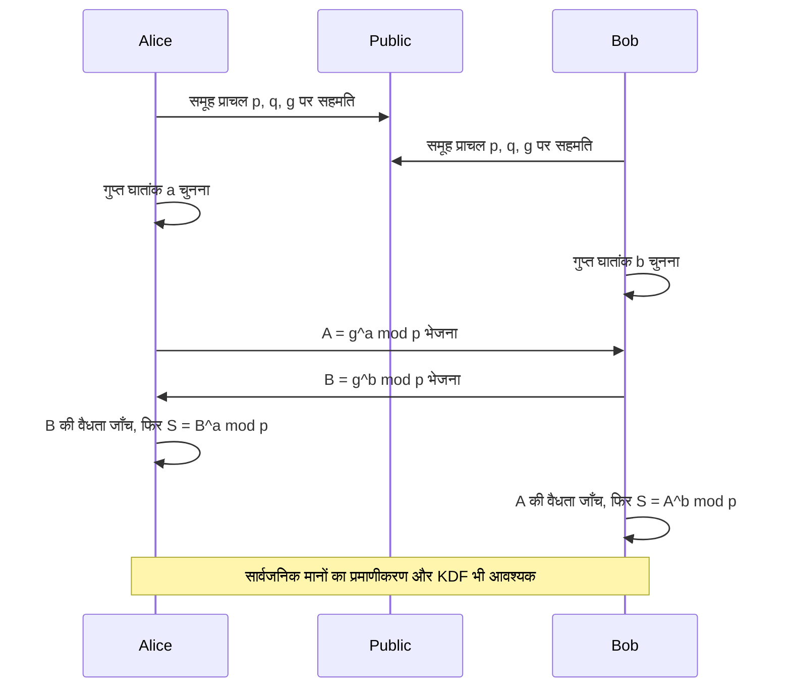
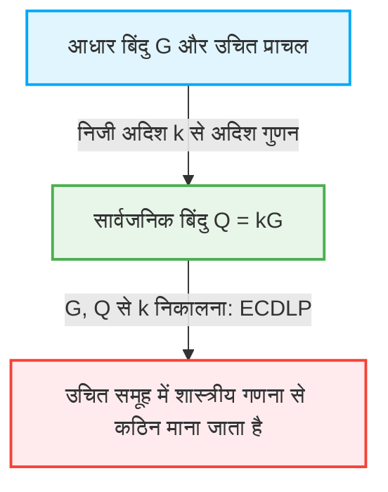

सार्वजनिक कुंजी क्रिप्टोग्राफी उन पक्षों के बीच संचार में सहायक है जिनके पास पहले से साझा गुप्त कुंजी नहीं है। यह लेख डिफी–हेलमैन (DH) कुंजी सहमति, RSA और एलिप्टिक कर्व क्रिप्टोग्राफी (ECC) का गणित समझाता है। अलग प्रणालियों में समान कुंजी लंबाई का अर्थ समान अनुमानित सुरक्षा नहीं है। केवल समीकरण पूरे संचार की सुरक्षा की गारंटी नहीं देते।

## 1. सममित क्रिप्टोग्राफी और कुंजी वितरण

सीज़र सिफर और एनिग्मा ऐसे ऐतिहासिक उदाहरण हैं जिनमें प्रेषक और प्राप्तकर्ता गुप्त सेटिंग साझा करते हैं। आधुनिक सममित क्रिप्टोग्राफी भी साझा गुप्त कुंजी का उपयोग करती है। फिर भी इन ऐतिहासिक प्रणालियों को आधुनिक सुरक्षित एल्गोरिदम के बराबर नहीं मानना चाहिए।

### कुंजी वितरण समस्या

असुरक्षित माध्यम से सममित कुंजी सीधे भेजने पर उसे सुनने वाला भी जान सकता है। इसलिए प्रश्न है कि साझा रहस्य कैसे और किसके साथ स्थापित किया जाए। सार्वजनिक कुंजी तकनीक इसमें मदद करती है, लेकिन दूसरे पक्ष की पहचान का प्रमाणीकरण भी आवश्यक है।

सममित क्रिप्टोग्राफी की भूमिका समाप्त नहीं होती। उदाहरण के लिए TLS 1.3 कुंजी सहमति और प्रमाणीकरण के साथ, व्युत्पन्न कुंजियों से डेटा का प्रमाणीकृत एन्क्रिप्शन जोड़ता है। वह सभी अनुप्रयोग डेटा को सार्वजनिक कुंजी संक्रियाओं से एन्क्रिप्ट नहीं करता।

## 2. डिफी–हेलमैन कुंजी सहमति

डिफी और हेलमैन के 1976 के शोधपत्र ने बताया कि सार्वजनिक रूप से आदान-प्रदान की गई जानकारी से दो पक्ष एक ही गुप्त मान कैसे गणना कर सकते हैं। यहाँ हम परिमित क्षेत्र पर DH की चर्चा करते हैं।

### विविक्त लघुगणक और साझा मान

अभाज्य $p$ के मापांक वाले गुणन समूह में, मान लें कि हम बड़ी अभाज्य कोटि $q$ का उपसमूह लेते हैं जिसे $g$ उत्पन्न करता है। यहाँ $q$, $p-1$ का भाजक है। यह $g$ उपसमूह का जनक है; पूरे गुणन समूह का आदिम मूल होना आवश्यक नहीं है। वास्तविक प्रोटोकॉल निर्धारित और पर्याप्त मजबूत प्राचल इस्तेमाल करते हैं, वास्तविक डेटा की रक्षा के लिए स्वयं बनाए छोटे मान नहीं।

1. ऐलिस क्रिप्टोग्राफिक रूप से सुरक्षित यादृच्छिकता से $1\le a\le q-1$ में समान प्रायिकता से गुप्त घातांक चुनती है और $A=g^a\bmod p$ भेजती है।
2. बॉब इसी प्रकार $1\le b\le q-1$ चुनकर $B=g^b\bmod p$ भेजता है।
3. योजना के अनुसार दूसरे पक्ष के सार्वजनिक मान की वैधता जाँचने के बाद ऐलिस $B^a\bmod p$ और बॉब $A^b\bmod p$ की गणना करते हैं।

$$
B^a\equiv (g^b)^a\equiv g^{ab}\equiv(g^a)^b\equiv A^b\pmod p.
$$

इस समान मान को $S$ कहते हैं। $A$ से $a$ निकालना विविक्त लघुगणक समस्या (DLP) है; $g,A,B$ से $S$ निकालना गणनात्मक डिफी–हेलमैन समस्या (CDH) है। DLP हल होने पर CDH भी हल हो जाता है, लेकिन इससे दोनों की कठिनाई हमेशा समान होना सिद्ध नहीं होता। DH की सुरक्षा के दावे में समूह, प्रोटोकॉल और हमलावर की क्षमताएँ स्पष्ट होनी चाहिए।

### प्रमाणीकरण, सार्वजनिक मान की वैधता और कुंजी व्युत्पत्ति

बिना प्रमाणीकरण वाला DH संचार बदल सकने वाले हमलावर के मध्यस्थ हमले को नहीं रोकता। सार्वजनिक मान बदलकर हमलावर ऐलिस और बॉब के साथ अलग-अलग साझा मान स्थापित कर सकता है। सार्वजनिक मान की वैधता जाँच दूसरे पक्ष की पहचान के प्रमाणीकरण का विकल्प नहीं है।

वैधता जाँच भी प्राचलों पर निर्भर करती है। ऊपर के अभाज्य कोटि उपसमूह में सही सीमा, उपसमूह की सदस्यता और तत्समक अवयव को अस्वीकार करना शामिल है। RFC 7919 के ज्ञात सुरक्षित-अभाज्य समूहों की $1<Y<p-1$ जाँच को किसी भी मनमाने समूह के लिए पूर्ण जाँच नहीं मानना चाहिए।

$S$ को सीधे सममित कुंजी नहीं बनाते। प्रोटोकॉल के अनुसार इस मान को एन्कोड किया जाता है और कुंजी व्युत्पत्ति फलन (KDF) में संचार-संदर्भ जैसी जानकारी के साथ अलग उपयोगों की कुंजियाँ निकाली जाती हैं। TLS 1.3 की कुंजी अनुसूची में HKDF और हैंडशेक संदेशों का रिकॉर्ड इस्तेमाल होता है।

चित्र केवल गणना की रूपरेखा है। यह प्रमाणीकरण के ठोस संदेश या KDF की पूरी प्रक्रिया नहीं दिखाता।

## 3. RSA और यूलर का प्रमेय

रिवेस्ट, शमीर और एडेलमैन द्वारा विकसित RSA का गणित DH से अलग है। RSA पर आधारित एन्क्रिप्शन और हस्ताक्षर योजनाओं की बनावट अलग होती है।

### कुंजियाँ और पूर्णांक संक्रियाएँ

दो अभाज्य गुणनखंड वाले RSA के शिक्षण मॉडल में अलग-अलग बड़ी विषम अभाज्य संख्याएँ $p,q$ चुनकर $N=pq$ रखते हैं। यहाँ $q$ RSA का अभाज्य गुणनखंड है, पिछले भाग की उपसमूह कोटि नहीं।

$$
\phi(N)=(p-1)(q-1),\qquad ed\equiv1\pmod{\phi(N)}.
$$

सार्वजनिक घातांक $e$ ऐसा चुनते हैं कि $1<e<\phi(N)$ और $\gcd(e,\phi(N))=1$ हो। उसका प्रतिलोम निकालकर धनात्मक निजी घातांक $d<\phi(N)$ पाते हैं। ये इस व्याख्या के लिए पर्याप्त शर्तें हैं। RFC 8017 में $\lambda(N)=\operatorname{lcm}(p-1,q-1)$ के साथ $ed\equiv1\pmod{\lambda(N)}$ की शर्त है। सार्वजनिक कुंजी $(N,e)$ है और निजी कुंजी का एक निरूपण $(N,d)$ है। निजी घातांक $d$ पूरी कुंजी की जानकारी से अलग है।

पूर्णांक प्रतिनिधि $0\le M<N$ के लिए मूल संक्रियाएँ हैं:

$$
C=M^e\bmod N,\qquad M=C^d\bmod N.
$$

सिफरटेक्स्ट प्रतिनिधि $C$ भी $0\le C<N$ वाला पूर्णांक है। यहाँ $M$ मनमानी लंबाई का पाठ या बाइट अनुक्रम स्वयं नहीं है।

### मूल मान वापस क्यों मिलता है

यदि $\gcd(M,N)=1$, तो यूलर का प्रमेय $M^{\phi(N)}\equiv1\pmod N$ देता है। $ed=1+t\phi(N)$, जहाँ $t\ge0$, लिखने पर:

$$
M^{ed}=M\bigl(M^{\phi(N)}\bigr)^t\equiv M\pmod N.
$$

जब $M$ और $N$ सह-अभाज्य नहीं हैं, यूलर का प्रमेय सीधे नहीं लगा सकते। हर अभाज्य गुणनखंड $r\in\{p,q\}$ के लिए, यदि $M\equiv0\pmod r$, तो $M^{ed}\equiv M\equiv0\pmod r$। अन्यथा फ़र्मा का छोटा प्रमेय और $ed-1$ का $r-1$ से विभाज्य होना $M^{ed}\equiv M\pmod r$ देते हैं। चीनी शेषफल प्रमेय दोनों परिणामों को मापांक $N$ पर जोड़ता है। इसलिए सभी प्रतिनिधि $0\le M<N$ वापस मिलते हैं।

### गणितीय शुद्धता और सुरक्षा

$N$ का गुणनखंडन कर सकें तो $\phi(N)$ और $d$ निकाल सकते हैं। इससे यह सिद्ध नहीं होता कि हर RSA हमले में गुणनखंडन आवश्यक है। कमजोर यादृच्छिकता, गलत एन्कोडिंग और कार्यान्वयन से जानकारी का रिसाव भी विफलता के कारण हो सकते हैं।

ऊपर की नियतात्मक (deterministic) घात-संक्रिया को सीधे एन्क्रिप्शन में लगाने पर सार्वजनिक कुंजी से कुछ संभावित संदेश आजमाने जैसे हमले संभव हैं। व्यावहारिक योजनाओं में अलग एन्कोडिंग और जाँच चाहिए, जैसे एन्क्रिप्शन के लिए RSAES-OAEP और हस्ताक्षर के लिए RSASSA-PSS। हस्ताक्षर करना निजी कुंजी से संदेश एन्क्रिप्ट करने के समान नहीं है। सार्वजनिक कुंजी अपेक्षित व्यक्ति की है, यह भी प्रमाणित करना होता है।

## 4. कुंजी लंबाई और अनुमानित सुरक्षा

RSA कुंजी लंबाई आम तौर पर मापांक $N$ की बिट लंबाई है। गणना संसाधन और हमले के एल्गोरिदम सुरक्षा अनुमान बदलते हैं। किसी लंबाई का अनुशंसित न रहना, RSA-1024 मापांकों का सामान्य रूप से गुणनखंडन हो चुकने का दावा नहीं है।

एक ठोस तुलना में, 2020 के NIST SP 800-57 Part 1 Rev.5 की Table 2 में 2048-बिट RSA मापांक को अनुमानित अधिकतम सुरक्षा शक्ति 112 बिट की पंक्ति में, और 3072-बिट मापांक को 128 बिट की पंक्ति में रखा गया है। ये उस दस्तावेज़ की धारणाओं पर शास्त्रीय गणना के विरुद्ध अनुमान हैं, आज हर उपयोग के लिए सार्वभौमिक अनुशंसाएँ या सफल डिक्रिप्शन के रिकॉर्ड नहीं।

लंबा मापांक आम तौर पर पूर्णांक गणना, कुंजियों और हस्ताक्षरों के भंडारण व प्रसारण का भार बढ़ाता है। लेकिन गति सार्वजनिक घातांक, CRT अनुकूलन, कार्यान्वयन, हार्डवेयर और संक्रिया पर भी निर्भर है। केवल कुंजी लंबाई से तय नहीं कर सकते कि कौन-सी प्रणाली तेज है।

## 5. एलिप्टिक कर्व का गणित

मिलर और कोब्लिट्ज ने 1980 के दशक में स्वतंत्र रूप से दीर्घवृत्तीय वक्रों के क्रिप्टोग्राफिक उपयोग का प्रस्ताव दिया। RFC 6090 में मिलर का CRYPTO '85 शोधपत्र और कोब्लिट्ज का 1987 का शोधपत्र उद्धृत हैं। प्रस्ताव का समय और प्रकाशन वर्ष अलग रखने चाहिए।

उसी NIST तालिका में आधार बिंदु की कोटि की बिट लंबाई 256–383 वाली ECC को अनुमानित अधिकतम सुरक्षा शक्ति 128 बिट की पंक्ति में रखा गया है। यही RSA-3072 और ECC-256 की तुलना का संदर्भ है। ECC का कॉलम आधार बिंदु की कोटि की लंबाई मापता है; इसका अर्थ निर्देशांकों वाली सीरियलाइज़ की गई सार्वजनिक कुंजी फ़ाइल का केवल 256 बिट होना नहीं है। तुलना उचित प्राचलों और कुंजी प्रबंधन जैसी शर्तों पर निर्भर है।

### परिमित क्षेत्र पर वक्र

यहाँ हम अभाज्य क्षेत्र $\mathbb F_p$ तक सीमित हैं, जहाँ $p>3$ और $a,b,x,y\in\mathbb F_p$ हैं। ये प्राचल ऊपर के RSA अभाज्यों से अलग हैं।

$$
y^2\equiv x^3+ax+b\pmod p,\qquad 4a^3+27b^2\not\equiv0\pmod p.
$$

दूसरी शर्त वक्र को इस क्षेत्र पर अविलक्षण (nonsingular) बनाती है। अभिव्यक्ति का पूर्णांक के रूप में केवल शून्य न होना पर्याप्त नहीं है। वक्र के बिंदुओं और तत्समक अवयव, अनंत बिंदु $\mathcal O$, के समुच्चय पर जोड़ परिभाषित होता है। अभिलक्षण 2 या 3 के क्षेत्रों का सामान्य विवेचन केवल इस समीकरण से नहीं होता।

### बिंदु जोड़ और अपवाद

वास्तविक संख्याओं के चित्र में दो बिंदुओं की रेखा का वक्र से तीसरा प्रतिच्छेद लेकर क्षैतिज अक्ष के सापेक्ष परावर्तन से जोड़ समझाते हैं। परिमित क्षेत्र में संबंधित बीजगणितीय सूत्र मापांक $p$ पर गणना करते हैं। $P=(x_1,y_1)$ और $Q=(x_2,y_2)$ के सामान्य मामलों में ढाल है:

$$
s=\begin{cases}
(y_2-y_1)(x_2-x_1)^{-1} & (x_1\ne x_2),\\
(3x_1^2+a)(2y_1)^{-1} & (P=Q,\ y_1\ne0).
\end{cases}
$$

$$
x_3=s^2-x_1-x_2,\qquad y_3=s(x_1-x_3)-y_1\quad\text{in }\mathbb F_p.
$$

केवल अशून्य क्षेत्र अवयवों का गुणनात्मक प्रतिलोम होता है। भिन्न का हर (denominator) शून्य होने पर ऊपर के सूत्र नहीं लगाने चाहिए।

$$
P+\mathcal O=P,\qquad -P=(x_1,-y_1),\qquad P+(-P)=\mathcal O.
$$

यदि $P=Q$ और $y_1=0$, तो $2P=\mathcal O$ है। $P+P$ निकालना बिंदु द्विगुणन है; यह सामान्य पूर्णांक गुणज निकालने वाले अदिश गुणन का विशेष मामला है।

### अदिश गुणन और ECDLP

ऐसा आधार बिंदु $G$ लेते हैं जो बड़ी अभाज्य कोटि $n$ का उपसमूह उत्पन्न करता है। कोटि सबसे छोटा धनात्मक पूर्णांक है जिसके लिए $nG=\mathcal O$ हो। सुरक्षित क्रिप्टोग्राफिक यादृच्छिकता से $1\le k\le n-1$ में निजी अदिश $k$ समान प्रायिकता से चुनते हैं।

$$
Q=kG=\underbrace{G+\cdots+G}_{k\text{ terms}}.
$$

$k$ निजी कुंजी और $Q$ सार्वजनिक कुंजी है। क्षेत्र का अभाज्य $p$, उपसमूह की कोटि $n$ और निजी अदिश $k$ अलग भूमिकाएँ निभाते हैं। $G,Q$ से $k$ निकालना दीर्घवृत्तीय वक्र विविक्त लघुगणक समस्या (ECDLP) है।

RFC 6090 में Pollard rho जैसे सामान्य शास्त्रीय हमलों की लागत लगभग $O(\sqrt n)$ समूह-संक्रियाएँ बताई गई है। लगभग 256-बिट $n$ के लिए यह पैमाना लगभग $2^{128}$ है। यह बिट लंबाई में घातीय अनुमान है, सभी वक्रों की कठिनाई का प्रमाण नहीं। विशेष वक्रों पर विशिष्ट हमले भी हैं। इसलिए वक्र और उपसमूह का चयन, सार्वजनिक बिंदु की वैधता जाँच और कार्यान्वयन से रिसाव की रोकथाम महत्त्वपूर्ण हैं।

## 6. प्रोटोकॉल में भूमिकाएँ और क्वांटम गणना

ECC किसी एक एन्क्रिप्शन योजना का नाम नहीं है। उदाहरण के लिए ECDH कुंजी सहमति और ECDSA हस्ताक्षर के लिए है। ECDH में भी प्रोटोकॉल के अनुसार साझा बिंदु से कुंजी व्युत्पत्ति, सार्वजनिक मान की वैधता जाँच और प्रमाणीकरण चाहिए।

TLS 1.3 में ECDHE जैसी कुंजी सहमति, ECDSA या RSA-PSS जैसे हस्ताक्षर, और व्युत्पन्न सममित कुंजियों का प्रमाणीकृत एन्क्रिप्शन अलग काम करते हैं। पूर्व-साझा कुंजी वाले मोड भी हैं। TLS 1.3 ने RSA कुंजी परिवहन हटाया है, लेकिन इससे RSA हस्ताक्षर भी हट गए हों, ऐसा नहीं है। ECC अपनाने से हर संक्रिया तेज होने की गारंटी नहीं मिलती।

### क्वांटम कंप्यूटर और उत्तर-क्वांटम क्रिप्टोग्राफी

शोर का एल्गोरिदम पर्याप्त सक्षम क्वांटम कंप्यूटर पर गुणनखंडन और विविक्त लघुगणक को इनपुट की बिट लंबाई में बहुपदीय चरणों में हल करता है। यह RSA और पारंपरिक ECC को खतरा है। बहुपदीय समय का अर्थ तुरंत निष्पादन या ऐसी मशीन कब बनेगी, इसकी भविष्यवाणी नहीं है।

उत्तर-क्वांटम क्रिप्टोग्राफी (PQC) क्वांटम हमलों को ध्यान में रखने वाली दूसरी धारणाओं के अंतर्गत कुंजी स्थापना और हस्ताक्षर जैसी सुविधाएँ देना चाहती है। यह क्वांटम कंप्यूटर से भी कभी न टूटने की गारंटी नहीं है। हर योजना, कार्यान्वयन और बदले जाने वाले प्रोटोकॉल का मूल्यांकन आवश्यक है।

## निष्कर्ष

DH साझा मान निकालता है, RSA पूर्णांकों की मॉड्यूलर घात-संक्रिया और ECC परिमित क्षेत्र के बिंदुओं की समूह-संक्रियाएँ इस्तेमाल करता है। गणितीय शर्तें पूरी करने के बाद भी संचार की रक्षा के लिए प्रमाणीकरण, कुंजी व्युत्पत्ति, उचित एन्कोडिंग और जाँच तथा कुंजी प्रबंधन जोड़ने होते हैं। केवल छोटी कुंजियाँ या सही समीकरण पूरे सिस्टम की सुरक्षा सिद्ध नहीं करते।

## संदर्भ

- [RFC 7919 §5.1: ज्ञात FFDHE समूहों के सार्वजनिक मान की वैधता जाँच](https://www.rfc-editor.org/rfc/rfc7919.html#section-5.1)
- [RFC 8017: RSA कुंजियाँ, मूल संक्रियाएँ, OAEP और PSS](https://www.rfc-editor.org/rfc/rfc8017.html)
- [RFC 6090 §§2–4 और 10: परिमित क्षेत्र, वक्र संक्रियाएँ, ECDH और सुरक्षा शर्तें](https://www.rfc-editor.org/rfc/rfc6090.html)
- [NIST SP 800-57 Part 1 Rev.5 (2020), §5.6.1.1 और Table 2: अनुमानित सुरक्षा शक्ति](https://csrc.nist.gov/pubs/sp/800/57/pt1/r5/final)
- [RFC 8446: TLS 1.3 की भूमिकाएँ और कुंजी अनुसूची](https://www.rfc-editor.org/rfc/rfc8446.html)
- [Shor: क्वांटम गुणनखंडन और विविक्त लघुगणक शोधपत्र का सार](https://arxiv.org/abs/quant-ph/9508027)
