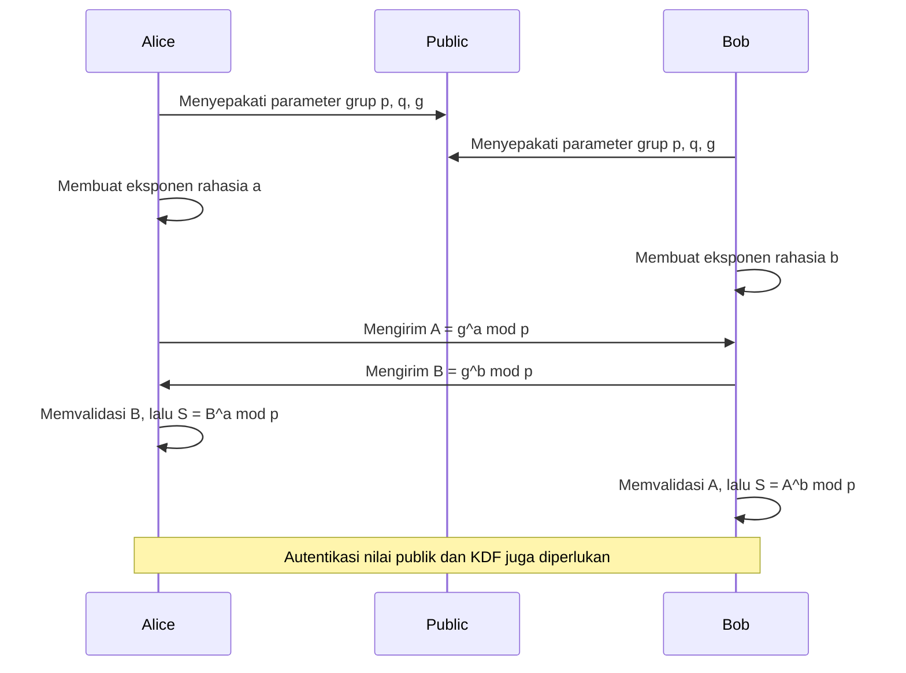
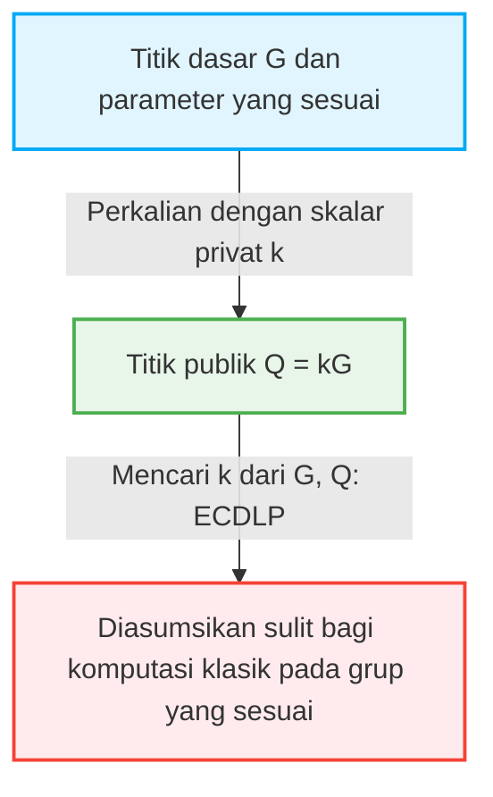

Kriptografi kunci publik mendukung komunikasi antara pihak yang sebelumnya belum berbagi kunci rahasia. Artikel ini menjelaskan matematika kesepakatan kunci Diffie–Hellman (DH), RSA, dan kriptografi kurva eliptik (ECC). Panjang kunci yang sama tidak berarti perkiraan keamanan yang sama pada sistem berbeda. Rumus saja juga tidak menjamin keamanan seluruh komunikasi.

## 1. Kriptografi simetris dan distribusi kunci

Sandi Caesar dan Enigma merupakan contoh historis ketika pengirim dan penerima berbagi pengaturan rahasia. Kriptografi simetris modern juga menggunakan kunci rahasia bersama. Namun, sistem historis tersebut tidak boleh dianggap setara dengan algoritma modern yang aman.

### Masalah distribusi kunci

Mengirim langsung kunci simetris melalui saluran tanpa perlindungan membuat penyadap ikut mengetahuinya. Masalahnya adalah bagaimana membentuk rahasia bersama dan dengan siapa. Teknik kunci publik membantu mengatasinya, tetapi autentikasi pihak lain tetap diperlukan.

Kriptografi simetris tetap memiliki peran. Misalnya, TLS 1.3 menggabungkan kesepakatan kunci dan autentikasi dengan enkripsi terautentikasi atas data menggunakan kunci turunan. Tidak semua data aplikasi dienkripsi melalui operasi kunci publik.

## 2. Kesepakatan kunci Diffie–Hellman

Makalah Diffie dan Hellman pada 1976 menjelaskan cara dua pihak menghitung nilai rahasia yang sama dari informasi yang dipertukarkan secara publik. Di sini kita membahas DH pada medan berhingga.

### Logaritma diskrit dan nilai bersama

Dalam grup perkalian modulo bilangan prima $p$, misalkan kita menggunakan subgrup berorde prima besar $q$ yang dibangkitkan oleh $g$, dengan $q$ membagi $p-1$. Nilai $g$ membangkitkan subgrup tersebut dan tidak harus merupakan akar primitif seluruh grup perkalian. Protokol nyata menggunakan parameter yang ditentukan dan cukup kuat, bukan nilai kecil buatan sendiri untuk melindungi data nyata.

1. Alice memilih eksponen rahasia $1\le a\le q-1$ secara seragam menggunakan keacakan yang aman secara kriptografis, lalu mengirim $A=g^a\bmod p$.
2. Bob memilih $1\le b\le q-1$ dengan cara yang sama dan mengirim $B=g^b\bmod p$.
3. Setelah memvalidasi nilai publik pihak lain sesuai skema, Alice menghitung $B^a\bmod p$ dan Bob menghitung $A^b\bmod p$.

$$
B^a\equiv (g^b)^a\equiv g^{ab}\equiv(g^a)^b\equiv A^b\pmod p.
$$

Kita menyebut nilai bersama itu $S$. Mencari $a$ dari $A$ adalah masalah logaritma diskrit (DLP), sedangkan menghitung $S$ dari $g,A,B$ adalah masalah Diffie–Hellman komputasional (CDH). Penyelesaian DLP juga memungkinkan penyelesaian CDH, tetapi tidak membuktikan bahwa keduanya selalu sama sulit. Klaim keamanan DH harus menyebutkan grup, protokol, dan kemampuan penyerang.

### Autentikasi, validasi nilai publik, dan derivasi kunci

DH tanpa autentikasi tidak mencegah serangan perantara yang mengubah komunikasi. Dengan mengganti nilai publik, penyerang dapat membentuk nilai bersama yang berbeda dengan Alice dan Bob. Validasi nilai publik tidak menggantikan autentikasi identitas pihak lain.

Cara validasi juga bergantung pada parameter. Untuk subgrup berorde prima di atas, pemeriksaan mencakup rentang yang benar, keanggotaan subgrup, dan penolakan elemen identitas. Pemeriksaan $1<Y<p-1$ dalam RFC 7919 untuk grup prima aman yang dikenal di sana tidak boleh dianggap sebagai aturan validasi lengkap bagi sembarang grup.

$S$ tidak langsung digunakan sebagai kunci simetris. Nilai itu dikodekan sesuai protokol, kemudian diproses oleh fungsi derivasi kunci (KDF) yang menyertakan informasi konteks dan menghasilkan kunci untuk tujuan berbeda. Jadwal kunci TLS 1.3 menggunakan HKDF dan catatan pesan handshake.

Diagram ini menunjukkan kerangka aritmetika, bukan pesan autentikasi konkret atau seluruh prosedur KDF.

## 3. RSA dan teorema Euler

RSA, yang dikembangkan oleh Rivest, Shamir, dan Adleman, menggunakan matematika berbeda dari DH. Skema enkripsi dan tanda tangan berbasis RSA memiliki rancangan berbeda.

### Kunci dan operasi bilangan bulat

Sebagai model pembelajaran RSA dengan dua faktor prima, pilih bilangan prima ganjil besar yang berbeda $p,q$, lalu tetapkan $N=pq$. Nilai $q$ di sini adalah faktor prima RSA, berbeda dari orde subgrup pada bagian sebelumnya.

$$
\phi(N)=(p-1)(q-1),\qquad ed\equiv1\pmod{\phi(N)}.
$$

Pilih eksponen publik yang memenuhi $1<e<\phi(N)$ dan $\gcd(e,\phi(N))=1$, lalu hitung inversnya sebagai eksponen privat positif $d<\phi(N)$. Ini merupakan syarat cukup untuk penjelasan ini. RFC 8017 menggunakan syarat $ed\equiv1\pmod{\lambda(N)}$, dengan $\lambda(N)=\operatorname{lcm}(p-1,q-1)$. Kunci publik adalah $(N,e)$, sedangkan salah satu representasi kunci privat adalah $(N,d)$. Eksponen privat $d$ perlu dibedakan dari informasi kunci secara lengkap.

Untuk wakil bilangan bulat $0\le M<N$, operasi dasarnya adalah:

$$
C=M^e\bmod N,\qquad M=C^d\bmod N.
$$

Wakil teks sandi $C$ juga merupakan bilangan bulat dengan $0\le C<N$. Di sini $M$ bukan langsung berupa teks atau deretan byte dengan panjang sembarang.

### Mengapa nilai awal dapat dipulihkan

Jika $\gcd(M,N)=1$, teorema Euler memberikan $M^{\phi(N)}\equiv1\pmod N$. Dengan menulis $ed=1+t\phi(N)$ dan $t\ge0$, kita memperoleh:

$$
M^{ed}=M\bigl(M^{\phi(N)}\bigr)^t\equiv M\pmod N.
$$

Teorema Euler tidak dapat langsung diterapkan jika $M$ dan $N$ tidak relatif prima. Untuk setiap faktor prima $r\in\{p,q\}$, jika $M\equiv0\pmod r$, maka $M^{ed}\equiv M\equiv0\pmod r$. Jika tidak, teorema kecil Fermat dan fakta bahwa $ed-1$ merupakan kelipatan $r-1$ memberikan $M^{ed}\equiv M\pmod r$. Teorema sisa Tiongkok menggabungkan kedua hasil modulo $N$. Jadi, setiap wakil $0\le M<N$ dapat dipulihkan.

### Kebenaran matematika dan keamanan

Memfaktorkan $N$ memungkinkan perhitungan $\phi(N)$ dan $d$. Namun, ini tidak membuktikan bahwa semua serangan RSA membutuhkan faktorisasi. Keacakan lemah, pengodean keliru, dan kebocoran implementasi juga dapat menyebabkan kegagalan.

Menggunakan langsung perpangkatan deterministik di atas untuk enkripsi memungkinkan serangan seperti menguji sedikit kandidat pesan dengan kunci publik. Skema praktis memerlukan pengodean dan pemeriksaan khusus, misalnya RSAES-OAEP untuk enkripsi dan RSASSA-PSS untuk tanda tangan. Penandatanganan tidak sama dengan mengenkripsi pesan menggunakan kunci privat. Hubungan antara kunci publik dan pihak yang dimaksud juga perlu diautentikasi.

## 4. Panjang kunci dan perkiraan keamanan

Panjang kunci RSA biasanya berarti panjang bit modulus $N$. Sumber daya komputasi dan algoritma serangan memengaruhi perkiraan keamanan. Tidak direkomendasikannya suatu panjang kunci tidak sama dengan pernyataan bahwa modulus RSA-1024 telah difaktorkan secara umum.

Sebagai perbandingan konkret, Tabel 2 pada NIST SP 800-57 Part 1 Rev.5, terbit tahun 2020, menempatkan modulus RSA 2048 bit pada baris perkiraan kekuatan keamanan maksimum 112 bit, dan modulus 3072 bit pada baris 128 bit. Ini adalah perkiraan terhadap komputasi klasik berdasarkan asumsi dokumen tersebut, bukan rekomendasi universal saat ini atau catatan keberhasilan dekripsi.

Modulus yang lebih panjang umumnya menambah biaya operasi bilangan bulat serta penyimpanan dan pengiriman kunci maupun tanda tangan. Kinerja juga bergantung pada eksponen publik, optimasi CRT, implementasi, perangkat keras, dan jenis operasi. Panjang kunci saja tidak menentukan sistem mana yang lebih cepat.

## 5. Matematika kurva eliptik

Miller dan Koblitz secara independen mengusulkan penggunaan kurva eliptik untuk kriptografi pada 1980-an. RFC 6090 mencantumkan makalah Miller di CRYPTO '85 dan makalah Koblitz tahun 1987. Waktu pengusulan perlu dibedakan dari tahun penerbitan.

Tabel NIST yang sama menempatkan ECC dengan panjang bit orde titik dasar 256–383 bit pada baris perkiraan kekuatan keamanan maksimum 128 bit. Inilah konteks perbandingan RSA-3072 dengan ECC-256. Kolom ECC mengukur panjang orde titik dasar, bukan menyatakan bahwa berkas kunci publik terserialisasi yang memuat koordinat hanya berukuran 256 bit. Perbandingan ini antara lain mengasumsikan parameter dan pengelolaan kunci yang sesuai.

### Kurva pada medan berhingga

Penjelasan ini dibatasi pada medan prima $\mathbb F_p$, dengan $p>3$ dan $a,b,x,y\in\mathbb F_p$. Parameter tersebut terpisah dari bilangan prima RSA di atas.

$$
y^2\equiv x^3+ax+b\pmod p,\qquad 4a^3+27b^2\not\equiv0\pmod p.
$$

Syarat kedua memastikan kurva nonsingular pada medan itu. Tidak cukup jika ekspresinya hanya tidak nol sebagai bilangan bulat. Penjumlahan didefinisikan pada himpunan titik kurva beserta elemen identitas, yaitu titik di takhingga $\mathcal O$. Persamaan ini saja tidak mencakup pembahasan umum medan berkarakteristik 2 atau 3.

### Penjumlahan titik dan kasus khusus

Pada bilangan real, penjumlahan dapat digambarkan dengan garis melalui dua titik, lalu mencerminkan perpotongan ketiganya dengan kurva terhadap sumbu horizontal. Pada medan berhingga, rumus aljabar yang sesuai dihitung modulo $p$. Untuk $P=(x_1,y_1)$ dan $Q=(x_2,y_2)$, kemiringan dalam kasus biasa adalah:

$$
s=\begin{cases}
(y_2-y_1)(x_2-x_1)^{-1} & (x_1\ne x_2),\\
(3x_1^2+a)(2y_1)^{-1} & (P=Q,\ y_1\ne0).
\end{cases}
$$

$$
x_3=s^2-x_1-x_2,\qquad y_3=s(x_1-x_3)-y_1\quad\text{in }\mathbb F_p.
$$

Hanya elemen medan yang tidak nol memiliki invers perkalian. Rumus tersebut tidak boleh digunakan jika penyebutnya nol.

$$
P+\mathcal O=P,\qquad -P=(x_1,-y_1),\qquad P+(-P)=\mathcal O.
$$

Jika $P=Q$ dan $y_1=0$, maka $2P=\mathcal O$. Menghitung $P+P$ adalah penggandaan titik, kasus khusus perkalian skalar yang menghitung kelipatan bilangan bulat secara umum.

### Perkalian skalar dan ECDLP

Gunakan titik dasar $G$ yang membangkitkan subgrup berorde prima besar $n$. Orde itu adalah bilangan bulat positif terkecil yang memenuhi $nG=\mathcal O$. Pilih skalar privat $1\le k\le n-1$ secara seragam menggunakan keacakan yang aman secara kriptografis.

$$
Q=kG=\underbrace{G+\cdots+G}_{k\text{ terms}}.
$$

$k$ adalah kunci privat dan $Q$ kunci publik. Bilangan prima medan $p$, orde subgrup $n$, dan skalar privat $k$ memiliki peran berbeda. Mencari $k$ dari $G,Q$ adalah masalah logaritma diskrit kurva eliptik (ECDLP).

RFC 6090 menjelaskan serangan klasik generik seperti Pollard rho dengan biaya kira-kira $O(\sqrt n)$ operasi grup. Untuk $n$ sekitar 256 bit, skalanya sekitar $2^{128}$. Ini adalah perkiraan yang eksponensial terhadap panjang bit, bukan bukti kesulitan bagi semua kurva. Serangan khusus pada kurva tertentu juga ada. Karena itu, pemilihan kurva dan subgrup, validasi titik publik, serta perlindungan dari kebocoran implementasi sangat penting.

## 6. Peran dalam protokol dan komputasi kuantum

ECC bukan nama satu skema enkripsi. Misalnya, ECDH digunakan untuk kesepakatan kunci, sedangkan ECDSA untuk tanda tangan. ECDH juga memerlukan derivasi kunci dari titik bersama sesuai protokol, validasi nilai publik, dan autentikasi.

Dalam TLS 1.3, kesepakatan kunci seperti ECDHE, tanda tangan seperti ECDSA atau RSA-PSS, dan enkripsi terautentikasi dengan kunci simetris turunan memiliki peran berbeda. Ada pula mode kunci praberbagi. TLS 1.3 menghapus transport kunci RSA, tetapi bukan berarti juga menghapus tanda tangan RSA. Beralih ke ECC tidak menjamin semua operasi menjadi lebih cepat.

### Komputer kuantum dan kriptografi pascakuantum

Algoritma Shor memecahkan faktorisasi bilangan bulat dan logaritma diskrit dalam jumlah langkah polinomial terhadap panjang bit masukan pada komputer kuantum yang cukup mampu. Algoritma ini mengancam RSA dan ECC konvensional, tetapi waktu polinomial tidak berarti eksekusi seketika atau memprediksi kapan mesin tersebut tersedia.

Kriptografi pascakuantum (PQC) bertujuan menyediakan fungsi seperti pembentukan kunci dan tanda tangan berdasarkan asumsi lain yang mempertimbangkan serangan kuantum. Ini bukan jaminan bahwa sistem mustahil dipecahkan bahkan oleh komputer kuantum. Skema, implementasi, dan protokol yang dimigrasikan tetap perlu dinilai.

## Kesimpulan

DH menghitung nilai bersama, RSA menggunakan perpangkatan modular bilangan bulat, dan ECC menggunakan operasi grup pada titik di medan berhingga. Setelah memenuhi syarat matematika, protokol menggabungkan autentikasi, derivasi kunci, pengodean dan validasi yang sesuai, serta pengelolaan kunci untuk melindungi komunikasi. Kunci pendek atau rumus yang benar saja tidak membuktikan keamanan seluruh sistem.

## Referensi

- [RFC 7919 §5.1: validasi nilai publik pada grup FFDHE yang dikenal](https://www.rfc-editor.org/rfc/rfc7919.html#section-5.1)
- [RFC 8017: kunci RSA, operasi dasar, OAEP, dan PSS](https://www.rfc-editor.org/rfc/rfc8017.html)
- [RFC 6090 §§2–4 dan 10: medan berhingga, operasi kurva, ECDH, dan syarat keamanan](https://www.rfc-editor.org/rfc/rfc6090.html)
- [NIST SP 800-57 Part 1 Rev.5 (2020), §5.6.1.1 dan Tabel 2: perkiraan kekuatan keamanan](https://csrc.nist.gov/pubs/sp/800/57/pt1/r5/final)
- [RFC 8446: peran protokol dan derivasi kunci TLS 1.3](https://www.rfc-editor.org/rfc/rfc8446.html)
- [Shor: abstrak makalah faktorisasi dan logaritma diskrit kuantum](https://arxiv.org/abs/quant-ph/9508027)
