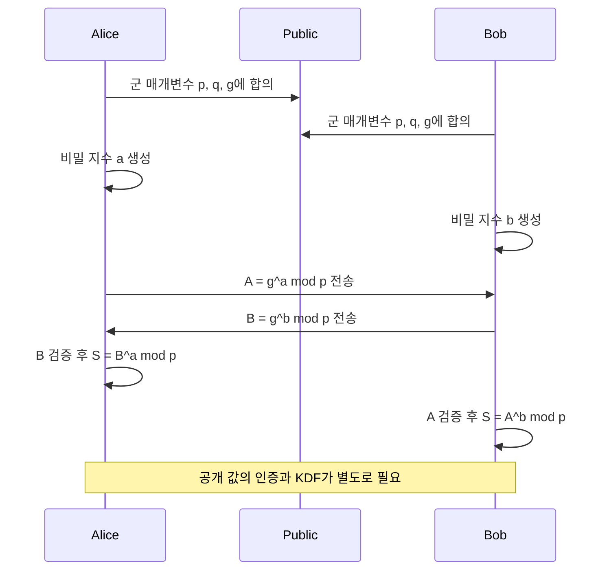
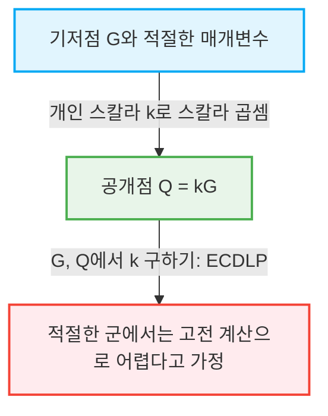

공개키 암호는 미리 비밀키를 공유하지 않은 상대와의 통신을 지원합니다. 이 글에서는 디피–헬만(DH) 키 합의, RSA, 타원곡선암호(ECC)의 수학을 차례로 설명합니다. 키 길이가 같아도 방식에 따라 추정되는 안전성은 다르며, 계산식만으로 통신 시스템 전체의 안전성이 보장되지는 않습니다.

## 1. 대칭키 암호와 키 분배 문제

시저 암호와 에니그마는 송수신자가 비밀 설정을 공유한 역사적 사례입니다. 현대의 대칭키 암호도 같은 비밀키를 공유하여 사용합니다. 다만 이러한 역사적 방식을 현대의 안전한 알고리즘과 동등하게 취급해서는 안 됩니다.

### 키 분배 문제

보호되지 않은 경로로 대칭키를 그대로 보내면 도청자도 알게 됩니다. 따라서 누구와 어떻게 비밀을 공유할 것인지가 문제가 됩니다. 공개키 기술은 이를 해결하는 데 쓰이지만, 통신 상대에 대한 인증도 필요합니다.

대칭키 암호의 역할이 사라지는 것은 아닙니다. 예를 들어 TLS 1.3은 키 합의와 인증을, 파생된 키를 사용하는 데이터의 인증 암호화와 결합합니다. 모든 애플리케이션 데이터를 공개키 연산으로 암호화하는 구조가 아닙니다.

## 2. 디피–헬만 키 합의

디피와 헬만의 1976년 논문은 공개적으로 교환한 정보로 두 당사자가 같은 비밀 값을 계산하는 방법을 제시했습니다. 여기서는 유한체 위의 DH를 설명합니다.

### 이산로그 문제와 공유 값

소수 $p$ 를 법으로 하는 곱셈군 안에서, 큰 소수 위수 $q$ 를 가지며 $g$ 가 생성하는 부분군을 사용한다고 가정합니다. $q$ 는 $p-1$ 의 약수입니다. 이때 $g$ 는 부분군의 생성원이며 전체 곱셈군의 원시근일 필요는 없습니다. 실제 프로토콜에서는 직접 만든 작은 값이 아니라, 정해진 충분히 강한 매개변수를 사용합니다.

1. 앨리스는 암호학적으로 안전한 난수로 $1\le a\le q-1$ 에서 비밀 지수를 균등하게 선택하고 $A=g^a\bmod p$ 를 보냅니다.
2. 밥도 같은 방식으로 $1\le b\le q-1$ 에서 선택하고 $B=g^b\bmod p$ 를 보냅니다.
3. 방식에 따라 상대의 공개 값을 검증한 뒤, 앨리스는 $B^a\bmod p$, 밥은 $A^b\bmod p$ 를 계산합니다.

$$
B^a\equiv (g^b)^a\equiv g^{ab}\equiv(g^a)^b\equiv A^b\pmod p.
$$

일치하는 값을 $S$ 라고 부릅니다. $A$ 에서 $a$ 를 구하는 것은 이산로그 문제(DLP)이고, $g,A,B$ 에서 $S$ 를 구하는 것은 계산 디피–헬만 문제(CDH)입니다. DLP를 풀면 CDH도 풀 수 있지만, 두 문제가 언제나 같은 난도라고 증명된 것은 아닙니다. DH의 안전성을 논할 때는 군, 프로토콜, 공격자의 능력을 지정해야 합니다.

### 인증, 공개 값 검증, 키 파생

인증 없는 DH는 통신을 변조하는 공격자의 중간자 공격을 막지 못합니다. 공격자가 공개 값을 바꾸면 앨리스와 밥은 각각 공격자와 별도의 공유 값을 만들 수 있습니다. 공개 값 검증은 상대의 신원 인증을 대신하지 않습니다.

검증 방법도 매개변수에 따라 다릅니다. 위의 소수 위수 부분군에서는 올바른 범위, 부분군 소속 여부, 항등원이 아닌지를 확인합니다. RFC 7919가 정한 알려진 안전 소수 군의 $1<Y<p-1$ 검사만으로 임의의 군을 완전히 검증할 수 있다고 생각해서는 안 됩니다.

$S$ 를 그대로 대칭키로 사용하지 않습니다. 프로토콜에 따라 인코딩한 뒤, 키 파생 함수(KDF)에서 통신 문맥 등과 결합하여 용도별 키를 만듭니다. TLS 1.3의 키 스케줄은 HKDF와 핸드셰이크 메시지 기록을 사용합니다.

그림은 계산의 골격입니다. 구체적인 인증 메시지나 KDF의 전체 절차를 나타내지는 않습니다.

## 3. RSA와 오일러의 정리

리베스트, 샤미르, 애들먼이 개발한 RSA는 DH와 다른 수학을 사용합니다. RSA 기반 암호화 방식과 서명 방식은 구분하여 설계합니다.

### 키와 정수 연산

두 소수를 사용하는 RSA의 교육용 모델로, 서로 다른 큰 홀수 소수 $p,q$ 를 선택하고 $N=pq$ 로 둡니다. 여기서 $q$ 는 RSA의 소인수이며 앞 절의 부분군 위수와는 다른 값입니다.

$$
\phi(N)=(p-1)(q-1),\qquad ed\equiv1\pmod{\phi(N)}.
$$

$1<e<\phi(N)$ 이고 $\gcd(e,\phi(N))=1$ 인 공개 지수 $e$ 를 선택합니다. 그 역원을 구해 양의 개인 지수 $d<\phi(N)$ 로 삼습니다. 이는 설명을 위한 충분조건입니다. RFC 8017은 $\lambda(N)=\operatorname{lcm}(p-1,q-1)$ 를 사용해 $ed\equiv1\pmod{\lambda(N)}$ 라는 조건을 둡니다. 공개키는 $(N,e)$ 이고, 개인키 표현의 하나는 $(N,d)$ 입니다. $d$ 는 개인 지수이며 키 전체의 정보와 구분해야 합니다.

정수 대표값 $0\le M<N$ 에 대한 기본 연산은 다음과 같습니다.

$$
C=M^e\bmod N,\qquad M=C^d\bmod N.
$$

암호문 대표값 $C$ 도 $0\le C<N$ 인 정수입니다. 이때 $M$ 은 임의 길이의 글이나 바이트열 자체가 아닙니다.

### 원래 값으로 돌아오는 이유

$\gcd(M,N)=1$ 이면 오일러의 정리에 따라 $M^{\phi(N)}\equiv1\pmod N$ 입니다. $ed=1+t\phi(N)$, $t\ge0$ 으로 쓰면 다음을 얻습니다.

$$
M^{ed}=M\bigl(M^{\phi(N)}\bigr)^t\equiv M\pmod N.
$$

$M$ 과 $N$ 이 서로소가 아니면 오일러의 정리를 그대로 적용할 수 없습니다. 대신 각 소인수 $r\in\{p,q\}$ 에 대해, $M\equiv0\pmod r$ 이면 $M^{ed}\equiv M\equiv0\pmod r$ 입니다. 그렇지 않으면 페르마의 소정리와 $ed-1$ 이 $r-1$ 의 배수라는 사실로부터 $M^{ed}\equiv M\pmod r$ 를 얻습니다. 중국인의 나머지 정리가 두 결과를 법 $N$ 에서 결합하므로, 모든 대표값 $0\le M<N$ 을 복원할 수 있습니다.

### 수학적 정확성과 안전성의 구분

$N$ 을 소인수분해할 수 있다면 $\phi(N)$ 과 $d$ 를 계산할 수 있습니다. 하지만 모든 RSA 공격에 소인수분해가 필요하다고 증명된 것은 아닙니다. 약한 난수, 잘못된 인코딩, 구현의 정보 누출로도 안전성이 무너질 수 있습니다.

위의 결정론적 거듭제곱 연산을 그대로 암호화에 쓰면, 적은 수의 후보 메시지를 공개키로 시험하는 등의 공격이 가능합니다. 실제 암호화에는 RSAES-OAEP, 서명에는 RSASSA-PSS처럼 별도의 인코딩과 검증을 갖춘 방식이 필요합니다. 서명은 개인키로 메시지를 암호화하는 것과 같지 않습니다. 공개키가 의도한 상대의 것인지 인증하는 절차도 필요합니다.

## 4. 키 길이와 추정 보안 강도

RSA 키 길이는 보통 법 $N$ 의 비트 길이를 뜻합니다. 계산 능력과 공격 알고리즘의 변화는 안전성 평가에 영향을 줍니다. 그러나 어떤 키 길이가 더 이상 권장되지 않는 것과 RSA-1024의 법들이 일반적으로 소인수분해되었다는 주장은 구분해야 합니다.

구체적인 비교 사례로, 2020년판 NIST SP 800-57 Part 1 Rev.5의 Table 2는 RSA 법 길이 2048비트를 추정 최대 보안 강도 112비트 행에, 3072비트를 128비트 행에 둡니다. 이는 문서의 가정에 따른 고전 계산에 대한 추정이며, 현재 모든 용도에 적용되는 키 길이 권고나 실제 해독 기록이 아닙니다.

법이 길어지면 일반적으로 정수 연산과 키·서명의 저장 및 전송 부담이 커집니다. 다만 공개 지수, CRT 최적화, 구현, 하드웨어, 연산 종류에 따라 성능이 다릅니다. 키 길이만으로 어느 방식이 더 빠른지 단정할 수 없습니다.

## 5. 타원곡선암호의 수학

밀러와 코블리츠는 1980년대에 타원곡선을 암호에 사용하는 방법을 독립적으로 제안했습니다. RFC 6090에는 밀러의 CRYPTO '85 논문과 코블리츠의 1987년 논문이 인용되어 있습니다. 제안 시기와 논문 출판 연도는 구분해야 합니다.

같은 NIST 표에서 기저점 위수의 비트 길이가 256〜383인 ECC는 추정 최대 보안 강도 128비트 행에 있습니다. 이것이 RSA-3072와 ECC-256 비교의 배경입니다. ECC의 해당 열은 기저점 위수의 길이이며, 좌표를 포함해 직렬화한 공개키 파일의 크기가 256비트라는 뜻이 아닙니다. 적절한 매개변수와 키 관리 등의 조건을 전제로 한 비교입니다.

### 유한체 위의 곡선

여기서는 소수 $p>3$ 인 소체 $\mathbb F_p$ 로 제한하고 $a,b,x,y\in\mathbb F_p$ 로 둡니다. 이 매개변수들은 앞의 RSA 소수들과 별개입니다.

$$
y^2\equiv x^3+ax+b\pmod p,\qquad 4a^3+27b^2\not\equiv0\pmod p.
$$

두 번째 조건은 이 체 위에서 곡선이 비특이적임을 보장합니다. 정수로서 0이 아닌 것만으로는 충분하지 않습니다. 곡선 위의 점들과 항등원인 무한원점 $\mathcal O$ 를 합친 집합에 덧셈을 정의합니다. 표수가 2나 3인 체의 일반적인 경우까지 이 식 하나로 설명할 수는 없습니다.

### 점의 덧셈과 예외

실수 그림에서는 두 점을 잇는 직선의 세 번째 교점을 가로축에 대칭 이동시켜 덧셈을 설명합니다. 유한체에서는 이에 대응하는 대수식을 법 $p$ 로 계산합니다. $P=(x_1,y_1)$, $Q=(x_2,y_2)$ 에 대해 일반적인 경우의 기울기는 다음과 같습니다.

$$
s=\begin{cases}
(y_2-y_1)(x_2-x_1)^{-1} & (x_1\ne x_2),\\
(3x_1^2+a)(2y_1)^{-1} & (P=Q,\ y_1\ne0).
\end{cases}
$$

$$
x_3=s^2-x_1-x_2,\qquad y_3=s(x_1-x_3)-y_1\quad\text{in }\mathbb F_p.
$$

0이 아닌 체의 원소에만 곱셈 역원이 존재합니다. 분모가 0일 때 위 공식을 사용해서는 안 됩니다.

$$
P+\mathcal O=P,\qquad -P=(x_1,-y_1),\qquad P+(-P)=\mathcal O.
$$

$P=Q$ 이고 $y_1=0$ 이면 $2P=\mathcal O$ 입니다. $P+P$ 를 구하는 것은 점의 두 배 연산(point doubling)이며, 일반적인 정수배를 구하는 스칼라 곱셈의 한 사례입니다.

### 스칼라 곱셈과 ECDLP

큰 소수 위수 $n$ 의 부분군을 생성하는 기저점 $G$ 를 사용합니다. 위수는 $nG=\mathcal O$ 가 되는 가장 작은 양의 정수입니다. 암호학적으로 안전한 난수로 $1\le k\le n-1$ 에서 개인 스칼라 $k$ 를 균등하게 선택합니다.

$$
Q=kG=\underbrace{G+\cdots+G}_{k\text{ terms}}.
$$

$k$ 는 개인키, $Q$ 는 공개키입니다. 체의 소수 $p$, 부분군 위수 $n$, 개인 스칼라 $k$ 는 역할이 다릅니다. $G,Q$ 에서 $k$ 를 구하는 것이 타원곡선 이산로그 문제(ECDLP)입니다.

RFC 6090은 Pollard rho 같은 일반적인 고전 공격의 계산량을 대략 $O(\sqrt n)$ 군 연산으로 설명합니다. $n$ 이 약 256비트이면 이 규모는 약 $2^{128}$ 입니다. 이는 비트 길이에 대해 지수적인 추정이며, 모든 곡선에서 어렵다는 증명은 아닙니다. 특수한 곡선에 대한 공격도 있으므로 곡선·부분군 선택, 공개점 검증, 구현의 정보 누출 방지가 중요합니다.

## 6. 프로토콜의 역할과 양자 계산

ECC는 하나의 암호화 방식 이름이 아닙니다. 예를 들어 ECDH는 키 합의, ECDSA는 서명 방식입니다. ECDH에서도 프로토콜에 따라 공유점으로부터 키를 파생하고, 공개 값을 검증하며 인증해야 합니다.

TLS 1.3에서는 ECDHE 등의 키 합의, ECDSA나 RSA-PSS 등의 서명, 파생 대칭키를 이용하는 인증 암호화가 서로 다른 역할을 맡습니다. 사전 공유키 모드도 있습니다. RSA 키 전송은 TLS 1.3에서 제거되었지만 RSA 서명까지 제거된 것은 아닙니다. ECC로 바꾼다고 모든 연산이 반드시 빨라지는 것도 아닙니다.

### 양자 컴퓨터와 양자내성암호

쇼어 알고리즘은 충분한 능력을 가진 양자 컴퓨터에서, 소인수분해와 이산로그를 입력의 비트 길이에 대해 다항식인 단계 수로 푸는 방법입니다. RSA와 기존 ECC를 위협하지만, 다항시간은 즉시 풀린다는 뜻도, 그런 장치의 실현 시기를 예측한다는 뜻도 아닙니다.

양자내성암호(PQC)는 양자 공격을 고려한 다른 가정 아래 키 설정과 서명 등의 기능을 제공하려는 기술입니다. 양자 컴퓨터로도 절대 깨지지 않는다는 보장이 아닙니다. 개별 방식, 구현, 전환할 프로토콜을 평가해야 합니다.

## 요약

DH는 공유 값 계산, RSA는 정수의 모듈러 거듭제곱, ECC는 유한체 위 점들의 군 연산을 기반으로 합니다. 수학적 성립 조건을 충족한 뒤에도 인증, 키 파생, 적절한 인코딩과 검증, 키 관리를 결합해야 통신을 보호할 수 있습니다. 짧은 키나 올바른 식만으로 전체 시스템의 안전성을 판단할 수는 없습니다.

## 참고 자료

- [RFC 7919 §5.1: 알려진 FFDHE 군의 공개 값 검증](https://www.rfc-editor.org/rfc/rfc7919.html#section-5.1)
- [RFC 8017: RSA 키, 기본 연산, OAEP와 PSS](https://www.rfc-editor.org/rfc/rfc8017.html)
- [RFC 6090 §§2–4, 10: 유한체, 곡선 연산, ECDH와 안전성 조건](https://www.rfc-editor.org/rfc/rfc6090.html)
- [NIST SP 800-57 Part 1 Rev.5(2020), §5.6.1.1과 Table 2: 추정 보안 강도](https://csrc.nist.gov/pubs/sp/800/57/pt1/r5/final)
- [RFC 8446: TLS 1.3의 역할 구분과 키 스케줄](https://www.rfc-editor.org/rfc/rfc8446.html)
- [Shor: 양자 소인수분해와 이산로그 논문 초록](https://arxiv.org/abs/quant-ph/9508027)
