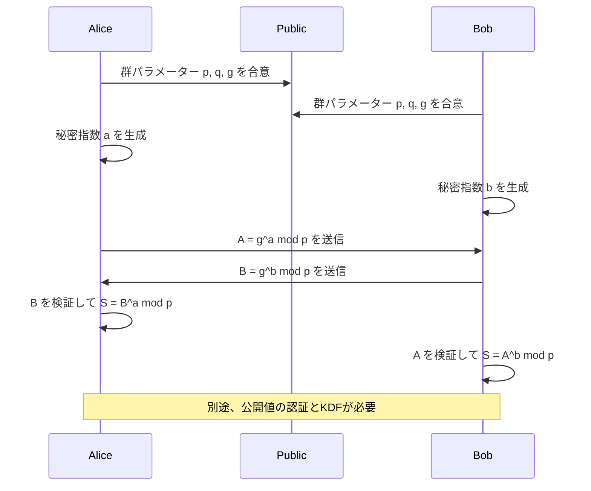
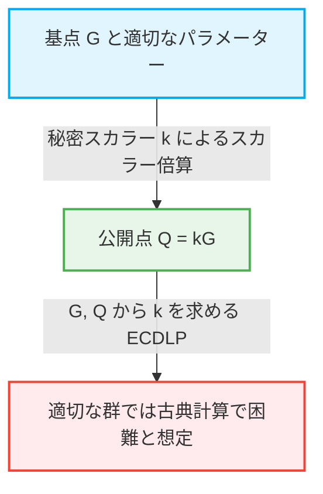

公開鍵暗号は、事前に同じ秘密鍵を持たない相手との通信を支える技術です。本記事では、ディフィー・ヘルマン（DH）鍵共有、RSA、楕円曲線暗号（ECC）の数学を順に説明します。同じ鍵長でも方式によって推定される安全性は異なり、計算式だけで通信全体の安全性が保証されるわけではありません。

## 1. 共通鍵暗号と鍵配送問題

シーザー暗号やエニグマは、送受信側が秘密の設定を共有する歴史的な例です。現代の共通鍵暗号でも、送受信側が同じ秘密鍵を使います。ただし、これらの歴史的な方式を現代の安全な方式と同等には扱えません。

### 鍵配送問題

共通鍵を保護されていない経路でそのまま送ると、盗聴者にも知られてしまいます。そこで「誰と、どのように秘密を共有するか」が問題になります。公開鍵技術はその解決に使われますが、通信相手の認証も必要です。

共通鍵暗号の役割がなくなるわけではありません。例えばTLS 1.3では、鍵共有や認証と、導出した鍵を使うデータの認証付き暗号化を組み合わせます。公開鍵処理ですべての本文データを暗号化する仕組みではありません。

## 2. ディフィー・ヘルマン鍵共有

ディフィーとヘルマンの1976年の論文は、公開された情報から二者が同じ秘密の値を計算する方法を示しました。ここでは有限体上のDHを説明します。

### 離散対数問題と共有値

素数 $p$ を法とする乗法群の中で、大きな素数位数 $q$ の部分群と、その生成元 $g$ を使うとします。$q$ は $p-1$ の約数です。ここでの $g$ は部分群の生成元であり、乗法群全体の原始根とは限りません。実際の通信では、独自に作った小さな値ではなく、プロトコルで定められた十分に強いパラメーターを使います。

1. アリスは $1\le a\le q-1$ から秘密指数を暗号学的に安全な乱数で一様に選び、$A=g^a\bmod p$ を送ります。
2. ボブも $1\le b\le q-1$ から同様に選び、$B=g^b\bmod p$ を送ります。
3. 相手の公開値を方式に従って検証し、アリスは $B^a\bmod p$、ボブは $A^b\bmod p$ を計算します。

$$
B^a\equiv (g^b)^a\equiv g^{ab}\equiv(g^a)^b\equiv A^b\pmod p.
$$

こうして一致する値を $S$ と呼びます。$A$ から $a$ を求めるのが離散対数問題（DLP）、$g,A,B$ から $S$ を求めるのが計算Diffie–Hellman問題（CDH）です。DLPが解ければCDHも解けますが、両者が常に同じ難しさだと証明されたとはいえません。DHの安全性を論じる際には、使う群・プロトコルと攻撃者の能力を指定する必要があります。

### 認証・公開値検証・鍵導出

未認証のDHは、通信を書き換える攻撃者による中間者攻撃を防ぎません。攻撃者が公開値を差し替えると、アリスとボブはそれぞれ攻撃者と別々の共有値を持ち得ます。公開値を検証しても、相手の身元の認証を代替することはできません。

公開値の検証方法もパラメーターに依存します。例えば上の素数位数部分群なら、正しい範囲と部分群への所属、単位元でないことを確認します。RFC 7919の既知の安全素数群に対する $1<Y<p-1$ という検査だけを、任意の群へ流用してはいけません。

$S$ をそのまま共通鍵にはしません。プロトコルに従って符号化し、鍵導出関数（KDF）で通信の文脈などと結び付けて用途別の鍵を導出します。TLS 1.3の鍵スケジュールではHKDFとハンドシェイクの記録を使います。

図は計算の骨格です。認証の具体的なメッセージやKDFの全手順を示すものではありません。

## 3. RSA暗号とオイラーの定理

リベスト、シャミア、エーデルマンによるRSAは、DHと異なる数学に基づく公開鍵技術です。RSAを用いる暗号化方式と署名方式は区別して設計されます。

### 鍵と整数上の演算

二素数RSAの教材として、異なる大きな奇素数 $p,q$ を選び、$N=pq$ とします。以下の $q$ はRSAの素因数であり、前節の部分群位数とは別の値です。

$$
\phi(N)=(p-1)(q-1),\qquad ed\equiv1\pmod{\phi(N)}.
$$

$1<e<\phi(N)$ かつ $\gcd(e,\phi(N))=1$ となる公開指数 $e$ を選び、その逆元として正の秘密指数 $d<\phi(N)$ を求めます。これは説明用の十分条件です。RFC 8017の条件では $\lambda(N)=\operatorname{lcm}(p-1,q-1)$ を使って $ed\equiv1\pmod{\lambda(N)}$ とします。公開鍵は $(N,e)$、秘密鍵の表現の一つは $(N,d)$ です。$d$ は秘密指数であり、鍵全体の情報とは区別します。

整数代表値 $0\le M<N$ に対する基本演算は次のとおりです。

$$
C=M^e\bmod N,\qquad M=C^d\bmod N.
$$

$C$ も $0\le C<N$ の整数です。この式の $M$ は、任意の長さの文章やバイト列そのものではありません。

### なぜ元に戻るのか

$\gcd(M,N)=1$ のとき、オイラーの定理から $M^{\phi(N)}\equiv1\pmod N$ です。$ed=1+t\phi(N)$、$t\ge0$ と書けば、

$$
M^{ed}=M\bigl(M^{\phi(N)}\bigr)^t\equiv M\pmod N.
$$

互いに素でない $M$ にオイラーの定理をそのまま適用することはできません。しかし、各素因数 $r\in\{p,q\}$ について、$M\equiv0\pmod r$ なら $M^{ed}\equiv M\equiv0\pmod r$ です。それ以外ならフェルマーの小定理と、$ed-1$ が $r-1$ の倍数であることから $M^{ed}\equiv M\pmod r$ です。中国剰余定理により、両方の場合を合わせて法 $N$ でも一致します。したがって、すべての代表値 $0\le M<N$ で復元できます。

### 正しさと安全性を分ける

$N$ を素因数分解できれば $\phi(N)$ と $d$ を計算できます。ただし、RSAへのあらゆる攻撃に素因数分解が必要だと証明されたわけではありません。弱い乱数、誤った符号化、実装の漏えいなどから破られる場合もあります。

上の決定的なべき乗演算をそのまま暗号化に使うと、少数の候補を公開鍵で試すなどの攻撃ができます。実用の暗号化方式にはRSAES-OAEP、署名方式にはRSASSA-PSSなどの専用の符号化と検証が必要です。署名は「秘密鍵で本文を暗号化すること」と同一ではありません。公開鍵が意図した相手のものかという認証も別途必要です。

## 4. 鍵長と推定安全性

RSAの鍵長は通常、法 $N$ のビット長を指します。計算能力や攻撃手法の変化は、安全性の評価に影響します。ただし、「RSA-1024が一律に素因数分解された」と、推奨から外れたことを混同してはいけません。

比較の一例として、2020年版のNIST SP 800-57 Part 1 Rev.5、Table 2では、RSAの法長2048ビットは推定最大安全性112ビット、3072ビットは128ビットの行にあります。これは同文書の前提に基づく古典計算に対する見積もりです。現在のすべての用途に適用する鍵長の推奨や、実際に解読された記録を示すものではありません。

法が長くなると、一般に整数演算や鍵・署名の保存と転送の負担が増えます。ただし、公開指数、CRTによる高速化、実装、ハードウェア、操作の種類で性能は変わります。方式間の速度を鍵長だけから断定することはできません。

## 5. 楕円曲線暗号（ECC）の数学

ミラーとコブリッツは1980年代に楕円曲線を暗号へ用いる方法を独立に提案しました。RFC 6090が挙げる文献には、ミラーのCRYPTO '85の論文と、コブリッツの1987年の論文があります。提案時期と論文の刊行年は区別します。

同じNISTの表では、基点の位数のビット長が256〜383ビットのECCは、推定最大安全性128ビットの行にあります。これが「RSA-3072とECC-256の比較」の背景です。ECCのこの列は基点位数の長さであり、座標を含む公開鍵のファイルサイズを256ビットとする意味ではありません。適切なパラメーターと鍵管理などの条件付きの比較です。

### 有限体上の曲線

ここでは素数 $p>3$ の体 $\mathbb F_p$ に限り、$a,b,x,y\in\mathbb F_p$ とします。前節のRSAの素数とは別のパラメーターです。

$$
y^2\equiv x^3+ax+b\pmod p,\qquad 4a^3+27b^2\not\equiv0\pmod p.
$$

右の条件は、この体上で曲線が特異点を持たないための条件です。整数としてゼロでないだけでは足りません。曲線の点に単位元である無限遠点 $\mathcal O$ を加えた集合に、加算を定めます。標数2や3の体の一般的な説明を、この式だけで済ませることはできません。

### 点の加算と例外

実数上の絵では、2点を結ぶ直線の第3の交点を上下反転することで加算を説明できます。有限体上では、その絵に対応する代数式を法 $p$ で計算します。$P=(x_1,y_1)$、$Q=(x_2,y_2)$ に対し、通常の場合の傾きは次のとおりです。

$$
s=\begin{cases}
(y_2-y_1)(x_2-x_1)^{-1} & (x_1\ne x_2),\\
(3x_1^2+a)(2y_1)^{-1} & (P=Q,\ y_1\ne0).
\end{cases}
$$

$$
x_3=s^2-x_1-x_2,\qquad y_3=s(x_1-x_3)-y_1\quad\text{in }\mathbb F_p.
$$

逆元は有限体の非零要素にだけ存在します。分母がゼロになる場合に上の式を使ってはいけません。

$$
P+\mathcal O=P,\qquad -P=(x_1,-y_1),\qquad P+(-P)=\mathcal O.
$$

$P=Q$ かつ $y_1=0$ なら $2P=\mathcal O$ です。$P+P$ は点の「2倍算」であり、一般の整数倍を求める「スカラー倍算」の一例です。

### スカラー倍算とECDLP

大きな素数位数 $n$ の部分群を生成する基点 $G$ を使います。位数は $nG=\mathcal O$ となる最小の正整数です。秘密スカラー $k$ は $1\le k\le n-1$ から暗号学的に安全な乱数で一様に選びます。

$$
Q=kG=\underbrace{G+\cdots+G}_{k\text{ terms}}.
$$

$k$ が秘密鍵、$Q$ が公開鍵です。体の素数 $p$、部分群位数 $n$、秘密スカラー $k$ はそれぞれ異なる役割を持ちます。$G,Q$ から $k$ を求めるのが楕円曲線離散対数問題（ECDLP）です。

RFC 6090の説明では、Pollard rhoのような汎用の古典的攻撃の計算量はおおむね $O(\sqrt n)$ 群演算です。$n$ が約256ビットなら、この規模は約 $2^{128}$ になります。これはビット長に対して指数的な見積もりであり、すべての曲線に対する困難さの証明ではありません。特殊な曲線への攻撃もあるため、曲線・部分群の選択、公開点の検証、実装の漏えい対策が重要です。

## 6. プロトコルでの役割と量子計算

ECCは一つの暗号化方式の名前ではありません。例えばECDHは鍵共有、ECDSAは署名の方式です。ECDHでも共有点からプロトコルに従って鍵を導出し、公開値の検証と認証を行う必要があります。

TLS 1.3では、ECDHEなどによる鍵共有、ECDSAやRSA-PSSなどによる署名、導出した共通鍵による認証付き暗号化が異なる役割を担います。事前共有鍵を用いるモードもあります。RSAによる鍵配送はTLS 1.3から取り除かれていますが、RSA署名がそれだけで取り除かれたわけではありません。ECCへの変更で、すべての操作が必ず高速になるともいえません。

### 量子コンピューターと耐量子暗号

ショアのアルゴリズムは、十分な能力を持つ量子コンピューター上で、素因数分解や離散対数を入力のビット長に対して多項式のステップ数で解く方法です。RSAや従来のECCの安全性を脅かしますが、「多項式時間」は即座に解けるという意味でも、その装置がいつ実現するかという予測でもありません。

耐量子暗号（PQC）は、量子攻撃も考慮した別の仮定に基づく鍵確立・署名などを目指します。「量子コンピューターでも絶対に破れない」という保証ではなく、方式ごとの解析、実装、移行するプロトコルを検討する必要があります。

## まとめ

DHは共有値の計算、RSAは整数の剰余べき乗、ECCは有限体上の点の群演算を基礎にしています。各方式の計算が成立する条件を満たしたうえで、認証、鍵導出、適切な符号化や検証、鍵管理を組み合わせて通信を保護します。鍵長の短さや数式の正しさだけで、システム全体の安全性を判断することはできません。

## 参照資料

- [RFC 7919 §5.1：既知のFFDHE群での公開値検証](https://www.rfc-editor.org/rfc/rfc7919.html#section-5.1)
- [RFC 8017：RSAの鍵・基本演算・OAEP・PSS](https://www.rfc-editor.org/rfc/rfc8017.html)
- [RFC 6090 §§2–4、10：有限体・楕円曲線の演算・ECDH・安全性の条件](https://www.rfc-editor.org/rfc/rfc6090.html)
- [NIST SP 800-57 Part 1 Rev.5（2020年）、§5.6.1.1・Table 2：推定安全性の比較](https://csrc.nist.gov/pubs/sp/800/57/pt1/r5/final)
- [RFC 8446：TLS 1.3の役割分担と鍵スケジュール](https://www.rfc-editor.org/rfc/rfc8446.html)
- [Shor：量子計算による素因数分解と離散対数の論文概要](https://arxiv.org/abs/quant-ph/9508027)
