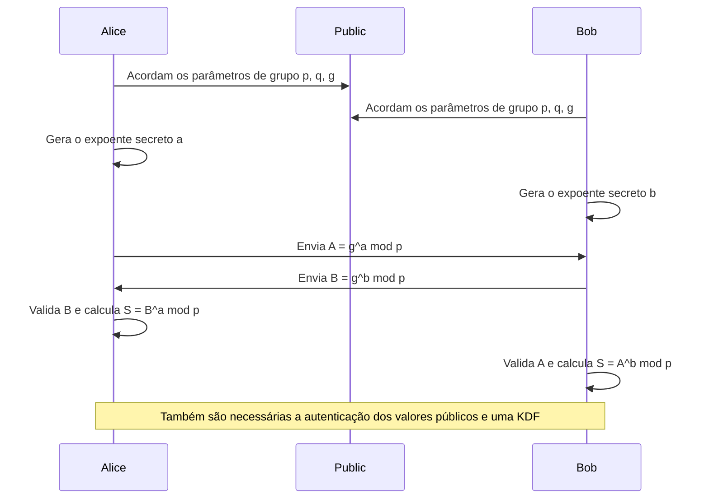
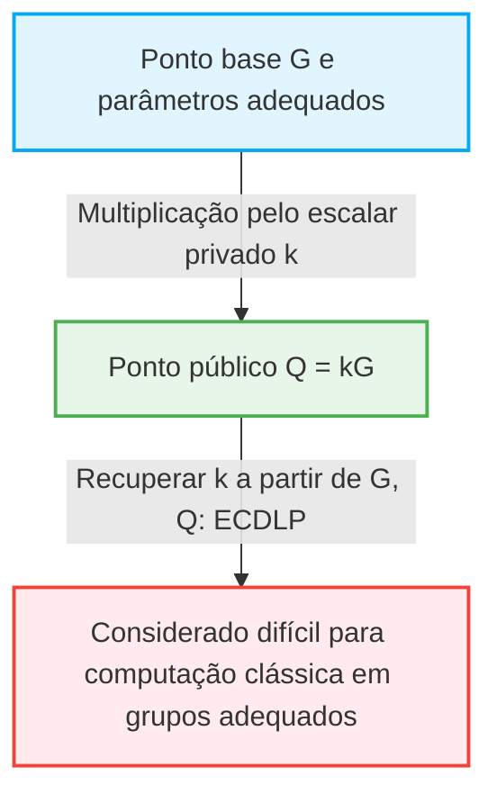

A criptografia de chave pública permite estabelecer comunicações entre partes que não compartilham previamente uma chave secreta. Este artigo apresenta a matemática do acordo de chaves Diffie–Hellman (DH), do RSA e da criptografia de curvas elípticas (ECC). Chaves do mesmo tamanho não implicam a mesma segurança estimada em sistemas diferentes, e as equações, por si só, não garantem a segurança de toda a comunicação.

## 1. Criptografia simétrica e distribuição de chaves

A cifra de César e a Enigma são exemplos históricos em que emissor e receptor compartilham configurações secretas. A criptografia simétrica moderna também utiliza uma chave secreta compartilhada. No entanto, esses sistemas históricos não devem ser considerados equivalentes aos algoritmos modernos seguros.

### O problema de distribuição de chaves

Enviar diretamente uma chave simétrica por um canal desprotegido também a revela a quem estiver escutando. O problema é como estabelecer um segredo compartilhado e com quem. Técnicas de chave pública ajudam a resolvê-lo, mas a autenticação da outra parte também é necessária.

A criptografia simétrica continua tendo sua função. Por exemplo, o TLS 1.3 combina acordo de chaves e autenticação com criptografia autenticada dos dados usando chaves derivadas. Não se trata de criptografar todos os dados da aplicação por meio de operações de chave pública.

## 2. Acordo de chaves Diffie–Hellman

O artigo de Diffie e Hellman de 1976 descreveu como duas partes podem calcular o mesmo valor secreto a partir de informações trocadas publicamente. Aqui consideramos o DH sobre um corpo finito.

### Logaritmos discretos e valor compartilhado

No grupo multiplicativo módulo um primo $p$, suponha que usemos um subgrupo de ordem prima grande $q$, gerado por $g$, em que $q$ divide $p-1$. Esse $g$ gera o subgrupo; não precisa ser uma raiz primitiva de todo o grupo multiplicativo. Protocolos reais usam parâmetros especificados e suficientemente fortes, não pequenos valores inventados para proteger dados reais.

1. Alice escolhe uniformemente um expoente secreto $1\le a\le q-1$, com aleatoriedade criptograficamente segura, e envia $A=g^a\bmod p$.
2. Bob escolhe da mesma forma $1\le b\le q-1$ e envia $B=g^b\bmod p$.
3. Depois de validar o valor público da outra parte conforme o esquema, Alice calcula $B^a\bmod p$ e Bob calcula $A^b\bmod p$.

$$
B^a\equiv (g^b)^a\equiv g^{ab}\equiv(g^a)^b\equiv A^b\pmod p.
$$

Chamamos o valor compartilhado de $S$. Recuperar $a$ a partir de $A$ é o problema do logaritmo discreto (DLP); calcular $S$ a partir de $g,A,B$ é o problema computacional de Diffie–Hellman (CDH). Resolver o DLP permite resolver o CDH, mas não demonstra que os dois tenham sempre a mesma dificuldade. Uma afirmação de segurança sobre DH deve especificar o grupo, o protocolo e as capacidades do atacante.

### Autenticação, validação de valores públicos e derivação de chaves

O DH sem autenticação não impede um ataque de intermediário que altere a comunicação. Substituindo valores públicos, o atacante pode estabelecer valores compartilhados diferentes com Alice e Bob. A validação dos valores públicos não substitui a autenticação da outra parte.

A validação também depende dos parâmetros. Para o subgrupo de ordem prima acima, inclui verificar o intervalo correto, a pertinência ao subgrupo e a exclusão do elemento neutro. A verificação $1<Y<p-1$ da RFC 7919 para seus grupos conhecidos de primos seguros não deve ser aplicada como regra completa para grupos arbitrários.

O valor $S$ não é usado diretamente como chave simétrica. Ele é codificado conforme o protocolo e passa por uma função de derivação de chaves (KDF), que incorpora informações de contexto e deriva chaves para finalidades distintas. O esquema de derivação do TLS 1.3 utiliza HKDF e o registro das mensagens do handshake.

O diagrama mostra o esboço aritmético, não as mensagens concretas de autenticação nem todo o procedimento da KDF.

## 3. RSA e o teorema de Euler

O RSA, desenvolvido por Rivest, Shamir e Adleman, usa uma matemática diferente da do DH. Esquemas de criptografia e de assinatura baseados em RSA têm projetos distintos.

### Chaves e operações com inteiros

Como modelo didático do RSA com dois primos, escolhemos primos ímpares grandes e distintos $p,q$ e definimos $N=pq$. Esse $q$ é um fator primo do RSA, diferente da ordem do subgrupo da seção anterior.

$$
\phi(N)=(p-1)(q-1),\qquad ed\equiv1\pmod{\phi(N)}.
$$

Escolhemos um expoente público que satisfaça $1<e<\phi(N)$ e $\gcd(e,\phi(N))=1$ e calculamos seu inverso como expoente privado positivo $d<\phi(N)$. São condições suficientes para esta explicação. A RFC 8017 utiliza a condição $ed\equiv1\pmod{\lambda(N)}$, em que $\lambda(N)=\operatorname{lcm}(p-1,q-1)$. A chave pública é $(N,e)$; uma representação da chave privada é $(N,d)$. O expoente privado $d$ deve ser distinguido das informações completas da chave.

Para um representante inteiro $0\le M<N$, as operações básicas são:

$$
C=M^e\bmod N,\qquad M=C^d\bmod N.
$$

O representante do texto cifrado $C$ também é um inteiro com $0\le C<N$. Aqui, $M$ não é diretamente um texto ou uma sequência de bytes de tamanho arbitrário.

### Por que o valor original é recuperado

Se $\gcd(M,N)=1$, o teorema de Euler fornece $M^{\phi(N)}\equiv1\pmod N$. Escrevendo $ed=1+t\phi(N)$, com $t\ge0$, obtemos:

$$
M^{ed}=M\bigl(M^{\phi(N)}\bigr)^t\equiv M\pmod N.
$$

O teorema de Euler não pode ser aplicado diretamente se $M$ não for coprimo de $N$. Para cada fator primo $r\in\{p,q\}$, se $M\equiv0\pmod r$, então $M^{ed}\equiv M\equiv0\pmod r$. Caso contrário, o pequeno teorema de Fermat e o fato de $ed-1$ ser múltiplo de $r-1$ dão $M^{ed}\equiv M\pmod r$. O teorema chinês dos restos combina os resultados módulo $N$. Assim, todo representante $0\le M<N$ pode ser recuperado.

### Correção matemática e segurança

Fatorar $N$ permite calcular $\phi(N)$ e $d$. Isso não prova que todo ataque ao RSA exija fatoração. Aleatoriedade fraca, codificação incorreta e vazamentos na implementação também podem causar falhas.

Usar diretamente a exponenciação determinística acima para criptografar permite ataques como testar um conjunto pequeno de mensagens candidatas com a chave pública. Esquemas práticos exigem codificações e verificações próprias, como RSAES-OAEP para criptografar e RSASSA-PSS para assinar. Assinar não equivale a criptografar a mensagem com uma chave privada. Também é preciso autenticar que a chave pública pertence à parte esperada.

## 4. Tamanho de chave e segurança estimada

O tamanho da chave RSA costuma indicar o comprimento em bits do módulo $N$. Recursos computacionais e algoritmos de ataque afetam as estimativas de segurança. Uma recomendação deixar de aceitar determinado tamanho não equivale a afirmar que os módulos RSA-1024 tenham sido fatorados de forma geral.

Como comparação concreta, a tabela 2 da NIST SP 800-57 Part 1 Rev.5, publicada em 2020, situa módulos RSA de 2048 bits na linha de força máxima de segurança estimada de 112 bits, e os de 3072 bits na linha de 128 bits. São estimativas para computação clássica sob as hipóteses do documento, não recomendações universais atuais nem registros de decifração bem-sucedida.

Um módulo maior geralmente aumenta o custo das operações com inteiros e do armazenamento e transmissão de chaves e assinaturas. O desempenho também depende do expoente público, das otimizações CRT, da implementação, do hardware e da operação realizada. O tamanho da chave, por si só, não determina qual sistema é mais rápido.

## 5. A matemática da criptografia de curvas elípticas

Miller e Koblitz propuseram independentemente o uso criptográfico de curvas elípticas na década de 1980. A RFC 6090 cita o artigo de Miller da CRYPTO '85 e o artigo de Koblitz de 1987. É preciso distinguir a data da proposta do ano de publicação.

A mesma tabela do NIST situa a ECC com uma ordem do ponto base de 256–383 bits na linha de força máxima de segurança estimada de 128 bits. Esse é o contexto da comparação RSA-3072 com ECC-256. A coluna da ECC mede o comprimento da ordem do ponto base; não afirma que um arquivo de chave pública serializada com coordenadas ocupe 256 bits. A comparação pressupõe parâmetros e gerenciamento de chaves adequados, entre outras condições.

### Uma curva sobre um corpo finito

Restringimos a explicação a um corpo primo $\mathbb F_p$, com $p>3$ e $a,b,x,y\in\mathbb F_p$. Esses parâmetros são diferentes dos primos do RSA acima.

$$
y^2\equiv x^3+ax+b\pmod p,\qquad 4a^3+27b^2\not\equiv0\pmod p.
$$

A segunda condição garante que a curva seja não singular sobre esse corpo. Não basta que a expressão seja diferente de zero como inteiro. Define-se uma adição sobre os pontos da curva junto com o elemento neutro, o ponto no infinito $\mathcal O$. Essa equação não cobre o tratamento geral dos corpos de característica 2 ou 3.

### Adição de pontos e casos excepcionais

Sobre os reais, a adição pode ser ilustrada traçando uma reta por dois pontos e refletindo sua terceira interseção com a curva em relação ao eixo horizontal. Em um corpo finito, calculamos as fórmulas algébricas correspondentes módulo $p$. Para $P=(x_1,y_1)$ e $Q=(x_2,y_2)$, a inclinação nos casos usuais é:

$$
s=\begin{cases}
(y_2-y_1)(x_2-x_1)^{-1} & (x_1\ne x_2),\\
(3x_1^2+a)(2y_1)^{-1} & (P=Q,\ y_1\ne0).
\end{cases}
$$

$$
x_3=s^2-x_1-x_2,\qquad y_3=s(x_1-x_3)-y_1\quad\text{in }\mathbb F_p.
$$

Somente os elementos não nulos do corpo têm inverso multiplicativo. Essas fórmulas não devem ser usadas quando o denominador for zero.

$$
P+\mathcal O=P,\qquad -P=(x_1,-y_1),\qquad P+(-P)=\mathcal O.
$$

Se $P=Q$ e $y_1=0$, então $2P=\mathcal O$. Calcular $P+P$ é a duplicação de um ponto, um caso particular da multiplicação escalar, que calcula múltiplos inteiros gerais.

### Multiplicação escalar e ECDLP

Usamos um ponto base $G$ que gera um subgrupo de ordem prima grande $n$. Sua ordem é o menor inteiro positivo que satisfaz $nG=\mathcal O$. Escolhemos uniformemente um escalar privado $1\le k\le n-1$ usando aleatoriedade criptograficamente segura.

$$
Q=kG=\underbrace{G+\cdots+G}_{k\text{ terms}}.
$$

$k$ é a chave privada e $Q$, a pública. O primo do corpo $p$, a ordem do subgrupo $n$ e o escalar privado $k$ têm papéis diferentes. Recuperar $k$ a partir de $G,Q$ é o problema do logaritmo discreto em curvas elípticas (ECDLP).

A RFC 6090 descreve ataques clássicos genéricos, como Pollard rho, com um custo aproximado de $O(\sqrt n)$ operações de grupo. Para um $n$ de aproximadamente 256 bits, essa escala é da ordem de $2^{128}$. A estimativa é exponencial no comprimento em bits, não uma prova de dificuldade para todas as curvas. Existem ataques específicos contra curvas especiais; portanto, importam a escolha da curva e do subgrupo, a validação de pontos públicos e a proteção contra vazamentos da implementação.

## 6. Funções nos protocolos e computação quântica

ECC não é o nome de um único esquema de criptografia. Por exemplo, ECDH serve para acordo de chaves, enquanto ECDSA serve para assinaturas. O ECDH também exige derivar chaves a partir do ponto compartilhado conforme o protocolo, validar os valores públicos e autenticar as partes.

No TLS 1.3, o acordo de chaves, como ECDHE, as assinaturas, como ECDSA ou RSA-PSS, e a criptografia autenticada com chaves simétricas derivadas têm funções diferentes. Também existem modos com chaves pré-compartilhadas. O TLS 1.3 removeu o transporte de chaves RSA, mas não por isso as assinaturas RSA. Mudar para ECC não garante que todas as operações fiquem mais rápidas.

### Computadores quânticos e criptografia pós-quântica

O algoritmo de Shor resolve a fatoração de inteiros e os logaritmos discretos em um número de passos polinomial no comprimento em bits da entrada, em um computador quântico suficientemente capaz. Ele ameaça o RSA e a ECC convencional, mas tempo polinomial não significa execução instantânea nem prevê quando essa máquina existirá.

A criptografia pós-quântica (PQC) busca fornecer funções como estabelecimento de chaves e assinaturas sob outras hipóteses que considerem ataques quânticos. Não garante ser impossível de quebrar mesmo com computadores quânticos. Cada esquema, implementação e protocolo envolvido na migração precisa ser avaliado.

## Conclusão

O DH calcula valores compartilhados, o RSA usa exponenciação modular de inteiros e a ECC usa operações de grupo sobre pontos de um corpo finito. Além de satisfazer as condições matemáticas, os protocolos combinam autenticação, derivação de chaves, codificação e validação apropriadas e gerenciamento de chaves para proteger a comunicação. Chaves curtas ou equações corretas, por si só, não estabelecem a segurança de todo o sistema.

## Referências

- [RFC 7919 §5.1: validação de valores públicos em grupos FFDHE conhecidos](https://www.rfc-editor.org/rfc/rfc7919.html#section-5.1)
- [RFC 8017: chaves RSA, primitivas, OAEP e PSS](https://www.rfc-editor.org/rfc/rfc8017.html)
- [RFC 6090 §§2–4 e 10: corpos finitos, operações de curva, ECDH e condições de segurança](https://www.rfc-editor.org/rfc/rfc6090.html)
- [NIST SP 800-57 Part 1 Rev.5 (2020), §5.6.1.1 e tabela 2: força de segurança estimada](https://csrc.nist.gov/pubs/sp/800/57/pt1/r5/final)
- [RFC 8446: funções do protocolo e derivação de chaves no TLS 1.3](https://www.rfc-editor.org/rfc/rfc8446.html)
- [Shor: resumo do artigo sobre fatoração e logaritmos discretos quânticos](https://arxiv.org/abs/quant-ph/9508027)
