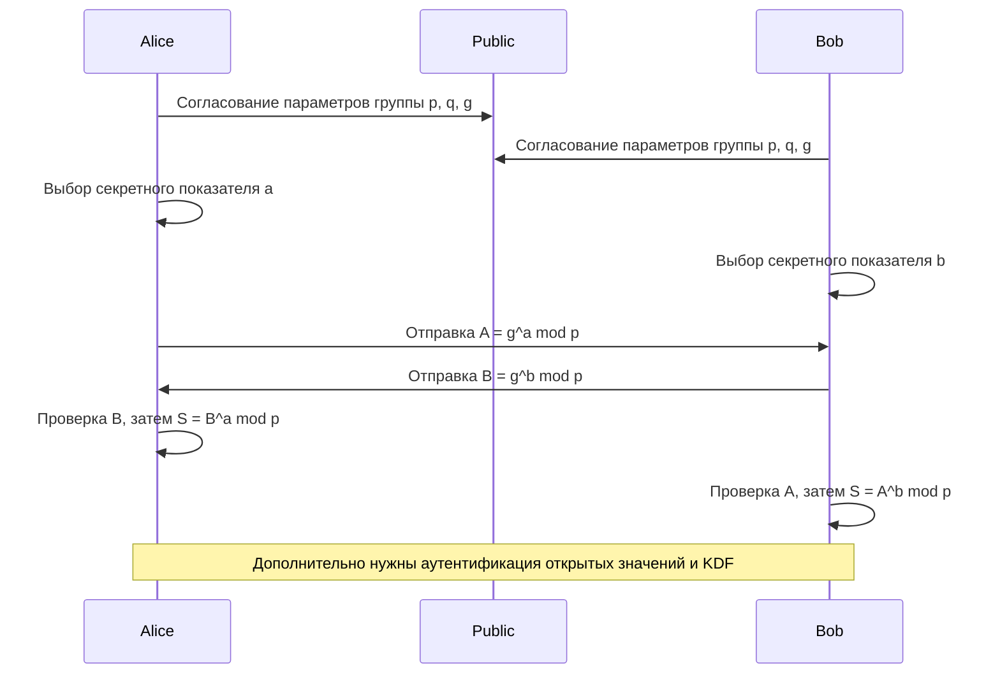
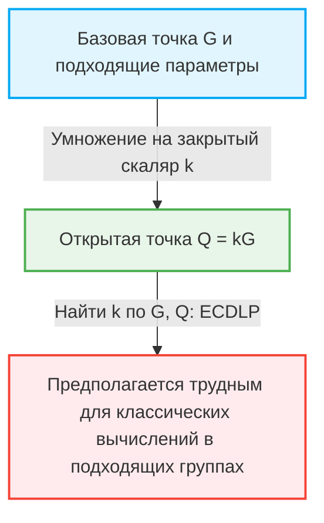

Криптография с открытым ключом помогает организовать связь между сторонами, у которых заранее нет общего секретного ключа. Статья объясняет математику согласования ключей Диффи–Хеллмана (DH), RSA и криптографии на эллиптических кривых (ECC). Одинаковая длина ключа не означает одинаковой оценочной стойкости разных систем, а одни уравнения не гарантируют безопасность всей связи.

## 1. Симметричная криптография и распределение ключей

Шифр Цезаря и «Энигма» — исторические примеры, в которых отправитель и получатель используют общие секретные настройки. Современная симметричная криптография тоже использует общий секретный ключ. Однако эти исторические системы нельзя приравнивать к современным безопасным алгоритмам.

### Проблема распределения ключей

Если передать симметричный ключ напрямую по незащищённому каналу, его узнает и наблюдатель. Поэтому нужно решить, как установить общий секрет и с кем именно. Технологии открытого ключа помогают, но необходима и аутентификация другой стороны.

Симметричная криптография сохраняет свою роль. Например, TLS 1.3 сочетает согласование ключей и аутентификацию с аутентифицированным шифрованием данных на производных ключах. Не все данные приложения шифруются операциями с открытым ключом.

## 2. Согласование ключей Диффи–Хеллмана

В работе 1976 года Диффи и Хеллман описали способ, позволяющий сторонам вычислить одинаковое секретное значение из публично переданной информации. Здесь рассматривается DH над конечным полем.

### Дискретный логарифм и общее значение

В мультипликативной группе по модулю простого числа $p$ используем подгруппу большого простого порядка $q$ с образующим $g$, где $q$ делит $p-1$. Этот $g$ порождает подгруппу и не обязан быть первообразным корнем всей мультипликативной группы. Реальные протоколы используют заданные достаточно стойкие параметры, а не самостоятельно придуманные малые числа для защиты настоящих данных.

1. Алиса равновероятно выбирает секретный показатель $1\le a\le q-1$ с помощью криптографически безопасной случайности и отправляет $A=g^a\bmod p$.
2. Боб аналогично выбирает $1\le b\le q-1$ и отправляет $B=g^b\bmod p$.
3. После проверки открытого значения другой стороны согласно схеме Алиса вычисляет $B^a\bmod p$, а Боб — $A^b\bmod p$.

$$
B^a\equiv (g^b)^a\equiv g^{ab}\equiv(g^a)^b\equiv A^b\pmod p.
$$

Обозначим общее значение через $S$. Нахождение $a$ по $A$ — задача дискретного логарифмирования (DLP); вычисление $S$ по $g,A,B$ — вычислительная задача Диффи–Хеллмана (CDH). Решение DLP позволяет решить CDH, но не доказывает, что их сложность всегда одинакова. Утверждения о безопасности DH должны указывать группу, протокол и возможности противника.

### Аутентификация, проверка открытых значений и выработка ключей

DH без аутентификации не предотвращает атаку посредника, способного изменять обмен. Подменяя открытые значения, противник может установить отдельные общие значения с Алисой и Бобом. Проверка допустимости открытого значения не заменяет аутентификацию собеседника.

Правила проверки тоже зависят от параметров. Для описанной подгруппы простого порядка проверяют диапазон, принадлежность подгруппе и отличие от нейтрального элемента. Условие $1<Y<p-1$ из RFC 7919 для известных групп на безопасных простых числах не является полной проверкой произвольных групп.

$S$ не используется напрямую как симметричный ключ. Значение кодируется по правилам протокола и обрабатывается функцией выработки ключей (KDF) с учётом контекста для получения ключей разного назначения. Расписание ключей TLS 1.3 использует HKDF и запись сообщений рукопожатия.

Диаграмма показывает арифметическую основу, а не конкретные сообщения аутентификации или полную процедуру KDF.

## 3. RSA и теорема Эйлера

Система RSA, разработанная Ривестом, Шамиром и Адлеманом, использует другую математику, чем DH. Схемы шифрования и подписи на основе RSA имеют разное устройство.

### Ключи и операции с целыми числами

В учебной модели RSA с двумя простыми множителями выбираем различные большие нечётные простые числа $p,q$ и полагаем $N=pq$. Здесь $q$ — простой множитель RSA, а не порядок подгруппы из предыдущего раздела.

$$
\phi(N)=(p-1)(q-1),\qquad ed\equiv1\pmod{\phi(N)}.
$$

Выбираем открытый показатель, удовлетворяющий $1<e<\phi(N)$ и $\gcd(e,\phi(N))=1$, и находим обратный к нему элемент — положительный закрытый показатель $d<\phi(N)$. Это достаточные условия для данного объяснения. RFC 8017 использует условие $ed\equiv1\pmod{\lambda(N)}$, где $\lambda(N)=\operatorname{lcm}(p-1,q-1)$. Открытый ключ — $(N,e)$; одно из представлений закрытого ключа — $(N,d)$. Закрытый показатель $d$ нужно отличать от полных данных ключа.

Для целочисленного представителя $0\le M<N$ основные операции таковы:

$$
C=M^e\bmod N,\qquad M=C^d\bmod N.
$$

Представитель шифртекста $C$ тоже является целым числом с $0\le C<N$. Здесь $M$ — не сам текст или последовательность байтов произвольной длины.

### Почему восстанавливается исходное значение

Если $\gcd(M,N)=1$, теорема Эйлера даёт $M^{\phi(N)}\equiv1\pmod N$. Записав $ed=1+t\phi(N)$ при $t\ge0$, получаем:

$$
M^{ed}=M\bigl(M^{\phi(N)}\bigr)^t\equiv M\pmod N.
$$

Если $M$ и $N$ не взаимно просты, теорему Эйлера нельзя применять напрямую. Но для каждого простого множителя $r\in\{p,q\}$, если $M\equiv0\pmod r$, то $M^{ed}\equiv M\equiv0\pmod r$. В ином случае малая теорема Ферма и кратность $ed-1$ числу $r-1$ дают $M^{ed}\equiv M\pmod r$. Китайская теорема об остатках объединяет результаты по модулю $N$. Поэтому восстанавливаются все представители $0\le M<N$.

### Математическая корректность и безопасность

Разложение $N$ на множители позволяет вычислить $\phi(N)$ и $d$. Это не доказывает, что каждый способ атаки на RSA требует факторизации. Слабая случайность, неверное кодирование и утечки реализации тоже могут привести к компрометации.

Прямое применение указанного детерминированного возведения в степень для шифрования допускает, например, проверку небольшого набора возможных сообщений открытым ключом. Практические схемы требуют специального кодирования и проверок: например, RSAES-OAEP для шифрования и RSASSA-PSS для подписи. Подпись не равнозначна шифрованию сообщения закрытым ключом. Также необходимо удостовериться, что открытый ключ принадлежит ожидаемому собеседнику.

## 4. Длина ключа и оценочная стойкость

Длина ключа RSA обычно означает битовую длину модуля $N$. Вычислительные ресурсы и алгоритмы атак влияют на оценки. Отказ от рекомендации определённой длины не означает, что модули RSA-1024 были факторизованы в общем случае.

В качестве конкретного сравнения таблица 2 в NIST SP 800-57 Part 1 Rev.5, опубликованной в 2020 году, относит модуль RSA длиной 2048 бит к строке с оценочной максимальной стойкостью 112 бит, а модуль 3072 бит — к строке 128 бит. Это оценки для классических вычислений при предположениях документа, а не универсальные современные рекомендации или записи об успешном расшифровании.

Более длинный модуль обычно повышает затраты на целочисленные операции, хранение и передачу ключей и подписей. Но производительность зависит также от открытого показателя, оптимизаций CRT, реализации, оборудования и операции. Одна длина ключа не определяет, какая система быстрее.

## 5. Математика эллиптических кривых

Миллер и Коблиц независимо предложили использовать эллиптические кривые в криптографии в 1980-х годах. RFC 6090 ссылается на работу Миллера на CRYPTO '85 и статью Коблица 1987 года. Время предложения и год публикации нужно различать.

Та же таблица NIST относит ECC с битовой длиной порядка базовой точки 256–383 бит к строке оценочной максимальной стойкости 128 бит. Таков контекст сравнения RSA-3072 и ECC-256. Столбец ECC измеряет длину порядка базовой точки; он не утверждает, что файл сериализованного открытого ключа с координатами занимает 256 бит. Сравнение предполагает подходящие параметры и управление ключами, помимо других условий.

### Кривая над конечным полем

Ограничимся простым полем $\mathbb F_p$ при $p>3$ и $a,b,x,y\in\mathbb F_p$. Эти параметры отличаются от простых чисел RSA выше.

$$
y^2\equiv x^3+ax+b\pmod p,\qquad 4a^3+27b^2\not\equiv0\pmod p.
$$

Второе условие обеспечивает неособость кривой над этим полем. Недостаточно, чтобы выражение просто было ненулевым целым числом. Сложение определяется на точках кривой вместе с нейтральным элементом — бесконечно удалённой точкой $\mathcal O$. Это уравнение не охватывает общий случай полей характеристики 2 или 3.

### Сложение точек и исключения

Над вещественными числами сложение иллюстрируют прямой через две точки и отражением её третьего пересечения с кривой относительно горизонтальной оси. Над конечным полем соответствующие алгебраические формулы вычисляют по модулю $p$. Для $P=(x_1,y_1)$ и $Q=(x_2,y_2)$ наклон в обычных случаях равен:

$$
s=\begin{cases}
(y_2-y_1)(x_2-x_1)^{-1} & (x_1\ne x_2),\\
(3x_1^2+a)(2y_1)^{-1} & (P=Q,\ y_1\ne0).
\end{cases}
$$

$$
x_3=s^2-x_1-x_2,\qquad y_3=s(x_1-x_3)-y_1\quad\text{in }\mathbb F_p.
$$

Обратный по умножению существует только у ненулевых элементов поля. При нулевом знаменателе эти формулы применять нельзя.

$$
P+\mathcal O=P,\qquad -P=(x_1,-y_1),\qquad P+(-P)=\mathcal O.
$$

Если $P=Q$ и $y_1=0$, то $2P=\mathcal O$. Вычисление $P+P$ — удвоение точки, частный случай скалярного умножения, вычисляющего произвольные целочисленные кратные.

### Скалярное умножение и ECDLP

Берём базовую точку $G$, порождающую подгруппу большого простого порядка $n$. Порядок — наименьшее положительное целое с $nG=\mathcal O$. Закрытый скаляр $1\le k\le n-1$ выбирается равновероятно с помощью криптографически безопасной случайности.

$$
Q=kG=\underbrace{G+\cdots+G}_{k\text{ terms}}.
$$

$k$ — закрытый ключ, $Q$ — открытый. Простое число поля $p$, порядок подгруппы $n$ и закрытый скаляр $k$ имеют разные роли. Нахождение $k$ по $G,Q$ — задача дискретного логарифмирования на эллиптической кривой (ECDLP).

RFC 6090 описывает универсальные классические атаки, например метод ро Полларда (Pollard rho), с затратами порядка $O(\sqrt n)$ групповых операций. Для $n$ длиной около 256 бит это масштаб примерно $2^{128}$. Такая оценка экспоненциальна по битовой длине, но не доказывает сложность для всех кривых. Существуют атаки на специальные кривые. Поэтому важны выбор кривой и подгруппы, проверка открытых точек и защита от утечек реализации.

## 6. Роли в протоколах и квантовые вычисления

ECC — не название одной схемы шифрования. Например, ECDH служит для согласования ключей, а ECDSA — для подписи. ECDH тоже требует выработки ключей из общей точки по правилам протокола, проверки открытых значений и аутентификации.

В TLS 1.3 согласование ключей, например ECDHE, подписи, такие как ECDSA или RSA-PSS, и аутентифицированное шифрование с производными симметричными ключами выполняют разные функции. Есть и режимы с предварительно распределёнными ключами. TLS 1.3 исключил транспорт ключей RSA, но это не означает исключение подписей RSA. Переход на ECC не гарантирует ускорения каждой операции.

### Квантовые компьютеры и постквантовая криптография

Алгоритм Шора решает факторизацию и дискретное логарифмирование за число шагов, полиномиальное по битовой длине входа, на достаточно мощном квантовом компьютере. Он угрожает RSA и обычной ECC, но полиномиальное время не означает мгновенного выполнения и не предсказывает, когда такая машина появится.

Постквантовая криптография (PQC) стремится обеспечить установление ключей и подписи на иных предположениях, учитывающих квантовые атаки. Это не гарантия абсолютной невзламываемости даже квантовым компьютером. Нужно оценивать конкретные схемы, реализации и переводимые на них протоколы.

## Заключение

DH вычисляет общие значения, RSA использует модульное возведение целых чисел в степень, ECC — групповые операции над точками конечного поля. После выполнения математических условий протоколы объединяют аутентификацию, выработку ключей, корректное кодирование и проверки, а также управление ключами для защиты связи. Короткие ключи или верные уравнения сами по себе не доказывают безопасность всей системы.

## Источники

- [RFC 7919 §5.1: проверка открытых значений в известных группах FFDHE](https://www.rfc-editor.org/rfc/rfc7919.html#section-5.1)
- [RFC 8017: ключи RSA, базовые операции, OAEP и PSS](https://www.rfc-editor.org/rfc/rfc8017.html)
- [RFC 6090 §§2–4 и 10: конечные поля, операции на кривой, ECDH и условия безопасности](https://www.rfc-editor.org/rfc/rfc6090.html)
- [NIST SP 800-57 Part 1 Rev.5 (2020), §5.6.1.1 и таблица 2: оценочная стойкость](https://csrc.nist.gov/pubs/sp/800/57/pt1/r5/final)
- [RFC 8446: роли протокола и выработка ключей в TLS 1.3](https://www.rfc-editor.org/rfc/rfc8446.html)
- [Shor: аннотация работы о квантовой факторизации и дискретном логарифмировании](https://arxiv.org/abs/quant-ph/9508027)
