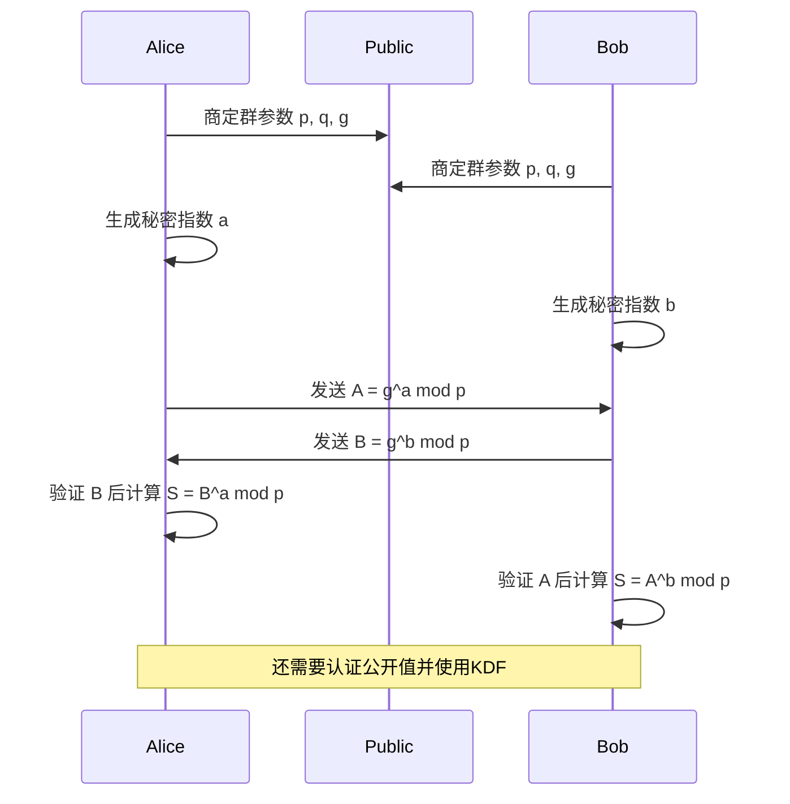
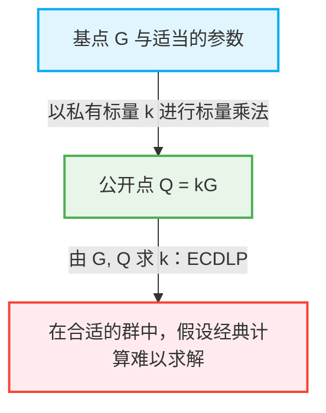

公钥密码学为事先没有共享密钥的双方提供通信基础。本文依次介绍迪菲–赫尔曼（DH）密钥协商、RSA和椭圆曲线密码学（ECC）的数学。不同体制即使密钥长度相同，估计安全强度也可能不同；仅有这些计算公式，并不能保证整个通信系统的安全。

## 1. 对称密码与密钥分发问题

凯撒密码和恩尼格玛是通信双方共享秘密设置的历史实例。现代对称密码也使用双方共享的秘密密钥。不过，不能把这些历史体制与现代安全算法等同起来。

### 密钥分发问题

如果通过未受保护的信道直接发送对称密钥，窃听者也会获知它。因此，需要解决“如何建立共享秘密，以及究竟与谁建立”的问题。公钥技术可以帮助解决这个问题，但也需要认证通信对端的身份。

对称密码仍然发挥作用。例如，TLS 1.3将密钥协商、身份认证与使用派生密钥的数据认证加密结合起来，并不是通过公钥运算加密全部应用数据。

## 2. 迪菲–赫尔曼密钥协商

迪菲和赫尔曼在1976年的论文中描述了双方通过公开交换的信息计算出同一秘密值的方法。这里讨论有限域上的DH。

### 离散对数问题与共享值

设在模素数 $p$ 的乘法群中，使用一个由 $g$ 生成、具有大素数阶 $q$ 的子群，其中 $q$ 整除 $p-1$。这里的 $g$ 是该子群的生成元，不一定是整个乘法群的原根。实际协议应使用规定的、具有足够安全强度的参数，不能自行选择小整数作为参数来保护真实数据。

1. 爱丽丝使用密码学安全的随机数，在 $1\le a\le q-1$ 中均匀选择秘密指数，并发送 $A=g^a\bmod p$。
2. 鲍勃同样在 $1\le b\le q-1$ 中选择秘密指数，并发送 $B=g^b\bmod p$。
3. 双方按方案要求验证对端的公开值后，爱丽丝计算 $B^a\bmod p$，鲍勃计算 $A^b\bmod p$。

$$
B^a\equiv (g^b)^a\equiv g^{ab}\equiv(g^a)^b\equiv A^b\pmod p.
$$

把这个相同的值记为 $S$。由 $A$ 求 $a$ 是离散对数问题（DLP）；由 $g,A,B$ 求 $S$ 是计算型Diffie–Hellman问题（CDH）。解出DLP也能解出CDH，但这并不证明两者在所有情况下都同样困难。讨论DH安全性时，需要指定群、协议以及攻击者的能力。

### 身份认证、公开值验证与密钥派生

未经身份认证的DH无法防止能篡改通信的攻击者实施中间人攻击。攻击者替换公开值后，可能分别与爱丽丝、鲍勃建立不同的共享值。验证公开值是否合法，不能代替对通信对端的身份认证。

验证方法也取决于参数。对于上述素数阶子群，检查包括正确的取值范围、子群成员资格以及排除单位元。RFC 7919针对其已知安全素数群规定的 $1<Y<p-1$ 检查，不能单独作为任意群的完整验证规则。

不应直接把 $S$ 当作对称密钥使用。应按协议对它进行编码，通过密钥派生函数（KDF）结合通信上下文，为不同用途派生密钥。TLS 1.3的密钥计划使用HKDF和握手消息记录。

图中仅展示计算框架，不包含身份认证的具体消息或完整的KDF步骤。

## 3. RSA与欧拉定理

由李维斯特、沙米尔和阿德曼提出的RSA，使用与DH不同的数学。基于RSA的加密方案与签名方案有不同的设计。

### 密钥与整数运算

以双素数RSA为教学模型，选择两个不同的大奇素数 $p,q$，令 $N=pq$。这里的 $q$ 是RSA的素因数，与前一节的子群阶无关。

$$
\phi(N)=(p-1)(q-1),\qquad ed\equiv1\pmod{\phi(N)}.
$$

选择满足 $1<e<\phi(N)$ 且 $\gcd(e,\phi(N))=1$ 的公钥指数 $e$，求其逆元，得到正的私钥指数 $d<\phi(N)$。这是本节讲解使用的充分条件。RFC 8017则以 $\lambda(N)=\operatorname{lcm}(p-1,q-1)$ 表述条件 $ed\equiv1\pmod{\lambda(N)}$。公钥为 $(N,e)$，私钥的一种表示为 $(N,d)$。$d$ 是私钥指数，应与完整的密钥信息区分。

对于整数代表值 $0\le M<N$，基本运算为：

$$
C=M^e\bmod N,\qquad M=C^d\bmod N.
$$

密文代表值 $C$ 也是满足 $0\le C<N$ 的整数。这里的 $M$ 并不是任意长度的文本或字节串本身。

### 为什么能够恢复原值

当 $\gcd(M,N)=1$ 时，欧拉定理给出 $M^{\phi(N)}\equiv1\pmod N$。写成 $ed=1+t\phi(N)$，其中 $t\ge0$，就有：

$$
M^{ed}=M\bigl(M^{\phi(N)}\bigr)^t\equiv M\pmod N.
$$

当 $M$ 与 $N$ 不互素时，不能直接使用欧拉定理。但对每个素因数 $r\in\{p,q\}$，若 $M\equiv0\pmod r$，则 $M^{ed}\equiv M\equiv0\pmod r$；否则，由费马小定理以及 $ed-1$ 是 $r-1$ 的倍数，可得 $M^{ed}\equiv M\pmod r$。中国剩余定理把这两个结果合并，得到模 $N$ 的同余。因此，每个代表值 $0\le M<N$ 都能恢复。

### 区分正确性与安全性

如果能分解 $N$，就能计算 $\phi(N)$ 和 $d$。但这并不证明所有针对RSA的攻击都必须进行素因数分解。薄弱的随机数、错误的编码和实现中的信息泄露，也可能导致失守。

如果直接用上述确定性幂运算加密，攻击者可以用公钥逐个测试少量候选消息。实用加密方案需要专门的编码和检查，例如RSAES-OAEP；签名方案也有相应要求，例如RSASSA-PSS。签名并不等于“用私钥加密消息”。还必须认证公钥是否属于预期的通信对象。

## 4. 密钥长度与估计安全强度

RSA密钥长度通常指模数 $N$ 的二进制位数。计算能力和攻击算法的变化会影响安全性评估。但不能把某种密钥长度不再被推荐使用，等同于宣称RSA-1024模数普遍已被分解。

作为具体比较，2020年出版的NIST SP 800-57 Part 1 Rev.5的Table 2，将2048位RSA模数列在估计最大安全强度112位的一行，将3072位模数列在128位的一行。这是在该文档假设下针对经典计算的估计，并非适用于当前所有用途的密钥长度建议，也不是成功解密的记录。

更长的模数通常会增加整数运算以及密钥、签名的存储和传输负担。性能还取决于公钥指数、CRT优化、实现、硬件和操作类型，不能只根据密钥长度断言哪种体制更快。

## 5. 椭圆曲线密码学的数学

米勒和科布利茨在1980年代独立提出将椭圆曲线用于密码学。RFC 6090引用了米勒在CRYPTO '85的论文和科布利茨1987年的论文。应区分提出时间与论文发表年份。

同一份NIST表格将基点阶的二进制位数为256〜383位的ECC列在估计最大安全强度128位的一行。这就是RSA-3072与ECC-256比较的背景。ECC这一列衡量的是基点阶的位数，并不表示含坐标的序列化公钥文件只有256位。这种比较以适当的参数和密钥管理等条件为前提。

### 有限域上的曲线

这里仅讨论素数 $p>3$ 的素域 $\mathbb F_p$，且 $a,b,x,y\in\mathbb F_p$。这些参数与上文RSA的素数不同。

$$
y^2\equiv x^3+ax+b\pmod p,\qquad 4a^3+27b^2\not\equiv0\pmod p.
$$

第二个条件保证曲线在该域上非奇异。仅仅在整数中不等于零还不够。在曲线上的点以及作为单位元的无穷远点 $\mathcal O$ 组成的集合上，可以定义加法。对于特征为2或3的域，不能只用这个方程概括一般情况。

### 点加法及其例外

在实数上的图中，可以用两点连线与曲线的第三个交点关于横轴的对称点，来解释加法。在有限域上，则对相应的代数公式按模 $p$ 运算。对于 $P=(x_1,y_1)$、$Q=(x_2,y_2)$，通常情况下的斜率为：

$$
s=\begin{cases}
(y_2-y_1)(x_2-x_1)^{-1} & (x_1\ne x_2),\\
(3x_1^2+a)(2y_1)^{-1} & (P=Q,\ y_1\ne0).
\end{cases}
$$

$$
x_3=s^2-x_1-x_2,\qquad y_3=s(x_1-x_3)-y_1\quad\text{in }\mathbb F_p.
$$

只有非零域元素才有乘法逆元。分母为零时，不能使用上述公式。

$$
P+\mathcal O=P,\qquad -P=(x_1,-y_1),\qquad P+(-P)=\mathcal O.
$$

如果 $P=Q$ 且 $y_1=0$，则 $2P=\mathcal O$。计算 $P+P$ 称为倍点运算（point doubling）；它是计算一般整数倍的标量乘法的一个特例。

### 标量乘法与ECDLP

使用生成大素数阶 $n$ 的子群的基点 $G$。阶是满足 $nG=\mathcal O$ 的最小正整数。使用密码学安全的随机数，从 $1\le k\le n-1$ 中均匀选择私有标量 $k$。

$$
Q=kG=\underbrace{G+\cdots+G}_{k\text{ terms}}.
$$

其中 $k$ 是私钥，$Q$ 是公钥。域的素数 $p$、子群的阶 $n$ 和私有标量 $k$ 各有不同作用。由 $G,Q$ 求 $k$，就是椭圆曲线离散对数问题（ECDLP）。

RFC 6090介绍的Pollard rho等通用经典攻击，大致需要 $O(\sqrt n)$ 次群运算。当 $n$ 约为256位时，这一规模约为 $2^{128}$。这是相对于位长呈指数增长的估计，并不是对所有曲线困难性的证明。特殊曲线也可能受到专门攻击，因此需要注意曲线和子群的选择、公开点验证以及实现的信息泄露防护。

## 6. 协议中的作用与量子计算

ECC不是某一种加密方案的名称。例如，ECDH用于密钥协商，ECDSA用于签名。ECDH也需要按协议从共享点派生密钥，并验证公开值和进行身份认证。

TLS 1.3中，ECDHE等密钥协商、ECDSA或RSA-PSS等签名、使用派生对称密钥的认证加密，分别承担不同作用。此外也有预共享密钥模式。TLS 1.3移除了RSA密钥传输，但这不意味着也移除了RSA签名。改用ECC不能保证每一种操作都更快。

### 量子计算机与后量子密码

秀尔（Shor）算法能在具有足够能力的量子计算机上，以相对于输入位长的多项式步数求解整数分解和离散对数。它威胁RSA和传统ECC，但多项式时间不意味着瞬间完成，也不预测这种设备何时实现。

后量子密码（PQC）旨在基于考虑量子攻击的其他假设，提供密钥建立、签名等功能。它不保证“即使量子计算机也绝对无法破解”。仍需评估具体方案、实现以及迁移涉及的协议。

## 总结

DH计算共享值，RSA使用整数模幂运算，ECC使用有限域上点的群运算。满足数学成立条件后，还要结合身份认证、密钥派生、适当的编码和验证以及密钥管理，才能保护通信。仅凭短密钥或正确的公式，不能判定整个系统的安全性。

## 参考资料

- [RFC 7919 §5.1：已知FFDHE群的公开值验证](https://www.rfc-editor.org/rfc/rfc7919.html#section-5.1)
- [RFC 8017：RSA密钥、基本运算、OAEP与PSS](https://www.rfc-editor.org/rfc/rfc8017.html)
- [RFC 6090 §§2–4、10：有限域、曲线运算、ECDH与安全条件](https://www.rfc-editor.org/rfc/rfc6090.html)
- [NIST SP 800-57 Part 1 Rev.5（2020年），§5.6.1.1与Table 2：估计安全强度](https://csrc.nist.gov/pubs/sp/800/57/pt1/r5/final)
- [RFC 8446：TLS 1.3中的协议角色与密钥计划](https://www.rfc-editor.org/rfc/rfc8446.html)
- [Shor：量子整数分解与离散对数论文摘要](https://arxiv.org/abs/quant-ph/9508027)
